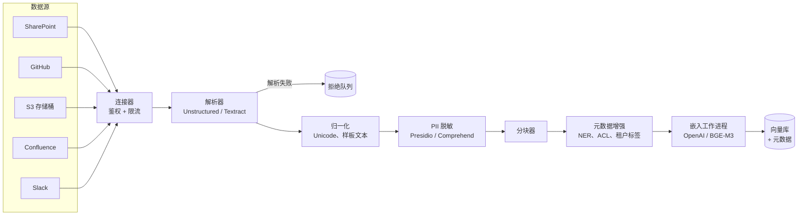
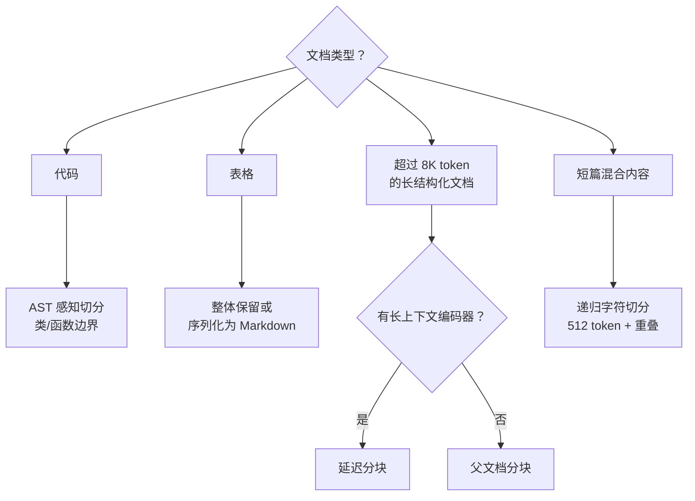
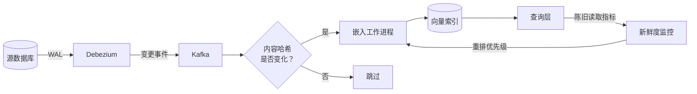
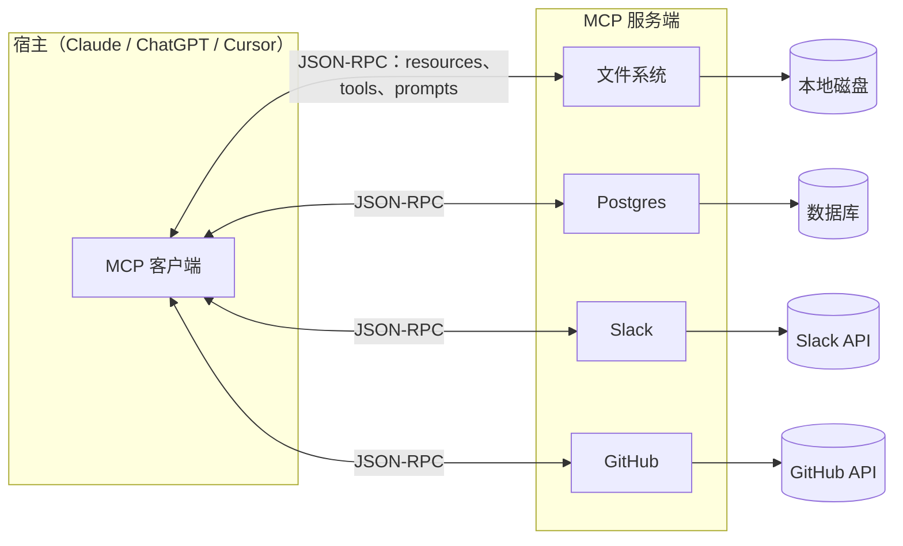

# 面向 AI 的数据基础设施

> **TL;DR**: 绝大多数 AI 产品的 bug 和成本其实都在数据面，而不是模型里。一个生产级 AI 系统需要端到端管道：数据源连接器拉取非结构化内容，解析器还原文本与版面，分块器切成检索单元，嵌入层把向量和元数据写入服务存储，新鲜度闭环让索引与事实来源保持同步。Anthropic 的上下文检索在入库时每百万文档 token 多花 1.02 美元，却把检索失败率降低 35-67%[^1]。模型上下文协议（Model Context Protocol，MCP）把 N × M 个定制适配器收敛成 N + M 个标准化服务端与客户端[^2]。入库和新鲜度要提前预算，否则几周之内你的 agent 就会理直气壮地引用已废弃的 API。

## 学习目标

学完本模块，你将能够：

- [ ] 搭建从数据源连接器到干净、可解析文本的非结构化 ETL 管道
- [ ] 根据文档形态，在固定长度、语义、递归、父文档四种分块方式中选择
- [ ] 为一千万文档规模的语料，估算并扩展嵌入层（批处理、流式、读时嵌入）
- [ ] 设计支持访问控制过滤和新鲜度追踪的元数据 schema
- [ ] 用 CDC 驱动的重新嵌入配合 TTL 与脏标记模式，让索引保持新鲜
- [ ] 通过模型上下文协议把数据源暴露给 agent，而不是写定制适配器
- [ ] 在整条管道上落实 PII 脱敏、租户隔离与删除传播

## 直觉理解

你在管理一家律所的图书馆。每天有成千上万份新文档进来：法院文书（版面复杂的 PDF）、客户邮件（带附件的 HTML）、合同（带修订记录的 Word 文档）、手写笔记（扫描图像）。你的任务是让每一位律师都能在瞬间找到任何一份文档。

首先，你按类型分拣进来的邮件，把每一份送到对应的工位：PDF 交给扫描员，邮件交给数字档案员，合同交给负责读修订稿的律师助理。每个工位产出一份干净的录入文本。然后编目员把长文档拆成一张张主题卡片（也就是分块），在每张卡片上盖客户名、案号、保密级别和日期，再把这些卡片排进索引。还有个跑腿的每天早上检查有没有源文档在夜里被更新过，把受影响的卡片重新归档。

现在想象一位新律师入职。她不必去记每个档案柜在哪儿，只要找一位图书管理员（也就是 MCP 服务端），这位管理员知道如何通过一套协议触达所有档案柜。她问“东区法院最近关于专利侵权的文书”，管理员就从正确的柜子里取件，而她根本不知道这些文件来自哪个物理抽屉。

这就是 AI 的数据面。工位是解析器。编目员是分块器加元数据增强。索引是向量库。跑腿的是 CDC 新鲜度闭环。而那位图书管理员就是 MCP。本章其余部分逐个拆解这些组件。

## 原理

### 非结构化 ETL：连接器、解析器、归一化

企业知识大多存在于机器难以处理的格式里：PDF、Office 文档、Slack 会话、Confluence 页面、扫描图像、邮件归档。管道的第一个阶段就是抽取。

**连接器**向数据源（S3、SharePoint、Google Drive、Confluence、Notion、GitHub、Salesforce、Zendesk、Slack、Jira、ServiceNow）鉴权，拉取全量快照或变更事件。每个源都有自己的鉴权模型、限流规则和变更通知机制。Glean 提供了 100 多个专用连接器[^3]，它们“充当 Glean 与贵组织各类数据源之间的桥梁”[^4]。

**解析器**按文件类型采用不同策略。原生数字 PDF 用快速文本抽取（PyMuPDF、pdfplumber、pypdfium2）。复杂版面和扫描件需要版面还原模型。Unstructured.io 提供了 `fast` 策略，“比主流图像转文本模型快约 100 倍”，以及面向重版面 PDF 的 `hi_res` 策略[^5]。云端替代方案有 AWS Textract、Azure Document Intelligence、Google Document AI。处理科学论文时，Meta 的 Nougat[^6] 和 IBM 的 Docling[^7]（2024）能处理数学符号和表格。Office 文档通过 mammoth（DOCX 转 HTML）或直接解析 XML 转换。

**归一化**会剥离样板文本、压缩空白、做 Unicode NFKC 规范化、检测语种，并用 MinHash 或 SimHash 去除近重复。从第一天起就要埋点监控解析成功率。典型企业语料中有 5-10% 的文档会静默解析失败（加密 PDF、损坏文件、带密码的归档）。没有拒绝队列，索引就有窟窿，答案只会引用解析成功的那一部分。

*完整的入库管道：数据源连接器把内容送进解析器和归一化器，再进入分块器、增强层和嵌入层。解析失败的内容路由到死信队列等待重放。*

### 分块策略

[RAG 管道](./01-rag-pipelines.md)里已经说过，分块是最不光鲜、影响却最大的决策。本节补充在基础设施规模上真正重要的几种策略。

**递归字符切分**按优先级顺序尝试分隔符（`\n\n`、`\n`、空格、字符），在长度预算内挑选最自然的边界。LangChain 的 `RecursiveCharacterTextSplitter` 默认就是这个列表；`from_language(Language.PYTHON)` 会在通用空白之前预置 `"\nclass "`、`"\ndef "`、`"\n\tdef "`[^8]。经过基准验证的生产默认值是 512 token，重叠 50-100 token。

**语义分块**在相邻句子的嵌入相似度跌破阈值处切分。它能拿到很高的检索召回率，但切出的块往往太小，生成器没法在其上做推理。

**父文档（层级）分块**用小块建索引以保证检索精度，命中后把父块返回给 LLM 作上下文。这样就把检索粒度与生成上下文解耦了。

**Anthropic 上下文检索**（2024 年 9 月）在嵌入之前给每个块前置 50-100 token 的 LLM 生成上下文。带上下文的块同时进入向量索引和 BM25 索引。结果：仅用上下文嵌入，top-20 检索失败率下降 35%；再加上上下文 BM25 后下降 49%；在上下文嵌入加上下文 BM25 之上再叠一个重排器，下降 67%[^1]。成本：用 Claude Haiku 配合 prompt 缓存，每百万文档 token 1.02 美元。

**延迟分块**（late chunking，Jina，2024 年 8 月）把顺序倒过来：先用长上下文模型（8,192 token）嵌入整篇长文档，再对已经带上上下文的 token 向量按块做均值池化。SciFact 的 nDCG@10 从 64.20% 提升到 66.10%，NFCorpus 从 23.46% 提升到 29.98%[^9]。与上下文检索不同，延迟分块在建索引时没有任何额外的 LLM 调用。代价是：它需要长上下文编码器。

*按文档形态挑分块器。递归切分是默认选择；父文档分块和延迟分块在长结构化内容上才有回报。*

### 嵌入管道：批处理与流式、成本、幂等性

嵌入层把块转成定长向量，连同元数据一起写入向量库。有两个维度要紧：吞吐模式和成本。

**成本算术：**OpenAI `text-embedding-3-small` 每百万输入 token 收费 0.02 美元；`text-embedding-3-large` 每百万 0.13 美元，默认 3,072 维嵌入（可用 Matryoshka 截断到更低维度）[^10]。OpenAI 自 2024 年 1 月起就没更新过嵌入系列；Google 的 `gemini-embedding-2` 和 Voyage 的 `voyage-4-large` 目前在 MTEB 上领先，但 OpenAI 的价格和工具链仍是许多团队的默认选择。一千万文档的语料，每篇 1K token，就是 100 亿 token：用 `3-small` 全量跑一遍 200 美元，用 `3-large` 1,300 美元。自托管的 BGE-M3 在普通 GPU 上摊薄下来约为每百万 token 0.001 美元。OpenAI Batch API 对非紧急负载给 50% 折扣。

**批处理管道**（Spark、Ray、Dask）并行处理大规模语料。15 万亿 token 的 FineWeb 数据集（以及它的多语种兄弟 FineWeb-2，覆盖 500 多种语言、1T+ token）就是用 HuggingFace 的 `datatrove` 库在横向扩展的 CPU 集群上产出的（过滤、MinHash 去重、语种识别），GPU 只留给其中少量用到神经质量分类器的工作[^11]。批处理便宜简单，但两次运行之间数据是旧的。

**流式管道**（Kafka 接嵌入工作进程）能给出秒级到分钟级的新鲜度。适合面向客户的 RAG，覆盖工单、聊天记录、代码提交。活动部件更多：队列、死信队列、背压、schema 注册中心。

**读时（惰性）嵌入**让冷文档免掉入库成本。首次查询延迟会飙升，很难满足 p99 SLO。适合那种只有一小部分会被查到的超大型档案。

**幂等性：**对归一化文本加 `embedding_model_version` 做 SHA256，是标准的去重键。如果哈希已存在且模型版本是当前的，就跳过。这样既能避免同一份文档在多次重爬中被反复嵌入，也能抓到只改了 CMS 元数据（权限变更、标签编辑）而正文未变的更新。

### 元数据 schema 与 ACL 传播

每个向量都带旁路元数据，它决定系统是否可上线、可审计、多租户安全。

**最小可用 schema：**`source_system`、`source_id`、`uri`、`author`、`created_at`、`modified_at`、`mime_type`、`content_hash`、`chunk_index`、`parent_id`、`language`、`tenant_id`、`acl_tags`、`sensitivity`、`embedding_model`、`embedding_version`。

**ACL 传播**是最难的集成问题。Confluence 的空间权限、Google Drive 的共享规则、Salesforce 的记录级共享各不相同。检索器必须在相似度搜索之前，把调用方的 ACL 标签 AND 进预过滤条件。没有这一步，用户 A 问一句“我们 Q3 的销售预测是多少”，就会拿到本不该看到的财务空间里的块。

**版本化：**`embedding_model` 和 `embedding_version` 两个字段让蓝绿重建索引成为可能。把新嵌入写入打了新版本标记的新集合；回填追上后切换读取方。旧集合留着以便回滚。

追加式 schema 变更（新增标签列）很便宜。重命名和删除字段则需要全量重建索引。

### 新鲜度：CDC、脏标记、TTL

模型只能对索引里有的东西做推理。过期的嵌入会让 agent 自信地给出错误答案。

[变更数据捕获](../part-4-data-systems/04-change-data-capture.md)介绍过用 Debezium 读事务日志的日志式 CDC。放到这里：Debezium 把行级变更事件发到 Kafka，消费者在数秒内重新嵌入被改动的文档[^12]。这让事务型数据源获得秒级到分钟级的新鲜度。

**脏标记**是更便宜的批处理替代方案：一个 `is_dirty` 布尔字段加一个定期扫的低优先级工作池。适合对账，以及没有实时变更流的数据源。

**TTL / 定期重爬**用于没有变更通知的源（公开网页、不支持 webhook 的文件共享）。节奏跟波动性挂钩：新闻类每小时，稳定文档每周。

**删除**必须传播到向量库（墓碑标记）、缓存、衍生的微调数据集和日志。GDPR 的“被遗忘权”真正落地就在这一步。法律框架见[数据驻留与合规架构](../part-7-security-at-scale/06-data-residency-compliance.md)。

**增量与全量重建：**增量靠 CDC、webhook 或轮询应对日常增删改。更换嵌入模型或改 schema 时必须全量重建。用蓝绿集合：把所有新嵌入写入全新集合，回填完成后切换读取方，旧集合留着回滚。

*CDC 驱动的新鲜度：Debezium 读 WAL，把变更事件发往 Kafka，内容哈希检查避免重复嵌入。查询侧的陈旧度指标回流到调度器。*

### 模型上下文协议（MCP）

过去每个 agent 都要为每个数据源手写适配器。同一个 Slack、GitHub、Jira、Postgres 集成本，各团队用一百种写法重复实现。MCP 之于 AI 数据，就像 LSP 之于编辑器。

Anthropic 于 2024 年 11 月 25 日发布模型上下文协议，作为连接 LLM 应用与外部数据、工具的开放 JSON-RPC 2.0 标准[^2]。协议定义了三种控制语义各不相同的服务端原语：**资源**（resources，由客户端宿主挂载的应用侧上下文，比如文件内容或 git 历史）、**工具**（tools，由模型调用的函数，用来执行动作）、**提示模板**（prompts，由用户显式选择调用的模板，比如斜杠命令）[^13]。规范定义两种标准传输方式：**stdio**（客户端把服务端作为子进程拉起，通过 stdin/stdout 交换 JSON-RPC 消息）和 **Streamable HTTP**（单一 HTTP 端点，支持 POST 和 GET，可选 Server-Sent Events 来流式推送服务端到客户端的消息）。Streamable HTTP 取代了协议 2024-11-05 版本中的 HTTP+SSE 传输，后者现已废弃。

采用速度很快。Block、Apollo、Zed、Replit、Codeium、Sourcegraph 在发布时即已上线。OpenAI 于 2025 年 3 月 26 日把 MCP 加入 Agents SDK[^14]。Google 于 2025 年 12 月 11 日宣布在其各项服务中官方支持 MCP[^15]。SDK 覆盖 TypeScript、Python、Go、Java、Kotlin、C#、Swift、Rust、PHP、Ruby。

数据面上的收益：接新工具只需跑一个 MCP 服务端，不必发布 agent 专用代码。Postgres 的 MCP 服务端把表暴露为资源，把 SQL 暴露为工具。文件系统服务端暴露目录。宿主（Claude、ChatGPT、Cursor）在连接时发现能力并呈现给模型。

*MCP 把 N × M 个定制适配器收敛成 N 个服务端 + M 个客户端。每个服务端都通过统一的 JSON-RPC 契约暴露资源、工具和提示模板。*

> [!IMPORTANT]
> MCP 是传输层和词汇表，不是检索引擎。它取代的是 agent 与数据源之间的胶水代码，不是向量索引本身。MCP 服务端带着真实凭证运行。像对待任何生产服务那样给它划定权限范围、做沙箱和审计。参见 [LLM 安全与护栏](./08-llm-safety-guardrails.md)。

## 真实案例

### turbopuffer：3.5 万亿文档的原生 S3 向量搜索

2024 至 2025 年向量存储的架构转向，是从“内存原生”转到“对象存储原生”。turbopuffer 是这一转变的典型。

turbopuffer 在所有租户上共存储 3.5 万亿以上文档，每秒处理 1,000 万次以上写入和 25,000 次以上查询[^16]。存储成本约每 TB 每月 70 美元，而内存 + SSD 的老牌方案是每 TB 每月 1,600 至 3,600 美元，便宜约 20-50 倍。它的架构把 S3/GCS 当作事实来源。每个命名空间是对象存储上的一个前缀；写入持久提交到桶里。分级缓存（内存 + NVMe SSD）服务热读，冷读直接打到对象存储。任何无状态节点都能为任何命名空间提供服务。

Cursor 是第一个大客户，把数十亿向量从内存型向量库迁出、覆盖数百万个代码库，成本降低 95%[^16]。Notion AI、Linear 的 issue 搜索、Superhuman 的邮件搜索随后跟进。

查询规划器为亚秒级冷查询预留三次对象存储往返（到 S3 的 p90 约 250 毫秒每次，单次取数小于 1MB）。热查询在 100 万个 768 维向量上 p90 为 10 毫秒。冷查询 p90 落在 444 毫秒[^16]。权衡摆得很明白：你接受冷启动延迟，换来 20-50 倍成本下降和 S3 的 11 个 9 持久性。

这对数据基础设施很重要，因为企业 RAG 语料大多是“冷读”的：索引了数百万文档，但任何一小时内只查询其中一小部分。为冷向量付内存的价格是浪费。turbopuffer 的模型让成本与访问模式对齐。

## 设计决策

**嵌入管道的运行模式。**

| 方案 | 优点 | 缺点 | 适用场景 | 我们的选择 |
|---|---|---|---|---|
| 批处理嵌入（定时调度） | 吞吐量最高，成本模型简单 | 两次运行之间数据是旧的（数小时到数天） | 大规模静态语料，可接受夜间重建索引 | 回填与模型升级 |
| 流式嵌入（CDC） | 近实时新鲜度（秒到分钟） | 队列、死信队列、背压带来的复杂度 | 面向客户的 RAG，事件丰富的数据源 | **实时数据源的生产默认** |
| 读时（惰性）嵌入 | 冷文档零入库成本 | 首次查询延迟飙升，p99 SLO 难达标 | 超大型档案，只有小部分会被查询 | 仅用于冷档案 |
| 混合（批处理 + 流式） | 新鲜度与成本的最佳折中 | 要维护两条代码路径 | 千万文档级语料 | **整体生产默认** |

**租户隔离。**

| 方案 | 优点 | 缺点 | 适用场景 | 我们的选择 |
|---|---|---|---|---|
| 每租户独立索引（每租户一个命名空间） | 隔离严格，ACL 简单，按租户删除轻而易举 | 每租户固定成本高；基础设施开销随租户数线性增长 | 受监管行业（HIPAA、PCI、FedRAMP），合同要求数据驻留的企业客户 | 合规或合同要求时 |
| 共享索引 + ACL 过滤（元数据谓词） | 成本高效，只需一套嵌入，质量一致 | 过滤逻辑的 bug 会变成跨租户泄露；过滤必须在检索时执行，不能事后过滤 | 有强审计和经过测试的过滤路径的 B2B SaaS | **多数 SaaS 的默认** |

## 常见陷阱

> [!WARNING]
> **没有内容哈希，就没有去重。**同一份文档在多次重爬中被嵌入几十遍；向量库膨胀，近重复内容挤占 top-k 结果。用归一化文本（NFKC、压缩空白）的 SHA256 作主去重键。每周拿索引增长量与源文档数对一次账。

> [!WARNING]
> **升级后残留旧模型的嵌入。**一半索引是 1,536 维的 `ada-002`，一半是 3,072 维的 `text-embedding-3-large`。两者之间的余弦相似度毫无意义。在每个索引里断言 `embedding_model` 和 `embedding_version` 字段；模型迁移用蓝绿集合。

> [!WARNING]
> **没有 ACL 传播。**连接器把文档入了库，却把源端权限剥掉了。用户 A 看到了本不该看到的财务文档。检索器必须在相似度搜索之前，把调用方的 ACL 标签 AND 进预过滤条件。影子查询审计：对着去掉 ACL 的副本跑检索，结果出现分叉就告警。

> [!WARNING]
> **一次性入库，没有新鲜度闭环。**1 月 1 日灌了一份产品文档；半年后 agent 理直气壮地引用已废弃的 API。从第一天就接上 CDC 或定时重爬。给每个源定新鲜度 SLO（比如文档 24 小时、工单 10 分钟），p95 年龄超了就叫。

> [!WARNING]
> **不监控解析失败。**5-10% 的 PDF 会静默解析失败（扫描件、损坏、加密）。没有拒绝队列和按 MIME 类型的成功率指标，索引就有窟窿，答案只引用解析成功的那一部分。解析器必须返回明确的状态枚举；非 OK 的行进死信队列等待重放。

## 练习

为一个服务 500 家律所的法律 RAG 产品设计语料入库与新鲜度管道。语料共 5,000 万份文档（判例法、法条、律所备忘录、合同），约 500B token；每家律所的私有文档必须严格隔离，而公开判例法是共享的。新鲜度 SLA：公开判例法 24 小时，上传的律所备忘录 10 分钟。请给出：(a) 数据源连接器与解析器；(b) 按文档类型的分块策略；(c) 嵌入模型，以及全量重建加增量更新的年度成本估算；(d) 含 ACL 的元数据 schema；(e) 按数据源的新鲜度机制（CDC、TTL、webhook、脏标记）；(f) 租户隔离架构与删除传播；(g) 是否通过 MCP 把这套语料暴露给内部 agent，以及那个服务端长什么样。

提示

想想共享的公开语料（判例法、法条）与逐律所的私有语料（备忘录、合同）之间的切分。共享语料在嵌入模型变更时需要一次全量重建；私有语料需要严格的租户隔离。CDC 用在律所备忘录的上传路径上；TTL 轮询用在公开判例法 feed 上。共享语料按每百万 token 0.02 美元算嵌入成本（结构良好的法律文本用 `text-embedding-3-small` 这类预算模型足够），私有语料按每百万 0.13 美元算（合同语言微妙，用 `text-embedding-3-large`、`voyage-4-large` 或 `gemini-embedding-2` 这类更高质量的模型）。

参考答案

**连接器与解析器：**公开判例法来自批量 feed（CourtListener API、政府 FTP），扫描的老文书用 Unstructured.io 的 `hi_res`，原生数字件用 `fast`。律所备忘录和合同通过安全 API 上传；表格密集的合同用 Azure Document Intelligence 解析，DOCX 备忘录用 mammoth。

**分块：**判例法：递归 512 token、重叠 100 token（结构良好、段落密集）。合同：按条款边界的版面感知切分（用章节标题作分隔符）。法条：父文档分块（小块用于检索，整节用于上下文）。

**嵌入与成本：**共享公开语料（3,000 万文档 × 1K token = 30B token）：`text-embedding-3-small` 按每百万 0.02 美元 = 每次全量重建 600 美元。私有语料（2,000 万文档 × 1K token = 20B token）：`text-embedding-3-large` 按每百万 0.13 美元 = 每次全量重建 2,600 美元。增量日更约触及私有语料的 2% = 每天 52 美元 = 每年 19,000 美元。年度总计：嵌入约 23,000 美元。

**元数据 schema：**`source_system`、`source_id`、`uri`、`jurisdiction`、`court`、`date_filed`、`content_hash`、`chunk_index`、`parent_id`、`firm_id`（公开内容为 null）、`acl_tags`、`sensitivity`（public/confidential/privileged）、`embedding_model`、`embedding_version`。

**新鲜度：**公开判例法：每日 TTL 重爬（24 小时 SLA）。律所备忘录：通过 Debezium 从上传数据库做 CDC，目标 10 分钟新鲜度。合同：上传事件触发 webhook，收到即嵌入。

**租户隔离：**混合。公开判例法放在共享索引（不需要 `firm_id` 过滤）。私有文档放在向量库内按律所划分的命名空间（Pinecone namespaces 或 Weaviate tenants）。删除传播：给向量打墓碑、让缓存的检索结果失效、从微调数据集里移除、记录删除事件以备合规审计。按 GDPR 的 30 天 SLA。

**MCP 服务端：**要暴露。把法律语料作为 MCP 服务端暴露，包含：资源（按引注取判例法、按案号取律所文档）、工具（语义搜索、引注查找、文档上传）、提示模板（法律研究模板、合同审阅模板）。凭证按律所划分权限范围；MCP 服务端在返回任何资源之前先行强制执行 ACL。

## 要点回顾

- 绝大多数 AI 产品的 bug 和成本在数据面，不在模型里。入库和新鲜度要提前预算。
- 分块是最不光鲜、杠杆最大的决策。递归 512 token 切分是生产默认；上下文检索和延迟分块以已知成本换取质量提升。
- 内容哈希幂等（归一化文本的 SHA256 + 模型版本）避免重复嵌入，也能抓到只改元数据的更新。
- 元数据不是事后补的装饰。ACL 标签、嵌入版本和来源信息决定你的 RAG 产品能否上线、能否审计、多租户是否安全。
- 新鲜度要按数据源分别决定：事务型源用 CDC，批处理用脏标记，不受控的源用 TTL。
- MCP（2024）把“数据到 agent”的接口标准化了。新集成按 MCP 服务端来建，你就能在 Claude、ChatGPT、Cursor 以及未来每一个宿主之间自由迁移。
- 对象存储原生的向量搜索（turbopuffer、Databricks storage-optimized）把 S3 当作事实来源，存储成本降 20-50 倍。

## 延伸阅读

- [Model Context Protocol specification](https://modelcontextprotocol.io/specification/2025-11-25) - 权威规范，涵盖传输层、资源、工具、提示模板与 schema 参考；动手写任何 MCP 服务端之前先读它。
- [Introducing Contextual Retrieval (Anthropic, Sep 2024)](https://www.anthropic.com/engineering/contextual-retrieval) - 35%/49%/67% 检索失败率下降的方法论，附可复现的 prompt 与成本分析。
- [Late Chunking in Long-Context Embedding Models (Jina, Aug 2024)](https://jina.ai/news/late-chunking-in-long-context-embedding-models/) - 零额外成本的上下文分块：算法、BEIR 评测与参考实现。
- [turbopuffer: fast search on object storage (Eskildsen, Jul 2024)](https://turbopuffer.com/blog/turbopuffer) - 原生 S3 向量搜索的架构论证，附与内存原生老牌方案的完整成本对比。
- [New embedding models and API updates (OpenAI, Jan 2024)](https://openai.com/index/new-embedding-models-and-api-updates/) - `text-embedding-3-small` 与 `-large` 的定价、MTEB/MIRACL 数据与 Matryoshka 截断。
- [Unstructured.io partitioning strategies](https://docs.unstructured.io/open-source/concepts/partitioning-strategies) - `fast`、`hi_res`、`ocr_only`、`auto` 四种策略在 100 多种文件类型上的参考。
- [LangChain text splitters](https://docs.langchain.com/oss/python/integrations/splitters/recursive_text_splitter) - 生产可用的 `RecursiveCharacterTextSplitter` 与各语言专用切分器，附代码示例。
- [MCP servers reference repository](https://github.com/modelcontextprotocol/servers) - 文件系统、Git、fetch、memory、Postgres、Slack 等的权威实现。

## 记忆卡片

**Q:** 嵌入管道的标准去重键是什么？
**A:** 归一化文本（Unicode NFKC、压缩空白）的 SHA256 哈希，加上 `embedding_model_version`。如果哈希已存在且模型版本是当前的，就跳过重新嵌入。

**Q:** MCP 的三类服务端原语是什么？
**A:** 资源（resources，客户端宿主挂载的应用侧上下文）、工具（tools，模型调用以执行动作的函数）、提示模板（prompts，用户显式选择调用的模板），全部通过 JSON-RPC 交换。客户端也可以向服务端反向提供能力（Sampling、Roots、Elicitation）。

**Q:** Anthropic 的上下文检索在建索引时要花多少钱？
**A:** 用 Claude Haiku 配合 prompt 缓存，每百万文档 token 1.02 美元。它在嵌入之前给每个块前置 50-100 token 的 LLM 生成上下文。

**Q:** 生产默认的分块策略是什么？
**A:** 递归字符切分，512 token，重叠 50-100 token。它按优先级顺序尝试分隔符（空行、换行、空格、字符），在长度预算内挑最自然的边界。

**Q:** 延迟分块与上下文检索有什么不同？
**A:** 延迟分块先用长上下文模型嵌入整篇长文档，再对已经带上上下文的 token 向量按块做均值池化。它没有额外的 LLM 调用，但需要长上下文编码器。上下文检索则在建索引时对每个块额外调用一次 LLM。

**Q:** 内存原生与 S3 原生向量存储的成本差多少？
**A:** 约 20-50 倍。turbopuffer 约每 TB 每月 70 美元，内存 + SSD 的老牌方案是每 TB 每月 1,600 至 3,600 美元。代价是冷查询延迟（p90 444 毫秒，热查询 10 毫秒）。

**Q:** 为什么 ACL 传播是 AI 数据基础设施里最难的集成问题？
**A:** 每个源系统（Confluence、Google Drive、Salesforce）的权限模型都不一样。检索器必须在相似度搜索之前把调用方的 ACL 标签 AND 进预过滤条件，否则用户会看到本不该看到的文档。

**Q:** 什么时候需要全量重建索引而不是增量更新？
**A:** 更换嵌入模型或修改 schema 时全量重建。增量（CDC、webhook、轮询）应对日常内容增删改。模型升级用蓝绿集合：写入新集合，回填完成后切换读取方。

**Q:** 哪些新鲜度机制适用于哪类数据源？
**A:** 事务型数据库用 CDC（Debezium + Kafka）。会发事件的 SaaS 源（Notion、Linear）用 webhook。没有变更通知的源（公开网页、文件共享）用 TTL 轮询。便宜的批量对账用脏标记。

**Q:** 哪些元数据字段让蓝绿重建索引可以做到零停机？
**A:** `embedding_model` 和 `embedding_version` 两个字段。查询时过滤到当前版本；把新嵌入写入打了新版本标记的新集合；回填追上后切换读取方。

**Q:** 说出 AI 数据管道里的三种反模式。
**A:** (1) 没有内容哈希，导致重复嵌入和索引膨胀。(2) 一次性入库、没有新鲜度闭环，导致答案过期。(3) 没有 ACL 传播，导致检索时跨租户数据泄露。

**Q:** 相比定制适配器，MCP 解决了什么问题？
**A:** MCP 把 N 个数据源 × M 个客户端，从 N × M 个定制集成收敛成 N + M 个标准化服务端与客户端。接新工具只需跑一个 MCP 服务端，不必发布 agent 专用代码。可在 Claude、ChatGPT、Gemini、Cursor 及未来宿主之间迁移。

## 参考文献

[^1]: Anthropic, "Introducing Contextual Retrieval", September 19, 2024. https://www.anthropic.com/engineering/contextual-retrieval
[^2]: Anthropic, "Introducing the Model Context Protocol", November 25, 2024. https://www.anthropic.com/news/model-context-protocol
[^3]: Glean, "Connectors and Actions". https://www.glean.com/connectors
[^4]: Glean, "About Connectors". https://docs.glean.com/connectors/about
[^5]: Unstructured.io, "Partitioning strategies". https://docs.unstructured.io/open-source/concepts/partitioning-strategies
[^6]: Lukas Blecher et al., "Nougat: Neural Optical Understanding for Academic Documents", August 2023. https://arxiv.org/abs/2308.13418
[^7]: Docling Project (IBM Research), "Docling Technical Report", August 2024. https://arxiv.org/abs/2408.09869
[^8]: LangChain source, `libs/text-splitters/langchain_text_splitters/character.py`. https://github.com/langchain-ai/langchain/blob/master/libs/text-splitters/langchain_text_splitters/character.py
[^9]: Jina AI, "Late Chunking in Long-Context Embedding Models", August 22, 2024. https://jina.ai/news/late-chunking-in-long-context-embedding-models/
[^10]: OpenAI, "New embedding models and API updates", January 25, 2024. https://openai.com/index/new-embedding-models-and-api-updates/
[^11]: Hugging Face, "The FineWeb Datasets: Decanting the Web for the Finest Text Data at Scale". https://arxiv.org/abs/2406.17557
[^12]: Debezium documentation and RisingWave, "CDC Architecture Patterns: From Debezium to Streaming Databases". https://risingwave.com/blog/cdc-architecture-patterns-debezium-streaming-databases/
[^13]: Model Context Protocol specification, version 2025-11-25. https://modelcontextprotocol.io/specification/2025-11-25
[^14]: TechCrunch, "OpenAI adopts rival Anthropic's standard for connecting AI models to data", March 26, 2025. https://techcrunch.com/2025/03/26/openai-adopts-rival-anthropics-standard-for-connecting-ai-models-to-data/
[^15]: Google Cloud, "Announcing official MCP support for Google services", December 2025. https://cloud.google.com/blog/products/ai-machine-learning/announcing-official-mcp-support-for-google-services
[^16]: Simon Eskildsen, "turbopuffer: fast search on object storage", July 8, 2024. https://turbopuffer.com/blog/turbopuffer
