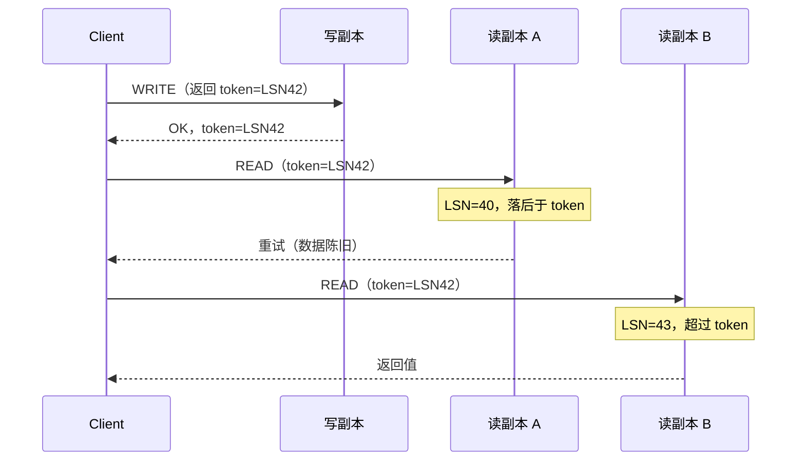
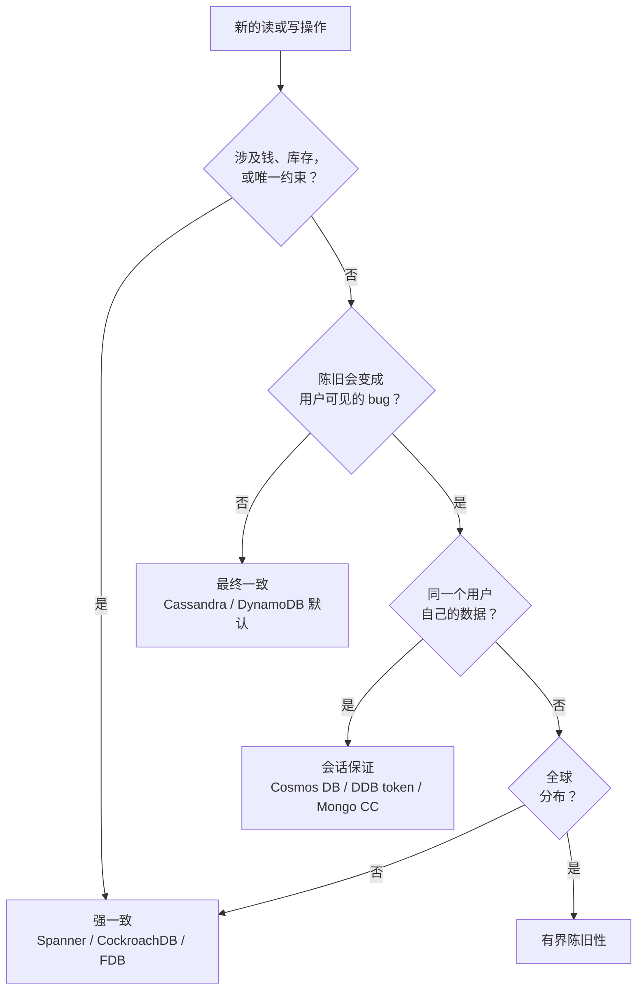

# 强一致性 vs 最终一致性

> **TL;DR.** 强一致性（线性一致性）保证每次读都返回最新已提交的写，代价是跨区域延迟（2 倍 RTT 加 p99 10 ms[^1]），以及分区期间可用性下降。最终一致性让写能就近落到本地副本、在毫秒级完成，但把陈旧读、乱序观测和冲突解决全甩给应用层。对大多数 Web 与移动系统，默认推荐是会话保证（session guarantees）：每个客户端享有读己之写的语义，延迟却停留在最终一致的水平。只有当某个操作的正确性不容妥协（钱、库存、唯一约束）时，才升级到强一致。这个决定是按操作做的，不是按数据库做的。

## 学习目标

- 从延迟、可用性、正确性、成本四个维度，比较强一致、最终一致与会话一致。
- 识别哪些负载特征必须强一致，哪些能容忍陈旧数据。
- 论证为什么“会话保证的混合方案”应当作为面向用户应用的默认选择。
- 评估真实生产系统（Spanner、DynamoDB、Cosmos DB、Discord），并解释它们各自为什么选了那个一致性级别。

## 核心权衡

这种张力是根本性的。CAP（Brewer 2000，Gilbert 与 Lynch 于 2002 年形式化[^2]）证明：网络分区期间，系统必须在线性一致性与完全可用性之间二选一。PACELC（Abadi 2012[^3]）把它往前推了一步：即使没有分区，更强的一致性也需要每个操作做更多协调，因此延迟更高。

强一致性把跨区域写的延迟下限推到至少两次广域往返，这是 Paxos 或 Raft 法定人数（多数派）的要求[^4]。最终一致性让写就近落到本地副本，量级是个位数毫秒[^5]。反向移动的那个指标是协调成本：每多一个必须在提交前确认的副本，持久性和新鲜度保证就涨一分，但写延迟直接膨胀、吞吐量随之下降。

*实践中的一致性光谱：保证强度从左到右递减，可用性与吞吐量随之上升。*

## 逐项对比

| 维度 | 强一致（线性一致） | 最终一致 |
|---|---|---|
| 读新鲜度 | 总是最新已提交的写 | 可能是任意一次更早的写，陈旧程度可达数秒[^6] |
| 写延迟（跨区域） | 2 倍区域间 RTT + p99 10 ms[^1] | 本地多数派确认，个位数毫秒 |
| 读延迟 | 走法定人数或主节点，区域内个位数毫秒[^7] | 单副本读，p99 < 10 ms[^1] |
| 分区期间可用性 | 少数派一侧拒绝写[^2] | 两侧都接受写 |
| 成本（DynamoDB 示例） | 每 4 KB 消耗 1 RCU | 每 4 KB 消耗 0.5 RCU（半价）[^8] |
| 冲突解决 | 不需要；存在全序 | 应用必须自己处理（LWW、CRDT、兄弟版本）[^9] |
| 编程模型 | 简单；读总能反映写 | 复杂；必须考虑陈旧性并做合并 |
| 扩展上限 | 每个分片受主节点瓶颈限制 | 接近线性的横向扩展[^9] |

这张表有一个维度会误导人：成本。DynamoDB 的强一致读确实贵一倍，但真正的开销是跨区域写延迟——它逼你要么接受慢写，要么把强一致操作限制在单个区域内。对全球分布的负载来说，延迟那一行压过其他所有考量。

“编程模型”这一行是最终一致的隐性成本。为性能选择最终一致的团队，往往要花几个月去搭核对逻辑、冲突处理，以及“刷新一下就好了”的兜底；而换成强一致，这些根本不需要[^5]。

## 何时选择强一致性

**钱、库存、唯一约束。** 双花、把最后一件商品超卖、两个用户注册同一个用户名，这些全是正确性 bug。银行账本、竞价出价、选座预订、分布式锁，都需要全序[^10]。2012 年 8 月 1 日，Knight Capital 的一次交易软件部署在纽交所开盘时出错，公司向市场发出大量错误订单，税前损失约 4.4 亿美元——生产服务器之间的状态不一致，可以在几分钟内扩散成灾难[^11]。

**每个操作都需要跨用户协调。** 主节点选举、分布式互斥锁、恰好一次的资源分配。如果一个用户的动作必须在下一个动作开始前对所有人可见，你就需要线性一致性。ZooKeeper、etcd、Consul 存在的理由正是这个[^12]。

**陈旧读是用户可见的 bug。** 必须反映精确状态的管理后台。合规报告。审计追踪——这里的“最终”就等于“错的”。

**代表系统：** Spanner（60 亿 QPS、17 EB 数据、五个九的可用性[^13]）、CockroachDB（14 万仓位下跑出 170 万 tpmC 且完全可串行化[^14]）、FoundationDB、etcd、ZooKeeper。

## 何时选择最终一致性

**延迟占主导，新鲜度只是装饰。** 浏览数、点赞数、趋势榜、动态流。晚两秒的计数器用户看不见；每次写多花几十毫秒的协调成本，用户看得见[^5]。

**跨区域复制里，“秒级最终”本身就是运营收益。** DNS、CDN 缓存失效、社交信息流扇出。DynamoDB 全局表在多区域最终一致模式下以“异步”方式复制条目变更，副本之间“通常在 1 秒以内”，实际滞后取决于所选 AWS 区域之间的距离[^6]。

**彼此独立、无需协调的写。** 用户偏好、分析聚合、日志、指标、时序遥测。这些写互不相关，可以在任何地方发生，不需要串行化。

**分区存活比精确状态更重要。** 任何可用性优先于最新值的系统。Dynamo 的购物车模型在分区两侧都接受写，愈合时再合并[^15]。

**代表系统：** DynamoDB 默认读[^8]、Cassandra / ScyllaDB[^9]、Riak、DNS。

## 混合路线

大多数生产系统跑的是会话保证：全局最终一致，但对每个客户端“感觉像”线性一致。四条标准保证（读己之写、单调读、单调写、写随读）覆盖了绝大多数用户可见的正确性预期[^5]。

**怎么做：** 客户端在每个请求里带一个 token（LSN、时间戳或版本向量）。读会阻塞，直到选中的副本至少应用了那个版本，或者客户端改去更新的副本重试[^16]。

- **Cosmos DB Session**（默认级别）：token 按分区划分，单副本读由 LSN 把关。吞吐量等同最终一致；每个客户端按顺序看到自己的写[^1]。
- **DynamoDB 会话亲和：** 在复制追上之前，把这个用户一直路由回他的写入区域[^6]。
- **MongoDB 因果一致性（3.6+）：** readConcern 里的 `afterClusterTime` 会让从节点阻塞，直到它的 oplog 推进到那个集群时间。只在写关注 `majority`、读关注 `majority` 下成立；低于这个级别，Jepsen 已确认会出现违反[^17]。

*会话 token 把客户端钉在一个最低 LSN 上；碰到陈旧副本就重试到更新的副本。*

**会话保证给不了什么：** 跨用户不变式。用户 A 的写，在任何时间线上都不保证对用户 B 可见。库存和支付，仍然需要强一致。

## 真实案例

**Google Spanner** 在全球规模上跑强一致：峰值超过 60 亿 QPS、超过 17 EB 数据、可用性 SLA 五个九[^13]。TrueTime（GPS + 原子钟）给提交时间戳赋予有界的不确定区间，commit-wait 机制吸收这段不确定性，从而保证外部一致性[^4]。区域内的强一致读能做到个位数毫秒 p99[^7]。代价是：多区域写要付 2 倍区域间 RTT。

**Discord** 用最终一致性扛住数万亿条消息。他们的 ScyllaDB 集群（72 个节点，从 177 节点的 Cassandra 迁过来）p99 读延迟 15 ms[^9]。消息只追加、按 Snowflake ID 排序，1 秒的滞后在聊天界面里根本看不出来。那个产生幽灵行的“编辑与删除竞态”，是在应用层修掉的，不是靠加强一致性[^9]。

**Azure Cosmos DB** 提供五档一致性，默认是 Session。会话读打到单个副本（不是法定人数），由客户端 token 把关，p99 做到 10 ms 以内[^1]。跨度超过 5,000 英里的部署默认禁止强一致，因为写延迟会高到不可接受[^1]。

## 常见错误

> [!WARNING]
> **“为了保险”选强一致，却从不测量。** 工程师把“一致性”等同于“正确性”，于是处处默认强一致。读写延迟膨胀 5 到 10 倍，跨区域写变得不可用，基础设施成本翻倍。决定应当按操作做：库存走强一致，商品目录走最终一致[^8]。

> [!WARNING]
> **为了钱选最终一致。** 最后写入者胜（LWW）会丢掉并发更新。异步复制在故障切换时丢写。MongoDB 用 `journaled` 写关注（低于多数派）时，Jepsen 测试中 6,095 次已确认的写丢了 543 次[^17]。账本和支付，用强一致的存储，没有例外。

> [!WARNING]
> **把“最终”当成套话，而不是 SLA。** 如果你说不出自己的 p99 复制滞后是几秒，你有的不是最终一致，而是未定义的一致性。定一个明确的 SLO（“p99 小于 3 秒”），越界就告警，并在用户期待新鲜度的 UX 路径上留一个强制刷新的逃生口[^6]。

> [!WARNING]
> **会话 token 没有跨层传递。** 用户写到 API 服务器，后台 worker 处理相关任务，用一个全新的会话去读数据库，读到的是旧数据。让 token 随每条消息穿过所有异步边界。MongoDB 提供 `advanceClusterTime` 正是为此[^18]。

## 决策清单

- [ ] 这个操作需要多方协调吗（防双花、唯一约束、分布式锁）？
- [ ] 一次陈旧读会造成正确性 bug，还是只是显示上的一点困惑？
- [ ] 今天实测的 p99 复制滞后是多少，用户能忍吗？
- [ ] 按操作给会话保证，能不能花 10% 的延迟代价拿到 90% 的体验？
- [ ] 负载是全球分布的吗，跨区域线性一致真的负担得起吗（最少 2 倍 RTT）？
- [ ] 你有没有按端点记录清楚：它用的是哪个一致性级别，为什么？

*按操作画的决策树：从操作出发，而不是从数据库出发。同一个系统常常在不同端点上用不同级别。*

## 要点回顾

- 选择是按操作做的，不是按数据库做的。下单走强一致；商品目录走最终一致；用户资料走会话保证。
- 对绝大多数面向用户的操作，会话保证（读己之写、单调读）就是正确的默认值。它以最终一致的成本，交付“感觉像强一致”的体验[^1]。
- 强一致的代价是每次写 2 倍区域间 RTT。付不起这个延迟，就付不起强一致，无论正确性需求多硬。
- 最终一致把复杂度从数据库搬到了应用。你得写冲突解决代码、核对任务，以及“刷新一下就好了”的兜底。
- 量一下复制滞后。没有 p99 SLO 的“最终”，不是设计决定，是许愿。

## 延伸阅读

- [Eventually Consistent - Revisited](https://www.allthingsdistributed.com/2008/12/eventually_consistent.html)：Werner Vogels 对最终一致与会话保证的经典导论，出自 Dynamo 的创造者之手。
- [Spanner: Google's Globally-Distributed Database](https://research.google/pubs/spanner-googles-globally-distributed-database-2/)：Corbett 等，OSDI 2012。讲清 TrueTime、外部一致性和 commit wait。
- [Consistency levels in Azure Cosmos DB](https://learn.microsoft.com/en-us/azure/cosmos-db/consistency-levels)：五档一致性光谱，附 SLA 数字与延迟保证。
- [MongoDB 3.6.4 Jepsen analysis](https://jepsen.io/analyses/mongodb-3-6-4)：精确展示因果一致性在低于多数派的关注级别下如何失效。
- [How Discord Stores Trillions of Messages](https://discord.com/blog/how-discord-stores-trillions-of-messages)：聊天规模下的最终一致、热点分片模式，以及 ScyllaDB 迁移。
- [PACELC: Consistency Tradeoffs in Modern Distributed Database System Design](https://www.cs.umd.edu/~abadi/papers/abadi-pacelc.pdf)：Abadi 2012。为什么 CAP 不够用；即使没有分区，延迟也很重要。

## 记忆卡片

<strong>Q: 跨区域强一致的最小写延迟是多少？</strong>

A: 两次区域间往返（Paxos/Raft 法定人数确认）加上协调开销。Cosmos DB 的文档口径是 2 倍 RTT + p99 10 ms。

<strong>Q: 为什么面向用户的应用推荐默认用会话一致性？</strong>

A: 它提供读己之写和单调读（覆盖约 90% 的用户可见正确性预期），同时只从单个副本读，延迟停留在最终一致的水平。跨用户不变式仍然需要强一致。

<strong>Q: MongoDB 因果一致性配 w=1 写关注，会坏在哪里？</strong>

A: 因果保证会被违反。Jepsen 显示，在分区下用 `journaled` 写关注（低于多数派），6,095 次已确认的写丢了 543 次。写关注和读关注都必须设为 majority。

<strong>Q: DynamoDB 对最终一致读和强一致读怎么定价？</strong>

A: 最终一致读消耗的 RCU 是强一致读的一半（每 4 KB 是 0.5 RCU 对 1 RCU）。

<strong>Q: DynamoDB 全局表的典型复制滞后是多少？</strong>

A: AWS 文档描述多区域最终一致（MREC）模式下的 DynamoDB 全局表会异步复制，副本之间“通常在 1 秒以内”。实际滞后取决于区域之间的距离，并通过 CloudWatch 的 `ReplicationLatency` 指标暴露出来。这就是最终一致性里那个“最终”，被测量出来。

<strong>Q: 什么时候该从会话一致性升级到强一致？</strong>

A: 当这个操作需要跨用户协调时：资金转移、库存预占、唯一约束、分布式锁。会话只保证每个客户端自己的不变式；跨用户的正确性需要全序。

<strong>Q: 选一致性时“按操作”原则指的是什么？</strong>

A: 决定是按操作做的，不是按数据库做的。同一个系统下单走强一致，读用户资料走会话保证，看浏览数走最终一致。按端点把这个选择记录下来。

## 参考文献

[^1]: "Consistency levels in Azure Cosmos DB." Microsoft Learn. https://learn.microsoft.com/en-us/azure/cosmos-db/consistency-levels
[^2]: Gilbert, Seth and Lynch, Nancy. "Brewer's Conjecture and the Feasibility of Consistent, Available, Partition-Tolerant Web Services." SIGACT News 2002. https://users.ece.cmu.edu/~adrian/731-sp04/readings/GL-cap.pdf
[^3]: Abadi, Daniel. "Consistency Tradeoffs in Modern Distributed Database System Design." IEEE Computer, February 2012. https://www.cs.umd.edu/~abadi/papers/abadi-pacelc.pdf
[^4]: Corbett et al. "Spanner: Google's Globally-Distributed Database." OSDI 2012. https://research.google/pubs/spanner-googles-globally-distributed-database-2/
[^5]: Vogels, Werner. "Eventually Consistent - Revisited." All Things Distributed, December 23, 2008. https://www.allthingsdistributed.com/2008/12/eventually_consistent.html
[^6]: "How DynamoDB global tables work." AWS Documentation. https://docs.aws.amazon.com/amazondynamodb/latest/developerguide/V2globaltables_HowItWorks.html
[^7]: Pasuparthy and Agarwal. "Benchmarking Spanner's price-performance for key-value workloads." Google Cloud Blog, December 15, 2023. https://cloud.google.com/blog/products/databases/benchmarking-spanner-for-key-value-workloads/
[^8]: "DynamoDB read consistency." AWS Documentation. https://docs.aws.amazon.com/amazondynamodb/latest/developerguide/HowItWorks.ReadConsistency.html
[^9]: Jaiswal, Sujeet. "Discord: From Billions to Trillions of Messages." February 2026. https://sujeet.pro/articles/discord-message-storage
[^10]: "Spanner: TrueTime and external consistency." Google Cloud docs. https://cloud.google.com/spanner/docs/true-time-external-consistency
[^11]: "Knight Capital Group Provides Update Regarding August 1st Disruption." SEC filing, August 2, 2012. https://www.sec.gov/Archives/edgar/data/1060749/000119312512332176/d391111dex991.htm
[^12]: Hunt, Konar, Junqueira, Reed. "ZooKeeper: Wait-free Coordination for Internet-scale Systems." USENIX ATC 2010. https://www.usenix.org/conference/usenix-atc-10/zookeeper-wait-free-coordination-internet-scale-systems
[^13]: "Spanner in 2025." Google Cloud Blog. https://cloud.google.com/blog/products/databases/spanner-in-2025/
[^14]: "CockroachDB 20.2 performs 40% better on TPC-C benchmark, passes 140k warehouses." Cockroach Labs, November 19, 2020. https://www.cockroachlabs.com/blog/cockroachdb-performance-20-2/
[^15]: DeCandia et al. "Dynamo: Amazon's Highly Available Key-value Store." SOSP 2007. https://www.amazon.science/publications/dynamo-amazons-highly-available-key-value-store
[^16]: "Manage consistency levels in Azure Cosmos DB: Utilize session tokens." Microsoft Learn. https://learn.microsoft.com/en-us/azure/cosmos-db/how-to-manage-consistency#utilize-session-tokens
[^17]: Patella, Kit. "MongoDB 3.6.4." Jepsen, October 23, 2018. https://jepsen.io/analyses/mongodb-3-6-4
[^18]: "Session Methods: Session.advanceClusterTime()." MongoDB Manual. https://www.mongodb.com/docs/manual/reference/method/Session/
