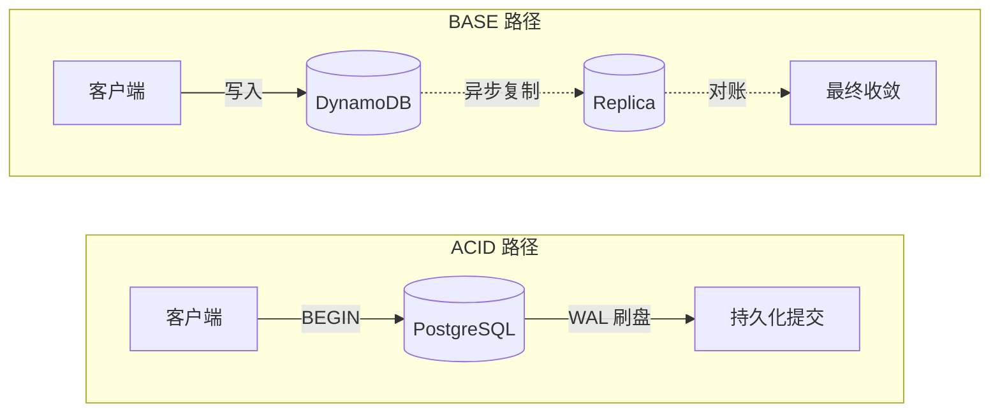
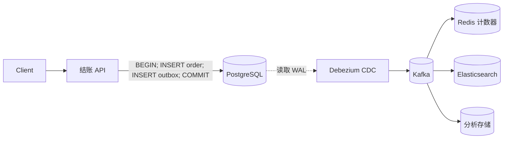
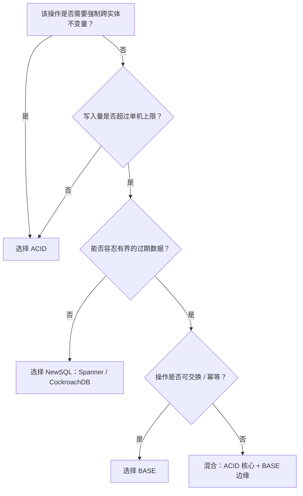

# ACID 与 BASE

> **TL;DR.** ACID（原子性、一致性、隔离性、持久性）用写入规模和分区容忍，换取数据库替你强制的正确性。BASE（基本可用、软状态、最终一致性）用正确性保证，换取横向吞吐量和故障下的可用性。决定性的维度是**不变量归属**：如果数据库必须强制跨实体的不变量（钱、库存、唯一性），选 ACID。如果操作可交换或幂等、过期的数据也能接受，选 BASE。多数生产系统在核心跑 ACID，在边缘跑 BASE。

## 学习目标

- 从一致性、可用性、扩展上限和编程复杂度四个维度比较 ACID 与 BASE。
- 识别决定选择的负载特征（不变量类型、写入量、对过期数据的容忍度）。
- 论证多数互联网规模系统采用的混合架构：“ACID 核心，BASE 边缘”。
- 评估真实系统（Spanner、DynamoDB、Uber Gulfstream），说清各自为什么这么选。

## 核心权衡

ACID 和 BASE 不是两种哲学，而是关于“由谁强制正确性”的工程立场：数据库，还是应用[^1]。

一个 ACID 事务会拿锁或取快照，把写入落到预写日志（WAL），等持久化刷盘之后才返回。应用白得崩溃一致性、自动回滚和可组合的不变量。代价是协调。跨分区的 ACID 每次提交都要走共识（跨地域就是几十毫秒），跨独立系统的两阶段提交则让不可用性相乘。两个 99.9% 的数据库用 2PC 连起来，组合可用性只剩 99.8%，等于每月多出约 43 分钟停机[^1]。

BASE 干脆绕开协调。每个分区本地提交、异步复制、之后再对账。应用在任意规模下都能拿到个位数毫秒的写入。代价是：数据库不再强制的每一个不变量，都得搬进应用代码，做成幂等处理器、补偿事务和对账任务[^2][^3]。

所以问题从来不是“哪个更好”，而是：哪些不变量必须由数据库强制，哪些可以放进幂等的应用代码？

*ACID 提前付出协调成本换取即时正确性；BASE 把协调推后，换来吞吐量和可用性。*

## 逐项对比

| 维度 | ACID | BASE |
|-----------|------|------|
| 一致性 | 即时，由数据库强制 | 最终，由应用强制 |
| 分区下的可用性 | 牺牲（CP） | 保留（AP） |
| 写入延迟 | 几十毫秒（共识往返） | 个位数毫秒（本地提交） |
| 扩展上限 | 单节点 Postgres 约 144K 写入/秒[^4]；NewSQL 可横向扩展 | 随节点近似线性；DynamoDB 峰值 146M 请求/秒[^5] |
| 编程复杂度 | 低（数据库强制不变量） | 高（应用处理冲突、过期数据、去重） |
| 故障模式 | 事务阻塞、协调者故障 | 静默数据丢失、过期读、写冲突 |
| 恢复 | WAL 自动重放 | 手工对账任务 |
| 规模下的成本 | 昂贵（共识、锁） | 单次写入便宜，工程时间昂贵 |

这张表有一个维度会误导人：**编程复杂度**。选 BASE 时，团队总会低估有多少活搬进了应用代码。到 2021 年，Uber 的 Gulfstream 账本系统已经跑在三套存储上（DynamoDB 存 12 周热数据、TerraBlob 存冷数据、LedgerStore 承接新写入），后来又把超过一万亿条记录迁到 LedgerStore，以削减经常性成本、把三套存储收敛成一套、拿到可验证的不可变性、并缩短二级索引的延迟[^6]。当存储、对账和索引的工程量占了路线图的大头，BASE 那点“便宜的写入”就贵了。

扩展上限那一行同样会误导人。NewSQL 系统（Spanner、CockroachDB、YugabyteDB）在横向规模上提供 ACID。Spanner 跨 17+ EB 数据、以 99.999% 的可用性每秒处理 60 亿次以上查询[^7]。“SQL 扩展不了”这个民间说法，随着这批系统一起死了。

## 何时选 ACID

当不变量必须由数据库强制、而不是应用自己兜住时，选 ACID：

- **资金流转与账本。** Uber 的 Gulfstream 支付平台采用双活架构，靠幂等实现恰好一次处理、强一致性、以及复式记账保证可审计[^3]。重复扣款比写入慢一点糟糕得多。
- **库存与预订。** “有预留才允许扣款”这条规则，如果事后再补，需要的对账代码会比 BEGIN/COMMIT 复杂得多。
- **唯一约束。** 用户名、订单号、座位分配。写入上的全序是这件事的内在要求；最终一致性意味着重名[^8]。
- **协调原语。** 主节点选举、分布式锁、配置管理。etcd、ZooKeeper 这类系统的存在，就是因为 BASE 存储给不了线性一致的操作。
- **合规与审计链路。** SOX、PCI、财务报告。“账上的数字此刻就反映真实”是监管要求，不是偏好[^3]。

调优过的单节点 PostgreSQL 在 96 vCPU 的实例上能跑到 144,000 写入/秒[^4]。CockroachDB 在 140,000 个仓库的规模上通过 TPC-C，且保持完整可串行化[^9]。这些都不是玩具数字。绝大多数应用一辈子也超不过它们。

## 何时选 BASE

当超过单机的横向写入吞吐量没有商量余地、而业务又能容忍有界的过期数据时，选 BASE：

- **计数器、点赞、浏览量、互动指标。** 浏览量晚两秒用户根本看不出来；写入上花几十毫秒协调，用户是能感觉到的[^1]。
- **社交信息流、通知、动态流。** 向百万粉丝扇出写，不能被全局共识卡住[^2]。
- **分析数据摄取、日志、遥测。** 天生只追加、与顺序无关、能容忍重复。
- **必须在分区中存活的可用性关键路径。** 购物车（Dynamo 最初的使用场景）、会话存储、功能开关读取[^2]。
- **任何超过单机上限的负载。** 2024 年 Prime Day 期间 DynamoDB 扛住了每秒 1.46 亿次请求，p99 仍是个位数毫秒[^5]。没有哪个 ACID 系统能在同样延迟下达到这个吞吐量。

关键前提：操作必须天然可交换或幂等。如果不是，你最终还是会用应用代码去造一套类 ACID 的保证，而且造得很糙。

## 混合路径

多数生产系统在核心跑 ACID，在边缘跑 BASE。结账链路用一个 ACID 事务提交到 PostgreSQL；浏览量计数器在 Redis 里自增；订单事件经 Kafka 扩散。这不是妥协，这就是正确的架构。

粘合它的是**事务性发件箱模式（transactional outbox）**：在业务写入的同一个 ACID 事务里，往 outbox 表插一行事件记录。CDC 中继（Debezium 追 WAL）把每一行发布到 Kafka，下游消费者幂等地更新 BASE 存储[^10]。这样就绕开 2PC 解决了双写问题。

跨服务的长流程用**Saga**（Garcia-Molina 与 Salem，1987）：把一串本地 ACID 事务排成序列，失败时执行补偿动作[^11]。每个服务各自本地提交，由编排器协调整个序列。Uber 的 Gulfstream 支付平台在生产中展示的正是同一形状：双活、靠幂等做到恰好一次、用复式记账保证可审计，底层是对不可变订单的异步流式处理[^3]。

*混合架构：业务写入走 ACID，事件扩散靠发件箱 + CDC，派生视图落在 BASE 存储。*

## 真实案例

**Google Spanner（行星级 ACID）。** Spanner 把数据切成 split，用 Paxos 复制。TrueTime（GPS + 原子钟）提供有界的时钟不确定性，从而无需应用层协调就能实现外部一致性。2025 年的数字：超过 60 亿 QPS、管理 17+ EB 数据、99.999% 可用性 SLA[^7]。这证明：只要你愿意付共识的延迟成本，ACID 是可以横向扩展的。

**Amazon DynamoDB（超大规模下的 BASE）。** 受 2007 年 Dynamo 论文启发[^2]。默认是最终一致性读，成本只有强读的一半。全局表在多地域最终一致性模式下，写入通常在 1 秒以内、有时更快地完成传播，RPO 一般几秒，取决于副本所在 Region[^12]。2024 年 Prime Day：每秒 1.46 亿次请求，p99 个位数毫秒[^5]。没有跨实体不变量的负载，标准答案就是它。

**Uber Gulfstream（混合）。** 双活架构，靠幂等实现恰好一次处理、强一致性、复式记账保证可审计，整体是对不可变订单的异步流式处理[^3]。Gulfstream 2017 年上线时用 DynamoDB 做存储；到 2021 年已经变成 DynamoDB（热数据）+ TerraBlob（冷数据）+ LedgerStore（新写入）的组合。之后 Uber 把超过一万亿条记录迁到 LedgerStore，以降低经常性成本、把三套存储并成一套、为账本类数据拿到可验证的不可变性、并缩短二级索引延迟[^6]。

## 常见错误

> [!WARNING]
> **因为“要分布式事务”就跨服务上 2PC。** 跨服务的 2PC 会让可用性相乘。两个 99.9% 的服务连起来只有 99.8%[^1]。改用带补偿事务的 Saga。2PC 留给同机房、同资源管理器的场景。

> [!WARNING]
> **以为 BASE 等于“没有不变量”。** 给有跨行不变量的数据（余额、库存、唯一用户名）选 DynamoDB 或 Cassandra，等于用应用代码重写冲突解决逻辑，而且通常写得很烂。选存储之前，先把不变量列清楚。

> [!WARNING]
> **没有发件箱的双写。** 把写数据库和发 Kafka 当成两个独立操作，必然导致最终不一致。如果 DB 提交后 broker 发布失败，下游永远不知道这次变更[^10]。用事务性发件箱模式。

> [!WARNING]
> **“最终一致”却不给 SLA。** 如果你说不出滞后到底多少（比如 DynamoDB 全局表，文档写的是通常 1 秒以内完成传播、跨 Region 的 RPO 一般几秒[^12]；而你的 CDC 管道——得自己测），你就不知道系统是不是健康。发布并监控一个滞后 SLO。

## 决策清单

- [ ] 这个操作是否有应用无法独自安全兜住的跨实体不变量？
- [ ] 写入量是否超过约 100K TPS（单节点 ACID 的现实上限）[^4]？
- [ ] 这个操作能否容忍有界的过期数据（是秒级，不是毫秒级）？
- [ ] 写入是否天然可交换或幂等？
- [ ] 如果选 BASE，对账 SLA 定了吗？监控搭了吗？
- [ ] 如果选 ACID，你确认过自己的隔离级别真能挡住你担心的那些异常现象吗？
- [ ] 在你的架构里，哪些数据属于 ACID 核心、哪些属于 BASE 边缘，画出来了吗？

*决策流程：不变量归属和写入量决定选择；多数系统最终落在混合路径上。*

## 要点回顾

- ACID 用写入规模换应用简单；BASE 用编程复杂度换规模。问题的实质是谁拥有不变量。
- 跨服务的两阶段提交会让不可用性相乘。改用 Saga 和事务性发件箱模式。
- NewSQL（Spanner、CockroachDB）终结了“SQL 扩展不了”的神话。60 亿 QPS 下的 ACID 是真实存在的[^7]。
- 多数生产系统是混合的：业务写入走 ACID，派生视图和高频读取走 BASE。
- 选了 BASE，就必须定义对账 SLA。没有数字的“最终”不算工程决策。

## 延伸阅读

- [Base: An Acid Alternative (Pritchett, 2008)](https://dl.acm.org/doi/10.1145/1394127.1394128)：提出 BASE 的那篇论文，并量化了 eBay 上 2PC 的可用性税。
- [Dynamo: Amazon's Highly Available Key-value Store (DeCandia et al, 2007)](https://www.allthingsdistributed.com/files/amazon-dynamo-sosp2007.pdf)：那个“永远可写”的设计，是 BASE 在规模侧的起点。
- [Spanner: Google's Globally-Distributed Database (Corbett et al, 2012)](https://research.google/pubs/spanner-googles-globally-distributed-database-2/)：ACID 借助 TrueTime 横向扩展的证明。
- [Sagas (Garcia-Molina and Salem, 1987)](https://www.cs.cornell.edu/andru/cs711/2002fa/reading/sagas.pdf)：面向长流程的补偿事务模式原始论文。
- [Pattern: Transactional Outbox (Richardson)](https://microservices.io/patterns/data/transactional-outbox.html)：双写问题的标准解法。
- [Engineering Uber's Next-Gen Payments Platform](https://www.uber.com/blog/payments-platform/)：生产规模的 ACID + Saga，配复式记账。

## 记忆卡片

<strong>Q: 2PC 的可用性相乘，具体是什么概念？</strong>

A: 两个 99.9% 可用性的数据库用 2PC 连起来，组合可用性只有 99.8%，相当于每月多停机约 43 分钟。每多一个参与者，风险就再乘一次[^1]。

<strong>Q: 什么时候该选 BASE 而不是 ACID？</strong>

A: 当写入量超过单机上限、操作天然可交换或幂等、并且能接受有界的过期数据（秒级）时。计数器、信息流、分析、会话存储都是 BASE 的典型负载。

<strong>Q: 事务性发件箱模式是什么？</strong>

A: 在业务写入的同一个 ACID 事务里，往 outbox 表插一行事件记录。CDC 中继（例如 Debezium）追 WAL，把每一行发布到 Kafka，消费者幂等地处理事件。这样不用 2PC 就避开了双写问题[^10]。

<strong>Q: 为什么“最终一致”在没有定义 SLA 时很危险？</strong>

A: 没有量化的滞后目标，你分不清系统是健康还是坏了。AWS 文档里 DynamoDB 全局表（MREC）的表述是：通常 1 秒以内完成传播，跨 Region 的 RPO 一般几秒。如果你的 CDC 管道没有滞后监控，就是在盲飞。

<strong>Q: 是什么终结了“SQL 扩展不了”的神话？</strong>

A: NewSQL 系统。Google Spanner 在 17+ EB 数据上、带完整 ACID 和 99.999% 可用性，每秒处理 60 亿+ QPS[^7]。CockroachDB 在 140K 个仓库的规模上以可串行化隔离通过 TPC-C[^9]。

<strong>Q: 什么是 Saga，什么时候用它？</strong>

A: Saga 是由编排器协调的一串本地 ACID 事务。某一步失败，就用补偿事务撤销前面已做的步骤。跨服务的业务流程用它，而不是用分布式 2PC[^11]。

<strong>Q: 什么是“ACID 核心，BASE 边缘”的混合架构？</strong>

A: 业务关键写入（订单、支付）提交到 ACID 存储（PostgreSQL）。CDC 把事件传给 Kafka。下游 BASE 存储（Redis、Elasticsearch、分析库）幂等地消费事件。多数互联网规模的生产系统都用这个模式。

## 参考文献

[^1]: Dan Pritchett. "Base: An Acid Alternative" (ACM Queue vol. 6, no. 3, 2008; 2PC 可用性计算). https://dl.acm.org/doi/10.1145/1394127.1394128
[^2]: DeCandia et al. "Dynamo: Amazon's Highly Available Key-value Store" (SOSP 2007; 永远可写、购物车). https://www.allthingsdistributed.com/files/amazon-dynamo-sosp2007.pdf
[^3]: Uber Engineering. "Engineering Uber's Next-Gen Payments Platform" (Gulfstream; 复式记账; 幂等). https://www.uber.com/blog/payments-platform/
[^4]: DBOS. "Benchmarking How Workflow Execution Scales on Postgres" (db.m7i.24xlarge 上 144K 写入/秒). https://www.dbos.dev/blog/benchmarking-workflow-execution-scalability-on-postgres
[^5]: AWS. "Performance at Scale" (DynamoDB 146M 请求/秒, Prime Day 2024). https://aws.amazon.com/products/databases/performance-at-scale/
[^6]: Uber Engineering. "Migrating a Trillion Entries of Uber's Ledger Data from DynamoDB to LedgerStore" (2024; 迁移动因：削减经常性成本、三套存储并为一套、可验证的不可变性、缩短二级索引延迟). https://www.uber.com/blog/migrating-from-dynamodb-to-ledgerstore/
[^7]: Google Cloud. "Spanner in 2025" (> 6B QPS, > 17 EB, 99.999% SLA). https://cloud.google.com/blog/products/databases/spanner-in-2025/
[^8]: PostgreSQL Global Development Group. "Transaction Isolation" (隔离级别、MVCC、可重复读即快照隔离). https://www.postgresql.org/docs/current/transaction-iso.html
[^9]: Cockroach Labs. "CockroachDB 20.2 performs 40% better on TPC-C benchmark, passes 140k warehouses" (1.7M tpmC, 可串行化). https://www.cockroachlabs.com/blog/cockroachdb-performance-20-2/
[^10]: RisingWave. "Debezium Outbox Pattern: Reliable Event Streaming for Microservices" (双写问题; outbox + CDC). https://risingwave.com/blog/debezium-outbox-pattern-microservices/
[^11]: Garcia-Molina and Salem. "Sagas" (ACM SIGMOD 1987; 补偿事务). https://www.cs.cornell.edu/andru/cs711/2002fa/reading/sagas.pdf
[^12]: AWS. "How DynamoDB global tables work" (MREC: 条目变更异步复制，通常 1 秒以内完成；RPO 等于副本之间的复制延迟，一般几秒，取决于副本所在 Region). https://docs.aws.amazon.com/amazondynamodb/latest/developerguide/V2globaltables_HowItWorks.html
