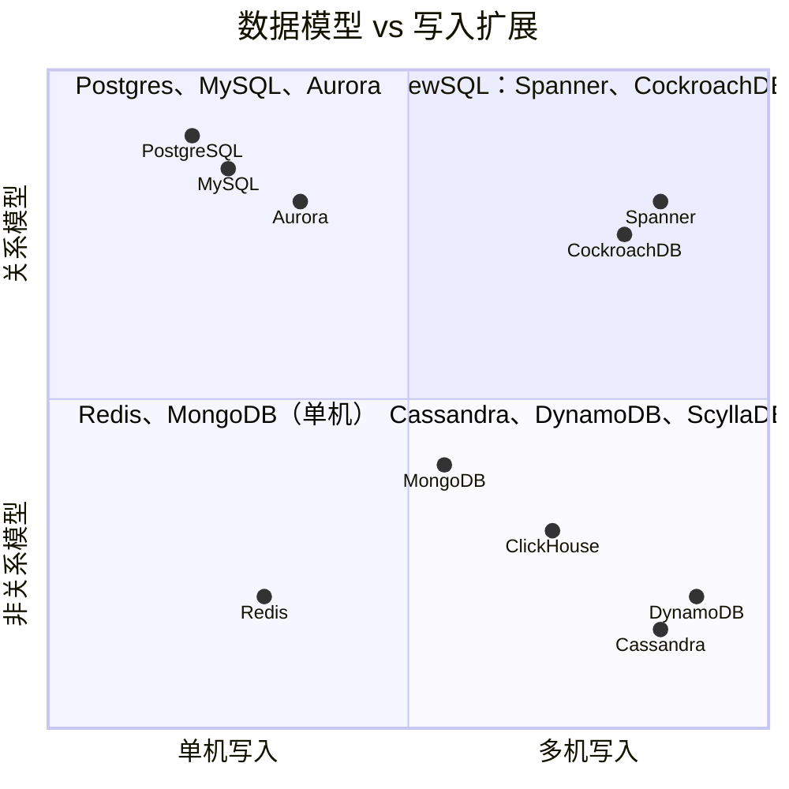
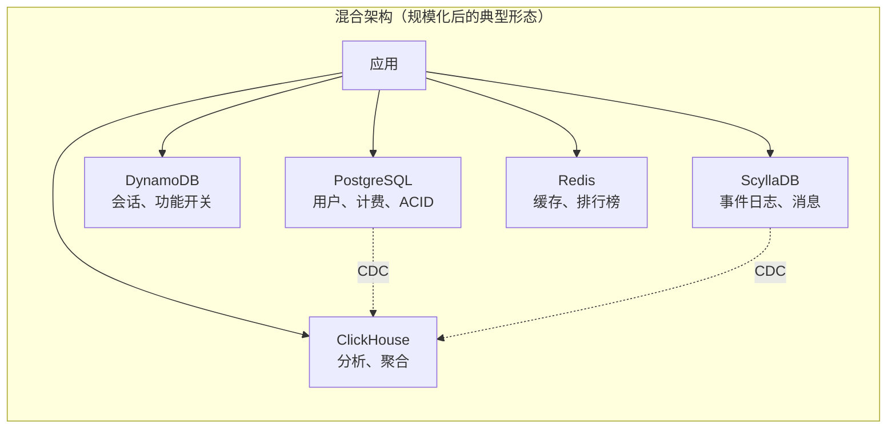
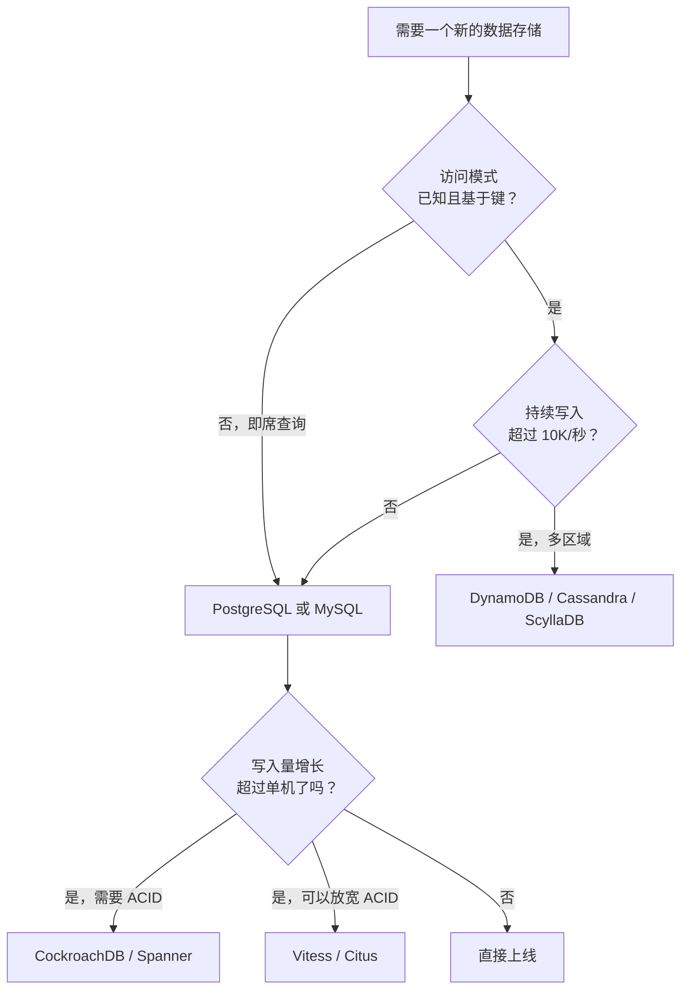

# SQL 与 NoSQL

> **TL;DR.** “SQL 与 NoSQL”把两个相互独立的维度硬压成了一个假二分。维度一：关系模型（连接、ACID、即席查询）对非关系模型（键值、文档、宽列）。维度二：单机写入对横向写入扩展。默认选 PostgreSQL。一个调优过的 Postgres 单实例，在预写日志（WAL）饱和之前能撑住每秒 144K 次写入[^1]。只有当你能说出逼你上 NoSQL 的那个具体访问模式或写入量时，才去选 NoSQL。多数生产系统最后两者都在跑。

## 学习目标

- 从数据模型灵活性、写入扩展性、一致性、运维成本四个角度对比 SQL 与 NoSQL。
- 找出真正决定选型的工作负载特征（写入量、查询形态、一致性需求）。
- 对一个给定系统，说清为什么要把关系型与非关系型存储组合成混合方案。
- 分析真实迁移案例（Discord、Uber、Figma），解释每个团队为什么动手。

## 核心权衡

关系数据库给你任意连接、多行 ACID 事务，以及一个基于成本的查询规划器——它能在你设计表结构时完全没预料到的问题上给出答案[^2]。NoSQL 数据库给你横向写入扩展、任意数据量下可预测的个位数毫秒延迟、以及表结构灵活性，但要求你在写第一行代码之前就弄清每一个访问模式[^3]。

这种张力很具体：你多写的每一个连接，在横向分片之后就是做不了的连接。你省掉规划的每一个访问模式，在键值存储里就是一次全表扫描。最糟的结局是：因为“它可扩展”而选了 NoSQL，却没把查询列清楚，六个月后才发现需要一个数据模型根本撑不住的连接。

两篇奠基性的 NoSQL 论文——Google 的 Bigtable（2006）[^4] 和 Amazon 的 Dynamo（2007）[^5]——解决的是超大规模写入量下的问题，而绝大多数应用从来碰不到那个量级。关系模型在 1970 年被形式化[^2]，至今仍是代数基础最成熟的数据模型——这也是 SQL 挺过四十年“SQL 杀手”宣言的原因。

*真正的决策落在两个维度上：数据模型（关系 vs 非关系）和写入扩展（单机 vs 分布式）。“SQL vs NoSQL”只是那条对角线。*

## 逐项对比

| 维度 | SQL（Postgres、MySQL） | NoSQL（DynamoDB、Cassandra、MongoDB） |
|---|---|---|
| 数据模型 | 范式化的表、任意连接 | 键值、文档或宽列；没有连接 |
| 写入上限 | 单节点约 144K/秒[^1]；要更多就分片 | 线性横向扩展；DynamoDB 曾达到 151M 请求/秒[^6] |
| 查询灵活性 | 即席；规划器在运行时决定连接顺序 | 只能走预先规划好的访问模式 |
| 一致性 | 默认可串行化 ACID | 最终一致或可调；MongoDB 的快照隔离存在已知异常[^7] |
| 表结构变更 | ALTER TABLE 可能锁表；gh-ost 这类工具可缓解 | 便宜（文档自描述），但表结构债务会累积 |
| 运维成熟度 | 40 多年积累的工具、备份、监控 | 参差不齐；托管服务（DynamoDB）把运维转给厂商 |
| 故障模式 | 单写入节点故障切换（数秒不可用） | 热点分片把延迟级联到整个集群 |
| 成本模型 | 按实例；可预测 | 按请求或按 CU；可能不可预测地飙升 |

这张表有一行会误导人：“写入上限”。大多数应用的持续写入在 5K/秒以下。144K 这个上限意味着对绝大多数系统来说 SQL 根本不是瓶颈。实践中真正起决定作用的维度是**查询灵活性**：如果你今天没法把查询列全，那就默认选 SQL。

## 什么时候选 SQL

- **事务型数据上的即席报表与分析。** 跨 4 张以上表做连接，对设计时未知的维度做 GROUP BY。每个 BI 工具都会说 SQL。
- **多行不变式。** “从 A 账户扣款、向 B 账户入账，原子完成”需要 ACID。应用层补偿又脆又容易出 bug[^8]。
- **持续写入量在 50K/秒以下。** 现代 96 vCPU 实例上的 Postgres 处理这个量还有余量[^1]。先测量，再假设你需要 NoSQL。
- **Figma 的路径：** 四年 100x 增长，先靠纵向扩展扛住，再上基于 DBProxy 的 Postgres 横向分片，全程保留 SQL 语义[^9]。
- **Notion 的路径：** 32 到 96 个物理 Postgres 实例上放 480 个逻辑分片，重分片零停机[^10]。

## 什么时候选 NoSQL

- **访问模式固定且基于键。** 会话存储、功能开关、设备状态、事件日志。查询时你总是知道键是什么。
- **写入量真的超过单机。** DynamoDB 在 2025 年 Prime Day 期间持续承受每秒 151M 次请求[^6]。Cassandra 和 ScyllaDB 在生产中能扩到几十万个节点（Apple 跑了 160K+ 个 Cassandra 实例）[^11]。
- **按时间排序、只追加的写入。** 带 `(partition_key, clustering_key)` 的宽列存储让“最新 N 条”的读取很便宜。ClickHouse 在并行副本集群上以亚秒级聚合 1000 亿行做分析[^12]。
- **早期产品的表结构频繁变动。** 文档存储让你不用 ALTER TABLE 就能迭代，但从第一天起就上 `$jsonSchema` 校验，否则你一定会后悔。
- **多区域写入可用性。** Cassandra 和 DynamoDB Global Tables 接受任意区域的写入，不用付跨区域共识的延迟。

## 混合路线

多数规模化生产系统跑的是多语言持久化（polyglot persistence）：Postgres 存用户账户和计费，Redis 存会话，Kafka 加 Cassandra 存事件日志，DynamoDB 扛高并发键值，ClickHouse 做分析。同时跑四个数据库很正常，这不叫选不出边。

两种混合模式占主流：

**PostgreSQL JSONB** 把文档存储的用例收进关系引擎里。结构化数据用带类型的列，可变字段用带 GIN 索引的 JSONB，两边共享完整 ACID。很多“想要灵活表结构、但也需要连接”的 MongoDB 用例都可以这么解[^13]。

**NewSQL（Spanner、CockroachDB、TiDB）** 用分布式共识给你 SQL + ACID + 横向写入扩展。CockroachDB 在 2020 年于 TPC-C 上跑出 170 万 tpmC[^14]。Spanner 因“重新构想关系数据管理，在全球规模上实现带外部一致性的可串行化”拿下 2025 年 ACM SIGMOD 系统奖[^15]。代价是：写入延迟受共识往返次数约束（跨区域几十毫秒）。

*多语言持久化是常见的终点：每个存储处理它被设计来处理的负载形态，彼此用 CDC 管道连起来。*

## 真实案例

**Discord（2015 到 2022）：** 上线时用 MongoDB，几个月就撞到扩展天花板。迁到 Cassandra（12 个节点，数十亿条消息）。到 2022 年：177 个 Cassandra 节点、数万亿条消息、P99 读延迟 40 到 125 ms。JVM 垃圾回收停顿引发过持续整个周末的救火。迁到 ScyllaDB 后：72 个节点，P99 读 15 ms，P99 写稳定在 5 ms[^16]。教训是：数据库选型是一个持续的容量决策，而不是一次性选择。

**Uber Schemaless（2014）：** 对行程数据存储来说，Postgres 没法“靠加机器线性加容量”。Uber 在只追加的分片 MySQL 上自建了 Schemaless，把数据建模成“一个只追加的稀疏三维持久哈希表，和 Google 的 Bigtable 非常像”，每个单元格一旦写入就不可变[^17]。他们放弃了 Cassandra、Riak 和 MongoDB，因为决策“最终归结为对我们即将使用的系统的运维信任，毕竟里面装的是关键业务行程数据”。

**Airbnb（2015）：** 对单体 MySQL 数据库做纵向分区，从消息收件箱功能（占写入的 33%）开刀，两周完成[^18]。他们明确推迟了横向分片，称之为“苦药”，转而按表分组隔离故障域。

## 常见错误

> [!WARNING]
> **因为“它可扩展”而选 NoSQL。** 先量一下你真实的写入/秒。如果持续在 10K 以下，Postgres 扛得住，还白送你连接能力。144K 这个上限[^1]意味着多数团队根本不需要离开 SQL。

> [!WARNING]
> **相信 MongoDB 的默认值。** 默认写关注 `w:1` 只在内存里确认写入；故障切换会把这些写入静默丢掉。大约 80% 的托管 MongoDB 用户用的是默认写关注[^7]。把 `writeConcern: "majority"` 和 `readConcern: "majority"` 设到所有地方。

> [!WARNING]
> **读时模式却不做校验。** 几个版本发下来，一个 MongoDB 集合里会躺着四代隐式表结构。每个消费方都得防御性处理缺失字段、类型不匹配和 null。从第一天起就上 `$jsonSchema`，或者改用带类型列的 Postgres JSONB。

> [!WARNING]
> **忽略热点分片。** 一个热门频道或租户就能把流量全压到三个副本上。Discord 用请求合并（request coalescing）和时间分桶的分区键解决了这个问题[^16]。DynamoDB 靠全局准入控制处理[^3]。你必须为数据倾斜做设计。

## 决策清单

- [ ] 你量过持续的写入/秒吗？（低于 50K，SQL 就够。）
- [ ] 应用需要多少种不同的查询形态？（几十种 = SQL；少数几种 = NoSQL 可行。）
- [ ] 不变式跨多行吗？（是的话，你需要 ACID 事务。）
- [ ] 负载是只追加且按时间排序的吗？（宽列或时序存储。）
- [ ] 你今天能把每个访问模式都列出来吗？（不能的话，SQL 的即席规划器能救你。）
- [ ] 你需要多区域写入可用性吗？（Cassandra、DynamoDB Global Tables 或 Spanner。）

## 要点回顾

- 单个 Postgres 实例能撑住每秒 144K 次写入[^1]。“SQL 不能扩展”对多数负载来说是民间传说。
- 当访问模式已知、基于键，且写入量真的超过单机时，NoSQL 胜出。
- 真正的维度是数据模型（关系 vs 非关系）和写入扩展（单机 vs 分布式）。“SQL vs NoSQL”只是那条对角线。
- 多语言持久化是规模化之后的正常终点。同时跑 4-5 个数据库是特性，不是失败。
- 默认选 SQL。只有当你能指出具体撞到哪个上限时，才外科手术式地加一个 NoSQL 存储。

## 延伸阅读

- [Amazon DynamoDB: A Scalable, Predictably Performant, and Fully Managed NoSQL Database Service](https://www.usenix.org/conference/atc22/presentation/elhemali)：2022 年 USENIX ATC 上那篇讲 DynamoDB 十年运维经验的论文；理解分区级准入控制的必读。
- [How Discord Stores Trillions of Messages](https://discord.com/blog/how-discord-stores-trillions-of-messages)：最经典的多数据库迁移故事；讲清为什么数据库选型是持续决策。
- [Does Postgres Scale?](https://dbos.dev/blog/benchmarking-workflow-execution-scalability-on-postgres)：DBOS 2026 年的基准测试，证明单节点 144K 写入/秒；对“SQL 不能扩展”最好的解药。
- [How Figma's Databases Team Lived to Tell the Scale](https://www.figma.com/blog/how-figmas-databases-team-lived-to-tell-the-scale/)：Postgres 先纵向再横向分片，100x 增长还保留 SQL。
- [Jepsen: MongoDB 4.2.6](https://jepsen.io/analyses/mongodb-4.2.6)：关于 MongoDB 事务异常与不安全默认值最清晰的单一来源。
- [Dynamo: Amazon's Highly Available Key-value Store](https://www.allthingsdistributed.com/files/amazon-dynamo-sosp2007.pdf)：2007 年 SOSP 那篇开创了 NoSQL 类别的论文；读它的原始动机。

## 记忆卡片

*从 SQL 起步。只有当你能量出撞到的具体天花板时，才转 NoSQL 或 NewSQL。*

<strong>问：PostgreSQL 的单节点写入上限是多少？</strong>

答：在 96 vCPU 实例上约每秒 144,000 次写入，瓶颈在 WAL fsync 而不是 CPU。多数应用永远碰不到这个上限。

<strong>问：“SQL vs NoSQL”把哪两个独立维度压成了一个？</strong>

答：数据模型（带连接的关系模型 vs 非关系模型）和写入扩展性（单机 vs 横向分布式）。两者正交；NewSQL 占据“关系 + 分布式”这个象限。

<strong>问：MongoDB 的默认写关注为什么危险？</strong>

答：默认 `w:1` 在主节点把写入放进内存后就确认。故障切换时这些写入可能被静默回滚。大约 80% 的托管用户用的是默认写关注。改用 `writeConcern: "majority"`。

<strong>问：DynamoDB 在 2025 年 Prime Day 达到了什么规模？</strong>

答：每秒 151M 次请求，P99 延迟个位数毫秒，整个活动期间服务了数十万亿次 API 调用。

<strong>问：Discord 怎么解决消息存储里的热点分片？</strong>

答：时间分桶的分区键 `(channel_id, bucket)` 把一个频道的流量摊到不同时间窗上，再加一层 Rust 数据服务，把同一个键的并发读合并成一次数据库调用。

<strong>问：什么时候该选 NewSQL 而不是分片 SQL？</strong>

答：当你同时需要横向写入扩展、可串行化 ACID 事务和多区域一致性时。代价是写入延迟受共识往返约束（跨区域几十毫秒）。

<strong>问：什么是多语言持久化？</strong>

答：在一个系统里跑多种数据库技术，各自处理它被设计来处理的负载形态。Postgres 管 ACID，Redis 管缓存，Cassandra 管事件日志，ClickHouse 管分析。这是规模化之后的正常终点。

## 参考文献

[^1]: Peter Kraft, "Does Postgres Scale?", DBOS, 2026. https://dbos.dev/blog/benchmarking-workflow-execution-scalability-on-postgres
[^2]: E. F. Codd, "A Relational Model of Data for Large Shared Data Banks", CACM 1970. https://dl.acm.org/doi/10.1145/362384.362685
[^3]: Elhemali et al., "Amazon DynamoDB: A Scalable, Predictably Performant, and Fully Managed NoSQL Database Service", USENIX ATC 2022. https://www.usenix.org/conference/atc22/presentation/elhemali
[^4]: Chang et al., "Bigtable: A Distributed Storage System for Structured Data", OSDI 2006. https://static.googleusercontent.com/media/research.google.com/en//archive/bigtable-osdi06.pdf
[^5]: DeCandia et al., "Dynamo: Amazon's Highly Available Key-value Store", SOSP 2007. https://www.allthingsdistributed.com/files/amazon-dynamo-sosp2007.pdf
[^6]: Channy Yun, "AWS services scale to new heights for Prime Day 2025", AWS Blog, 2025. https://aws.amazon.com/blogs/aws/aws-services-scale-to-new-heights-for-prime-day-2025-key-metrics-and-milestones/
[^7]: Kyle Kingsbury, "Jepsen: MongoDB 4.2.6", 2020. https://jepsen.io/analyses/mongodb-4.2.6
[^8]: PostgreSQL documentation, "Transaction Isolation". https://www.postgresql.org/docs/current/transaction-iso.html
[^9]: pganalyze, "How Figma built DBProxy for sharding Postgres", 2024. https://pganalyze.com/blog/5mins-postgres-figma-dbproxy-sharding-postgres
[^10]: Notion Engineering, "The Great Re-shard: adding Postgres capacity (again) with zero downtime", 2023. https://www.notion.com/blog/the-great-re-shard
[^11]: The Apache Software Foundation, "The Apache Cassandra Project Releases Apache Cassandra v4.0", 2021. https://news.apache.org/foundation/entry/the-apache-cassandra-project-releases
[^12]: ClickHouse, "How we scaled raw GROUP BY to 100 B+ rows in under a second". https://clickhouse.com/blog/clickhouse-parallel-replicas
[^13]: PostgreSQL documentation, "JSON Types" (JSONB). https://www.postgresql.org/docs/current/datatype-json.html
[^14]: Cockroach Labs, "CockroachDB 20.2 performs 40% better on TPC-C benchmark, passes 140k warehouses", 2020. https://www.cockroachlabs.com/blog/cockroachdb-performance-20-2/
[^15]: Google Cloud, "Spanner wins the 2025 ACM SIGMOD Systems Award". https://cloud.google.com/blog/products/databases/spanner-wins-the-2025-acm-sigmod-systems-award
[^16]: Bo Ingram, "How Discord Stores Trillions of Messages", Discord Engineering, 2023. https://discord.com/blog/how-discord-stores-trillions-of-messages
[^17]: Uber Engineering, "Designing Schemaless, Uber Engineering's Scalable Datastore Using MySQL". https://www.uber.com/blog/schemaless-part-one-mysql-datastore/
[^18]: Airbnb Engineering, "How We Partitioned Airbnb's Main Database in Two Weeks", 2015. https://web.archive.org/web/20250114091952/https://medium.com/airbnb-engineering/how-we-partitioned-airbnb-s-main-database-in-two-weeks-55f7e006ff21
