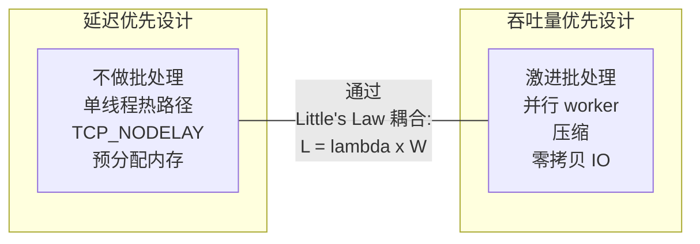
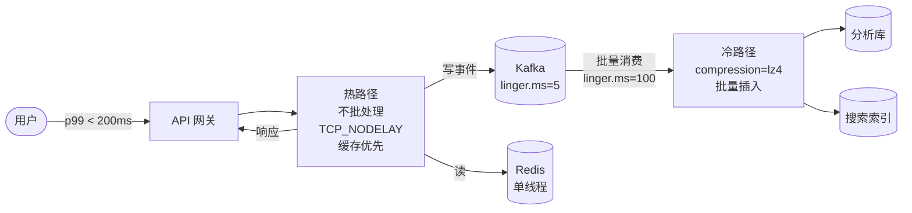
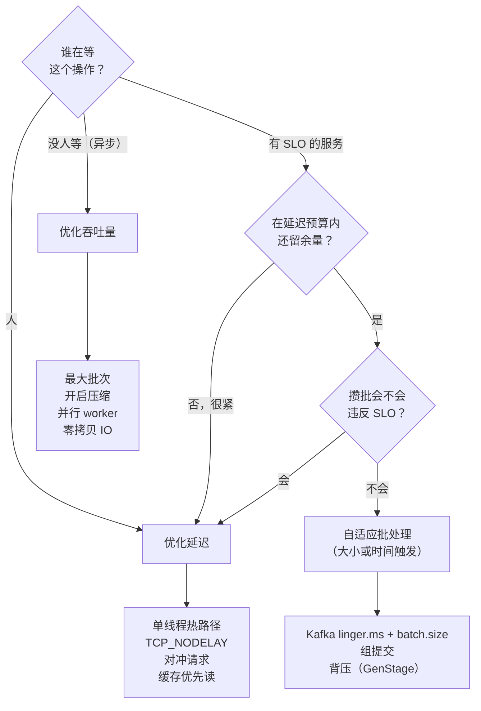

# 延迟 vs 吞吐量

> **TL;DR.** 延迟（latency，每个请求的耗时）与吞吐量（throughput，单位时间内处理的请求数）通过排队耦合在一起：Little's Law（利特尔法则）指出，在途工作量等于到达速率乘以在系统内停留的时间[^1]。批处理提升吞吐量，但要向延迟收税；单线程把延迟压到最低，却锁死了吞吐量的上限。有人等着看结果时就优先保延迟，没人等时就优先保吞吐量，两者都需要时用自适应批处理（按大小或按时间触发）。真正要回答的问题不是"哪个重要"，而是"谁在等，他等的时候在做什么？"

## 学习目标

- 比较延迟优先与吞吐量优先两种架构在排队行为、硬件利用率和失效模式上的差异。
- 识别决定该优化哪一维度的工作负载特征（有人在回路中、异步流水线、扇出深度）。
- 论证一种自适应批处理混合方案：既能兜住最坏情况延迟，又能拿到大部分吞吐量收益。
- 评估真实的生产系统（LMAX、Kafka、Redis、Google 搜索），解释它们为什么各自停在前沿的某个位置上。

## 核心权衡

每个系统都站在一条前沿上：把吞吐量往上推，延迟就上升；把延迟往下压，吞吐量就下降。这种耦合不是偶然，它来自三个具体机制：

1. **批处理（Batching）。** 把固定开销（syscall、TLS 握手、TCP 头、fsync）摊到 N 个条目上，吞吐量最高可提升 N 倍，但第一个条目得等整批凑满。[^2]
2. **排队（Queueing）。** 利用率逼近 1.0 时，队列深度会非线性爆炸。80% 利用率时队列还可控，99% 时就是灾难。[^3]
3. **并行（Parallelism）。** 增加核数能提高总吞吐量，但会引入协调成本（锁、缓存行乒乓、上下文切换），反过来推高单请求延迟。[^4]

反直觉的结论：Kafka 的 `linger.ms=5`（故意等 5 ms）把端到端净延迟从 27.5 ms 降到 7.5 ms，因为它消除了服务端的请求排队。[^2] 加一点延迟，总延迟反而下降。这也是这个决策难做的原因。

*延迟优先与吞吐量优先的设计，优化的是同一个排队方程的两端；不理解耦合关系就单方面改善一端，只会把另一端弄坏。*

## 逐项对比

| 维度 | 延迟优先 | 吞吐量优先 |
|---|---|---|
| 单请求耗时 | 压到最低（目标亚毫秒） | 可接受（秒级也行） |
| 硬件利用率 | 低（CPU 留 30-50% 余量） | 高（目标 80-95%） |
| 批处理 | 不做，或微批（< 1 ms） | 激进（linger 100 ms 以上） |
| 并发模型 | 单线程或绑定核 | 线程池、工作窃取 |
| 故障爆炸半径 | 一个请求 | 整批（N 个条目） |
| 成本效率 | 单次操作昂贵 | 单次操作便宜 |
| 长尾表现 | p99 可预测 | 高负载下 p99 可能爆炸 |
| 扩展手段 | 更快的代码、更少的协调 | 更多机器、更大的批次 |

这张表在一个维度上会误导人：**成本**。像 LMAX 这样的延迟优先系统，单线程就能跑 600 万订单/秒[^5]，单次操作比大多数吞吐量优先的设计更便宜。关键在于延迟优先只在工作负载能塞进一个核的缓存时才成立。一旦超出，你就必须上并行，这时吞吐量优先的模型在成本上胜出。

实践中真正起决定作用的维度是**谁在等**。如果人在 1 秒时就放弃，吞吐量效率再高也没意义；如果根本没人等，延迟打磨得再细也没意义。

## 何时该优化延迟

**有人在回路中（human in the loop）。** 被广泛引用的一个 Amazon A/B 测试（据称出自 Greg Linden，约 2000-2002 年）报告称，延迟每增加 100 ms 大约损失 1% 收入；这个结论是方向性的，而非正式发表的当前研究，但此后该模式被反复复现。[^6] 搜索、结算、页面加载和交互式 API 都有硬性的放弃阈值。每一毫秒都要削。

**下游 SLO 会在扇出时复利放大。** 一个 p99 = 10 ms 的服务被 100 个叶子分片共同调用，聚合后的 p99 变成 140 ms，因为至少命中一次长尾事件的概率是 1 - 0.99^100 = 63%。[^7] Google 用对冲请求（hedged requests）压缩这个问题：过 p95 阈值就发一个备份请求，接受 2% 的额外负载，把 p99.9 从 1,800 ms 砍到 74 ms。[^7]

**热点资源上的争用就是瓶颈。** Redis 把所有命令都跑在单线程上，就是为了避开锁开销。结果：内存命令处理达到亚微秒级，裸机上（据 Redis 的延迟诊断基准）操作系统调度带来的固有延迟低至 115 us。[^8] 缩短请求在争用资源上的持有时间，会顺带提高总吞吐量。

**标杆系统：** LMAX Disruptor。单线程业务逻辑处理器，600 万订单/秒，平均每跳延迟 52 ns，p99.99 低于 8,192 ns。对比 `ArrayBlockingQueue`：平均 32,757 ns，最大 5 ms。[^4]

## 何时该优化吞吐量

**工作异步，且没人在等。** 日志摄取、ETL、批量机器学习训练、报表生成。优化目标是每小时完成多少作业，而不是响应时间。没人观察的 200 ms 单条延迟是免费的。

**大规模下硬件成本占主导。** Kafka 生产者调参（batch.size=200000、linger.ms=100、compression=lz4）把吞吐量从 23.58 MB/s 提到 94.89 MB/s，4 倍提升；同时单条记录延迟从 927 ms 降到 4.92 ms，因为 broker 侧的排队消失了。[^9] 同样的负载，机器数量只要四分之一。

**批处理是安全的，且合并不会破坏顺序。** 写入 Kafka、日志投递、分析事件、数据库组提交都受益。PostgreSQL 的 `commit_delay`（单位微秒，默认 0）在 WAL 刷盘前加一小段延迟，让更多事务能搭同一次 fsync，从而提高组提交吞吐量，代价是每次刷盘最多多等 `commit_delay`；典型调参值在几十到一百多微秒。[^10]

**标杆系统：** 调好 `linger.ms` + `batch.size` 的 Kafka 生产者。压缩作用在整批上，让批处理与压缩形成协同。[^11]

## 混合路径

大多数生产系统按层划线：延迟优化的热路径，把数据喂给吞吐量优化的冷路径。

**自适应批处理**在**大小阈值或时间阈值**任一先触发时就发出这一批。这样把最坏情况延迟限制在 linger 窗口内，同时拿到大部分吞吐量收益。Kafka 4.0（2025 年 3 月）把默认 `linger.ms` 从 0 改成 5 ms，正是因为零 linger 会造成服务端排队，净效果反而增加延迟。[^2]

同样的模式出现在 TCP（Nagle 算法，RFC 896）[^12]、PostgreSQL 组提交[^10]，以及 Discord 的 GenStage 推送流水线里——它把每个 Firebase XMPP 连接的待处理请求限制在 100 个（Firebase 协议的限制），并在饱和时施加背压。[^13]

*热路径在 200 ms 内把响应还给用户；它背后的冷路径为吞吐量激进地攒批，不影响用户感知到的延迟。*

## 真实案例

**LMAX Exchange（延迟优先）。** 金融交易要求亚微秒级的抖动。LMAX 在原型阶段发现队列管理的 CPU 占用超过业务逻辑之后，放弃了 actor 模型。[^5] 他们的 Disruptor 环形缓冲区在启动时预分配全部内存，把序列计数器填充到独立缓存行以消除伪共享，单线程跑 600 万订单/秒。[^5][^4] 设计原则是"机械同情"（mechanical sympathy）——明确按 CPU 缓存行为来写代码，而不是只求抽象正确。

**Apache Kafka（吞吐量优先，自适应混合）。** 生产者的双触发（大小或时间）是教科书式的自适应批。默认配置下，10 分区主题会在 broker 上排 5 个在途请求，每个 5 ms，净得 27.5 ms 平均延迟。`linger.ms=5` 时，一个合并后的请求净得 7.5 ms。[^2] 推荐的调参规则：`linger.ms >= server_processing_time`。[^2]

**Google 搜索（用对冲请求压缩长尾）。** 100 路扇出时，单叶子 10 ms 的 p99 会变成根节点 140 ms 的 p99。[^7] 对冲请求（过 p95 阈值就发备份）把 BigTable 的 p99.9 从 1,800 ms 压到 74 ms，只多花 2% 负载。[^7] 这是一个用可控吞吐量换延迟的优化。

## 常见错误

> [!WARNING]
> **优化平均延迟而不是长尾。** 50 ms 的平均值会盖住 500 ms 的 p99。100 路扇出时，63% 的请求至少撞上一次 p99 事件，长尾成了每个用户的体验。[^7] 永远把 p50、p95、p99、p99.9 一起报。

> [!WARNING]
> **对这一层批得太狠。** 在面向用户的生产者上设 `linger.ms=500`，最坏情况就多 500 ms。流量低谷时批次永远凑不满，每个请求都付满整个窗口。从 5-10 ms 起步，只有吞吐量确实是瓶颈时再往上调。[^2]

> [!WARNING]
> **忽略 Nagle 与延迟 ACK 的相互作用。** Nagle（RFC 896）缓存小写入；延迟 ACK 推迟确认。两者叠加，每个小 RPC 都会卡住约 40 ms。[^14][^12] 每个延迟敏感的 socket 都要开 `TCP_NODELAY`。这应该是默认，不是例外。

> [!WARNING]
> **相信带有协调遗漏的基准测试。** 同步压测工具在系统卡顿时自己也暂停，于是卡顿在直方图里消失了。Gil Tene 演示过，协调遗漏能让基准测试报出 p99.99 = 16 us，而实际延迟 >= 582 ms，少报了 35,000 倍。[^15] 用 `wrk2` 或带期望间隔校正的 HdrHistogram。

## 决策清单

- [ ] 这个操作是谁在等：人、另一个有 SLO 的服务，还是没人等？
- [ ] 能不能在不突破最紧的下游延迟预算的前提下攒批？
- [ ] 瓶颈资源的利用率是多少？（超过 80% 意味着 J 曲线已经在发力。）
- [ ] 你在测 p99 和 p99.9，还是只测平均值？
- [ ] 这条请求路径上，你有没有算出一份显式的分层延迟预算？
- [ ] 你的压测有没有对协调遗漏做校正？
- [ ] 延迟敏感的 socket 上，`TCP_NODELAY` 开了吗？

*从"谁在等？"出发沿着分支走。大多数生产系统最终落在自适应批处理的中间路径上。*

## 要点回顾

- 延迟与吞吐量通过排队（Little's Law）耦合在一起，不是可以独立拧的两个旋钮。
- 决策从一个问题开始：谁在等，他等的时候在做什么？
- 加上一点故意的延迟（Kafka `linger.ms=5`）可以通过消除服务端队列堆积来降低净延迟。
- 高扇出下，单条请求的长尾会变成所有人的中位数；要么对冲，要么接受这个数学结果。
- 多数生产系统会拆成延迟优化的热路径，以及它背后吞吐量优化的冷路径。

## 延伸阅读

- [The Tail at Scale（Dean 与 Barroso，2013）](https://research.google/pubs/the-tail-at-scale/)：为什么扇出规模下 p99 会主导，以及对冲/并联请求如何把它压缩 10-25 倍。
- [The LMAX Architecture（Martin Fowler，2011）](https://martinfowler.com/articles/lmax.html)：为什么 600 万次/秒的业务逻辑能跑在一个线程上，以及低延迟场景下队列为什么输给环形缓冲区。
- [Kafka Performance Tuning: linger.ms and batch.size（AutoMQ，2025）](https://www.automq.com/blog/kafka-performance-tuning-linger-ms-batch-size)：Kafka 4.0 的默认值变更，附带完整的延迟数字，说明 5 ms 为什么胜出 0 ms。
- [It's always TCP_NODELAY（Marc Brooker，2024）](https://brooker.co.za/blog/2024/05/09/nagle.html)：为什么 Nagle + 延迟 ACK 是你不知情就一定会踩到的延迟 bug。
- [How NOT to Measure Latency（Gil Tene，InfoQ）](https://www.infoq.com/presentations/latency-pitfalls/)：协调遗漏那场演讲；在相信任何基准测试之前必看。
- [How Discord handles push bursts with GenStage（Discord，2016）](https://discord.com/blog/how-discord-handles-push-request-bursts-of-over-a-million-per-minute-with-elixirs-genstage)：带背压、在途数量上限和主动丢弃的具体混合路径。

## 记忆卡片

<strong>问：哪个方程把延迟与吞吐量耦合起来，它说了什么？</strong>

答：Little's Law：L = lambda x W。在途请求数等于到达速率乘以平均在系统内的时间。并发数 L 固定时，压小 W（延迟）就能抬高吞吐量上限（lambda = L / W）。

<strong>问：相比 linger.ms=0，Kafka 的 linger.ms=5 为什么能降低净延迟？</strong>

答：linger.ms=0 时，大量小请求排在 broker 的串行协议上，每个都在等前面的。linger.ms=5 时，记录合并成一个请求，服务端排队消失。净延迟从约 27.5 ms 降到约 7.5 ms。

<strong>问：100 路扇出、单个 p99 = 10 ms 时，根节点的 p99 是多少？</strong>

答：约 140 ms。至少命中一次长尾事件的概率是 1 - 0.99^100 = 63%，所以在根节点上长尾成了典型体验。

<strong>问：对冲请求怎么压缩长尾延迟，代价是什么？</strong>

答：过了 p95 阈值就发一个备份请求，先返回的胜出，另一个被取消。Google 测到 p99.9 从 1,800 ms 降到 74 ms，只多花 2% 负载。

<strong>问：Redis 为什么用单线程命令循环？</strong>

答：锁争用、缓存行乒乓和上下文切换对 p99 的抬高，超过并行对 p50 的降低。单线程让内存操作获得可预测的亚微秒延迟。

<strong>问："热路径 / 冷路径"混合模式是什么？</strong>

答：面向用户的热路径为延迟优化（不批处理、TCP_NODELAY、缓存优先），它把事件写进队列。它背后的冷路径为吞吐量激进攒批（压缩、批量插入、高 linger）。每一层各有自己的 SLO。

<strong>问：什么是协调遗漏，它为什么重要？</strong>

答：一种压测缺陷：压测工具在系统卡顿时也暂停，卡顿就从直方图里消失了。它能让 p99 少报 35,000 倍。用 wrk2 或带期望间隔校正的 HdrHistogram。

<strong>问：Nagle + 延迟 ACK 造成的 40 ms 卡顿是怎么来的？</strong>

答：Nagle 会缓存小写入，直到前一个报文段被 ACK。延迟 ACK 最多等 40 ms 才发确认。两者凑一起就互锁：发送方在等一个接收方故意拖延的 ACK。修法：打开 TCP_NODELAY。

## 参考文献

[^1]: Brooker, M. "Telling Stories About Little's Law." Marc's Blog, 20 June 2018. http://brooker.co.za/blog/2018/06/20/littles-law
[^2]: AutoMQ Team. "Kafka Performance Tuning: Best Practice for linger.ms and batch.size." AutoMQ Blog, 11 December 2025. https://www.automq.com/blog/kafka-performance-tuning-linger-ms-batch-size
[^3]: Brooker, M. "Latency Sneaks Up On You." Marc's Blog, 5 August 2021. https://brooker.co.za/blog/2021/08/05/utilization/
[^4]: Thompson, M. et al. "Disruptor: High performance alternative to bounded queues for exchanging data between concurrent threads." LMAX Technical Paper, May 2011. https://lmax-exchange.github.io/disruptor/disruptor.html
[^5]: Fowler, M. "The LMAX Architecture." martinfowler.com, 12 July 2011. https://martinfowler.com/articles/lmax.html
[^6]: Salau, N-O. "100 ms in additional latency cost you 1% revenue, don't they?" niels-ole.com, 27 October 2018. https://www.niels-ole.com/amazon/performance/2018/10/27/100ms-latency-1percent-revenue.html
[^7]: Dean, J. and Barroso, L.A. "The Tail at Scale." Communications of the ACM 56, no. 2 (February 2013): 74-80. https://research.google/pubs/the-tail-at-scale/
[^8]: Redis documentation. "Diagnosing latency issues." Redis Open Source docs. https://redis.io/docs/latest/operate/oss_and_stack/management/optimization/latency/
[^9]: Confluent Developer. "How to optimize a Kafka producer for throughput." Confluent Tutorials. https://developer.confluent.io/confluent-tutorials/optimize-producer-throughput/kafka/
[^10]: PostgreSQL Global Development Group. "Write Ahead Log (runtime config): commit_delay." PostgreSQL documentation. https://www.postgresql.org/docs/current/runtime-config-wal.html
[^11]: Conduktor documentation. "Kafka producer batching." https://docs.conduktor.io/learn/advanced/producers/batching
[^12]: Nagle, J. "Congestion Control in IP/TCP Internetworks." RFC 896, IETF, 6 January 1984. https://datatracker.ietf.org/doc/html/rfc896
[^13]: Howarth, J. "How Discord handles push request bursts of over a million per minute with Elixir's GenStage." Discord Engineering Blog, 12 December 2016. https://discord.com/blog/how-discord-handles-push-request-bursts-of-over-a-million-per-minute-with-elixirs-genstage
[^14]: Brooker, M. "It's always TCP_NODELAY. Every damn time." Marc's Blog, 9 May 2024. https://brooker.co.za/blog/2024/05/09/nagle.html
[^15]: Tene, G. "How NOT to Measure Latency." InfoQ, 2015. https://www.infoq.com/presentations/latency-pitfalls/
