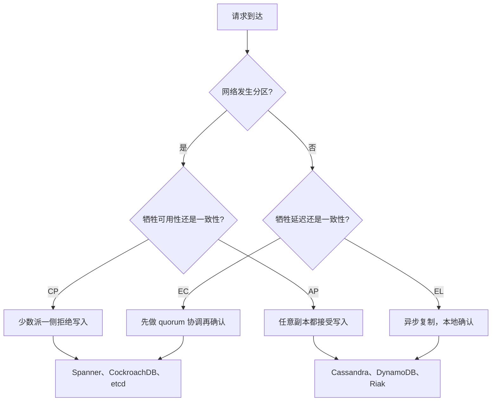
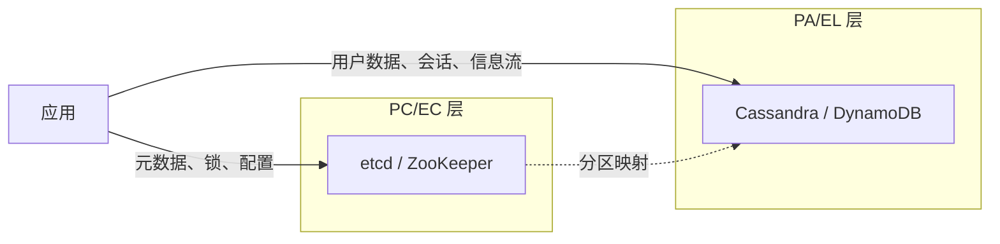
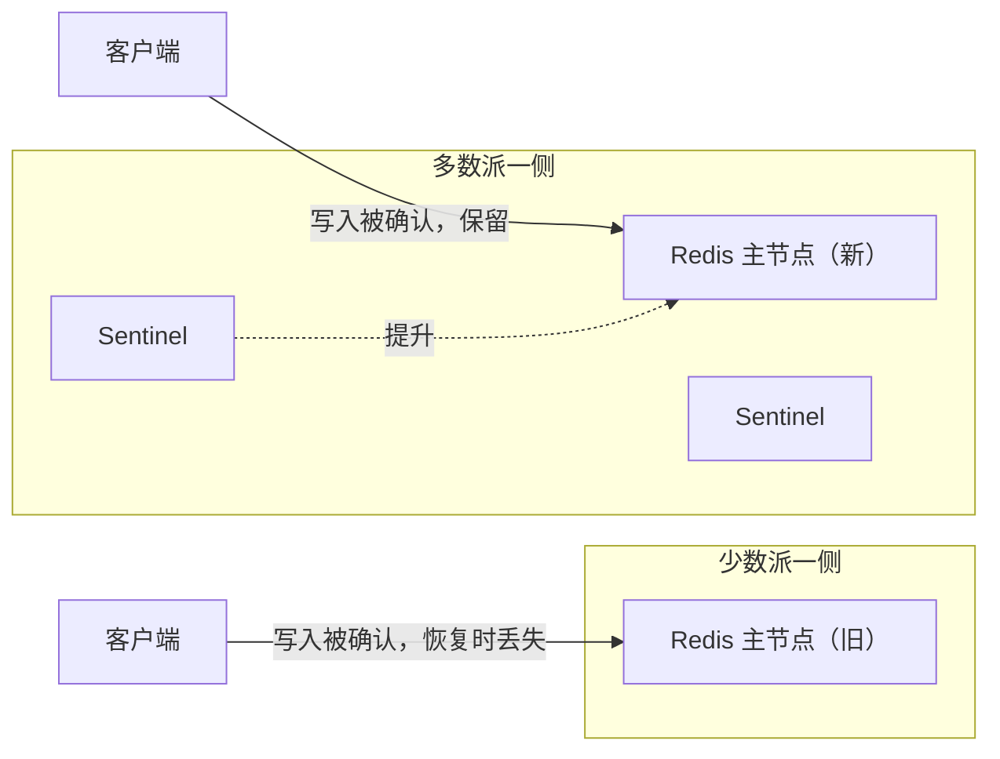

# CAP 与 PACELC 的落地应用

> **TL;DR.** 网络发生分区时，你要么牺牲一致性（AP），要么牺牲可用性（CP）。但这种选择很少发生。每一次请求都要面对的选择，是 PACELC 的 else 子句：为强一致性付出协调延迟（EC），或者接受读到旧数据换取速度（EL）。面向用户的流量（购物车、信息流、会话）默认 PA/EL，协调类状态（金额、锁、库存）默认 PC/EC。多数生产系统是按操作混用两者，而不是按集群整体选一个。

## 学习目标

- 用具体的读写语义对比分区下 CP 和 AP 的行为差异。
- 判断某个数据库配置属于哪个 PACELC 分类（PC/EC、PA/EL、PC/EL）。
- 论证应按操作设定一致性级别，而不是给整个系统贴 CP/AP 标签。
- 评估什么情况下 harvest/yield 降级比二选一的 CP 或 AP 更可取。

## 核心权衡

[CAP 与 PACELC](../part-3-distributed-systems-theory/03-cap-and-pacelc.md) 讲了这条定理。这一页讲怎么做决策。

Gilbert 和 Lynch 证明了：网络分区期间，一个复制寄存器无法同时提供线性一致性和可用性[^1]。分区不是你能挑掉的设计项，因为真实网络本来就会分区[^2]。真正活的问题是：分裂发生时，你是让少数派一侧直接拒绝请求（CP），还是两侧都继续返回可能过期的数据（AP）？

但分区在 Google 私有网络里造成的故障不到 10%[^3]。日常的张力来自 PACELC 的 else 子句：同步复制（一致性更强、长尾延迟更高）对异步复制（延迟更低、一致性更弱）[^4]。对复制存储的每一次写入都在持续交这笔税，不只是交换机挂掉的时候。

*PACELC 逼你做两个决定：分区时牺牲什么（A 还是 C），正常运行时牺牲什么（L 还是 C）。多数互联网规模系统落在 PA/EL，多数金融系统落在 PC/EC。*

## 逐项对比

| 维度 | CP（PC/EC） | AP（PA/EL） |
|-----------|-----------|-----------|
| 写入延迟 | 到多数派 quorum 需 1+ RTT[^5] | 本地磁盘确认，异步传输 |
| 读取新鲜度 | 线性一致，每次读都能看到最新写入 | 可能读到旧数据，受复制延迟约束 |
| 分区期间行为 | 少数派一侧返回错误 | 两侧都继续服务，分叉不断累积 |
| 冲突解决 | 无需处理，单写者胜出 | 必需：LWW、向量时钟或 CRDT[^6] |
| 失败模式 | 不可用（显式、响亮） | 静默丢数据（隐式、无声）[^7] |
| 运维成本 | 单次故障的爆炸半径更小 | 分区后需更大代价对账 |
| 扩展上限 | 无 multi-raft 时主节点成为瓶颈 | 写入线性扩展，任意节点可接受 |
| 示例系统 | Spanner、etcd、CockroachDB[^3][^8] | Cassandra 默认、DynamoDB 默认[^9]、Riak[^10] |

这张表有一个维度会误导人：“AP 系统总是可用”是错的。Cassandra 在 QUORUM 下一旦 quorum 不可达，读就会失败。DynamoDB 的强一致读在可用区隔离时也会失败。CP/AP 标签描述的是默认行为，不是保证。按操作设置一致性级别，可以让同一个系统在不同格子里移动[^11][^12]。

实践中最主要的维度不是分区行为，而是正常运行时的延迟。Spanner 的 TrueTime commit-wait 给每次写入加约 7 ms[^13]。Cassandra 在 ONE 下本地确认通常是低个位数毫秒。对一个每秒 50 万次写入的信息流服务来说，这个差值就是整个容量规划。

## 何时选择 CP

- **钱和库存。** 重复扣款、超卖最后一个座位、双重扣费。一个被拒绝的请求比一个错误答案便宜。银行账本、支付处理、座位预订。
- **分布式协调。** 主节点选举、分布式锁、唯一 ID 分配。[共识协议](../part-3-distributed-systems-theory/00-consensus-protocols.md) 讲了为什么这些必须靠多数派达成一致。
- **合规与审计。** 那些“T 时刻的记录”必须权威的监管系统。病历、财务报告、法律文档库。
- **小体量元数据存储。** etcd（默认后端配额 2 GiB，建议上限 8 GiB[^14]）、ZooKeeper、Consul。数据量小，协调成本付得起，而一个错误答案会级联到整个集群。

## 何时选择 AP

- **能容忍读旧的面向用户流量。** 购物车、社交信息流、点赞数、浏览计数。差几秒没人看得出来；给每次写入加 80 ms 却很明显。
- **多区域且分区频繁或持续时间长。** 跨区域链路一断就是几分钟。PA/EL 系统（DynamoDB Global Tables、Cassandra multi-DC）两侧都继续服务，事后对账[^15][^16]。
- **离线优先与 IoT。** 移动应用和边缘设备按定义就始终处于分区状态。网络是例外，不是常态。
- **大规模写密集负载。** 无主架构在任意节点都接受写入。写路径上既没有单主瓶颈，也没有跨区域协调。

## 混合路线

多数生产系统不会只挑一个格子，而是按操作混用：

- **DynamoDB：** 默认最终一致读（PA/EL），可以显式开 `ConsistentRead=true`，代价是 2 倍 RCU（这一次读变成 PC/EC）[^9]。
- **Cassandra：** 每次查询 11 种一致性级别。`ONE` 是 PA/EL。RF=3 时 `QUORUM` 实质上是单个数据中心内的 PC/EC。`SERIAL` 用 Paxos 实现线性一致的 CAS[^12]。
- **元数据与数据分离：** 协调状态（谁拥有哪个分片、集群成员）放 etcd 或 ZooKeeper（PC/EC）。用户数据放 Cassandra 或 DynamoDB（PA/EL）。这是行业惯例[^4]。

*混合架构：协调元数据放在 PC/EC 存储里，面向用户的数据放在 PA/EL 存储里。多数大规模系统最终都落在这里。*

harvest/yield 提供了第三条路。Fox 和 Brewer 提出，系统不必二选 CP 或 AP，可以降低 harvest（只返回 90% 分片的结果）来保住 yield（仍在 SLA 内响应）[^17]。Google 网页搜索就是这么做的：一个分片失败只降低结果质量，不影响可用性。

## 真实案例

**Google Spanner（PC/EC）。** 可用性目标超过五个 9[^3]。Spanner 技术上属于 CP：分区期间少数派一侧的写入会失败。但 Google 在网络（私有光纤、冗余路径）和时钟硬件（GPS + 原子钟）上做了工程，把分区压得足够罕见，用户于是把 Spanner 当作始终可用。TrueTime 的 commit-wait 窗口通常不到 7 ms[^13]。教训是：如果你付得起让分区变罕见的成本，CP 的可用性代价就变得可以忽略。

**Redis Sentinel（反面教材）。** Kingsbury 在 2013 年的 Jepsen 测试里把 Redis Sentinel 集群分区了 42 秒。结果：1,998 次已确认写入丢了 1,126 次，丢失率 56%[^18]。失败模式是：异步的数据路径复制加上基于 quorum 的故障切换，造出了脑裂。老主节点持续确认写入，而这些写入在分区恢复、Sentinel 提升新主节点时被丢弃。这就是既想要“可用又要一致”、两边却都没做工程的结果。

*异步复制加上基于 quorum 的故障切换会造出脑裂：老主节点确认的写入，在新主节点接管后全部消失。*

**Cassandra 在 QUORUM 下。** Jepsen 发现，在分区集群上用 QUORUM 读写时丢了 28% 的已确认写入，原因是 LWW 冲突解决（毫秒精度的时间戳生成让它更糟）[^7]。解法不是“改用 ALL”，而是认清：即使 quorum 有重叠，LWW 冲突解决也会静默丢弃数据。

## 常见错误

> [!WARNING]
> **把 CAP 当成“三选二”。** 分区不是可选项。CA 是单节点的退化情形。Brewer 在 2012 年纠正了这一点[^2]。换成“分区时在 C 和 A 里选一个”，再补上 PACELC 关于正常运行的那个问题。

> [!WARNING]
> **把分区和节点崩溃混为一谈。** 为崩溃节点设计的故障切换协议，会在老主节点仍在少数派一侧接受写入时就提升新主节点。如果你的数据路径复制是异步的、故障切换又基于 quorum，那就一定会丢写入[^18]。

> [!WARNING]
> **只说“我们选了 AP”，却不说明读行为。** AP 只保证节点会响应，完全没说响应里装的是什么数据。把分区期间每个操作的读语义写清楚，否则早晚被吓到[^11]。

> [!WARNING]
> **以为 R+W>N 就等于线性一致。** LOCAL_QUORUM 的 quorum 是按数据中心算的。DC1 的写和 DC2 的读可能完全没有交集。sloppy quorum 会进一步破坏重叠保证[^11]。跨 DC 的线性一致确实重要时，用集群级 QUORUM 或 SERIAL。

## 决策清单

- [ ] 你的网络实际多久分区一次？（去测量。单区域内的可用区故障才是常见的痛点。）
- [ ] 分区期间，“暂时拒绝写入”是可接受的用户体验，还是会触发事故？
- [ ] 正常运行时，你是不是在为并不需要的一致性付出协调延迟？
- [ ] 如果两个副本接受了相互冲突的写入，靠什么解决冲突：CRDT、LWW，还是人？
- [ ] 你是否按操作混用 CP 和 AP？（真实系统大多如此。把哪份数据属于哪一类写下来。）
- [ ] 你测过分区行为，还是只从厂商的宣传材料里推断过？

## 要点回顾

- CAP 是分区时刻的选择（C 或 A）。PACELC 补上了每天都要做的选择（L 或 C）。后者才是主导。
- 没有哪个系统整体上是“CP”或“AP”。按操作设定一致性级别才是生产现实[^11]。
- 面向用户的流量默认 PA/EL，协调类状态默认 PC/EC。两者混用。
- 异步复制加自动故障切换，等于分区期间静默丢数据。Redis Sentinel 在 42 秒里丢了 56% 的写入[^18]。
- 如果你说不出每个操作在分区期间会返回什么，那这个系统你还没设计完。

## 延伸阅读

- [Brewer, "CAP Twelve Years Later"](https://ieeexplore.ieee.org/document/6133253) - 作者本人对“三选二”迷思的纠正；把 CAP 定义成按操作做选择的权威论述。
- [Abadi, "Consistency Tradeoffs in Modern Distributed Database System Design"](https://www.cs.umd.edu/~abadi/papers/abadi-pacelc.pdf) - PACELC 原始论文；解释为什么日常里延迟比分区行为更重要。
- [Kleppmann, "Please stop calling databases CP or AP"](https://kleppmann.com/2015/05/11/please-stop-calling-databases-cp-or-ap.html) - 这篇批评解释了为什么单字母标签会掩盖分层现实。
- [Jepsen analyses](https://jepsen.io/analyses) - 数据库的真实行为与厂商宣传的对比；从 Redis 和 Cassandra 开始看。
- [Fox and Brewer, "Harvest, Yield, and Scalable Tolerant Systems"](https://dl.acm.org/doi/10.5555/822076.822436) - 可调一致性的思想前身；把 CAP 的二元选择重构成一个设计旋钮。
- [Brewer, "Inside Cloud Spanner and the CAP Theorem"](https://cloud.google.com/blog/products/databases/inside-cloud-spanner-and-the-cap-theorem) - “实际上 CA”的论证及其工程边界。

## 记忆卡片

<strong>问：CAP 究竟逼你在什么之间做选择？</strong>

答：网络分区期间，你要在一致性（线性一致的读，少数派一侧拒绝请求）和可用性（所有未故障节点都响应，但可能返回旧数据）之间选一个。分区状态下的一个寄存器无法同时具备两者[^1]。

<strong>问：PACELC 的“else 子句”是什么，为什么它比 CAP 更重要？</strong>

答：没有分区时，你仍然要用延迟换一致性。同步复制到 quorum，每次写入至少一个 RTT。异步复制更快，但允许读到旧数据。这个权衡在每次请求上都发生，而不只是在罕见的分区期间[^4]。

<strong>问：为什么“Cassandra 是 AP”是个不完整的说法？</strong>

答：Cassandra 每次查询有 11 种一致性级别。在 ONE 下是 PA/EL。RF=3 时用 QUORUM，在单个数据中心内行为接近 PC/EC。用 SERIAL 时通过 Paxos 实现线性一致的 CAS。标签取决于操作，不取决于集群[^12]。

<strong>问：Jepsen 2013 年测 Redis Sentinel 时出了什么问题？</strong>

答：异步数据路径复制加上基于 quorum 的故障切换，在一次持续 42 秒的分区中造成脑裂。老主节点持续确认写入（1,998 次中的 1,126 次），这些写入在 Sentinel 提升新主节点后全部被丢弃。已确认写入丢失 56%[^18]。

<strong>问：为什么多 DC 部署下 R+W>N 不能保证线性一致？</strong>

答：LOCAL_QUORUM 按数据中心计算 quorum。DC1 的写和 DC2 的读可能用到完全不相交的副本集合，重叠不变式就断了。sloppy quorum（把写入以 hint 交给非副本节点）会进一步破坏它[^11]。

<strong>问：Spanner 技术上属于 CP，怎么做到“实际上 CA”？</strong>

答：Spanner 在分区时选择 C（少数派写入失败）。但 Google 通过改造网络和时钟硬件，让分区造成的故障不到 10%，从而实现超过五个 9 的可用性。“CA”这个说法讲的是网络质量，不是 CAP 的第四个格子[^3]。

<strong>问：harvest/yield 框架是什么，什么时候有用？</strong>

答：harvest 是响应里反映出的数据占比，yield 是拿到响应的请求占比。搜索引擎可以降低 harvest（返回 90% 分片的结果）来保住 yield。账本必须保住 harvest，牺牲 yield（拒绝请求）。它把 CAP 的二元选择变成一个连续可调的设计旋钮[^17]。

## 参考文献

[^1]: Gilbert and Lynch, "Brewer's Conjecture and the Feasibility of Consistent, Available, Partition-Tolerant Web Services", ACM SIGACT News 33(2), 2002. https://dl.acm.org/doi/10.1145/564585.564601 (open-access mirror: https://users.ece.cmu.edu/~adrian/731-sp04/readings/GL-cap.pdf)
[^2]: Brewer, "CAP Twelve Years Later: How the 'Rules' Have Changed", IEEE Computer 45(2), Feb 2012. https://ieeexplore.ieee.org/document/6133253
[^3]: Brewer, "Inside Cloud Spanner and the CAP Theorem", Google Cloud Blog, Feb 2017. https://cloud.google.com/blog/products/databases/inside-cloud-spanner-and-the-cap-theorem
[^4]: Abadi, "Consistency Tradeoffs in Modern Distributed Database System Design: CAP is Only Part of the Story", IEEE Computer 45(2), Feb 2012. https://www.cs.umd.edu/~abadi/papers/abadi-pacelc.pdf
[^5]: Cockroach Labs, "Data Resilience", CockroachDB docs. https://www.cockroachlabs.com/docs/stable/data-resilience
[^6]: Shapiro, Preguica, Baquero, Zawirski, "Conflict-Free Replicated Data Types", SSS 2011. https://link.springer.com/chapter/10.1007/978-3-642-24550-3_29
[^7]: Kingsbury, "Jepsen: Cassandra", September 2013. https://aphyr.com/posts/294-call-me-maybe-cassandra
[^8]: Kingsbury, "Jepsen: etcd 3.4.3", January 2020. https://jepsen.io/analyses/etcd-3.4.3
[^9]: AWS, "DynamoDB read consistency". https://docs.aws.amazon.com/amazondynamodb/latest/developerguide/HowItWorks.ReadConsistency.html
[^10]: DeCandia et al., "Dynamo: Amazon's Highly Available Key-value Store", SOSP 2007. https://www.allthingsdistributed.com/files/amazon-dynamo-sosp2007.pdf
[^11]: Kleppmann, "Please stop calling databases CP or AP", May 2015. https://kleppmann.com/2015/05/11/please-stop-calling-databases-cp-or-ap.html
[^12]: Apache Cassandra, ConsistencyLevel.java source. https://github.com/apache/cassandra/blob/trunk/src/java/org/apache/cassandra/db/ConsistencyLevel.java
[^13]: Corbett et al., "Spanner: Google's Globally-Distributed Database", OSDI 2012 / ACM Trans. Comput. Syst. 31(3), 2013. https://research.google/pubs/spanner-googles-globally-distributed-database/
[^14]: etcd documentation, "System limits" (v3.5). https://etcd.io/docs/v3.5/dev-guide/limit/
[^15]: AWS, "Write modes with DynamoDB global tables". https://docs.aws.amazon.com/amazondynamodb/latest/developerguide/bp-global-table-design.prescriptive-guidance.writemodes.html
[^16]: AWS, "Using DynamoDB global tables". https://docs.aws.amazon.com/amazondynamodb/latest/developerguide/bp-global-table-design.html
[^17]: Fox and Brewer, "Harvest, Yield, and Scalable Tolerant Systems", HotOS-VII, 1999. https://dl.acm.org/doi/10.5555/822076.822436
[^18]: Kingsbury, "Jepsen: Redis", May 2013. https://aphyr.com/posts/283-jepsen-redis
