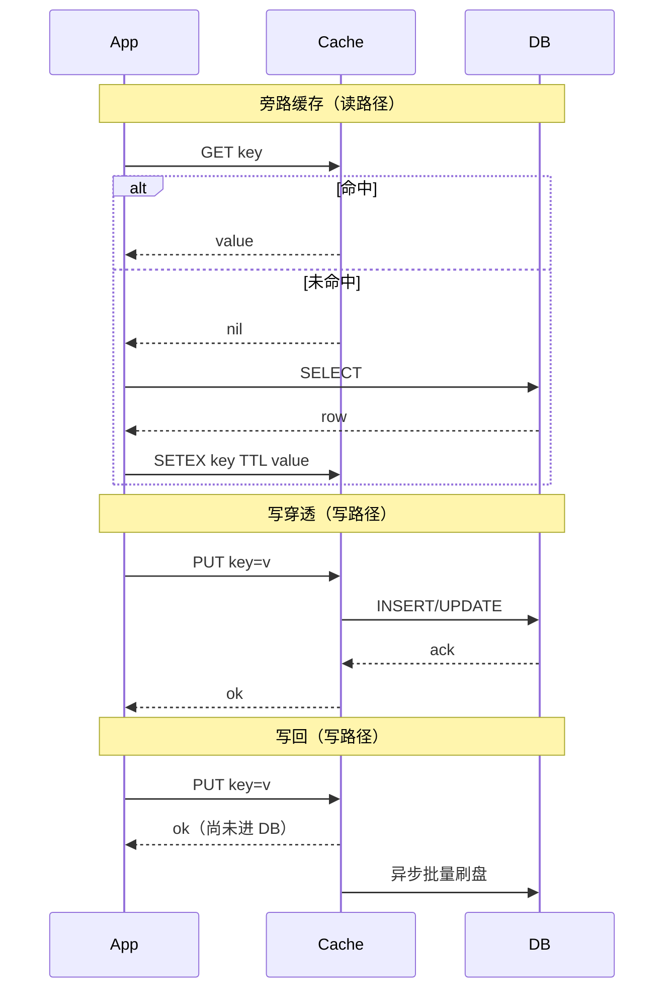
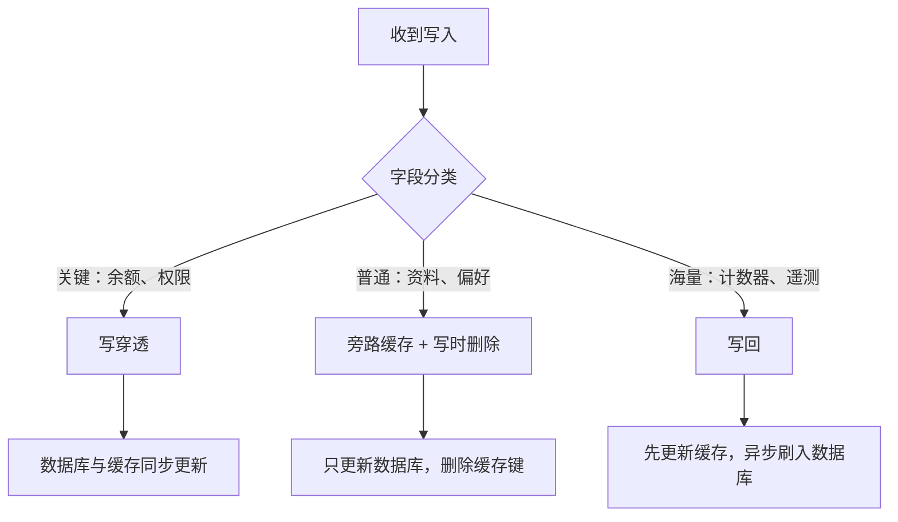
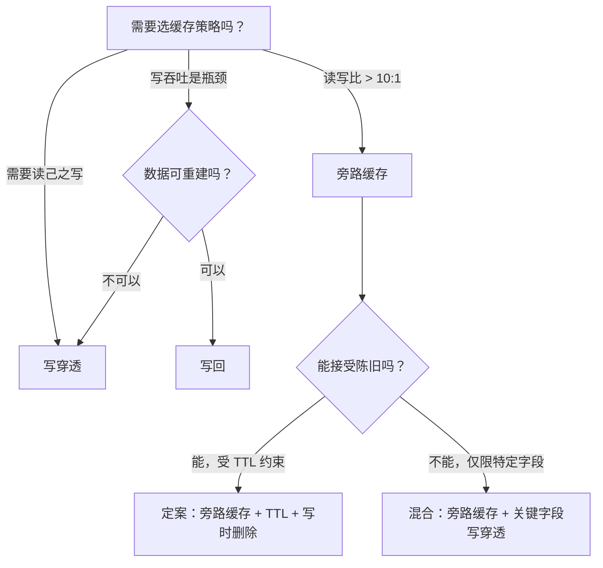

# 缓存策略：旁路缓存 vs 写穿透 vs 写回

> **TL;DR.** 旁路缓存（cache-aside）是读多写少负载的默认正确答案：未命中与回填的逻辑握在应用手里，数据库始终是权威来源，缓存挂了只是性能下降，不会丢数据。[^1] 当“读己之写”是产品硬需求（账户余额、功能开关）时，换成写穿透（write-through）。写回（write-behind）只留给可重建、高吞吐的写入（计数器、遥测），代价是接受一个等于刷盘间隔的丢数据窗口。[^2] 大多数生产系统把三种模式组合起来用，按字段分别归类。

## 学习目标

- 从一致性、延迟、持久性和运维复杂度四个维度比较旁路缓存、写穿透与写回。
- 判断哪些负载特征（读写比、陈旧容忍度、持久化要求）决定哪种策略胜出。
- 论证一种混合方案：在旁路缓存之上，对关键字段叠加写穿透。
- 剖析真实系统（Facebook Memcache、TAO、Netflix EVCache），说清它们各自为什么选那种策略。

## 核心权衡

缓存策略本质上是一份合约：约定你愿意为哪种故障模式买单。有三个维度无法同时优化到最好：

1. 缓存与数据库之间的**一致性**，代价是写路径上多出的写入。
2. **低未命中延迟**，代价是内存开销和准入策略的复杂度。
3. **持久性**，代价是写吞吐量，因为每次写入都必须在返回确认前落到持久存储。[^1][^2]

旁路缓存优化读路径，在写上接受最终一致。写穿透优化读己之写，接受额外的写延迟。写回优化写吞吐，接受缓存故障时的丢数据窗口。[^2]

真正让团队栽跟头的是这里的非线性：命中率从 99% 掉到 98%，数据库负载就翻倍。[^3] 这一个百分点，就是健康系统与级联故障之间的差别。

*旁路缓存把未命中逻辑交给应用；写穿透要等数据库确认；写回立即返回，代价是可能丢掉还没刷盘的写入。*

## 逐项对比

| 维度 | 旁路缓存 | 写穿透 | 写回 |
|-----------|-------------|---------------|--------------|
| 读延迟（命中） | 亚毫秒 | 亚毫秒 | 亚毫秒 |
| 读延迟（未命中） | 数据库延迟 + 一次缓存写入 | 数据库延迟（经缓存加载器） | 亚毫秒（数据始终在缓存里） |
| 写延迟 | 数据库写入 + 缓存删除 | 数据库写入 + 缓存写入（串行） | 仅缓存写入（约 1 us） |
| 一致性 | 最终一致（受 TTL 约束） | 读己之写 | 最终一致（受刷盘间隔约束） |
| 持久性 | 完整（数据库是权威来源） | 完整 | 有风险：刷盘间隔 = 丢数据窗口[^4] |
| 缓存污染 | 低（只缓存被请求过的数据） | 高（所有写入都进缓存） | 高 |
| 运维复杂度 | 应用自己负责失效 | 缓存库负责一致性 | 刷盘监控、崩溃恢复 |
| 故障模式 | 冷启动时的惊群 | 热键上的写放大 | 崩溃时静默丢数据[^2] |

这张表在一个维度上有误导性：写穿透所说的“完整持久性”，前提是数据库写入先成功、缓存后更新。如果你先更新缓存而数据库写失败，就留下一条脏缓存，而且没有 TTL 能救你。顺序很重要：先数据库，再缓存。[^3]

写回的“亚毫秒读延迟”只在读请求走缓存时成立。任何绕过缓存直接读数据库的请求，都会在下次刷盘前看到旧数据。[^2]

## 何时选择旁路缓存

- **读写比超过 10:1。** Facebook 的 Memcache 每秒承接数十亿次读，命中率约 99%，后面是每台服务器每秒约 10 万次查询的 MySQL。[^3] 缓存与数据库之间 10 倍的吞吐差距，就是经济性上的理由。
- **缓存是性能层，不是正确性层。** Redis 挂了，系统退化成只靠数据库跑。难受，但不丢数据。
- **多个服务读同一批键。** 各服务自己管理 get-or-populate 逻辑，不需要一个集中的缓存库。
- **你能容忍有界的陈旧。** TTL 把失效 bug 的爆炸半径限制在秒级或分钟级，而不是永久。[^1]
- **写模式多种多样。** 很多代码路径都会更新同一个实体。写的时候用 `delete`（而不是 `set`），可以避开并发更新下的陈旧 set 竞态。[^3]

## 何时选择写穿透/写回

**选写穿透的场景：**

- **读己之写是硬性产品需求。** 账户余额、RBAC 权限、功能开关状态。用户改完密码，下次打开页面绝不能还看到旧的。
- **写入速率不高。** DynamoDB DAX 对 `PutItem` 和 `UpdateItem` 用写穿透；多出来的延迟可以接受，因为 DynamoDB 的写本身就已经是个位数毫秒。[^2]
- **你要求缓存与数据库零漂移。** Facebook TAO 用写穿透，从主节点缓存写到 MySQL，消除了当年原始 Memcache 上反复出现的失效竞态 bug。[^5]

**选写回的场景：**

- **写吞吐是瓶颈，且数据可重建。** 浏览量计数器、分析事件、个性化信号。丢掉一秒的计数增量不是正确性 bug。
- **你需要 10 到 100 倍的写吞吐提升。** 带 `appendfsync everysec` 的 Redis AOF 就是持久层上的写回：崩溃时最多丢一秒的写入。[^4]
- **批处理与合并能降低后端负载。** 对同一个键的多次更新会合并成一次数据库写入，减少写放大。[^2]

## 混合路线

大多数生产系统默认用旁路缓存承载读，再对那一小撮“读己之写”属于产品硬需求的字段叠加写穿透。写回只在高吞吐、低价值的写入上小范围出现。按字段混用策略是常态，不是例外。[^1][^6]

*按一致性与持久性需求给每个字段归类；大多数系统同时在不同数据上跑着三种策略。*

Facebook 的架构就是范例：Memcache（旁路缓存）承担通用读负载，TAO（写穿透）负责社交图谱——那里失效竞态不可接受，内部计数器则用写回换吞吐。[^5][^3]

## 真实案例

**Facebook Memcache（2013）。** 每秒数十亿次请求，数万亿条数据，命中率约 99%。[^7] 采用旁路缓存，写时用 `delete` 而非 `set`，因为 delete 在并发更新下满足交换律。租约（lease）把惊群回填串行化：未命中时，Memcached 给第一个请求者发一个一次性令牌，其他人重试。McSqueal 跟踪 MySQL 的 binlog，把跨区域失效广播出去。[^3]

**Facebook TAO（2013）。** 每秒超过 10 亿次读、数百万次写，分布在大量地理上分散的服务器集群上。[^5] 从主节点缓存到 MySQL 用写穿透。两层拓扑（从节点服务读，主节点负责写）降低了 MySQL 的扇入。团队之所以从旁路缓存切换过来，正是因为 Memcache 的陈旧 set 竞态对图数据来说代价太高。[^5]

**Netflix EVCache（2024）。** 截至 2024 年，每秒 4 亿次操作，14.3 PB 数据分布在四个 AWS 区域的 22,000 个实例上。[^8] 采用旁路缓存，跨区域复制由客户端发起、走 Kafka（只传元数据，不传值）。SSD 支撑的存储层（extstore）用更高的延迟换取相比纯内存显著更低的每 GB 成本。[^8]

## 常见错误

> [!WARNING]
> **写的时候用 `set` 而不是 `delete`。** 两次并发写都用 `set`，可能让缓存里永久留下错误数据（写 A set、写 B set，写 A 的旧值最后到达）。用 `delete`；下一次读会从权威数据库重新回填。[^3]

> [!WARNING]
> **缓存键不设 TTL。** 没有 TTL，一个失效 bug 就意味着脏数据永久存活。TTL 不只是新鲜度旋钮，它是 bug 的爆炸半径上限。哪怕 24 小时，也比无穷大强。[^1]

> [!WARNING]
> **在关键数据上用写回。** 缓存故障时，写回会静默吞掉你的数据。持久性窗口等于刷盘间隔。钱、订单、任何无法从上游重建的东西，都别用它。[^4]

> [!WARNING]
> **忽略命中率监控。** 命中率是个派生指标，仪表盘上经常漏掉。从 99% 掉到 98%，数据库负载翻倍。把命中率当成一等 SLI，下跌就告警。[^3]

## 决策清单

- [ ] 读写比是多少？如果大于 10:1，旁路缓存几乎总是对的。
- [ ] 用户在自己写完之后会读到旧数据吗？会的话，这个字段用写穿透。
- [ ] 如果缓存崩溃、还有 N 条未刷盘的写入，业务影响是什么？
- [ ] 你的失效策略在所有缓存副本和所有区域上都正确吗？
- [ ] 每个缓存键都有 TTL 吗，哪怕是兜底？
- [ ] 你把缓存命中率当一等 SLI 在监控吗？
- [ ] 数据能从上游重建吗？不能的话，写回直接排除。

## 要点回顾

- 旁路缓存是默认答案。它适用于 90% 以上的读多写少负载，缓存故障时也能优雅降级。
- 写穿透用写延迟换读己之写。只在“陈旧就是正确性 bug”的字段上小范围使用。
- 写回是那个会静默吞掉你数据的策略。限制在可重建、高吞吐的写入上。
- 写路径上一律用 `delete`（不要用 `set`），避免并发下的陈旧 set 竞态。[^3]
- TTL 既是新鲜度旋钮，也是 bug 爆炸半径的上限。每个键都设一个。

## 延伸阅读

- [Scaling Memcache at Facebook (NSDI 2013)](https://www.usenix.org/conference/nsdi13/technical-sessions/presentation/nishtala) - 旁路缓存的经典论文；租约、McSqueal 以及“为什么用 delete 不用 set”的论证都出自这里。
- [TAO: Facebook's Distributed Data Store for the Social Graph](https://engineering.fb.com/core-data/tao-the-power-of-the-graph/) - 面向图数据的写穿透缓存，取代了原先用于社交数据的原始 Memcache。
- [Netflix EVCache Global Replication (InfoQ, 2024)](https://www.infoq.com/articles/netflix-global-cache/) - 基于 Memcached 的全球缓存跑到每秒 4 亿次操作的现代生产数据。
- [DynamoDB DAX: Read-Through/Write-Through Cache](https://aws.amazon.com/blogs/database/amazon-dynamodb-accelerator-dax-a-read-throughwrite-through-cache-for-dynamodb/) - 对 read-through、write-through 与 side-cache 三者区别最清晰的文字定义。
- [Cache made consistent (Engineering at Meta, 2022)](https://engineering.fb.com/2022/06/08/core-infra/cache-made-consistent/) - 十年回顾：如何在 Memcache/TAO 中彻底关掉失效竞态。
- [Optimal Probabilistic Cache Stampede Prevention (Vattani et al.)](https://cseweb.ucsd.edu/~avattani/papers/cache_stampede.pdf) - 用 XFetch 算法抹平 TTL 边界上的惊群。

## 记忆卡片

<strong>问：缓存的写路径上为什么用 delete 而不是 set？</strong>

答：delete 在并发写下满足交换律。两次重叠的写都用 `set`，可能让缓存永久停留在旧数据（较慢那次写的值最后到达）。delete 保证下一次读从权威数据库回填。[^3]

<strong>问：写回的丢数据窗口有多大？</strong>

答：等于刷盘间隔。对带 `appendfsync everysec` 的 Redis AOF，崩溃时最多丢掉一秒已确认的写入。对自定义批量刷盘，窗口等于批处理周期。[^4]

<strong>问：命中率从 99% 掉到 98%，为什么数据库负载会翻倍？</strong>

答：命中率 99% 时，1% 的请求打到数据库；98% 时是 2% 打到数据库。未命中率翻倍（从 1% 到 2%），数据库负载也就翻倍。在高命中率区间，命中率与数据库负载之间是非线性关系。[^3]

<strong>问：什么时候该用写穿透而不是旁路缓存？</strong>

答：当读己之写是硬性产品需求（账户余额、权限、功能开关），且写入速率足够低、能吸收同步写缓存和数据库带来的额外延迟时。[^2]

<strong>问：什么是惊群问题，Facebook 怎么解决的？</strong>

答：一个热门键过期时，N 个并发请求同时未命中并一起查数据库。Facebook 的 Memcache 用租约：未命中时，缓存把一次性令牌发给第一个请求者，其余人退避后重试。于是每次未命中事件、每个键只发生一次数据库读。[^3]

<strong>问：为什么大多数生产系统混用多种缓存策略？</strong>

答：不同字段的一致性和持久性要求不同。账户余额需要写穿透（读己之写）。资料数据能容忍旁路缓存（有界陈旧）。浏览量计数器用写回（吞吐优先于持久性）。按字段分类是常态。[^1][^6]

<strong>问：TTL 除了保鲜，还有什么作用？</strong>

答：TTL 是失效 bug 的爆炸半径上限。即使你的失效逻辑有竞态条件或漏了某条代码路径，脏值也会在 TTL 秒后过期。没有 TTL，一个 bug 就意味着脏数据永久存活。[^1]

*先把旁路缓存当默认；只有“陈旧就是正确性 bug”的字段才升级到写穿透；写回只对可重建的数据安全。*

## 参考文献

[^1]: AWS Caching Best Practices whitepaper. https://aws.amazon.com/caching/best-practices/
[^2]: Joseph Idziorek, "Amazon DynamoDB Accelerator (DAX): A Read-Through/Write-Through Cache for DynamoDB", AWS Database Blog, 2017. https://aws.amazon.com/blogs/database/amazon-dynamodb-accelerator-dax-a-read-throughwrite-through-cache-for-dynamodb/
[^3]: Robert Morris, MIT 6.824 lecture notes on Nishtala et al., "Scaling Memcache at Facebook". https://pdos.csail.mit.edu/6.824/notes/l-memcached.txt
[^4]: Redis Persistence (AOF appendfsync) docs. https://redis.io/docs/latest/operate/oss_and_stack/management/persistence/
[^5]: Mark Marchukov, "TAO: The power of the graph", Engineering at Meta, 25 Jun 2013. https://engineering.fb.com/core-data/tao-the-power-of-the-graph/
[^6]: AWS Database Caching Strategies Using Redis: Caching Patterns. https://docs.aws.amazon.com/whitepapers/latest/database-caching-strategies-using-redis/caching-patterns.html
[^7]: Nishtala et al., "Scaling Memcache at Facebook", NSDI 2013. https://www.usenix.org/conference/nsdi13/technical-sessions/presentation/nishtala
[^8]: Rangarajan & Karumanchi, "Building a Global Caching System at Netflix: a Deep Dive to Global Replication", InfoQ, Oct 2024. https://www.infoq.com/articles/netflix-global-cache/
