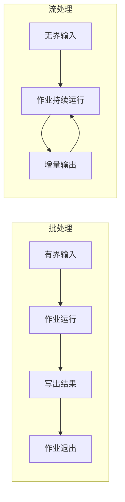
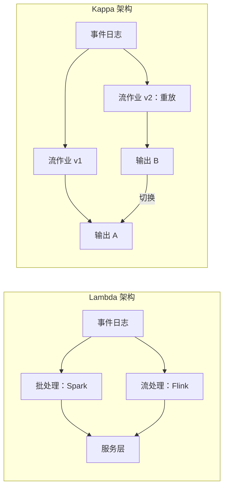
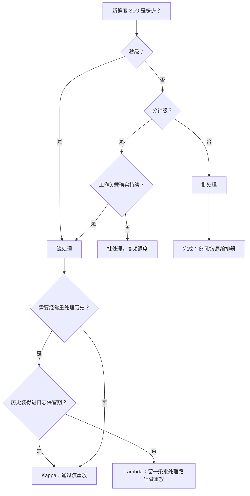

# 批处理与流处理

> **TL;DR.** 这个决策锚定在一个数字上：新鲜度 SLO。如果下游消费者能接受几小时前的结果，批处理更便宜、更简单，还会白送你 exactly-once。如果需要秒级拿到答案，流处理是唯一选项，而且这套基础设施在大规模下已经过验证：Netflix 跑着 15,000+ 个 Flink 作业，每天处理 60+ PB 数据[^1]；Uber 把数据湖的新鲜度从小时级压到分钟级，同时把计算量降低 25%[^2]。批处理并没有被淘汰。对于大量没有亚分钟新鲜度要求的尾部工作负载，它仍是正确的工具。

## 学习目标

- 从新鲜度、成本、正确性和运维复杂度四个方面对比批处理与流处理。
- 找出使选择从批处理翻转到流处理的 freshness SLO 阈值。
- 论证混合方案（Lambda 或 Kappa）的合理性，并说明各自在什么条件下失效。
- 评估做出这类选择的真实生产系统，并给出依据。

## 核心权衡

批处理处理的是有界数据集：作业启动，读完全部数据，产出结果，退出。流处理处理的是无界数据集：作业永不结束，数据一到就产出增量结果。[^3][^4] 两者的差别主要不在延迟，而在于输入是否存在已知的终点。

批处理给你廉价的正确性。作业要么整体成功，要么整体失败。对同一份输入重跑，天然幂等。编排器（Airflow、Dagster）不需要开发者操心就能处理重试。代价是硬性的新鲜度下限：每小时跑一次的作业，结果最早也要在事件发生后一小时才出来。[^2]

流处理给你廉价的新鲜度。Flink 的持续执行以内存速度交付极低的处理延迟[^5]；Spark Structured Streaming 的默认触发模式瞄准 3 到 5 秒。[^6] 代价是运维复杂度：exactly-once 需要事务型 sink[^7]，状态管理需要调优，而在 PB 级规模上把历史数据重放进流作业非常痛苦。[^8]

*批处理有天然的终点；流处理永远循环。这一点决定了成本、正确性和运维上所有下游选择。*

## 并排对比

| 维度 | 批处理 | 流处理 |
|-----------|-------|-----------|
| 新鲜度下限 | 分钟到小时（作业调度周期 + 运行时长） | 毫秒到秒（checkpoint 间隔） |
| exactly-once | 免费（重跑作业即可） | 困难（需要事务型 sink、Kafka EOS）[^7] |
| 重处理 | 便宜（在快照上重跑） | 昂贵（从 offset 0 重放，还会和线上争资源）[^8] |
| 成本形态 | 尖峰突发，两次运行之间归零 | 常年开着的稳态集群 |
| 运维复杂度 | 低（cron + 编排器） | 高（状态后端、背压、watermark） |
| 关联（join） | 在有界数据上结果确定 | 需要窗口状态或广播表 |
| 故障模式 | 作业挂了，重跑 | 状态损坏、savepoint 恢复、watermark 停滞 |

这张表在成本上会误导人。在 Uber 的规模上，按峰值容量预留的批处理在两次运行之间白白浪费资源。改成流式摄取后计算量降低 25%，因为常年开着的集群跟随真实流量，而不是按最坏情况的突发来预留。[^2] 反过来，Spotify 的 Wrapped 2020 批处理作业处理了约 1 PB 数据，成本只有此前方案的一半，因为这个工作负载确实是周期性的：一年一次活动。[^9]

实践中起决定作用的是新鲜度这一维。如果你的 SLO 是小时级，批处理在其余每一行上都赢。如果你的 SLO 是秒级，不管其余几行怎么填，流处理都赢。

## 何时选择批处理

- **新鲜度 SLO 是分钟或小时级。** 夜间报表、ML 训练、开票、合规导出、数据仓库重载。Spotify Wrapped 以批处理方式跑出了 Google Dataflow 史上最大的作业，因为一年一次的活动不需要一个 365 天都在跑的流处理集群。[^9]
- **exactly-once 很重要，而你承受不起那份复杂度。** 批处理的可重跑性写进了每个编排器。流处理的 exactly-once 需要 Kafka 事务、Flink checkpoint 和事务型 sink。[^7]
- **关联要跨大的有界数据集。** Spotify 的 Sort Merge Bucket 优化在三个数据源之间关联了约 1 PB 数据，没有走常规 shuffle，成本比他们基于 Bigtable 的方案省了约 50%。[^9]
- **需要频繁重处理。** 修 bug、改 schema、回填都很便宜：在昨天的快照上重跑作业就行。不用和线上流处理集群抢资源。

## 何时选择流处理

- **新鲜度 SLO 是秒级。** 欺诈评分、实时看板、实时特征存储、广告投放节奏控制、告警。Netflix 跑着 15,000+ 个 Flink 作业，每天处理 60+ PB 数据，服务于个性化、消息和财务场景。[^1]
- **工作负载确实是持续的。** 事件全天不断到达，没有天然的批次边界。Uber 的数据湖摄取本身就是持续的；硬拆成每小时的 Spark 批次既浪费算力，又带来几小时的过期数据。[^2]
- **要和实时参考数据做关联。** CDC 流、用缓慢变化维度做补全、实时特征存储。Flink 的 Table API 和 Samza 的本地状态模式都原生支持这类需求。[^4]
- **成本跟随流量而不是峰值。** LinkedIn 跑着 3,000+ 个 Samza 应用（截至 2018 年）[^4]，Brooklin 每天镜像 7+ 万亿条 Kafka 消息[^10]，这些常年开着的集群随实际负载伸缩。

## 混合路线

大规模生产系统大多两条路都跑。问题在于你是维护两套代码（Lambda），还是一套代码加重放（Kappa）。

**Lambda** 用一条批处理路径保正确性，用一条流处理路径保新鲜度，服务层把两者的结果并起来。它确实能用，但正如 Jay Kreps 所写，在两个系统之间维持完全一致的语义“就和看上去一样痛苦”。[^8]

**Kappa** 只跑一条流处理管道。重处理意味着部署第二个实例，从 offset 0 开始重放，然后切换过去。当日志保留期装得下全部历史时，这个方案很优雅。LinkedIn 在 2014 年就把超过 1 PB 的 Kafka 数据长期保留在线，正是为了支撑这种做法。[^8] 但在 PB 级规模上，把多年数据重放进一个 Flink 作业要花好几天，这段时间新管道还要和线上作业抢集群容量。

务实的中间路线：热路径走流处理（Flink 写到服务层），周期性跑批处理做对账并落到数仓（Spark 读 Hudi/Iceberg 快照），然后承认自己就是 Lambda 形态，但至少是诚实的 Lambda。

*Lambda 有两条路径通向服务层；Kappa 只有一条流路径，重放以并行实例的形式出现。两者都有运维成本，按重处理量来选。*

## 真实案例

**Netflix Keystone（流处理）。** 15,000+ 个 Flink 作业，每天处理 60+ PB 数据，单个作业状态最大 4 TB。[^1] 每个作业跑在独立的 Flink 集群里，一个声明式控制面持续把实际状态收敛到期望状态。Netflix 选择流处理，是因为个性化、消息和财务三个场景都要求亚秒级新鲜度。[^1]

**Uber IngestionNext（从批处理迁到流处理）。** 用 Flink 写 Apache Hudi 替换了原来的 Spark 批摄取，数据落在数据湖上。新鲜度从小时级提升到分钟级，计算成本下降 25%。行组（row-group）级别的 Parquet 合并比逐条记录合并快 10 倍以上，解决了流式摄取带来小文件噩梦。[^2]

**Spotify Wrapped（批处理）。** GCP 上跑过的最大 Dataflow 作业。[^9] Wrapped 2020 用 Sort Merge Bucket 关联了约 1 PB 数据，全程无 shuffle，成本只有此前 Bigtable 方案的一半。[^9] 一年一次的活动，不值得为它常年养一个流处理集群。

## 常见错误

> [!WARNING]
> **没有新鲜度 SLO，就为了“面向未来”上流处理。** 如果消费者一天才看一次结果，你就是在为批处理形态的工作付 7×24 的集群费用。先把 SLO 写下来。如果大于 60 分钟，批处理赢。

> [!WARNING]
> **在重放不动的 PB 级历史上用 Kappa。** 把 3 年的 Kafka 保留数据重放进一个 Flink 作业要花好几天，还会把线上作业饿死。承诺上 Kappa 之前，先模拟一次完整重放。如果实际耗时超出你的容忍度，就保留一条 Spark 重处理路径。[^8]

> [!WARNING]
> **流式摄取的小文件噩梦。** 持续提交会产生数百万个极小的 Parquet 文件，查询慢到爬。从第一天就把压实（compaction）排进调度（Hudi、Iceberg、Delta）。Uber 的行组合并比逐条记录合并快 10 倍以上。[^2]

> [!WARNING]
> **exactly-once 的表演。** Kafka EOS + Flink checkpoint 只有在 sink 是事务型时才给你 exactly-once。一次非事务的 HTTP 调用（发邮件、扣款）在重放时就把这个保证打破了。宣称 exactly-once 之前，先审计 sink。[^7][^11]

> [!WARNING]
> **Lambda 漂移。** 两套代码相隔 18 个月、由不同团队写出，会悄悄算出不同的数字。用同一份输入对两条路径做影子比对。更好的做法是：从一份 SQL 源同时生成两条路径（Flink SQL、Beam）。[^8]

## 决策清单

*从新鲜度 SLO 开始。其余一切都是这一个数字的下游。*

- [ ] 真实的新鲜度 SLO 是多少？秒级 = 流处理。分钟到小时 = 批处理。
- [ ] 完整重放一遍历史有多贵？承诺上 Kappa 之前先测实际耗时。
- [ ] sink 支持事务吗？不支持的话，不管框架怎么配，你都没有 exactly-once。
- [ ] 工作负载是真正持续的，还是周期性的、只是没有天然的批次边界？
- [ ] 关联的对象是有界快照，还是实时无界流？
- [ ] 你的团队能运维有状态流处理吗（checkpoint、背压、状态 TTL）？
- [ ] 你现在是不是在维护两套代码，这份痛值不值得那份正确性保证？

## 要点回顾

- 新鲜度 SLO 是首要决策维度，其余都在它下游。
- 批处理没有被淘汰。在周期性工作负载上它更便宜、更简单，还白送 exactly-once。
- 当新鲜度以秒计、且工作负载确实持续时，流处理赢。
- Kappa 在中等规模下很优雅；到了 PB 级历史，重放就变成一次多天的批处理操作，不管你叫不叫它批处理。
- 大规模生产系统大多是 Lambda 形态，哪怕它们不用这个名字。

## 延伸阅读

- [Questioning the Lambda Architecture](https://www.oreilly.com/radar/questioning-the-lambda-architecture/) by Jay Kreps (2014)：Kappa 的奠基性论证，做这个决策的必读。
- [Accelerating Data Freshness in Uber's Data Lake](https://www.uber.com/blog/from-batch-to-streaming-accelerating-data-freshness-in-ubers-data-lake/)：近年最干净的批转流迁移记录，带具体的成本和新鲜度数字。
- [How Spotify Optimized the Largest Dataflow Job Ever for Wrapped 2020](https://engineering.atspotify.com/2021/2/how-spotify-optimized-the-largest-dataflow-job-ever-for-wrapped-2020)：PB 级批处理加上 Sort Merge Bucket 关联。
- [Building a Scalable Flink Platform: 15,000 Jobs at Netflix](https://current.confluent.io/2024-sessions/building-a-scalable-flink-platform-a-tale-of-15-000-jobs-at-netflix)：每天 60 PB 的 Flink；大规模流处理的运维模型。
- [Real-Time Exactly-Once Ad Event Processing](https://www.uber.com/en-GB/blog/real-time-exactly-once-ad-event-processing/)（Uber，2021）：用 Flink、Kafka 和 Pinot 搭 exactly-once 流管道的标准范例。
- [Samza 1.0: Stream Processing at Massive Scale](https://engineering.linkedin.com/blog/2018/11/samza-1-0--stream-processing-at-massive-scale)（LinkedIn，2018）：3,000+ 个流处理应用与本地状态模式。

## 记忆卡片

<strong>问：哪一个指标最能决定用批处理还是流处理？</strong>

答：新鲜度 SLO。如果消费者需要秒级拿到结果，用流处理。如果能接受分钟到小时级，批处理更简单也更便宜。

<strong>问：为什么 exactly-once 在批处理里是“免费”的，在流处理里却很难？</strong>

答：批处理作业要么整体成功要么整体失败，对同一份输入重跑是幂等的。流处理的 exactly-once 需要一组协同的原语：Kafka 事务、Flink checkpoint 和事务型 sink。

<strong>问：Kappa 架构在什么情况下失效？</strong>

答：当历史数据到 PB 级时。把多年数据重放进一个流作业要花好几天，还会和线上作业抢集群容量。到那一步，一条 Spark 批处理重处理路径更快也更便宜。

<strong>问：流式摄取里的“小文件噩梦”是什么？</strong>

答：持续提交在数据湖上产生数百万个极小的 Parquet 文件。查询性能下滑，元数据操作成了成本大头。解法是把压实排进调度（Hudi、Iceberg、Delta）。

<strong>问：Uber 为什么把数据湖摄取从批处理换成流处理？</strong>

答：新鲜度从小时级提升到分钟级，同时计算成本下降 25%，因为流处理集群跟随真实流量，而不是按峰值突发量预留容量。

<strong>问：Spotify 明明有流处理基础设施，为什么 Wrapped 仍然用批处理？</strong>

答：Wrapped 是一年一次的活动。为了一天的产出常年养 365 天的流处理集群是浪费。批处理处理约 1 PB 数据，成本只有此前方案的一半。

<strong>问：即使开了 Kafka EOS，流管道里的什么还会打破“exactly-once”？</strong>

答：非事务型的 sink（HTTP 调用、发邮件、支付 API）。exactly-once 只覆盖读-处理-写这个环，且前提是所有参与者都支持事务或幂等键。

<strong>问：纯 Lambda 和纯 Kappa 之间务实的中间路线是什么？</strong>

答：热路径走流处理（Flink 到服务层）保新鲜度，周期性跑批处理对账（Spark 读 Hudi/Iceberg）保正确性和重处理能力。承认自己是 Lambda 形态，但事件日志里只有一份事实来源。

## 参考文献

[^1]: Mark Cho and Mingliang Liu, "Building a Scalable Flink Platform: A Tale of 15,000 Jobs at Netflix," Current 2024. https://current.confluent.io/2024-sessions/building-a-scalable-flink-platform-a-tale-of-15-000-jobs-at-netflix
[^2]: Uber Engineering, "From Batch to Streaming: Accelerating Data Freshness in Uber's Data Lake," December 11, 2025. https://www.uber.com/blog/from-batch-to-streaming-accelerating-data-freshness-in-ubers-data-lake/
[^3]: Dean and Ghemawat, "MapReduce: Simplified Data Processing on Large Clusters," OSDI 2004. https://research.google/pubs/mapreduce-simplified-data-processing-on-large-clusters/
[^4]: Jagadish Venkatraman, "Samza 1.0: Stream Processing at Massive Scale," LinkedIn Engineering, 2018. https://engineering.linkedin.com/blog/2018/11/samza-1-0--stream-processing-at-massive-scale
[^5]: Apache Flink, "What is Apache Flink?: Architecture," flink.apache.org. https://flink.apache.org/what-is-flink/flink-architecture/
[^6]: Databricks, "Configure Structured Streaming trigger intervals," Databricks Docs, 2026. https://docs.databricks.com/aws/structured-streaming/triggers
[^7]: Neha Narkhede, Guozhang Wang, and Confluent Staff, "Exactly-Once Semantics Are Possible: Here's How Apache Kafka Does It," Confluent Blog, 2017. https://www.confluent.io/blog/exactly-once-semantics-are-possible-heres-how-apache-kafka-does-it/
[^8]: Jay Kreps, "Questioning the Lambda Architecture," O'Reilly Radar, July 2014. https://www.oreilly.com/radar/questioning-the-lambda-architecture/
[^9]: Li, McGinty, Nallapareddy, and Ostlund, "How Spotify Optimized the Largest Dataflow Job Ever for Wrapped 2020," Spotify Engineering, 2021. https://engineering.atspotify.com/2021/2/how-spotify-optimized-the-largest-dataflow-job-ever-for-wrapped-2020
[^10]: Vaibhav Maheshwari, "Load-balanced Brooklin Mirror Maker: Replicating large-scale Kafka clusters at LinkedIn," LinkedIn Engineering, 2022. https://engineering.linkedin.com/blog/2022/load-balanced-brooklin-mirror-maker--replicating-large-scale-kaf
[^11]: Uber Engineering, "Real-Time Exactly-Once Ad Event Processing with Apache Flink, Kafka, and Pinot," 2021. https://www.uber.com/en-GB/blog/real-time-exactly-once-ad-event-processing/
