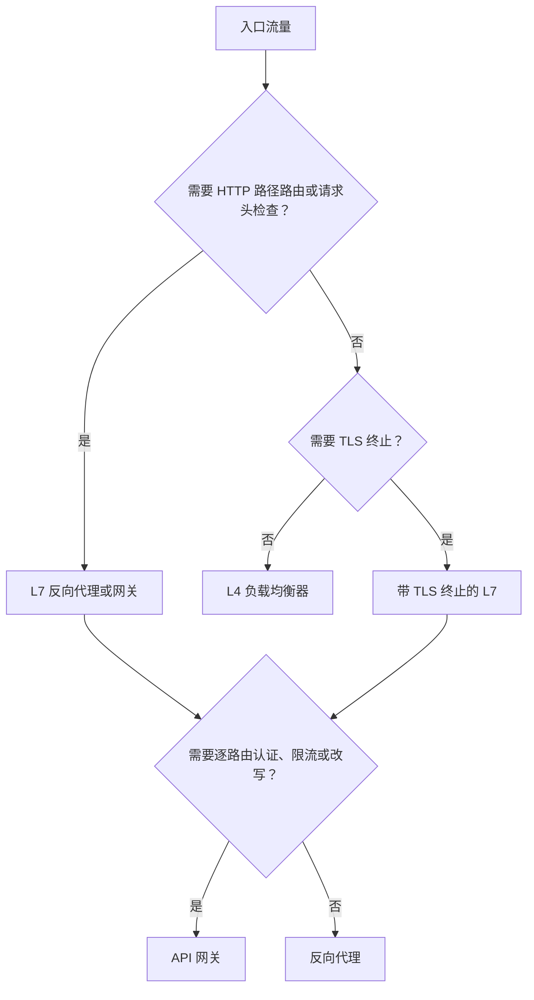

# 负载均衡器 vs 反向代理 vs API 网关

> **TL;DR.** 这三者在实现上高度重叠（NGINX、Envoy、HAProxy 都能扮演任意一个角色），但意图不同。负载均衡器以亚毫秒级开销把连接分发到相同的副本上[^1]。反向代理在 HTTP 层终止 TLS、做压缩、做缓冲。API 网关再往上加逐路由策略：认证、限流、请求改写，代价是 p99 大约 5-9 ms 的额外开销[^2]。默认方案是一片云上 L4 负载均衡器加一层轻量反向代理。只有当你要在 10 个以上服务前对每个消费者施加策略时，才引入网关。

## 学习目标

- 从延迟、可见性和运维成本三个维度比较 L4 负载均衡器、L7 反向代理和 API 网关。
- 识别哪些负载特征会让某一层成为必需，哪些会让它变得冗余。
- 为生产环境的边缘层论证混合分层（L4 + 网关 + 服务网格）的合理性。
- 剖析真实系统（Cloudflare Unimog、Netflix Zuul、HAProxy）并解释它们的架构取舍。

## 核心权衡

根本矛盾是**可见性与速度之争**。L4 负载均衡器只看得到五元组（源 IP、源端口、目的 IP、目的端口、协议），它通过 XDP/eBPF 在内核态转发数据包，CPU 开销不到 1%[^1]。反向代理要终止 TLS、解析 HTTP 头、按请求做路由决策，在饱和状态下会增加约 400 微秒[^3]。API 网关对每个请求执行一条过滤器链（认证、限流、改写），p99 增加约 5-9 ms[^2]。极端情况下，服务网格的 sidecar 在一次服务间调用中，两端 sidecar 加起来贡献约 2.65 ms 的 P90 开销（Istio 1.10）[^4]，也就是说每一跳大约占其中一半[^5]。

沿着调用栈每上升一层，表达能力更强，但要在延迟、CPU 和故障面上付出代价。选错的症状有两种：要么重新实现正确工具本来就提供的功能，要么为永远用不到的功能付费。

第二个矛盾是**爆炸半径**。L4 负载均衡器故障会断开连接，但它没有应用状态可以被弄坏。配置错误的 API 网关则是它身后每一条路由的单点故障，限流插件里一个写坏的正则就能打掉你整个对外 API 面。

*每一层都在用延迟换取可见性和策略能力；用不到的层就跳过。*

## 逐项对比

| 维度 | L4 负载均衡器 | 反向代理 | API 网关 |
|-----------|-----------------|---------------|-------------|
| 新增延迟 | 亚毫秒级[^1] | 饱和时约 400 us[^3] | p99 5-9 ms[^2] |
| 吞吐上限 | 单台 AWS NLB 3M+ RPS[^6] | 2M RPS（HAProxy HTTP 模式，64 核 Graviton2）[^3] | 每节点约 100-140K RPS[^2] |
| 协议可见性 | 仅 IP + 端口 | 完整 HTTP 头、路径、方法 | HTTP + 请求体 + 认证上下文 |
| TLS 终止 | 否（透传） | 是 | 是 |
| 逐路由认证 | 否 | 否（仅基础 IP ACL） | 是（JWT、API key、OAuth） |
| gRPC/HTTP2 负载均衡 | 仅按连接[^3] | 按流 | 按流 + 策略 |
| 运维复杂度 | 低（无状态转发） | 中（证书轮换、配置） | 高（带数据库的控制面） |
| 故障爆炸半径 | 断连接 | 丢请求、泄露请求头 | 阻断全部 API 路由 |

这张表有一个维度会误导人：**吞吐上限**。网关每节点 10 万 RPS 听起来很低，但你很少需要给每个请求都套上网关级策略。L4 负载均衡器负责吸收 DDoS 并做分发，只有被路由过来的流量才会打到网关。实践中，只要别把网关放在本该放 L4 负载均衡器的位置，它就不会成为你的吞吐瓶颈。

面试里真正起决定作用的是另一个维度：**gRPC**。L4 负载均衡器没法给 gRPC 流做均衡，因为 HTTP/2 把多个 RPC 复用在同一条 TCP 连接上，于是某一个后端吃下全部负载[^3]。仅凭这一点，任何 gRPC 密集的架构都必须上 L7。

## 何时选择负载均衡器

以下情况用纯 L4 负载均衡器：

- **流量是 TCP/UDP，你只需要原始分发。** 数据库连接、Redis 集群、DNS、游戏服务器。AWS NLB 在 30 Gbps 下能扛 3M+ RPS，还原生保留源 IP[^6]。
- **DDoS 吸收是首要关切。** Cloudflare 在 335+ 个城市的每一台服务器上都跑 Unimog；同一条 XDP 链上的 L4drop 在流量进入应用代码之前就把洪水攻击吸收掉[^1][^7]。
- **你需要能持续数小时乃至数天的连接。** VPN 隧道、WebSocket 透传、Cloudflare Spectrum。L4 保留端到端的 TCP 会话[^1]。
- **亚毫秒级开销是硬要求。** 对延迟敏感的交易系统、实时竞价、集群内东西向流量，每一微秒都要算。L4 上的轮询（Round Robin）是按新连接算的，不是按请求算的[^8]。

## 何时选择 API 网关

以下情况用 API 网关：

- **服务很多，对外只有一个域名。** 你有 10 个以上微服务挂在 `api.example.com` 后面，需要逐路由的认证、限流和版本管理。这正是网关的天然栖息地[^9]。
- **按消费者施加策略是业务需求。** API key、用量套餐、按租户限流、开发者门户。Netflix 把所有外部流量都过一遍 Zuul，原因就在这里[^9]。
- **需要请求改写或协议桥接。** REST 转 gRPC、GraphQL 联邦、跨多个上游聚合响应。
- **你在把 API 当产品卖。** Stripe、Twilio 以及每一家 API 优先的公司都跑着一个网关，做用量计量、配额执行和密钥管理。

反向代理够用的时候，别去动网关。Kong 即使一个插件都不装，仍会带来约 5 ms 的 p99 开销[^2]。如果你只有一个服务，只需要 TLS 终止和路径重写，NGINX 或 Caddy 在延迟和运维上都更便宜。

## 混合分层方案

大多数生产系统把这三层叠起来，各管一摊：

1. **云上 L4 负载均衡器**（NLB、Unimog）：吸收 DDoS、按健康状态分发、保留源 IP。
2. **API 网关**（Kong、Envoy Gateway、Zuul）：逐路由认证、限流、请求改写。
3. **服务网格 sidecar**（Envoy via Istio）：东西向 mTLS、重试、熔断、遥测。

每一层只负责一件事。反模式是不带职责划分地往上叠：NLB 之后接 ALB，再接 NGINX，再接 Envoy sidecar，每一跳加 1-3 ms。如果你的分布式追踪显示代理跳转吃掉了端到端延迟的 20% 以上，说明有冗余层。

对于网格原生的应用，Istio 的 Gateway API 可以取代独立的 ingress NGINX[^10]。如果你已经在跑网格，先评估网格入口能不能替掉你那个独立网关，再决定要不要多加一跳。

*典型的生产边缘：L4 负责分发，网关负责策略，网格负责东西向安全。每一层只干一件事。*

## 真实案例

**Cloudflare Unimog（L4）。** Cloudflare 在 335+ 个城市网络里的每一台服务器都充当负载均衡器[^7]。一段 XDP/eBPF 程序对四元组做哈希，查一张转发表，再把数据包用 GUE 封装后送到选定的后端。CPU 开销：不到 1%[^1]。这套系统通过双槽菊花链（每个桶里存当前 DIP 和上一个 DIP）支持持续数天的连接。一个叫 conductor 的控制面读取 Prometheus 指标并调整桶的数量，让不同代际的服务器收敛到相同的利用率[^1]。

**Netflix Zuul 2（API 网关）。** 所有外部 API 流量（2016 年那篇博客发布时有 8300 万+ 会员）都经过 Zuul 集群[^9]。Zuul 1 用 Servlet 模型，一条连接一个线程。Zuul 2 用 Netty 重写，为的是支撑设备的长连接，在日志繁重的集群上拿到约 25% 的吞吐提升。Netflix 说得很直白：“迁移到异步并没有让我们看到显著的效率收益”[^9]。真正的收益是连接规模，不是 CPU。过滤器是可热加载的 Groovy 脚本，Netflix 因此能在几分钟内把路由逻辑更新到数千台主机上[^9]。

**HAProxy（反向代理基准测试）。** 在一台 64 核 AWS Graviton2 实例上，HAProxy 2.3 在 HTTP 模式下转发 2.04M RPS，平均延迟增加约 400 微秒。加上 TLS 1.3（RSA-2048）：1.99-2.01M RPS，约 413 微秒[^3]。Envoy 的 P2C（Power of Two Choices）算法随机挑两台主机，路由到负载较轻的那台，以 O(1) 的代价拿到接近最优的分布[^11]。这份基准测试证明：单个反向代理节点能扛的流量，比大多数公司这辈子见到的都多。

## 常见错误

> [!WARNING]
> **为一个服务上 API 网关。** 如果你只有一个后端，只需要 TLS 终止，那你是在为用不到的功能付 p99 约 5-9 ms 的代价，还额外运维一套带数据库的控制面[^2]。用 NGINX 或 Caddy 就好。

> [!WARNING]
> **用 L4 给 gRPC 流量做均衡。** HTTP/2 把多条流复用在一条 TCP 连接上。L4 负载均衡器会把所有流钉在同一个后端上，造成极端不均[^3]。用能看懂 HTTP/2 帧的 L7 均衡器。

> [!WARNING]
> **不带职责划分地叠代理。** 一条请求路径上 NLB + ALB + NGINX + Envoy sidecar。每一跳加 1-3 ms。给每层分配一个明确职责，把冗余的 L7 代理删掉。

> [!WARNING]
> **为 3 个服务跑服务网格。** Istio sidecar 每 pod 每 1000 RPS 消耗约 0.20 vCPU 和约 60 MB 内存[^5]（ambient 模式下用 ztunnel 能降到约 0.06 vCPU）。只有 3 个服务时，网格引入的故障模式比它解决的问题还多[^10]。先用库级别的重试和一个普通 ingress 网关，等到你有 20 个以上异构语言的服务再说。

## 决策清单

- [ ] 主要需求是“分发到相同的副本”（L4），还是“逐路由策略”（网关）？
- [ ] 协议是否需要 HTTP 级别的可见性（gRPC、路径路由、请求头检查）？
- [ ] 是否需要按消费者认证、API key 或用量套餐？
- [ ] TLS 是在边缘终止、端到端保持，还是通过网格 mTLS 重新加密？
- [ ] 这个入口后面有多少个不同的服务？（1-3 个：代理。10 个以上：网关。）
- [ ] 你的分布式追踪是否显示代理跳转占用了 15% 以上的端到端延迟？

*从你需要的协议和功能出发，答案会自己浮出来，没有含糊余地。*

## 要点回顾

- L4 负载均衡器的开销是亚毫秒级，能扛数百万 RPS，但对 HTTP 语义一无所知。
- 反向代理为 TLS 终止、压缩和按请求路由付出约 400 微秒。
- API 网关为认证、限流和改写付出 p99 约 5-9 ms；只有逐路由策略值这个价时才用。
- gRPC 和 HTTP/2 逼着你上 L7 均衡，因为 L4 无法分发复用流。
- 生产默认形态是：L4 负责分发，网关负责策略，网格负责东西向 mTLS。任何不承担独立职责的层都删掉。

## 延伸阅读

- [Cloudflare Unimog](https://blog.cloudflare.com/unimog-cloudflares-edge-load-balancer/)：目前公开资料里最详细的生产级 L4 负载均衡器剖析，它通过 XDP/eBPF 跑在每一台服务器上。
- [Netflix Zuul 2: Journey to Asynchronous, Non-Blocking Systems](https://netflixtechblog.com/zuul-2-the-netflix-journey-to-asynchronous-non-blocking-systems-45947377fb5c)：诚实的迁移后复盘；重点看“异步并没有替我们省下 CPU”这个结论。
- [HAProxy Forwards Over 2M RPS on Graviton2](https://www.haproxy.com/blog/haproxy-forwards-over-2-million-http-requests-per-second-on-a-single-aws-arm-instance/)：它的基准测试方法论是关于“如何正确跑代理基准”最好的实践参考。
- [Envoy Supported Load Balancers](https://www.envoyproxy.io/docs/envoy/latest/intro/arch_overview/upstream/load_balancing/load_balancers)：P2C、Ring Hash、Maglev 以及各种加权变体的权威参考。
- [Kong Gateway Performance Benchmarks](https://docs.konghq.com/gateway/latest/how-kong-works/performance-testing)：可复现的 RPS 与 p99 数据，按插件配置分组，适合给网关做容量规划。
- [Istio Performance and Scalability](https://istio.io/latest/docs/ops/deployment/performance-and-scalability/)：各版本 sidecar 的 CPU、内存和延迟数据。

## 记忆卡片

<strong>Q: Cloudflare 的 L4 负载均衡器（Unimog）CPU 开销是多少？</strong>

A: 相比不部署负载均衡器，处理器占用不到 1%，靠的是内核态里的 XDP/eBPF 数据包转发。

<strong>Q: 为什么 L4 负载均衡器无法有效均衡 gRPC 流量？</strong>

A: gRPC 把多条流复用在同一条 HTTP/2 TCP 连接上。L4 按连接均衡，所以一个客户端的所有流都被钉在同一个后端。必须用按流均衡的 L7。

<strong>Q: API 网关（Kong）挂上限流和 key-auth 插件后会带来多少延迟？</strong>

A: 在 c5.4xlarge 实例、约 100K RPS 下，p99 大约 8-9 ms。即使不装任何插件，也要多出约 5 ms 的 p99。

<strong>Q: 典型的生产混合边缘栈长什么样？</strong>

A: 云上 L4 负载均衡器（吸收 DDoS、按健康状态分发）→ API 网关（认证、限流、路由）→ 服务网格 sidecar（mTLS、重试、遥测）。每一层只承担一个独立职责。

<strong>Q: 一个 Istio Envoy sidecar 每个 pod 带来多少开销？</strong>

A: 在 1000 RPS、1 KB 负载下约 0.20 vCPU 和 60 MB 内存（Istio 1.24）。ambient 模式配合 ztunnel 可降到约 0.06 vCPU。

<strong>Q: 什么时候不该用 API 网关？</strong>

A: 当你只有一个服务，且只需要 TLS 终止和路径重写时。反向代理（NGINX、Caddy）的延迟和运维成本都低于一套带数据库的网关控制面。

<strong>Q: HAProxy 在单台 64 核 Graviton2 实例上达到多少吞吐？</strong>

A: 明文模式下 204 万 HTTP RPS；加上 TLS 1.3 终止后是 199-201 万 RPS，平均延迟增加约 400-413 微秒。

## 参考文献

[^1]: David Wragg, "Unimog - Cloudflare's edge load balancer," Cloudflare blog, 2020. https://blog.cloudflare.com/unimog-cloudflares-edge-load-balancer/
[^2]: Kong Inc., "Kong Gateway performance testing benchmarks." https://docs.konghq.com/gateway/latest/how-kong-works/performance-testing/
[^3]: Willy Tarreau, "HAProxy Forwards Over 2 Million HTTP Requests per Second on a Single Arm-based AWS Graviton2 Instance," HAProxy Technologies, 2021. https://www.haproxy.com/blog/haproxy-forwards-over-2-million-http-requests-per-second-on-a-single-aws-arm-instance/
[^4]: Istio project, "Performance and Scalability (Istio 1.10)." https://istio.io/v1.10/docs/ops/deployment/performance-and-scalability/
[^5]: Istio project, "Performance and Scalability" (Istio 1.24 data, current docs). https://istio.io/latest/docs/ops/deployment/performance-and-scalability/
[^6]: Jeff Barr, "New Network Load Balancer - Effortless Scaling to Millions of Requests per Second," AWS News Blog, 2017. https://aws.amazon.com/blogs/aws/new-network-load-balancer-effortless-scaling-to-millions-of-requests-per-second/
[^7]: Cloudflare, "Connectivity cloud services" (accessed 2026-05-08): "services built to run in every location in our 335 city cloud network." https://www.cloudflare.com/connectivity-cloud/
[^8]: AWS, "What is a Network Load Balancer?" (NLB documentation): "Each individual TCP connection is routed to a single target for the life of the connection." https://docs.aws.amazon.com/elasticloadbalancing/latest/network/introduction.html
[^9]: Netflix Cloud Gateway Team, "Zuul 2: The Netflix Journey to Asynchronous, Non-Blocking Systems," 2016. https://netflixtechblog.com/zuul-2-the-netflix-journey-to-asynchronous-non-blocking-systems-45947377fb5c
[^10]: Mateusz Prokopowicz, "Why you should NOT use Service Mesh," Google Cloud Medium, 2023. https://medium.com/google-cloud/when-not-to-use-service-mesh-1a44abdeea31
[^11]: Envoy project, "Supported load balancers" (architecture overview, current docs). https://www.envoyproxy.io/docs/envoy/latest/intro/arch_overview/upstream/load_balancing/load_balancers
