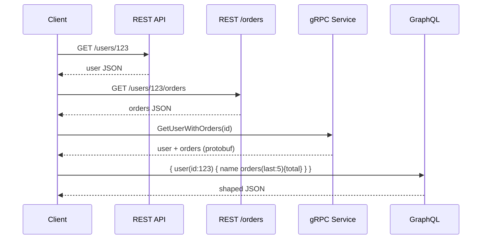
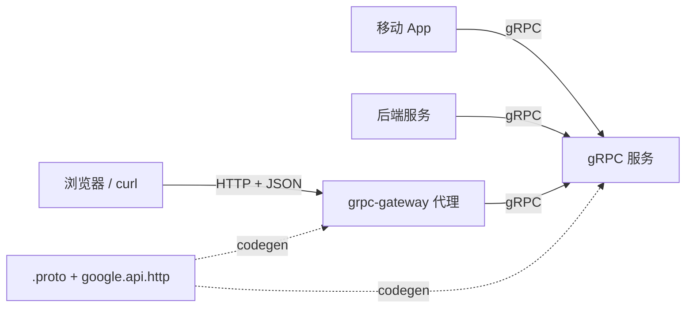
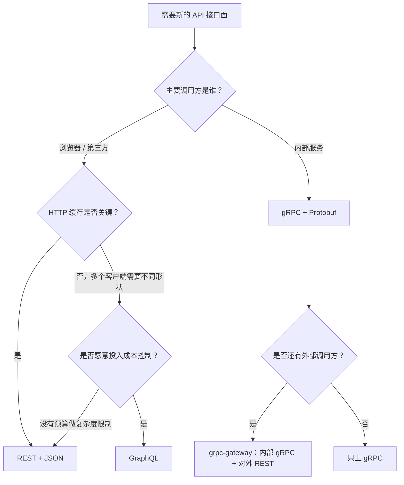

# REST vs gRPC vs GraphQL

> **TL;DR.** 这个决策真正的变量是：谁在调用你的 API，以及他们需要什么形状的数据。面向公众、面向浏览器、可被 HTTP 缓存的接口面，REST 胜出。内部服务间调用关注延迟（最高比 REST 低 77%[^1]）、严格类型和流式传输时，gRPC 胜出。当多个客户端需要同一张图的不同子集、且前端迭代速度比后端快时，GraphQL 胜出。成熟的系统大多跑混合架构：内部 gRPC，对外 REST 或 GraphQL。

## 学习目标

- 从延迟、可缓存性、类型约束和浏览器可达性四个维度对比 REST、gRPC 与 GraphQL。
- 识别哪些调用方特征决定了哪种协议会胜出。
- 论证一种混合架构：从同一套服务层同时暴露多个接口面。
- 评估 GraphQL 在规模化运行时必须配备的成本控制机制（查询复杂度、限流）。

## 核心权衡

三种协议，对“谁来承担契约的成本”给出三种不同的答案。

REST 把成本推给客户端：解析 JSON、忽略用不到的字段、为嵌套资源发多次往返。gRPC 把成本推进一个 `.proto` 文件，双方都从它生成代码，于是接口漂移变成编译错误，而不是运行时的意外[^2]。GraphQL 把成本推给服务端：服务端必须高效地解析任意字段组合，还要防住那些写起来便宜、执行起来昂贵的查询[^3][^4]。

第二个维度是传输。REST 可以跑在任何 HTTP 版本上。gRPC 需要端到端的 HTTP/2，才能提供多路复用的流和 trailer，而浏览器刻意不暴露这些能力[^5]。GraphQL 跑在 `POST /graphql` 上，除非额外加一层复杂度，否则按 URL 缓存的 HTTP 语义直接被废掉[^6]。

第三个维度是工具链。REST 开箱就有 `curl`、浏览器 DevTools 和 CDN 缓存。gRPC 需要专门的客户端（`grpcurl`），而且它的二进制线格式在 Chrome DevTools 里是一团黑箱[^5]。GraphQL 有 introspection 和 GraphiQL，但默认没有 HTTP 缓存这条路。

*REST 要拿到“用户加订单”需要两次往返；gRPC 和 GraphQL 都把它压缩成一次，但机制不同（有类型的 RPC 调用 vs 客户端自定义形状的查询）。*

## 逐项对比

| 维度 | REST | gRPC | GraphQL |
|---|---|---|---|
| 线格式 | JSON（文本） | Protobuf（二进制，体积最多小 10 倍[^1]） | JSON（文本） |
| 传输 | HTTP/1.1 或 HTTP/2 | 必须 HTTP/2 | HTTP POST（任意版本） |
| 浏览器支持 | 原生 | 需要 grpc-web 代理[^5] | 原生（单一端点） |
| HTTP 缓存 | 动词 + URL + ETag，可与 CDN 组合[^7] | 不适用 | 被 POST 请求体废掉[^6] |
| 类型约束 | 约定（OpenAPI 可选） | 由 `.proto` 代码生成强制[^2] | 带 introspection 的 schema |
| 流式传输 | 外挂方案（SSE、WebSocket） | 一等公民（4 种模式）[^8] | 订阅（能力有限） |
| 延迟 | 基准线 | 小负载下最多低 77%[^1] | 取决于 resolver 的嵌套深度 |
| 失效模式 | 过度获取、N+1 次往返 | 对浏览器不友好、错误信息不透明 | N+1 查询、成本爆炸[^3] |

这张表在“延迟”一栏有误导性。77% 这个数字针对的是序列化开销占主导的小负载，而且来自对多份基准测试的二次汇总[^1]。负载变大后，差距收窄到大约 2 倍的吞吐量优势[^9]。实践中真正起决定性作用的维度是**调用方身份**：浏览器说不了原生 gRPC，CDN 也缓存不了 GraphQL 的 POST 请求体。

## 何时选择 REST

- **面向第三方集成方的公开 API。** JSON over HTTP 是所有人都看得懂的约定。`curl` 能用。每种语言都有 HTTP 客户端。Stripe 整套支付 API 就建在带幂等键的 REST 之上[^10]。
- **HTTP 缓存是你性能策略的一部分。** REST 的动词 + URL + ETag 模型可以和 CDN、反向代理、浏览器缓存干净地组合[^7]。GraphQL 与这套机制对抗；gRPC 根本进不了这个体系。
- **操作是资源导向、CRUD 形状的。** `/users/123/orders` 能干净地映射到 HTTP 动词上。不需要复杂的 RPC 语义。
- **可调试性比线格式效率更重要。** Chrome DevTools、Postman、`curl` 全都能用，不需要代码生成或代理层。

用游标分页（Stripe 每页上限 100 条[^11]），并在所有写操作的端点上支持 `Idempotency-Key` 头，REST 才算能在生产环境放心用。

## 何时选择 gRPC

- **内部服务间调用，且对延迟敏感。** 在独立基准测试中，Protobuf over HTTP/2 在小负载上的吞吐量比 REST 高大约 2 倍[^9]。Google 在内部跑了十多年它的前身（Stubby），2015 年才把 gRPC 开源[^8]。
- **流式传输是一等需求。** 服务端流、客户端流和双向流都内建在 RPC 模型里。REST 得靠外挂 WebSocket 或 SSE 才能做到。
- **多语言服务，且版本管理要严格。** Protobuf 的向后兼容规则（保留字段号、可选字段）由代码生成强制。schema 漂移会变成编译错误，而不是生产事故[^2]。
- **你接受浏览器的限制。** grpc-web 加一个翻译代理（带 `grpc_web` filter 的 Envoy）能支持一元调用，但从浏览器里会丢掉客户端流和双向流[^5]。

## 何时选择 GraphQL

- **多个客户端需要同一张图的不同子集。** 移动端只要 5 个字段，Web 端要 30 个，管理后台要嵌套关联。一个端点，各自定制查询。GitHub 的迁移文档里，一个 PR 加提交、加评论、加评审，从四次 REST GET 塌缩成一次 GraphQL 查询[^2]。
- **前端迭代速度比后端快。** 查询形状由前端定义；后端不必为每个 UI 单独发一个端点。
- **你愿意投入成本控制。** 没有查询复杂度上限，单个请求就能把服务端耗尽[^4]。Shopify 的规则是 100 点/秒、桶容量 1,000 点，写操作每次扣 10 点[^12]。GitHub 的上限是 5,000 点/小时、单次调用最多 500,000 个节点，外加硬性 10 秒超时[^13]。

## 混合路线

规模化的生产系统大多在同一套服务层上跑多种协议。两种模式最主流：

**模式 A：内部 gRPC，对外经 grpc-gateway 走 REST。** 在一个 `.proto` 文件里用 `google.api.http` 规则打上注解，代码生成会同时产出 gRPC 服务和 REST-JSON 反向代理[^14]。内部调用方走 gRPC 拿速度，外部调用方走 REST 拿浏览器兼容性。grpc-gateway 自 2018 年起在生产环境每天承载数百万次 API 请求[^15]。

**模式 B：GraphQL 联邦作为 BFF，架在 gRPC/REST 微服务之上。** 一个网关把众多领域图服务（Domain Graph Service，DGS）组合成一张超图（supergraph）。Netflix 的 Studio Edge 就是这个模式：数百名工程师每天向联邦 schema 提交改动，每个 DGS 拥有自己的子图，网关以多区域部署，并按功能分片（查询、写操作、订阅分别跑在不同的机器池上）[^16]。

*一个 `.proto` 文件同时生成两个接口面：内部调用方拿到 gRPC 的速度，外部调用方拿到 REST 的兼容性，而契约只存在一处。*

## 真实案例

**Netflix Studio Edge（联邦 GraphQL，2020）。** 数百名工程师共同向一张联邦 schema 贡献内容[^16][^17]。截至 2025 年，Netflix 在全球服务的付费订阅用户超过 3.25 亿[^18]。网关是单一职责、无状态、带需求控制的（在执行前就拒掉昂贵的查询），并且按功能分片。schema 优先的设计把 GraphQL schema 与底层 protobuf 解耦，于是图的形状由 UI 需求驱动，而不是由存储 schema 驱动[^16]。

**Stripe（带幂等的 REST，2017）。** 每个写操作端点都接受 `Idempotency-Key` 头。首次收到时，服务端处理并把“键到结果”的映射存下来；重复收到时，直接返回缓存的结果，不再处理一遍[^10]。游标分页用不透明的 `starting_after`/`ending_before` 游标，在并发插入时依然稳定[^11]。

**GitHub（REST v3 + GraphQL v4 并存）。** 简单的可缓存读取仍推荐 REST；定制化的数据形状用 GraphQL。限流是按成本算的：一次请求 100 个仓库、每个仓库 50 个 issue、每个 issue 60 个 label，计费 51 点（而不是 1 次请求）[^13]。两个接口面并存，因为各自优化的调用方不同。

## 常见错误

> [!WARNING]
> **在浏览器里不经 grpc-web 直接调 gRPC。** 浏览器不暴露 HTTP/2 trailer，也不给你帧级控制权。对 gRPC 端点发一个 `fetch()`，拿回来的是 HTTP 200 加一团不透明二进制，没有任何可用的状态码。你需要一个懂 grpc-web 的代理（Envoy、Connect-RPC），并且必须接受丢掉双向流[^5]。

> [!WARNING]
> **上 GraphQL 却不设查询复杂度上限。** 一个深嵌套的查询会扇出到成千上万行数据。GitLab CVE-2025-8014 和 Mercurius CVE-2026-30241 就是公开案例：未认证用户绕过复杂度限制，把资源耗光[^4]。成本上限要在执行前就生效。

> [!WARNING]
> **无视 GraphQL resolver 里的 N+1 问题。** 查 10 篇文章及其作者，默认会打 11 次数据库。用 DataLoader 在同一个请求的 tick 内做批量和合并查询，把 1+N 压到 2 次[^3][^19]。每个请求一个 DataLoader 实例；绝不要跨请求共享。

> [!WARNING]
> **REST 的 POST 不配幂等键。** 移动端在超时后重试一次支付，用户被扣两次钱。每个写操作端点都要接受 `Idempotency-Key` 头。Stripe 把这称作“解决故障导致的分布式状态不一致最省事的办法”[^10]。

## 决策清单

- [ ] 主要调用方是谁：浏览器、移动 App、另一个后端，还是第三方开发者？
- [ ] HTTP 缓存（CDN、浏览器、反向代理）是不是你延迟策略的一部分？
- [ ] 客户端需要大对象的一个子集，还是整个对象？
- [ ] 需要双向流吗？
- [ ] 如果选 GraphQL，你能否落实查询成本上限和 DataLoader？
- [ ] 你既需要内部的速度、又需要外部的可达性吗？（走混合路线）

*从调用方身份出发。内部调用方给 gRPC。外部调用方给 REST，除非多个客户端需要不同形状、且你愿意投入成本控制，那就给 GraphQL。*

## 要点回顾

- 决策的轴心是调用方身份，不是协议特性。浏览器说不了原生 gRPC；CDN 缓存不了 GraphQL 的 POST 请求体。
- 在小消息上，gRPC 的延迟最多比 REST+JSON 低 77%，负载体积小 10 倍[^1]，但这只对不涉及浏览器的内部链路有意义。
- GraphQL 把 N 次 REST 往返塌缩成一次查询，但要安全地规模化运行，必须配上 DataLoader、成本上限和网关加固。
- 混合路线（内部 gRPC，对外 REST 或 GraphQL）是大系统的预期终点，而不是什么猎奇选择。
- 每个 REST POST 端点都需要幂等键。每个 GraphQL 端点都需要成本预算。这两件事都不是可选项。

## 延伸阅读

- [Designing robust and predictable APIs with idempotency (Stripe, 2017)](https://stripe.com/blog/idempotency)：关于 REST API 重试安全性的经典文章；解释了为什么 `Idempotency-Key` 对支付场景不可让步。
- [How Netflix Scales its API with GraphQL Federation, Part 2 (Netflix TechBlog, 2020)](https://netflixtechblog.com/how-netflix-scales-its-api-with-graphql-federation-part-2-bbe71aaec44a)：一个联邦网关如何作为数百名工程师级别 schema 的唯一入口活下来。
- [Rate Limiting GraphQL APIs by Calculating Query Complexity (Shopify Engineering, 2021)](http://shopify.engineering/rate-limiting-graphql-apis-calculating-query-complexity)：GraphQL 上按成本限流的参考实现。
- [gRPC in the browser: gRPC-Web under the hood (Kreya, 2026)](https://kreya.app/blog/grpc-web-deep-dive/)：浏览器为什么说不了原生 gRPC，以及 grpc-web、Connect-RPC、WebTransport 三者的对比。
- [Migrating from REST to GraphQL (GitHub Docs)](https://docs.github.com/v4/guides/migrating-from-rest)：一个产品最终为什么同时跑两个接口面。
- [gRPC Motivation and Design Principles (Google, 2015)](https://grpc.io/blog/principles/)：gRPC 为什么存在，以及十年 Stubby 教会了 Google 什么关于内部 RPC 的事。

## 记忆卡片

<strong>Q: 浏览器为什么说不了原生 gRPC？</strong>

A: gRPC 依赖 HTTP/2 的 trailer 和原始帧控制，而浏览器有意不通过 Fetch API 暴露这些。grpc-web 用一个标志位把 trailer 编进响应体，但会丢掉客户端流和双向流。

<strong>Q: 小负载下 gRPC 相对 REST 的实测延迟优势是多少？</strong>

A: 延迟最多低 77%，序列化后的消息体积小 10 倍，来源是 Protobuf 的二进制编码和 HTTP/2 的多路复用。负载变大后，差距收窄到大约 2 倍的吞吐量优势。

<strong>Q: Shopify 如何对 GraphQL 查询限流？</strong>

A: 按成本计费：每个对象 1 点，每个连接 2 + N 点，每次写操作 10 点。客户端拿到 100 点/秒，桶容量 1,000 点。执行结束后，未用完的点数按实际成本（而非请求时声明的成本）退还。

<strong>Q: GraphQL 的 N+1 问题是什么，怎么解？</strong>

A: 每个字段的 resolver 独立执行，所以查 10 篇文章及其作者会打 11 次数据库。DataLoader 把同一个事件循环 tick 内的所有 `.load(id)` 调用合并成一次批量查询，把 1+N 压到 2。

<strong>Q: grpc-gateway 的混合模式是什么？</strong>

A: 在 `.proto` 文件里加 `google.api.http` 规则注解。代码生成从同一份契约同时产出 gRPC 服务和 REST-JSON 反向代理。内部调用方说 gRPC，外部调用方说 REST。一份真相来源，两个接口面。

<strong>Q: GraphQL 为什么会让 HTTP 缓存失效？</strong>

A: 所有查询都发到 `POST /graphql`，查询本身在请求体里。CDN 和浏览器按动词 + URL 缓存；URL 从不变化，缓存键就毫无用处，除非在应用层做变通（持久化查询、用 GET 带查询参数）。

<strong>Q: GitHub 的 GraphQL 限流模型是什么？</strong>

A: 用户级 5,000 点/小时，算法是把每个连接可能返回的节点数求和再除以 100。硬性 10 秒超时。单次调用最多 500,000 个节点。在二级限流里，写操作每次 5 点，读操作 1 点。

## 参考文献

[^1]: Tech Insider, "gRPC vs REST 2026: 77% Faster, 10x Smaller Payloads". https://tech-insider.org/grpc-vs-rest-2026/
[^2]: GitHub Docs, "Migrating from REST to GraphQL". https://docs.github.com/v4/guides/migrating-from-rest
[^3]: graphql-js, "Solving the N+1 Problem with DataLoader". https://www.graphql-js.org/docs/n1-dataloader/
[^4]: SentinelOne, "Mercurius GraphQL Adapter DOS Vulnerability" (CVE-2026-30241) and "GitLab GraphQL DoS Vulnerability" (CVE-2025-8014). https://www.sentinelone.com/vulnerability-database/cve-2026-30241/
[^5]: Kreya, "gRPC in the browser: gRPC-Web under the hood", 2026. https://kreya.app/blog/grpc-web-deep-dive/
[^6]: graphql-js, "Caching Strategies". https://www.graphql-js.org/docs/caching-strategies/
[^7]: RFC 9111, HTTP Caching (June 2022; obsoletes RFC 7234). https://www.rfc-editor.org/rfc/rfc9111
[^8]: Louis Ryan, "gRPC Motivation and Design Principles", Google, 2015. https://grpc.io/blog/principles/
[^9]: markaicode, "gRPC vs REST in 2025: Performance Benchmarks for Microservices". https://markaicode.com/vs/grpc-vs-rest-in/
[^10]: Brandur Leach, "Designing robust and predictable APIs with idempotency", Stripe Engineering, 2017. https://stripe.com/blog/idempotency
[^11]: Stripe API Reference, "Pagination". https://docs.stripe.com/api/pagination
[^12]: Guilherme Vieira, "Rate Limiting GraphQL APIs by Calculating Query Complexity", Shopify Engineering, 2021. https://shopify.engineering/rate-limiting-graphql-apis-calculating-query-complexity
[^13]: GitHub Docs, "Rate limits and query limits for the GraphQL API". https://docs.github.com/en/graphql/overview/rate-limits-and-query-limits-for-the-graphql-api
[^14]: googleapis/googleapis, google/api/http.proto. https://github.com/googleapis/googleapis/blob/master/google/api/http.proto
[^15]: grpc-ecosystem/grpc-gateway README. https://github.com/grpc-ecosystem/grpc-gateway
[^16]: Tejas Shikhare, "How Netflix Scales its API with GraphQL Federation (Part 2)", Netflix TechBlog, 2020. https://netflixtechblog.com/how-netflix-scales-its-api-with-graphql-federation-part-2-bbe71aaec44a (Medium URL; if unavailable, see Apollo GraphQL blog [^17] for equivalent coverage)
[^17]: Apollo GraphQL, "An Unexpected Journey: How Netflix Transitioned to a Federated Supergraph". https://www.apollographql.com/blog/an-unexpected-journey-how-netflix-transitioned-to-a-federated-supergraph
[^18]: Statista, "Number of Netflix paid subscribers worldwide Q1 2013-Q4 2025" (January 2026). https://www.statista.com/statistics/250934/quarterly-number-of-netflix-streaming-subscribers-worldwide/
[^19]: graphql/dataloader README. https://github.com/graphql/dataloader
