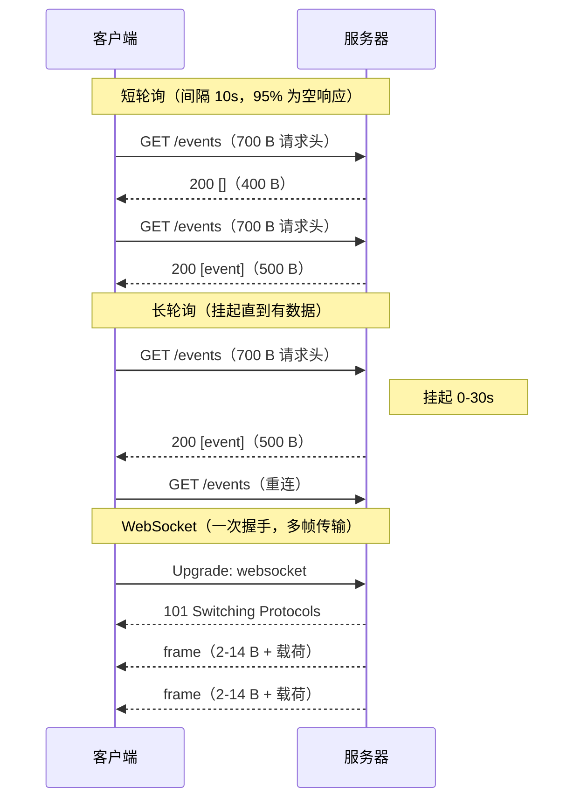
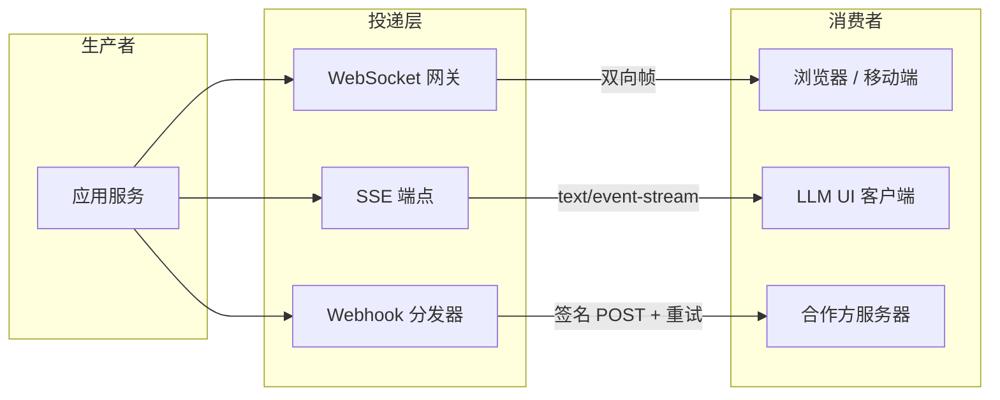
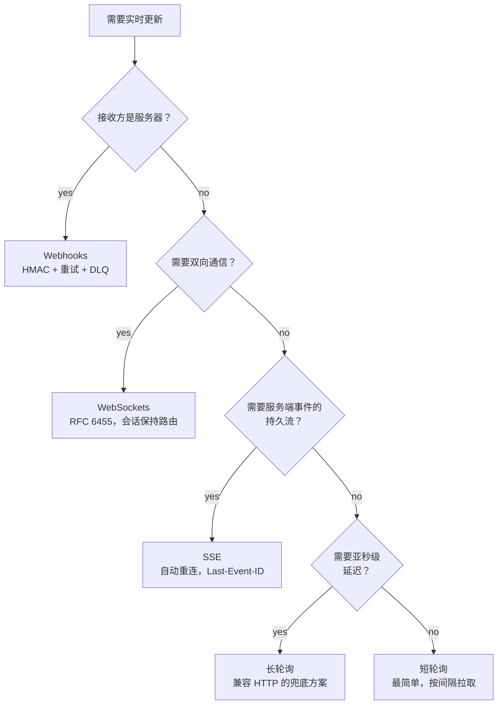

# 轮询 vs 长轮询 vs SSE vs WebSockets vs Webhooks

> **TL;DR.** “我需要实时”其实是五个不同的问题。决策取决于三个维度：谁推送（客户端拉取 vs 服务端推送）、连接生命周期（请求级 vs 持久）、以及接收方是谁（浏览器 vs 服务器）。默认选择是：服务端到客户端的流式传输用 SSE，双向通信用 WebSocket，服务器之间用 webhook。短轮询是其他方案都穿不过网络时的兜底。一个 WebSocket 帧只增加 2 到 14 字节开销[^1]；一个 HTTP 请求则要加 700 字节以上[^2]。规模上来之后，这个比例就是架构本身。

## 学习目标

- 从延迟、开销、方向性和运维复杂度四个角度比较五种实时模式。
- 识别出决定选哪种模式的工作负载特征（方向、频率、接收方类型）。
- 论证一种混合方案：针对不同的消费方类型，叠加 SSE 或 WebSockets 与 webhook 投递。
- 评估生产系统（Discord、Stripe、OpenAI），并解释各自为什么选那种模式。

## 核心权衡

每个实时系统都要回答三个问题：谁发起数据流、连接能活多久、接收方是浏览器还是服务器。任何一个维度搞错，你付出的代价都是漏掉的更新、浪费的带宽，或者没做预算的运维复杂度。

短轮询按定时器拉取。长轮询把这次拉取挂住，直到有数据才返回。SSE 在 HTTP 上做单向流。WebSocket 升级为全双工帧。Webhook 在服务器之间 POST 事件。[^2][^3][^4][^1]

单条消息的成本差异非常悬殊。一个典型的 HTTP/1.1 请求带 700 到 800 字节请求头（带 cookie 时有好几 KB）[^2]。一个 WebSocket 帧头是 2 到 14 字节[^1]。对一条 20 字节的聊天消息，短轮询的开销比是 35:1，WebSocket 是 1.1:1。到了每秒数百万条消息的规模，这笔账就是架构本身。

*单事件网络成本：短轮询每次检查都付全额 HTTP 开销；WebSocket 用一次握手摊薄到数千个帧上。*

## 横向对比

| 维度 | 短轮询 | 长轮询 | SSE | WebSockets | Webhooks |
|---|---|---|---|---|---|
| 方向 | 客户端拉取 | 客户端拉取（服务端挂起） | 服务端推送 | 双向 | 服务器到服务器推送 |
| 延迟 | 平均为间隔的一半 | 事件后约 1 个 RTT | 约 0（流式） | 约 0（流式） | 投递 + 重试退避 |
| 单条消息开销 | 约 700 B 请求头[^2] | 每个事件约 700 B | 约 50 B（字段前缀） | 2-14 B 帧[^1] | 完整 HTTP POST |
| 重连 | 不适用（无状态） | 立即重新 GET | 自动（`Last-Event-ID`）[^5] | 应用层实现 | 不适用（无状态） |
| 代理兼容性 | 完全兼容 | 良好 | 良好（HTTP） | 需要支持 Upgrade | 完全兼容 |
| 连接状态 | 无 | 服务端持有 N 个 FD | 服务端持有 N 条流 | 服务端持有 N 个 socket | 无 |
| 浏览器支持 | 普遍支持 | 普遍支持 | `EventSource` API[^5] | `WebSocket` API[^1] | 不适用（接收方是服务器） |
| 扩展上限 | 受带宽限制 | 受 FD 或协程限制 | 受 HTTP/2 流限制[^6] | 受 FD 与内存限制 | 受 HTTP worker 限制 |

这张表在“延迟”这一行会误导人。长轮询在事件发生后一个 RTT 内送达，但每次送达都要付一次完整的重连成本。SSE 和 WebSocket 送达时没有重连成本，代价是必须维持持久连接。实践中真正起决定作用的是**接收方是谁**：浏览器收不到 webhook；服务器也不该为罕见事件长期挂着 WebSocket 连接。

## 何时选择轮询或 SSE

**短轮询**在这些情况下胜出：

- 变更不频繁（几分钟一次），而客户端处在会掐断长连接的企业代理后面。邮箱收信检查、CI 构建状态、DNS 传播监控。
- 实现速度比效率更重要。一个 `setInterval` 加 `fetch` 就两行代码。
- 你需要服务端零连接状态。负载均衡就是简单的轮询（round-robin）。

**长轮询**在这些情况下胜出：

- 你需要亚秒级的发现延迟，但 WebSocket 的升级请求被挡住。Facebook 2008 年的聊天（服务 7000 万用户）就建在 Erlang 的长轮询上，选它是因为并发能力经过验证（Yaws 实测 8 万以上并发连接）[^4]。
- 故障切换是白送的：连接断掉和一次正常重连没有区别。

**SSE** 在这些情况下胜出：

- 数据流只从服务端到客户端。LLM token 流式输出（OpenAI 用 `stream=true` 的 SSE）[^7]、股票行情、进度条、日志跟踪。
- 你想要内置的断线重连与续传。`Last-Event-ID` 让服务端重放漏掉的事件，不必在应用层自己做序列号追踪[^5]。
- HTTP/2 多路复用打破了 HTTP/1.1 每源 6 条连接的上限[^6]。

## 何时选择 WebSockets

WebSockets 在双向、低开销、持久通信是硬需求时胜出：

- **聊天与消息。** 正在输入提示、已读回执、消息投递，都要在同一条连接上双向流动。Discord 在 Elixir 上扛着近 500 万并发 WebSocket 用户[^8]。
- **多人游戏与协同编辑。** 光标位置、操作变换（OT）、游戏状态增量，双向都要求 10 毫秒以内的封帧。
- **WebRTC 信令。** 对等连接建立之前，信令通道必须双向转发 SDP offer 和 ICE candidate。
- **高频双向遥测。** 交易平台里客户端在同一条 socket 上下单，服务端推送成交回报。

代价是：WebSocket 连接是有状态的。你需要会话保持路由、一个 pub/sub 骨干（Redis、Kafka、NATS）让任意网关都能推给任意用户，以及应用层的重连与序列号重放[^8][^9]。SSE 的重连是白送的；WebSocket 得自己造。

## 混合路径

多数生产系统按接收方类型组合多种模式。Slack 的架构是经典例子：早期的 Real Time Messaging API 是每个应用在每个工作区一条 WebSocket 连接。Slack 废弃了它，换成 Events API——对服务端集成走 HTTP webhook 投递，对防火墙后面的应用提供 “Socket Mode”（由 Slack 主动发起的 WebSocket）[^10][^11]。

套路是这样的：浏览器拿 WebSocket 或 SSE 做低延迟推送；合作方服务器拿 webhook 做解耦、可安全重试的投递；内部服务通过 Kafka 或 NATS 走事件流。

*混合投递：一个事件源经过三层传输扇出，分别匹配不同类型的消费者。*

## 真实案例

**Discord（大规模 WebSocket）：** 2017 年有近 500 万并发 WebSocket 用户[^8]，到 2019 年增长到 1100 万[^12]。每个会话是一个 Elixir GenServer；扇出用 Manifold 按节点把目标 PID 分组，再在节点内分片。用 Manifold 之前，向一个 3 万人的 guild 发布消息要 900 毫秒到 2.1 秒；之后延迟大幅下降[^8]。WhatsApp 走得更远：2012 年单台 FreeBSD 服务器上扛住 200 万条 TCP 连接[^13]。

**Stripe（Webhooks）：** 对 `timestamp + "." + body` 做 HMAC-SHA256，重放窗口 5 分钟[^14][^15]。至少一次投递，指数退避重试最长 3 天[^14]。接收方必须按 `event.id` 做幂等，因为重复是必然会发生的。

**OpenAI（SSE）：** Chat Completions 和 Responses API 通过 `Content-Type: text/event-stream` 流式输出 token[^7]。每个 `data:` 帧携带一段 JSON 增量。客户端边到边渲染，而不是等全部生成完。SSE 内置的重连和 `Last-Event-ID` 让它在这样的单向场景里比 WebSocket 简单。

## 常见错误

> [!WARNING]
> **用 2 秒一次的轮询“营造实时感”。** 20 字节的载荷配 700 字节请求头，95% 的响应是空的。上线前先算一下有效字节占比。如果事件本来就稀疏，把间隔提到 30-60 秒，或者换成 SSE。[^2][^3]

> [!WARNING]
> **WebSocket 在 localhost 上好好的，一上生产就坏。** 没有会话保持路由，重连就会落到一个没有该用户状态的网关上。加一层 pub/sub 骨干（Redis、NATS），让任意网关都能推给任意 socket，并按用户或会话 ID 路由。[^8]

> [!WARNING]
> **先解析 webhook 请求体，再验 HMAC。** Express 的 `bodyParser.json`、Rails、Next.js 都会在你的代码跑起来之前把请求体规范化。重新序列化出来的 JSON 和签名时的字节不再一致。先对原始字节验签，再解析。[^15]

> [!WARNING]
> **webhook 接收端不做幂等。** Stripe 超时后会重试；你的处理逻辑跑了两遍；客户被扣了两次钱。执行副作用之前，用带 TTL 的集合按 `event.id` 去重。[^14]

> [!WARNING]
> **SSE 在有缓冲的代理后面悄悄死掉。** 企业代理和 CDN 会缓冲，或者在 30-60 秒后掐掉空闲连接。设置 `Cache-Control: no-cache`、`X-Accel-Buffering: no`，并每 15-30 秒发一次 `: ping\n\n` 保活。[^5]

## 决策清单

- [ ] 接收方是浏览器/应用还是服务器？（服务器 = webhook；浏览器 = SSE 或 WebSocket。）
- [ ] 数据是双向流动，还是只从服务端到客户端？（双向 = WebSocket。）
- [ ] 可接受的发现延迟是多少？（分钟级 = 轮询；亚秒级 = SSE/WS/长轮询。）
- [ ] 你能维持持久连接吗？（不能就用轮询或 webhook。）
- [ ] 接收方是一直在线还是间歇在线？（间歇在线 = 带重试和死信队列的 webhook。）
- [ ] 你的基础设施支持 HTTP Upgrade 吗？（被挡就用 SSE 或长轮询。）
- [ ] 消息频率有多高？（稀疏 = webhook 或轮询；持续 = SSE/WebSocket。）

*决策流程图：先看接收方类型，再看方向性，最后看延迟要求。每个叶子节点都是一个站得住脚的默认选择。*

## 要点回顾

- 决策取决于三个维度：方向（拉取 vs 推送）、连接生命周期（短连接 vs 持久）、接收方类型（浏览器 vs 服务器）。
- WebSocket 帧开销是 2-14 字节；HTTP 请求开销是 700 字节以上。消息速率高的时候，这个比例主宰架构。[^2][^1]
- SSE 是服务端到客户端流式传输的正确默认项。断线重连和续传是白送的；WebSocket 得你自己造两样。
- Webhook 是服务器到服务器的正确默认项。没有持久连接，有行业标准的重试模式，还能靠无状态 HTTP worker 横向扩展。
- 大规模生产系统大多用混合方案：浏览器侧用 WebSocket/SSE，合作方用 webhook，内部服务走事件流。

## 延伸阅读

- [How Discord Scaled Elixir to 5,000,000 Concurrent Users](https://discord.com/blog/how-discord-scaled-elixir-to-5-000-000-concurrent-users)：WebSocket 扇出的经典叙事；涵盖 Manifold、FastGlobal 和级联故障模式。
- [Stripe: Webhooks](https://docs.stripe.com/webhooks)：重试时间表、签名验证，以及至少一次投递下的端点最佳实践。
- [WHATWG: Server-sent events](https://html.spec.whatwg.org/multipage/server-sent-events.html)：SSE 的规范文本，含 `EventSource`、`Last-Event-ID` 和 `retry:` 语义。
- [OpenAI: Streaming API responses](https://developers.openai.com/api/docs/guides/streaming-responses)：生产环境里的 SSE token 流式输出；现代 SSE 最清晰的用例。
- [Discord Developer Docs: Gateway](https://discord.com/developers/docs/events/gateway)：opcode、心跳、resume 语义，以及大规模 WebSocket 下的 zlib-stream 压缩。
- [Facebook Chat Architecture (High Scalability, 2008)](https://highscalability.com/new-facebook-chat-feature-scales-to-70-million-users-using-e/)：最早那篇“大规模长轮询”文章；Erlang 单机 8 万连接。

## 记忆卡片

<strong>Q: WebSocket 帧和 HTTP 请求的单条消息开销分别是多少？</strong>

A: 一个 WebSocket 帧增加 2 到 14 字节帧头。一个典型 HTTP/1.1 请求增加 700 到 800 字节请求头（带 cookie 更多）。对小载荷来说，HTTP 的开销比在 35:1 以上。

<strong>Q: 什么时候该选 SSE 而不是 WebSockets？</strong>

A: 当数据只从服务端流向客户端时。SSE 的自动重连和 `Last-Event-ID` 续传是白送的，在 HTTP/1.1 和 HTTP/2 上都能跑，也不需要应用层的心跳或重放逻辑。LLM 流式输出、股票行情、进度更新都适合它。

<strong>Q: Slack 为什么废弃了自己的 RTM WebSocket API？</strong>

A: Events API（webhook）让合作方集成可以用无状态 HTTP worker 扩展，不需要会话保持路由，也不需要持久连接。Socket Mode 则留给被防火墙挡住的那些应用当逃生口。

<strong>Q: webhook 接收方必须做的三件事是什么？</strong>

A: （1）对原始请求体字节验证 HMAC 签名。（2）在提供方的超时窗口内返回 2xx（Stripe：要快；GitHub：10 秒；Slack：3 秒）。（3）幂等处理，按事件 ID 去重，因为至少一次投递必然带来重复。

<strong>Q: Discord 如何在 WebSocket 重连时不丢事件？</strong>

A: 每次 dispatch 都带一个单调递增的序列号（`s`）。重连时客户端带上最后收到的 `s` 值发 `op 6 Resume`，服务端重放漏掉的 dispatch。这正是 SSE 的 `Last-Event-ID` 在应用层的等价物。

<strong>Q: 大规模 WebSocket 最主要的运维成本是什么？</strong>

A: 有状态。每条连接把用户钉死在一个网关进程上，于是你需要会话保持路由、用于跨网关扇出的 pub/sub 骨干、感知连接数的自动扩缩容，以及带鉴权重握手的应用层重连。

<strong>Q: Discord 和 WhatsApp 各自做到了多少并发 WebSocket 连接？</strong>

A: Discord 在 Elixir 上扛住 500 万并发用户（2017 年），到 2019 年扩展到 1100 万。WhatsApp 通过调优 Erlang VM 和操作系统内核，在 2012 年做到单台 FreeBSD 服务器 200 万条 TCP 连接。

## 参考文献

[^1]: IETF, "The WebSocket Protocol", RFC 6455, 2011. https://datatracker.ietf.org/doc/html/rfc6455
[^2]: "WebSockets Protocol vs HTTP", Stack Overflow. https://stackoverflow.com/questions/14703627/WebSockets-Protocol-VS-http
[^3]: Karan Pratap Singh, "System Design: Long polling, WebSockets, Server-Sent Events". https://dev.to/karanpratapsingh/system-design-long-polling-websockets-server-sent-events-sse-1hip
[^4]: Todd Hoff, "New Facebook Chat Feature Scales to 70 Million Users Using Erlang", High Scalability, 2008. https://highscalability.com/new-facebook-chat-feature-scales-to-70-million-users-using-e/
[^5]: WHATWG, "Server-sent events", HTML Living Standard. https://html.spec.whatwg.org/multipage/server-sent-events.html
[^6]: Better-SSE FAQ, "Browser connection limits for HTTP/1.1 vs HTTP/2". https://matthewwid.github.io/better-sse/reference/faq/
[^7]: OpenAI, "Streaming API responses". https://developers.openai.com/api/docs/guides/streaming-responses
[^8]: Stanislav Vishnevskiy, "How Discord Scaled Elixir to 5,000,000 Concurrent Users", Discord Engineering, 2017. https://discord.com/blog/how-discord-scaled-elixir-to-5-000-000-concurrent-users
[^9]: Discord Developer Documentation, "Gateway". https://discord.com/developers/docs/events/gateway
[^10]: Slack, "Real Time Messaging (RTM)". https://docs.slack.dev/tools/node-slack-sdk/rtm-api/
[^11]: Slack, "The Events API". https://docs.slack.dev/apis/events-api/
[^12]: Matt Nowack, "Using Rust to Scale Elixir for 11 Million Concurrent Users", Discord Engineering, 2019. https://discord.com/blog/using-rust-to-scale-elixir-for-11-million-concurrent-users
[^13]: Todd Hoff, "The WhatsApp Architecture Facebook Bought For $19 Billion", High Scalability, 2014. https://highscalability.com/the-whatsapp-architecture-facebook-bought-for-19-billion/
[^14]: Stripe Docs, "Receive Stripe events in your webhook endpoint". https://docs.stripe.com/webhooks
[^15]: Stripe Docs, "Resolve webhook signature verification errors". https://docs.stripe.com/webhooks/signature
