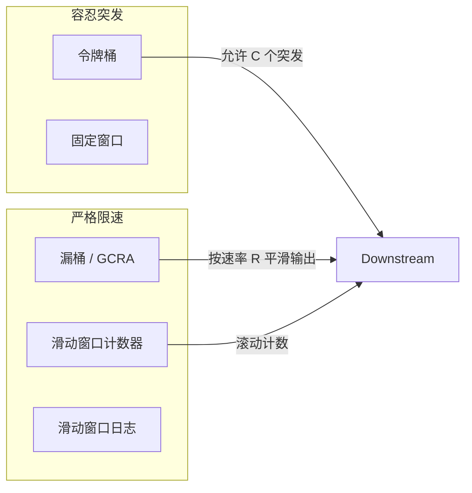
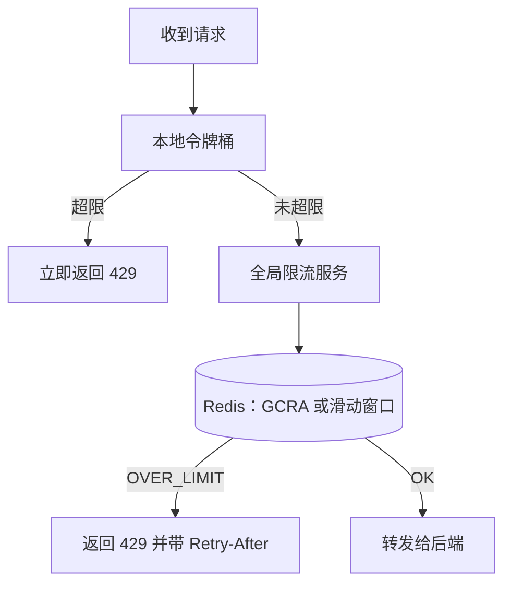
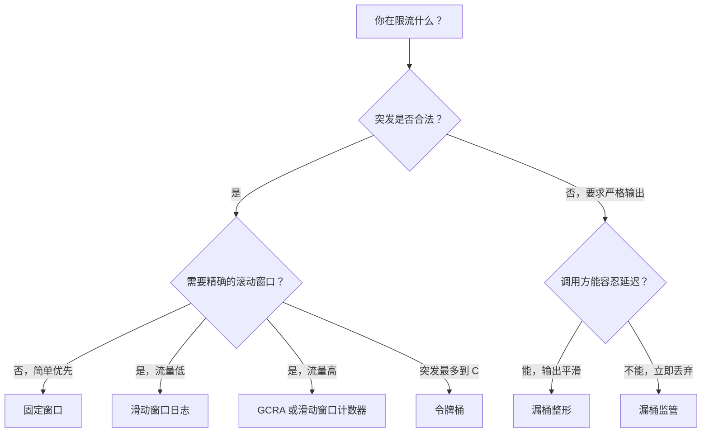

# 限流算法：令牌桶 vs 滑动窗口

> **TL;DR.** 对公开 API 来说，令牌桶是正确的默认选择：它允许合法的突发，上限是一个明确的容量值，同时限制持续速率。Stripe、GitHub、AWS 全都用它，原因正是这一点。[^1][^2][^3] 当边界突发不可接受、你需要在固定窗口的成本下拿到滚动窗口的精确度时，换成滑动窗口计数器。想要滚动精度又不想跑任何后台进程，就用 GCRA（漏桶的一个变种，每个键只存一个时间戳）。[^4][^5] 决定性的维度是突发容忍度：下游能吃下短时尖峰，就选令牌桶；吃不下，就选滑动窗口或 GCRA。

## 学习目标

- 从突发容忍度、内存成本、实现复杂度三个维度对比令牌桶、漏桶、固定窗口、滑动窗口和 GCRA。
- 识别哪些负载特征适合容忍突发的算法，而不是严格限速的算法。
- 论证一种混合方案：本地令牌桶叠加全局滑动窗口服务。
- 评估 Stripe 与 Cloudflare 的生产选择，并解释各自为什么选了这个算法。

## 核心权衡

限流限制的是每个时间窗口内的操作数量。根本张力在于**突发容忍 vs 执行精度**。令牌桶让空闲客户端累积信用，一次性打出最多容量 C 的突发，这正合 API 使用方的需求（批处理任务、移动端 App 集中上线、断网恢复后的重试风暴）。[^1] 滑动窗口执行严格的滚动计数，堵住了边界突发漏洞——客户端踩着固定窗口重置的瞬间，在 200 ms 内打出 2N 个请求。[^6]

底下还藏着第二重张力：**状态成本 vs 精确度**。固定窗口每个客户端只需要一个整数；滑动窗口日志每个客户端需要 O(N) 个时间戳；滑动窗口计数器和 GCRA 用 O(1) 的状态就做到了接近精确的滚动精度，这也是它们在现代生产系统里占据主导的原因。[^6][^4]

规模化之后，算法选择很少是瓶颈，协调模式才是。Cloudflare 按 PoP 分别计数，因为集中式存储在 L7 攻击流量下会直接崩掉。[^6] Envoy 在全局 gRPC 限流服务之前叠了一层本地令牌桶，用来降低中心存储的负载。[^7]

*令牌桶和固定窗口容忍短时突发；漏桶、GCRA、滑动窗口执行严格的滚动限制。*

## 并排对比

| 维度 | 令牌桶 | 滑动窗口计数器 | GCRA | 固定窗口 | 漏桶 |
|-----------|-------------|----------------------|------|--------------|--------------|
| 突发容忍度 | 最高到容量 C | 无（滚动） | 无（滚动） | 边界处最高 2× | 无 |
| 每个键的内存 | 2 个字段（tokens、timestamp） | 2 个计数器 | 1 个时间戳（8 字节）[^8] | 1 个计数器 | 1-2 个字段 |
| 精确度 | 持续速率精确 | 相比真实滚动平均误差约 6%[^6] | 精确的滚动窗口[^4] | 单个窗口内精确，边界泄漏 2× | 输出速率精确 |
| 实现方式 | Lua 脚本，1 个 HASH | 2 次 INCR + 加权公式 | 单条 CL.THROTTLE 命令[^8] | 1 次 INCR + EXPIRE | Lua 脚本，1 个 HASH |
| 单次决策延迟 | ~0.1 ms（Redis 往返） | ~0.1 ms | ~0.1 ms[^8] | ~0.05 ms | ~0.1 ms |
| 失效模式 | 突发压垮下游 | 流量分布倾斜时出现近似误差 | 时钟偏移把客户端锁死[^5] | 边界处 2× 突发[^9] | 尖峰期间丢请求，即便均值正常 |

这张表在一个维度上有误导性：令牌桶的“持续速率精确”掩盖了一个事实——1 ms 内打出 C 个请求是合法的。如果下游吃不下 C 个并发请求，那么无论持续速率多准确，令牌桶都是错的选择。

GCRA 的单时间戳状态让它成为最便宜的精确算法，但它的 TAT 数学不如显式计数器直观。需要在生产环境里调试限流决策的团队，往往更偏爱滑动窗口计数器，因为它的两个计数器状态可以直接查看。[^5]

## 何时选择令牌桶

- **客户端行为突发的公开 API。** Stripe（线上模式每个账户 100 个并发请求/秒，测试模式 25 个）[^10]、GitHub（5,000 请求/小时）[^2]、AWS API Gateway（主要区域可持续 10,000 RPS，突发桶 5,000 个请求）[^3] 全都用令牌桶，因为正常的 API 使用本身就是突发的。
- **移动端与批处理负载。** 一个空闲了 30 分钟后唤醒的移动端 App，应该被允许立刻同步。令牌桶在空闲期间累积信用，直到容量 C。
- **按用户隔离、且轻微超量可以接受。** 下游有自己的容量余量或排队能力，能吃下短时尖峰。
- **你需要两个直观的旋钮。** 速率 R（持续）和容量 C（突发）直接对应产品决策：“每分钟 100 个请求，突发最多 50 个”。

## 何时选择滑动窗口

- **固定窗口的边界突发不可接受。** 保护昂贵的操作（支付处理、认证端点），这类场景里 200 ms 内的 2× 突发就可能压垮脆弱的下游。[^6]
- **大流量边缘限流。** Cloudflare 每天数十亿次决策选了滑动窗口计数器，因为它每个键只用两个计数器，就把总错误率（请求被误放行或误拦截）压到 0.003%。[^6]
- **反滥用与 DDoS 缓解。** 攻击者会刻意利用窗口边界。滑动窗口把这个缺口关上。
- **你想要 GCRA 的精度，但不想承担它的时钟偏移风险。** GCRA 的绝对 TAT 对时钟偏移敏感（Brandur 建议用 Redis 的 TIME 来同步[^5]）；滑动窗口计数器只用当前窗口内的相对偏移，通常受影响更小。
- **需要审计线索。** 滑动窗口日志（O(N) 内存）保存每一个时间戳，可以精确计算 retry-after，也能对滥用模式做取证分析。[^9]

## 混合路径

多数生产系统是叠算法，而不是只挑一个。Envoy 推荐的模式：本地进程内令牌桶先吸收尖峰，再向全局 gRPC 限流服务查询——后者在 Redis 里跑滑动窗口或 GCRA 逻辑。[^11][^7] 本地桶处理掉大部分超限流量，连一次网络往返都不用；全局服务负责跨节点的精确性。

Stripe 同时跑四个限流器：(1) 按账户的请求速率令牌桶；(2) 并发请求限流器，把在途请求压到 ~20；(3) 集群用量卸载器（load shedder），为关键方法预留容量；(4) worker 利用率卸载器，作为最后一道防线。[^1] 没有哪个单一算法能同时覆盖这四件事。

*用本地令牌桶吸收尖峰，用全局服务保证跨节点精确。绝大多数流量根本到不了全局服务。*

## 真实案例

**Stripe（2017）。** 通过 Throttled 库（Go 实现，内部是 GCRA）对 Redis 做令牌桶。[^1][^4] 线上模式默认限制：每个账户每秒 100 个并发请求（测试模式 25 个）；单个端点的默认限制是 25 req/sec。[^10] 并发请求限流器的触发频率远低于速率限流器（2017 年的博客提到单月约 12,000 次拒绝），它针对的是 CPU 密集型端点。[^1] 所有限流器都在功能开关后面，先暗发布再正式生效，并且在 Redis 故障时放行（fail open）。[^1]

**Cloudflare（2017）。** 在边缘跑滑动窗口计数器，每天处理数十亿次限流决策。[^6] 曾在不降低服务质量的前提下扛住单域名 400,000 req/sec 的攻击。计数器放在各 PoP 的 Twemcache 里（不是 Redis），因为这套基础设施本来就在为 SSL session ID 服务。异步自增让 p99 低于 Redis 往返耗时；一旦某个键被判定超限，边缘服务器就把拒绝结论缓存在本地。[^6]

**Envoy/Lyft（2017 至今）。** 全局 gRPC 限流服务，后端用 Redis，支持嵌套的 descriptor 层级和 shadow 模式以便安全上线。[^11] 推荐把本地令牌桶过滤器作为第一层。双 Redis 拓扑把每秒级限制和每小时级限制拆开，隔离热键争用。[^11]

## 常见陷阱

> [!WARNING]
> **固定窗口的边界突发。** 客户端在 t=59.9s 打出 N 个请求，在 t=60.1s 再打 N 个，200 ms 内就是 2N 个，而它始终“没超限”。换成滑动窗口计数器或 GCRA 来堵住这个缺口。[^9][^6]

> [!WARNING]
> **没有原子脚本的竞态。** 读-判断-写跨三条 Redis 命令，并发请求就能钻过去。用 Lua `EVAL` 保证原子性；`WATCH`/`MULTI`/`EXEC` 在争用下会引发重试风暴。[^9]

> [!WARNING]
> **按 IP 而不是按身份限流。** 企业 NAT 或 CGNAT 网关后面可能是几千个用户共用一个 IP。封掉它就是干掉一个大客户。对已认证流量，用按 API key 或按账户的标识。[^1]

> [!WARNING]
> **后台滴漏式漏桶会丢时间。** 如果滴漏 worker 暂停（GC、发布），桶就停止泄漏，新到的请求被错误限流。GCRA 通过按墙上时钟惰性计算泄漏量，直接消除了这个问题。[^5][^12]

## 决策清单

- [ ] 突发是合法的（令牌桶），还是滥用的（滑动窗口 / GCRA）？
- [ ] 下游能吃下 C 个并发请求，还是输出必须严格平滑？
- [ ] 每个键的内存预算是多少？滑动窗口日志的 O(N) 在限制值很高时非常贵。
- [ ] 需要跨节点精确性吗？需要的话，上 Redis + Lua 或全局限流服务。
- [ ] 限流器在关键路径上吗？在的话，存储故障时要放行。
- [ ] 正式生效之前做过暗发布（shadow 模式）吗？[^11]
- [ ] 是否用存储侧的时钟（Redis `TIME`）来规避 GCRA 的时钟偏移问题？[^5]

## 要点回顾

- 令牌桶是公开 API 的默认选择：它既贴合真实客户端的行为（突发），也贴合多数团队对限额的思考方式（速率 + 突发容量）。
- 滑动窗口计数器以固定窗口的成本拿到滚动窗口的精度，是 Cloudflare 每天数十亿次决策的选择。[^6]
- GCRA 每个键只存一个时间戳，不需要后台进程，是经典漏桶的现代替代品。[^4][^5]
- 规模化之后，协调模式（本地还是全局、Redis 还是进程内）比算法本身更重要。
- 在 Redis 里做限流决策，永远用 Lua `EVAL` 保证原子性；争用下绝不要用 `WATCH`/`MULTI`/`EXEC`。[^9]

## 延伸阅读

- [Scaling your API with rate limiters（Stripe，2017）](https://stripe.com/blog/rate-limiters) - 经典的 4 限流器生产模式；讲清了为什么一个算法永远不够用。
- [How we built rate limiting capable of scaling to millions of domains（Cloudflare，2017）](https://blog.cloudflare.com/counting-things-a-lot-of-different-things/) - 滑动窗口计数器的设计，附 4 亿次真实请求上的精度测量。
- [Rate Limiting, Cells, and GCRA（Brandur，2015）](https://brandur.org/rate-limiting) - 目前最好的 GCRA 讲解；作者是 Throttled 的维护者。
- [How Pingora keeps count（Cloudflare，2023）](https://blog.cloudflare.com/how-pingora-keeps-count/) - 用 count-min sketch 做 20M req/sec 的按键限流；相比朴素的 HashMap 省 1000× 内存。
- [Build 5 Rate Limiters with Redis（Redis）](https://redis.io/tutorials/howtos/ratelimiting/) - 五种算法的 Lua 脚本并排对比；解释了为什么 EVAL 优于 WATCH。
- [envoyproxy/ratelimit（GitHub）](https://github.com/envoyproxy/ratelimit) - 生产级参考实现，含 descriptor 层级、shadow 模式和双 Redis 拓扑。

## 记忆卡片

<strong>Q：为什么多数公开 API（Stripe、GitHub、AWS）都用令牌桶？</strong>

A：正常的 API 使用本身就是突发的（批处理任务、移动端集中上线、重试风暴）。令牌桶在空闲期累积信用，允许最多容量 C 的突发，贴合真实客户端行为，不会误伤。[^1][^2][^3]

<strong>Q：固定窗口的边界突发漏洞是什么？</strong>

A：客户端在 t=59.9s 发 N 个请求，在 t=60.1s 再发 N 个，200 ms 内产生 2N 个请求，而技术上始终低于“每分钟 N 个”。计数器在边界重置，把它们当成两个独立窗口。[^9][^6]

<strong>Q：GCRA 和经典漏桶有什么区别？</strong>

A：GCRA 每个键只存一个理论到达时间（TAT），每次请求时用墙上时钟算出下一个允许的时刻。不需要后台滴漏进程，也就消除了滴漏 worker 落后的运维风险。[^5][^12]

<strong>Q：Cloudflare 的滑动窗口计数器能达到什么精度？</strong>

A：在来自 270,000 个来源的 4 亿次请求上，总错误率（请求被误放行或误拦截）为 0.003%，估算速率与真实速率的平均差异为 6%。观察到的少数错误全是假阴性，最多超出阈值 15%。[^6]

<strong>Q：在 Redis 里做限流，为什么用 Lua EVAL 而不是 WATCH/MULTI/EXEC？</strong>

A：WATCH/MULTI/EXEC 在并发写入时中止并重试，恰好在争用最激烈的时候制造重试风暴。Lua EVAL 在服务端原子执行，能对中间值做 if/then 分支，从而消除 TOCTOU 竞态。[^9]

<strong>Q：Envoy 推荐的混合限流模式是什么？</strong>

A：本地进程内令牌桶不发网络调用就能吸收尖峰。通过本地过滤器的请求，再去查一个由 Redis 支撑的全局 gRPC 限流服务。这样在尖峰期间能大幅降低中心服务的负载。[^11][^7]

<strong>Q：Redis 不可用时，Stripe 为什么选择放行？</strong>

A：Redis 故障应该让限流失效，而不是把 API 弄挂。Stripe 捕获限流器的异常，让存储故障时流量通过，而不是给所有客户端返回 500。[^1]

*决策流程图：先判断突发是否合法，再按精度需求和流量规模分支。*

## 参考文献

[^1]: Paul Tarjan, "Scaling your API with rate limiters", Stripe Engineering, 2017. https://stripe.com/blog/rate-limiters
[^2]: "Rate limits for the REST API", GitHub Docs. https://docs.github.com/en/rest/using-the-rest-api/rate-limits-for-the-rest-api
[^3]: "Throttle requests to your REST APIs for better throughput in API Gateway", AWS. https://docs.aws.amazon.com/apigateway/latest/developerguide/api-gateway-request-throttling.html
[^4]: Throttled library source, GCRA implementation in Go. https://github.com/throttled/throttled/blob/master/rate.go
[^5]: Brandur Leach, "Rate Limiting, Cells, and GCRA", 2015. https://brandur.org/rate-limiting
[^6]: Julien Desgats, "How we built rate limiting capable of scaling to millions of domains", Cloudflare, 2017. https://blog.cloudflare.com/counting-things-a-lot-of-different-things/
[^7]: "Local rate limiting + global rate limiting combined", Envoy docs. https://envoyproxy.io/docs/envoy/latest/intro/arch_overview/other_features/local_rate_limiting
[^8]: brandur/redis-cell README (GCRA as Redis command). https://github.com/brandur/redis-cell
[^9]: William Johnston, "Build 5 Rate Limiters with Redis: Fixed Window, Sliding Window, Token Bucket, and Leaky Bucket", Redis, 2026. https://redis.io/tutorials/howtos/ratelimiting/
[^10]: "Rate limits", Stripe Documentation. https://docs.stripe.com/rate-limits
[^11]: envoyproxy/ratelimit README. https://github.com/envoyproxy/ratelimit
[^12]: "Generic cell rate algorithm", Wikipedia. https://en.wikipedia.org/wiki/Generic_cell_rate_algorithm
