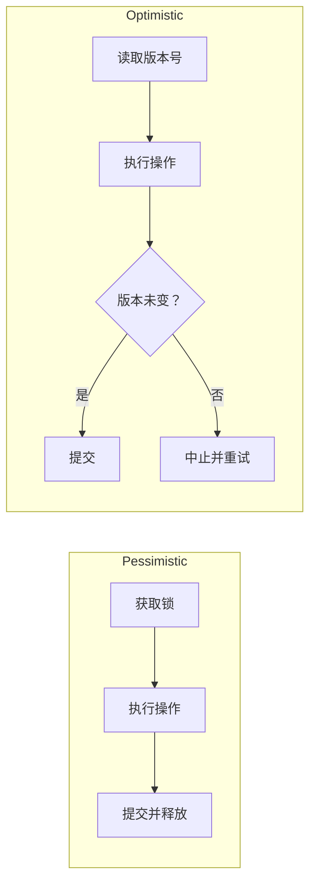
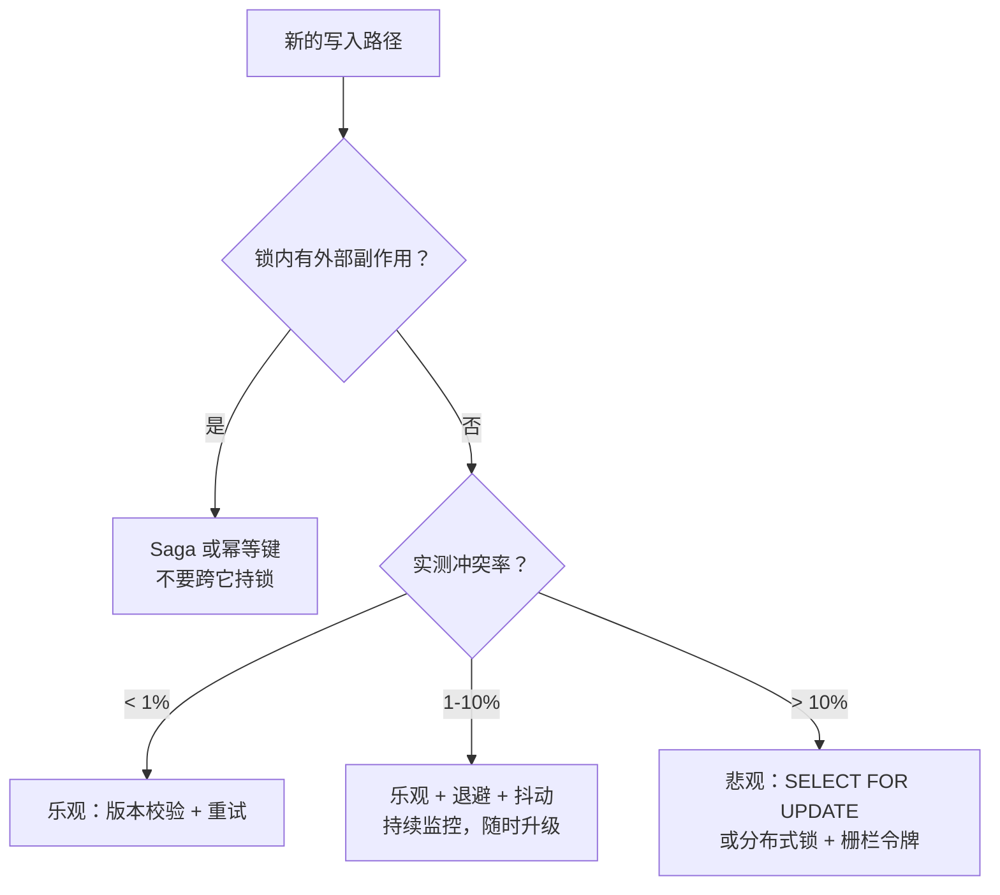
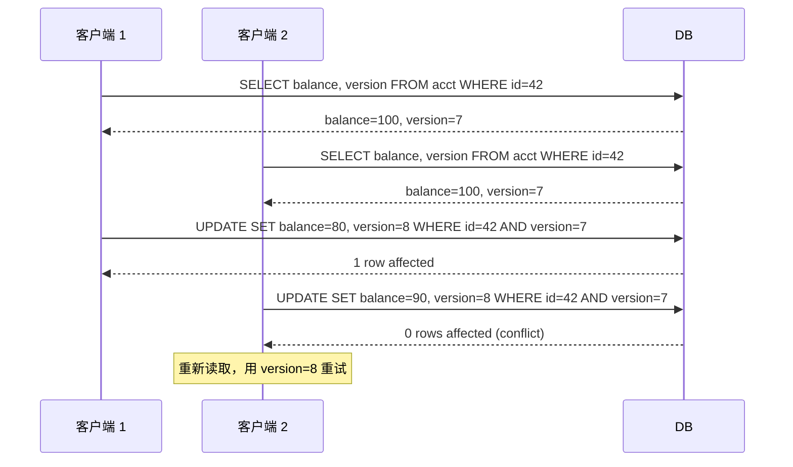

# 乐观并发控制 vs 悲观并发控制

> **TL;DR.** 悲观锁在碰数据之前先拿锁，一直持有到提交；乐观并发全程不加锁，到提交时才校验。决定性的变量是冲突率。争用低（中止率 < 1%）时乐观控制占优，因为校验比加锁便宜，而且读操作永远不会阻塞写操作[^1]。争用高（> 10%）时，乐观控制会塌成重试风暴带来的 O(N^2) 无效功[^2]。默认走乐观（MVCC + 版本校验），在实测出来的热行上升级到 `SELECT FOR UPDATE`。分布式锁一律要挂栅栏令牌（fencing token）[^3]。

## 学习目标

- 在不同冲突率下，从吞吐量、长尾延迟和失效模式三个维度对比乐观与悲观并发控制。
- 找出决定正确选择的三个变量（冲突率、重试成本、副作用）。
- 论证「MVCC 加按需升级」的混合方案为什么可以当作生产环境的默认做法。
- 评估 Spanner 的 wound-wait、PostgreSQL 的 SSI 和 Stripe 的幂等键，把它们看成两种策略各自的真实实现。

## 核心权衡

两个事务在同一时刻想要同一行数据。悲观的做法是：让其中一个等着。乐观的做法是：两个都放行，提交时把输的那个中止掉。根本的矛盾在于浪费工作和浪费等待之间。

悲观锁把对热数据的访问串行化。每个等待者都要把锁持有者的完整执行时间当作延迟付出去，但没有任何工作被丢掉。乐观并发让所有事务并行跑，但输家丢弃自己的工作再重试。争用低的时候几乎没人输，所以乐观的吞吐量占绝对优势。争用高的时候，中止—重试的循环会不断累积：N 个互相争用的客户端下，总工作量按 O(N^2) 增长[^2]。

切换点在每个负载上都不一样。Google Spanner 对可串行化事务默认采用悲观并发控制；文档里说「在高度争用的负载下，它有助于事务取得进展」[^4]。DynamoDB 的条件写入让 OCC 天然合适，因为多数 NoSQL 访问模式打的是不同的键[^2]。

还有第二个变量，不管冲突率多少都能翻转选择：重试的代价。5 ms 的行更新重试起来毫无成本。一个跑 30 秒的分析任务，或者一次非幂等的支付 API 调用，就没法安全重试。带副作用的操作即便争用很低，也会把你推向悲观锁。

*悲观控制先付协调成本；乐观控制把它推迟到提交，只在冲突时付账。*

## 逐项对比

| 维度 | 乐观（版本校验、CAS） | 悲观（SELECT FOR UPDATE、2PL） |
|---|---|---|
| 低争用下的吞吐量 | 高：没有加锁开销，读操作永不阻塞写操作[^1] | 较低：每次操作都要加锁、释放锁 |
| 高争用下的吞吐量 | 崩塌：O(N^2) 无效功[^2] | 优雅降级：串行化，但可预测 |
| 长尾延迟 | 顺利路径上 p99 很低；重试风暴时冒出尖刺 | 受锁持有者执行时长约束；GC 停顿会放大[^3] |
| 死锁风险 | 无（不持有任何锁） | 必须检测并解开环路[^5] |
| 饿死风险 | 慢事务被快事务反复中止[^4] | wound-wait 保证老事务能推进[^5] |
| 外部副作用 | 不安全：被重试的副作用可能触发两次 | 安全：锁横跨临界区（配合栅栏令牌） |
| 实现复杂度 | 应用要自己管重试循环和退避 | 数据库管锁图；分布式锁需要共识 |
| 服务端状态 | 读和写之间没有状态 | 每个活跃锁都要占一条锁表记录[^5] |

这张表在「死锁风险」这一项上有误导。乐观控制避开了死锁，却引入了活锁：持续争用之下，事务可能无限期饿死。Spanner 把这种情况记为「transaction starvation」，并建议切换到悲观模式[^4]。

「长尾延迟」那一行藏着悲观锁的真正危险：临界区里任何一次 GC 停顿、慢查询或网络抖动，都会让所有等待者把整个卡顿时间等完[^3]。

## 何时选择 乐观控制

**低争用的宽键空间。** 用户资料编辑、配置更新、分片数据上的大部分 CRUD。DynamoDB 的条件写入能扛住上百万个键而冲突接近零，因为每个用户只碰自己的分区[^2]。

**短小且幂等的事务。** 当事务就是一条 5 ms 以内的单行更新时，重试成本可以忽略。经典写法：`UPDATE ... SET version = version + 1 WHERE id = ? AND version = ?`[^1]。

**带 ETag 的 HTTP API。** RFC 7232 的 `If-Match` 头让写入以资源版本为条件。客户端在收到 412 Precondition Failed 时重试。Stripe 的幂等键把这一套延伸到支付 API，最短 TTL 为 24 小时[^6]。

**MVCC 数据库上的读密集负载。** PostgreSQL、InnoDB 和 Spanner 都能在不阻塞写操作的前提下提供快照读。SSI（PostgreSQL 9.1+）给出完整的可串行化，而不需要 2PL 那种阻塞[^7]。

## 何时选择 悲观控制

**实测高争用的热行。** 库存计数、座位预订、拍卖出价计数器、被大量并发写者更新的账户余额。用 `SELECT FOR UPDATE` 串行化，能彻底躲开重试风暴。

**重试代价高昂的长事务。** 批量导入、多步骤工作流，或者耗时以秒计的事务。中止并重做 10 秒的工作，比等 50 ms 的锁要糟。

**带非幂等外部副作用的操作。** 在事务里调用支付服务商、发短信、触发 webhook。这些都没法安全重试，所以你必须让锁横跨整个临界区[^3]。

**要求正确性的分布式协调。** 主节点选举、分布式互斥锁、恰好一次的资源的分配。用带共识的锁（ZooKeeper 的 zxid、etcd 的 lease）并附带栅栏令牌，绝不要用裸的基于 TTL 的锁[^3][^8]。

## 混合路线

多数生产数据库本来就在跑混合模式：顺利路径用 MVCC，热路径用显式锁。PostgreSQL 用快照隔离承担读，同时把 `SELECT FOR UPDATE` 暴露给应用层做升级[^9]。Spanner 允许你按事务设置 `ReadLockMode`：热路径用悲观，长时间的多区域读用乐观[^4]。

实操套路是：默认全部走乐观，把冲突率打点出来（PostgreSQL 看 `pg_stat_database.xact_rollback` 和 `deadlocks`，再在应用层记录 SSI 序列化失败抛出的 SQLSTATE 40001；Spanner 看 Lock Statistics[^10]），然后在中止率超过 5-10% 的路径上明确升级为悲观。这样大多数操作拿到无锁吞吐，已知的热路径拿到确定性的推进。

*决策流程图：冲突率和副作用情况决定策略。多数 OLTP 路径落在乐观一档，再对实测热行做升级。*

## 真实案例

**Google Spanner** 对可串行化的读写事务默认使用悲观锁。锁的粒度是 cell（行 × 列），所以两个事务可以同时改同一行的不同列[^5]。冲突消解用 wound-wait：老事务中止年轻事务，从而保证向前推进且不会死锁[^5]。四种锁模式（ReaderShared、WriterShared、Exclusive、WriterSharedTimestamp）提供细粒度的并发[^5]。

**PostgreSQL SSI** 是可串行化快照隔离（Serializable Snapshot Isolation）的第一个生产级实现（Ports 与 Grittner，VLDB 2012）[^7]。读操作获取不阻塞的 SIRead 谓词锁；引擎盯着危险的读写依赖环，一旦发现就用 SQLSTATE 40001 中止其中一个事务[^9]。先提交者胜（first-committer-wins）：先到达提交点的那个事务成功[^11]。应用必须在收到 40001 时重试，所以这在应用层看来是乐观的。

**Stripe 的幂等键**为支付 API 实现了应用层的 OCC。客户端为每个逻辑操作生成一个 UUID；Stripe 在服务端去重，最短 TTL 为 24 小时[^6]。重试复用同一个键。如果第二个请求改动了载荷，Stripe 会拒绝它。这是 OCC，只不过这里的「版本」是幂等键的占有声明。

*OCC 的版本校验模式：第二个写者在提交时发现冲突，然后带着当前版本重试。*

## 常见错误

> [!WARNING]
> **跨网络调用持锁。** 在 `SELECT FOR UPDATE` 事务里调支付 API，会把每个等待者都堵住一整个 RPC 的延迟。把外部调用挪到事务之外；用 saga 或者「先记录再调用」的模式。

> [!WARNING]
> **分布式锁漏了栅栏令牌。** 一个被 GC 暂停的客户端在 TTL 过期后醒来，能覆盖掉合法锁持有者的数据。始终附带单调递增的令牌，并在存储层强制执行[^3]。没有栅栏的 Redlock 在正确性上是不安全的[^12]。

> [!WARNING]
> **不带退避的朴素重试循环。** N 个客户端争用时，同步的重试会产生 O(N^2) 的无效功[^2]。用指数退避加全抖动。AWS 的测算显示，N=100 时总调用量能因此减少约 50%[^2]。

> [!WARNING]
> **在已知热行上还用乐观。** 如果中止率超过 10%，你在重试上烧掉的 CPU 已经比加锁贵了。在生产环境测冲突率，然后明确升级[^9]。

## 决策清单

- [ ] 这条路径上实测的冲突率是多少？（查 `pg_stat_database.xact_rollback` 和 `deadlocks`，再看应用日志里的 SQLSTATE 40001，或者看 Spanner Lock Statistics[^10]。）
- [ ] 重试时重做这份工作有多贵？（几秒的计算？一次外部 API 调用？）
- [ ] 事务里有没有非幂等的副作用？
- [ ] 你的数据库是基于 MVCC 的吗？（如果是，顺利路径默认走乐观。）
- [ ] 用分布式锁的话：你的锁服务会不会产出栅栏令牌？
- [ ] 重试路径上有没有实现带抖动的指数退避？

## 要点回顾

- 决定性的变量是冲突率。低于 1% 乐观赢。高于 10% 悲观赢。1-10% 之间用乐观加退避和监控。
- 大多数操作默认 MVCC + 版本校验。在实测出来的热行上升级到 `SELECT FOR UPDATE`。
- 绝不要跨网络调用持有数据库锁。有外部副作用的操作用 saga 或幂等键。
- 没有栅栏令牌的分布式锁在正确性上不安全。用 ZooKeeper 的 zxid、etcd 的 lease ID 或者数据库序列作为令牌[^3]。
- 重试风暴是乐观系统的隐形杀手。带全抖动的指数退避没有商量余地[^2]。

## 延伸阅读

- [How to do distributed locking](https://martin.kleppmann.com/2016/02/08/how-to-do-distributed-locking.html)：Kleppmann 对 Redlock 的经典批评和栅栏令牌论证；要推理分布式锁的正确性，从这篇开始。
- [Exponential Backoff And Jitter](https://aws.amazon.com/blogs/architecture/exponential-backoff-and-jitter/)：Marc Brooker 的模拟，说明为什么朴素 OCC 重试在规模上会崩溃，以及抖动如何修复它。
- [Serializable Snapshot Isolation in PostgreSQL](https://arxiv.org/abs/1208.4179)：Ports 与 Grittner，VLDB 2012。PostgreSQL SSI 背后的论文；讲清了乐观校验如何在不使用 2PL 的情况下达到可串行化。
- [Transaction locking in Cloud Spanner](https://cloud.google.com/blog/products/databases/transaction-locking-in-cloud-spanner)：wound-wait、cell 级锁和四种锁模式，配生产案例讲透。
- [Designing robust and predictable APIs with idempotency](https://stripe.com/blog/idempotency)：Stripe 工程博客谈支付 API 的应用层 OCC；幂等键模式的权威版本。
- [Is Redlock safe?](http://antirez.com/news/101)：Sanfilippo 对 Kleppmann 的反驳。选分布式锁实现之前，两边都读一遍。

## 记忆卡片

<strong>Q: OCC 在 N 个争用客户端下，总无效功的 O 记号是什么？</strong>

A: O(N^2)。每一轮里有 N-1 个客户端中止并重试。要等所有客户端都完成需要 N 轮，总工作量与争用者数量的平方成正比[^2]。

<strong>Q: 应用层乐观并发的经典 SQL 写法是什么？</strong>

A: `UPDATE table SET col = ?, version = version + 1 WHERE id = ? AND version = ?`。如果影响行数为零，说明有并发写者把版本号顶了；重新读取再重试。

<strong>Q: Spanner 为什么用 wound-wait 而不是 wait-die？</strong>

A: wound-wait 通过中止年轻事务来保住老事务（更早开始的那些）。这保证系统向前推进且不会死锁[^5]。

<strong>Q: 栅栏令牌是什么，为什么分布式锁必须有它？</strong>

A: 一个随每次锁授予而递增的单调数字。存储层会拒绝携带过期令牌的写入。没有它，被 GC 暂停的客户端在 TTL 过期后醒来就能覆盖掉合法锁持有者的数据[^3]。

<strong>Q: 冲突率到多少就该从乐观升级到悲观？</strong>

A: 实测中止率超过 5-10% 时。低于 1% 乐观更好。高于 10% 时重试风暴烧掉的 CPU 比加锁还多。1-10% 之间用乐观加退避并持续监控。

<strong>Q: PostgreSQL 里哪个错误码表示 SSI 下的序列化失败？</strong>

A: SQLSTATE 40001。应用必须捕获它并把整个事务从头重试[^9]。

<strong>Q: 为什么 Redlock 不适用于对正确性敏感的分布式锁？</strong>

A: 它不产出栅栏令牌，所以一个被暂停的客户端和一个合法客户端无法区分。它的安全性还依赖各 Redis 节点之间时钟偏移有界，而 NTP 跳变可以打破这个前提[^3][^12]。

## 参考文献

[^1]: H.T. Kung and John T. Robinson, "On Optimistic Methods for Concurrency Control", ACM Transactions on Database Systems, 1981. https://dl.acm.org/doi/10.1145/319566.319567
[^2]: Marc Brooker, "Exponential Backoff And Jitter", AWS Architecture Blog, 2015-03-04. https://aws.amazon.com/blogs/architecture/exponential-backoff-and-jitter/
[^3]: Martin Kleppmann, "How to do distributed locking", 2016-02-08. https://martin.kleppmann.com/2016/02/08/how-to-do-distributed-locking.html
[^4]: Google Cloud, "Concurrency control" (Spanner documentation), last updated 2026-05-01. https://cloud.google.com/spanner/docs/concurrency-control
[^5]: Manit Gupta, "Understanding transactional locking in Cloud Spanner", Google Cloud Blog, 2022-11-16. https://cloud.google.com/blog/products/databases/transaction-locking-in-cloud-spanner
[^6]: Brandur Leach, "Designing robust and predictable APIs with idempotency", Stripe Engineering Blog, 2017-02-22. https://stripe.com/blog/idempotency
[^7]: Dan R.K. Ports and Kevin Grittner, "Serializable Snapshot Isolation in PostgreSQL", VLDB 2012 (arXiv 1208.4179). https://arxiv.org/abs/1208.4179
[^8]: etcd project, "contrib/lock/README.md" (distributed locking with fencing token example). https://github.com/etcd-io/etcd/blob/main/contrib/lock/README.md
[^9]: PostgreSQL wiki, "SSI: Serializable Snapshot Isolation in PostgreSQL". https://wiki.postgresql.org/wiki/SSI
[^10]: Hans Huang, "Lock Statistics: Diagnose performance issues in Cloud Spanner", Google Cloud Blog. https://cloud.google.com/blog/topics/developers-practitioners/lock-statistics-diagnose-performance-issues-in-cloud-spanner
[^11]: PostgreSQL wiki SSI examples section, "first-committer-wins" rule. https://wiki.postgresql.org/wiki/SSI#Overview
[^12]: Salvatore Sanfilippo, "Distributed Locks with Redis" (Redlock specification). https://redis.io/docs/latest/develop/clients/patterns/distributed-locks/
