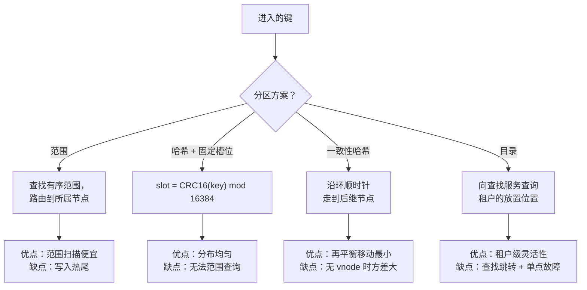
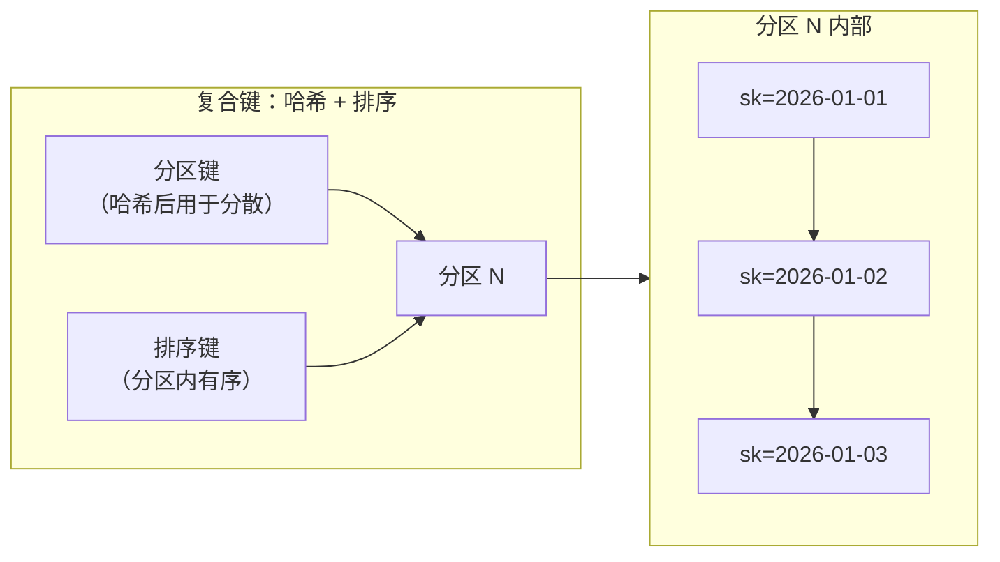
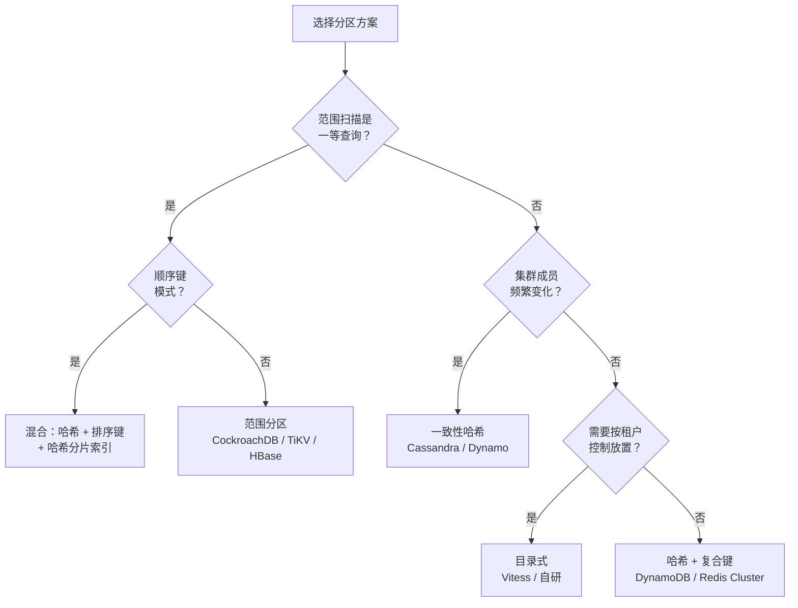

# 分区方案：范围、哈希、一致性哈希与目录

> **TL;DR.** 每个横向扩展的数据库都要切分数据，而它选的方案决定了哪些查询便宜、哪些昂贵、再平衡有多痛。哈希分区（DynamoDB、Redis Cluster）把负载摊匀，但断送了范围扫描。范围分区（CockroachDB、HBase、TiKV）让范围扫描便宜，却在顺序写入上造出热尾。一致性哈希（Cassandra、Dynamo）在节点加入或离开时把数据移动降到最少。目录式分区（Vitess）给出租户级的放置灵活性，代价是一次查找跳转。对大多数负载，默认选带复合键（分区键 + 排序键）的哈希；只有当范围扫描占主导时才升级到范围分区；当鲸鱼租户需要隔离时再加一层目录。

## 学习目标

- 从查询支持、再平衡成本、热点风险三个维度比较范围、哈希、一致性哈希与目录分区。
- 识别哪些负载特征会让某一种方案更合适。
- 论证一种把哈希分散与分区内范围局部性结合起来的复合键混合方案。
- 剖析真实系统（DynamoDB、CockroachDB、Redis Cluster、Vitess），解释它们各自为什么选那种方案。

## 核心权衡

根本矛盾是**均匀分布与局部性之争**。哈希分区为了把负载摊匀而摧毁键的顺序，所以“最近一小时的所有事件”这类范围扫描必须扇出到每一个分区[^1]。范围分区保住了顺序，这类扫描就便宜，但顺序写入（时间戳、自增 ID）全堆在最新的那个范围上，造出热尾[^2][^3]。

第二个矛盾是**再平衡成本**。朴素的 `hash(key) % N` 在 N 变化时几乎要把所有键重新映射一遍。一致性哈希在加入或离开一个节点时只搬 K/N 个键[^4]。目录式方案在你显式把某个租户重新分配之前一个字节都不搬，但多了一次查找跳转，并且对目录服务形成了关键路径依赖[^5]。

没有哪种方案在所有维度上都赢。决策取决于你的主要访问模式是点查、范围扫描，还是成员的动态变化。

*每种方案都是拿一个维度换另一个维度；没有哪种做法能在所有负载下通吃。*

## 逐项对比

| 维度 | 范围 | 哈希（固定槽位） | 一致性哈希 | 目录 |
|---|---|---|---|---|
| 范围扫描成本 | 一到两个分区[^2] | 扇出到所有分区[^1] | 扇出到所有分区 | 取决于 vindex 设计[^6] |
| 点查成本 | Log(ranges) 次元数据跳转 | O(1) 槽位计算[^7] | O(1) 环上遍历 | 一次目录查找 + 数据读取 |
| 写入分布 | 顺序键上的热尾[^3] | 均匀 | 有 vnode 时均匀[^8] | 由运维控制 |
| 再平衡的移动量 | 原地分裂（仅元数据）[^9] | N 变化时几乎全部键都要搬 | 只搬 K/N 个键[^4] | 显式重新分配前为零 |
| 运维复杂度 | 自动分裂、自动合并 | 简单，槽位数固定 | 虚拟节点、token 管理 | 目录高可用、缓存一致性 |
| 热点缓解 | 哈希分片索引（需显式开启）[^10] | 加后缀做写入分片[^11] | 有界负载算法[^12] | 把租户迁到专用分片 |
| 规模上限 | 数十亿个 range（Spanner 级） | 16,384 个槽位（Redis Cluster）[^7] | 与 vnode 数量成正比 | 受目录吞吐限制 |
| 代表系统 | CockroachDB、HBase、TiKV | Redis Cluster、DynamoDB | Cassandra、Amazon Dynamo | Vitess、多租户 SaaS |

这张表低估了一件事：再平衡成本从来不是零。即便是 CockroachDB 的“仅元数据”分裂，后面也紧跟着副本再平衡——在 Raft 重配置期间把 Pebble 数据流式传给新节点[^13]。而一致性哈希的 K/N 保证意味着，往 10 节点集群里加一个节点仍要搬走 10% 的数据，在 PB 级上就是几 TB 的网络传输。

“规模上限”那一行比看上去更重要。Redis Cluster 的规范建议节点数最多约 1,000 个，而 16,384 个槽位给出的理论上限是 16,384 个 master[^7]。如果你需要更多，你需要换一种方案，或者做分层架构。

## 何时选择哈希分区

**点查占主导，范围查询很少或只用于报表。** 按 ID 取用户资料、会话存储、键值缓存都属于这一类。DynamoDB 对分区键做哈希，在每秒数百万次操作下仍能均匀分布[^1]。

**你需要可预测的写入分布。** 哈希摧毁了顺序，顺序时间戳因此不会堆到同一个分区上。Redis Cluster 的 CRC16 mod 16,384 不管输入是什么形态都能把键摊匀[^7]。

**集群规模稳定。** 固定槽位方案（Redis Cluster 的 16,384 个槽位、Cassandra 的 vnode）能从容应对成员变化，因为重新分配的是槽位而不是键[^8]。但如果你用的是没有预分片的朴素取模，加一个节点几乎要把一切都重映射[^14]。

**复合键把两边的好处都拿到。** DynamoDB 的分区键 + 排序键先对前者哈希选定分区，再在分区内让后者保持有序。点查和分区内范围扫描都便宜[^15]。

## 何时选择范围分区

**范围扫描是一等查询。** 时序数据（“09:00 到 10:00 之间的所有事件”）、字典序前缀扫描（“所有名字以 'Sm' 开头的用户”）、有序分页。CockroachDB 和 TiKV 从一到两个 range 里就取到了，不需要扇出[^2][^3]。

**自动分裂能跟着数据长。** CockroachDB 在 512 MiB 处分裂 range[^16]；TiKV 是 96 MB[^3]；HBase 是 10 GB[^17]。数据增长时不需要人工介入。

**你有办法缓解热尾。** 在时间戳前面加上租户 ID 或桶编号，写入就能散到多个 range 上。CockroachDB 提供哈希分片索引，作为顺序负载的显式逃生口[^10]。

**注意：** 如果你的主键是不带前缀的单调时间戳，每一次写入都落在最后一个 range 上。这是生产环境里最常见的分区错误。

## 何时选择一致性哈希

**成员动态变化是常态。** 节点每小时加入和离开的缓存集群、CDN 边缘服务器、节点不断更替的 Dynamo 式存储。一致性哈希在每次成员变化时只搬 K/N 个键[^4][^18]。

**扩量时你需要尽量小的扰动。** 往 100 节点的 Cassandra 集群加一个节点，只搬大约 1% 的数据，而不是 99%[^14]。

**虚拟节点能抹平方差。** 没有 vnode 时，有的节点会拿到大约 2 倍于平均值的负载[^19]。Cassandra 3.x 默认每节点 256 个 vnode，Cassandra 4.0+ 默认 16 个[^8]。Jump consistent hash（Lamping 与 Veach，2014）在零内存、O(ln N) 时间内达到完美均衡[^20]。有界负载一致性哈希把任何节点的负载压在均值的 (1 + epsilon) 倍以内[^12]。

## 何时选择目录式分区

**按租户放置的灵活性不可妥协。** 多租户 SaaS 里某个鲸鱼客户需要独占分片，或者合规要求数据必须落在特定区域。目录把 `tenant_id` 映射到分片，完全自由[^5]。

**分片异构是可以接受的。** 有的分片更大，有的副本更多，有的跑在更强的机器上。目录把这一切都编码进去，而不必去约束哈希函数。

**你能承受这份运维重量。** 目录本身就是一个关键服务。它必须高可用、缓存得足够激进、并且保持一致。Vitess 的 `vtgate` 每次查询都要查 VSchema[^6]。目录挂了，路由就挂了。

## 混合路线

大多数生产系统会把两种以上的方案组合起来。主流形态是**用一致性哈希映射预分片的虚拟分区，同时对已知的重租户保留一份目录**。

DynamoDB 对分区键做哈希，从众多内部分区里选一个，用自适应容量重新分配余量，并自动分裂热分区[^1]。Cassandra 在一致性哈希环上给每个物理节点分配 vnode（3.x 是 256 个，4.0+ 是 16 个）[^8]。Vitess 用目录（VSchema）通过可配置的 vindex 把行映射到分片，路由基于键区间[^6]。

复合键模式（对分区键哈希，在分区内排序）是适用面最广的混合做法。它给写入哈希级别的负载分散，给读取在同一个逻辑组内范围级别的局部性[^15]。

*复合键对分区键做哈希以获得均匀分布，再在每个分区内让排序键保持有序，从而拿到便宜的范围扫描。*

## 真实案例

**DynamoDB** 对分区键做哈希，把每秒数百万次操作摊到内部分区上，每个分区的上限是 3,000 RCU 和 1,000 WCU[^15]。某个分区过热时，split-for-heat 会把它分裂，但前提是排序键的基数足够大、分裂才有收益。分区键基数低、排序键单调递增的组合，无论自适应机制怎么努力，吞吐都被压在 1,000 WCU[^1]。官方给出的缓解手段是写入分片：往分区键后面追加一个随机后缀（1 到 200）[^11]。

**CockroachDB** 把整个键空间范围分区成 512 MiB 的 range，每个 range 是一个带三个副本的 Raft group[^16][^9]。分裂是对 Pebble 存储的元数据操作。对顺序负载，哈希分片索引把写入散到许多 range 上，代价是失去范围扫描的局部性[^10]。2026 年 2 月的一份安全公告记录了一个 MVCC 垃圾回收与 range 分裂之间的竞态，在特定条件下可能删掉活数据[^21]。

**Redis Cluster** 在安装时就固定下 16,384 个哈希槽。节点各自拥有一部分槽位；重分片通过 `MIGRATE` 一次搬一个槽[^7]。哈希标签（`{user1000}.followers`）把相关的键强制放进同一个槽，以便多键操作。16,384 这个上限的来源是 gossip 心跳要携带完整的槽位位图；槽位数翻倍就会让 gossip 带宽翻倍[^7]。

## 常见错误

> [!WARNING]
> **把时间戳当成唯一的分区键。** 所有写入都落在最新的分区上，99% 的容量闲着。加租户 ID 或桶编号做前缀，或者用哈希分片索引[^10][^11]。

> [!WARNING]
> **没有预分片的朴素取模。** N 变一个，`hash(key) % N` 几乎把所有键都重映射。用固定槽位预分片（Redis：16,384 个槽）或一致性哈希，才能保证只搬 K/N 个键[^14][^4]。

> [!WARNING]
> **把分区键和排序键搞混。** 只按排序键过滤的查询必须扇出到每一个分区。先按查询建模，再定 schema；分区键决定路由，排序键决定分区内的顺序[^15]。

> [!WARNING]
> **上线时分片太少。** 单分片的 MVP 在流量涨起来时会撞上限。预分到 256 到 1,024 个虚拟分区，这样未来 3 到 5 年只做重分配、不用重分片[^8]。

## 决策清单

- [ ] 范围扫描是一等查询，还是只用于报表（能容忍扇出）？
- [ ] 分区键是否单调（时间戳、自增）？如果是，对它做哈希或加前缀。
- [ ] 集群成员会频繁变化吗（每周扩量、节点更替）？
- [ ] 有没有哪个租户大到值得独占一个分片？
- [ ] 你有没有预分到足够多的虚拟分区，能撑 3 到 5 年的增长？
- [ ] 你能说出单分区的吞吐上限吗（DynamoDB：1,000 WCU）？
- [ ] 你的复合键分区键基数够不够大，能避开热分区？

*决策流程图：从你的主要查询模式出发，再考虑成员动态和租户隔离需求。*

## 要点回顾

- 哈希分区是点查负载的安全默认。加一个排序键就能拿到分区内的范围局部性。
- 范围扫描占主导时范围分区才是对的，但你必须缓解顺序键上的热尾。
- 一致性哈希解决的是再平衡成本（K/N 的移动量），不是查询路由。节点频繁更替时用它。
- 目录式分区是为了鲸鱼租户隔离和异构放置，不是通用路由。
- 决策是按表做的，不是按库做的。同一个系统可以对用户查询用哈希、对时序数据用范围。

## 延伸阅读

- [Scaling DynamoDB: partitions, hot keys, and split for heat](https://aws.amazon.com/blogs/database/part-3-scaling-dynamodb-how-partitions-hot-keys-and-split-for-heat-impact-performance/)：DynamoDB 内部分区、自适应容量与 split-for-heat 机制的权威导览。
- [Karger et al., “Consistent Hashing and Random Trees”, STOC 1997](https://dl.acm.org/doi/10.1145/258533.258660)：原始论文；至今仍是对环结构和 K/N 移动保证最清楚的解释。
- [Lamping and Veach, “A Fast, Minimal Memory, Consistent Hash Algorithm”, 2014](https://arxiv.org/abs/1406.2294)：五行代码实现的 jump consistent hash；任何动手实现分区的人都该先读这篇。
- [How CockroachDB Automates Operations](https://www.cockroachlabs.com/blog/automated-rebalance-and-repair/)：自动再平衡与修复的机制，带具体的 range 大小和死节点超时数值。
- [Redis Cluster specification](https://redis.io/docs/latest/operate/oss_and_stack/reference/cluster-spec/)：16,384 槽的设计、MOVED/ASK 重定向、gossip 协议与哈希标签。
- [How Discord Stores Trillions of Messages](https://discord.com/blog/how-discord-stores-trillions-of-messages)：大规模下 Cassandra 热分区的痛，以及带请求合并的 ScyllaDB 迁移。

## 记忆卡片

<strong>Q: 哈希分区与范围分区的核心矛盾是什么？</strong>

A: 哈希分区把负载摊匀，但摧毁键的顺序，让范围扫描变贵（要扇出到所有分区）。范围分区保住顺序、范围扫描便宜，但在顺序写入上造出热尾。

<strong>Q: 往一致性哈希环里加一个节点，会搬走多少数据？</strong>

A: 大约 K/N 个键，K 是键总数，N 是新的节点数。只有新节点与它前驱之间的那些键会被重新分配。没有虚拟节点时方差很大（有的节点会拿到平均负载的 2 倍）。

<strong>Q: DynamoDB 的单分区吞吐上限是多少？</strong>

A: 每秒 3,000 个读容量单位、每秒 1,000 个写容量单位，每个分区的存储大约 10 GB。

<strong>Q: Redis Cluster 为什么正好用 16,384 个哈希槽？</strong>

A: gossip 心跳要携带完整的槽位位图。16,384 个槽（CRC16 的 14 位）在槽粒度和 gossip 带宽之间取得了平衡。换成 65,536 个槽（数量 4 倍）会让每条心跳消息里的位图从 2KB 膨胀到 8KB。

<strong>Q: “把时间戳当分区键”这个反模式是怎么回事？</strong>

A: 因为时间戳单调递增，所有写入都落在最新的那个分区上。99% 的分区闲着，一个分区被打满。缓解办法是加租户 ID 前缀、做分桶，或者用哈希分片索引。

<strong>Q: 复合键（分区键 + 排序键）怎样把哈希与范围的好处结合起来？</strong>

A: 分区键做哈希，换来跨分区的均匀分布。排序键在每个分区内维持顺序。点查只打一个分区；同一个分区键内的范围扫描很便宜。跨分区的范围扫描仍然需要扇出。

<strong>Q: 什么时候该选目录式分区而不是一致性哈希？</strong>

A: 当你需要按租户控制放置时（鲸鱼租户隔离、合规要求的数据驻留、分片大小异构）。目录多了一次查找跳转和一条关键路径依赖，但换来了对“哪份数据放在哪里”的完全掌控。

## 参考文献

[^1]: Jason Hunter and Vivek Natarajan. "Scaling DynamoDB (Part 3): Summary and best practices." AWS Database Blog, January 2023. https://aws.amazon.com/blogs/database/part-3-scaling-dynamodb-how-partitions-hot-keys-and-split-for-heat-impact-performance/
[^2]: Cockroach Labs. "Range / Shard glossary entry." https://www.cockroachlabs.com/glossary/distributed-db/range-shard/
[^3]: "Coprocessor Config: region-split-size 96MB default." TiKV docs. https://tikv.org/docs/4.0/tasks/configure/coprocessor/
[^4]: David Karger et al. "Consistent Hashing and Random Trees." STOC 1997. https://dl.acm.org/doi/10.1145/258533.258660
[^5]: Vitess. "VSchema and Query Serving." https://vitess.io/docs/24.0/user-guides/vschema-guide/
[^6]: Vitess. "Sharded Keyspace." https://vitess.io/docs/user-guides/vschema-guide/sharded/
[^7]: "Redis cluster specification." Redis Docs. https://redis.io/docs/latest/operate/oss_and_stack/reference/cluster-spec/
[^8]: "cassandra.yaml file configuration (num_tokens)." Apache Cassandra docs. 3.11 default: 256; 4.0+ default: 16. https://cassandra.apache.org/doc/4.0/cassandra/configuration/cass_yaml_file.html
[^9]: Bram Gruneir. "How CockroachDB Automates Operations." Cockroach Labs blog, 2017. https://www.cockroachlabs.com/blog/automated-rebalance-and-repair/
[^10]: Cockroach Labs. "Hash-Sharded Indexes." CockroachDB docs. https://www.cockroachlabs.com/docs/stable/hash-sharded-indexes.html
[^11]: "Using write sharding to distribute workloads evenly in your DynamoDB table." AWS docs. https://docs.aws.amazon.com/amazondynamodb/latest/developerguide/bp-partition-key-sharding.html
[^12]: Vahab Mirrokni, Mikkel Thorup, Morteza Zadimoghaddam. "Consistent Hashing with Bounded Loads." arXiv:1608.01350, 2016. https://arxiv.org/abs/1608.01350
[^13]: Jack Vanlightly. "Serverless CockroachDB ASDS Chapter 4 part 3: heat management." 2023. https://jack-vanlightly.com/analyses/2023/11/21/serverless-cockroachdb-asds-chapter-4-part-3
[^14]: David Karger et al. "Web Caching with Consistent Hashing." 1999. https://web.archive.org/web/20240625143825/https://www.cs.cmu.edu/~srini/15-744/F04/readings/K+99.html
[^15]: "Partitions and data distribution in DynamoDB." AWS docs. https://docs.aws.amazon.com/amazondynamodb/latest/developerguide/HowItWorks.Partitions.html
[^16]: Cockroach Labs. "Replication Controls." https://www.cockroachlabs.com/docs/configure-replication-zones.html
[^17]: HBase region split basics. hbase.hregion.max.filesize default 10 GB. https://knowledge.broadcom.com/external/article/294551/hbase-basics.html
[^18]: Giuseppe DeCandia et al. "Dynamo: Amazon's Highly Available Key-value Store." SOSP 2007. https://www.amazon.science/publications/dynamo-amazons-highly-available-key-value-store
[^19]: Consistent hashing load variance with virtual nodes. Karger et al., 1997. https://people.csail.mit.edu/karger/Talks/Hash/index.htm
[^20]: John Lamping and Eric Veach. "A Fast, Minimal Memory, Consistent Hash Algorithm." arXiv:1406.2294, 2014. https://arxiv.org/abs/1406.2294v1
[^21]: Cockroach Labs. "Technical Advisory 162085: MVCC garbage collection and range split race." https://www.cockroachlabs.com/docs/advisories/a162085
