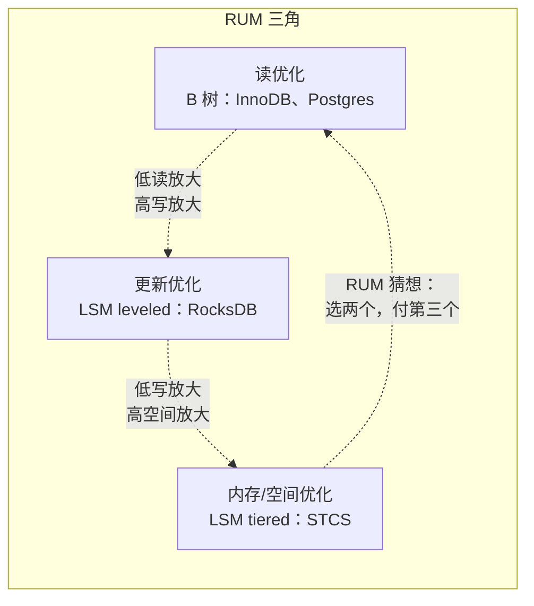
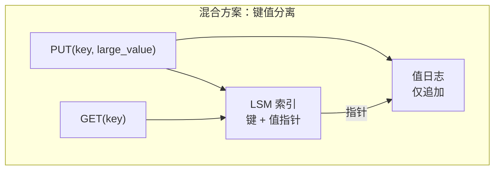
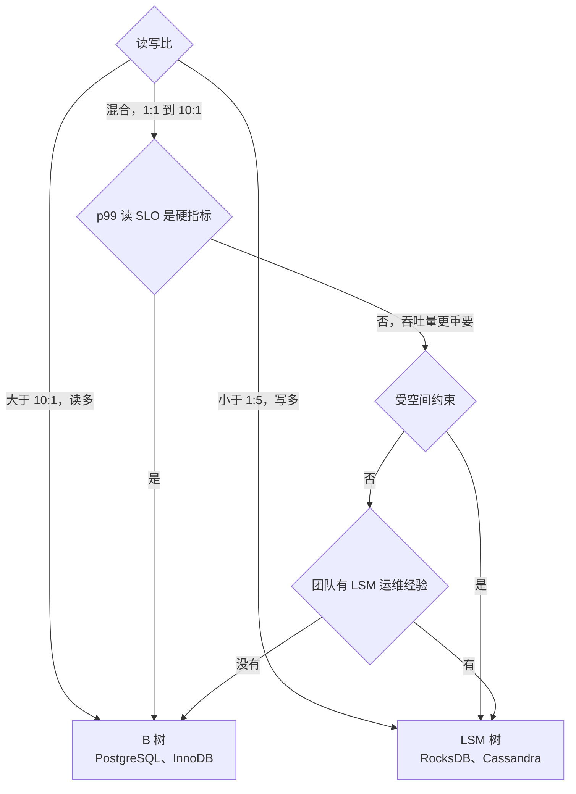

# B 树与 LSM 树的存储选型

> **TL;DR.** B 树用可预测的 3-5 次页 I/O 查找来优化读，代价是整页重写导致的 5-10 倍写放大[^1]。LSM 树用顺序的批量刷盘来优化写，代价是 compaction 导致的 10-30 倍写放大，再加上跨多个有序层级的读路径开销[^2]。读写比超过 10:1、且 p99 读延迟是硬性 SLO 时选 B 树。写入占主导、又能容忍 compaction 带来的延迟抖动时选 LSM。起决定作用的维度是读写比。

## 学习目标

- 从读放大、写放大、空间放大和长尾延迟四个角度对比 B 树与 LSM 树。
- 识别哪些负载特征（读写比、值大小、删除频率）会让某一引擎更占优。
- 为混合负载论证混合方案（键值分离、按集合选引擎）的合理性。
- 把 Facebook MyRocks、CockroachDB Pebble 和 Cassandra 的 compaction 策略当作生产决策案例来评估。

## 核心权衡

RUM 猜想（Athanassoulis 等，EDBT 2016）把这种张力讲得很精确：对任何访问方法来说，在读开销、更新开销、内存/空间开销这三者中优化其中两个，第三个就必然被推高[^3]。B 树坐落在“读”这个角附近：一次点查无论数据集多大，都要走 3-4 层 8 KB 的页树[^4]，但每写一条 50 字节的更新，都要重写整页再加 WAL。LSM 树坐落在“更新”这个角附近：写入是顺序的、成批刷进 memtable，但读必须探测多个有序层级，而且 compaction 会把数据重写 10-30 倍[^2][^5]。

两个方向正好相反的指标是 I/O 模式。B 树发出随机写（脏页刷到磁盘上任意位置），但随机读很快（走一次树就行）。LSM 树发出顺序写（只追加的刷盘），但读要扇出到各层。在闪存上，顺序写能延长 SSD 寿命；随机整页重写则会把写周期浪费在根本没变的字节上。

*RUM 猜想把 B 树摆在“读”角附近，把各种 LSM 变体摆在更新—内存这条边上；没有哪个引擎能逃出这个三角。*

## 逐项对比

| 维度 | B 树（InnoDB、PostgreSQL） | LSM 树（RocksDB、Cassandra） |
|---|---|---|
| 点查延迟 | 3-5 次页 I/O，p99 稳定[^4] | memtable + 布隆过滤后的层级探测，p99 有波动 |
| 写吞吐量 | 受随机页 I/O 限制 | 同等硬件上持续写入最高可达 10 倍以上[^1] |
| 写放大 | 5-10 倍（页重写 + double-write buffer）[^1] | leveled 为 10-30 倍，tiered 约为 2-3 倍[^2][^5] |
| 空间放大 | 页填充因子留下约 33% 空隙 | leveled 约 10%，tiered 在 compaction 期间最高到 2 倍[^6] |
| 范围扫描 | 顺序遍历叶子页，快 | 必须跨层归并，较慢 |
| 负载下的长尾延迟 | 稳定（没有后台重写） | compaction 卡顿时出现尖刺[^7] |
| 运维复杂度 | 数十年的工具积累（vacuum、repack） | 要调 compaction、盯 L0 stall |
| 删除处理 | 原地标记 + vacuum | 墓碑一直累积，直到 compaction 清理[^8] |

这张表低估了一个维度：运维上的意外。B 树数据库在负载下的行为可预测，因为更新都是原地发生的。LSM 数据库有一个后台进程（compaction）会和前台读争抢 I/O 和 CPU。compaction 跟不上时，写入就会卡住[^7]。这是实践中最关键的一项运维差异。

范围扫描是另一个隐蔽的差距。在 PostgreSQL 和 InnoDB 里，B 树的叶子页是双向链接的，范围扫描就是一次顺序遍历。LSM 的范围扫描必须把每一层的迭代器归并起来，因为布隆过滤器只对点查有用[^9]。

## 何时选 B 树

**读占主导、且 p99 SLO 是硬指标的 OLTP。** 读写比超过 10:1 的 Web 应用。用户信息查询、订单历史、会话读取。PostgreSQL 和 InnoDB 处理这类请求只需 3-4 次页 I/O，与表大小无关[^4][^10]。

**频繁范围扫描的负载。** 报表查询、分页、对索引列做时间范围过滤。B 树的叶子遍历是顺序的；LSM 必须跨层归并。

**团队没有 compaction 经验的场景。** B 树的运维工具很成熟：`VACUUM`、`pg_repack`、InnoDB buffer pool 调参、在线索引重建。故障模式都有详尽文档，也能恢复。

**预置 IOPS 上的中小数据集（1 TB 以下）。** 存储不是瓶颈时，B 树架构更简单，在可调试性和可预测性上胜出。

**代表系统：** PostgreSQL、MySQL/InnoDB、SQLite、Oracle、SQL Server。

## 何时选 LSM 树

**写密集的写入场景，且吞吐上限很关键。** 时序数据、事件溯源、日志聚合、IoT 遥测。同样的闪存上，LSM 能撑住的写入速率最高可达 B 树的 10 倍以上[^1][^11]。

**空间受限、且压缩效率重要的环境。** MyRocks 的落盘体积比压缩后的 InnoDB 还小一半，因为 SSTable 不按页对齐：一个压缩后为 5 KB 的块就正好占 5 KB[^1]。Facebook 从 InnoDB 迁到 MyRocks 后，把 UDB 实例规格缩减了 62.3%[^12]。

**以追加为主、更新和删除很少的负载。** 聊天消息、社交信息流事件、区块链状态。删除很少时，墓碑几乎不会累积。

**对 SSD 寿命敏感的环境。** 即使写放大在数字上更高，顺序写也能减少闪存磨损，因为 SSD 控制器处理顺序模式的效率高于随机页重写[^1]。

**代表系统：** RocksDB、LevelDB、Cassandra、ScyllaDB、CockroachDB（Pebble）、TiKV、BadgerDB。

## 混合路径

大多数生产系统不会所有场景都只用一个引擎。实用的混合策略有：

**键值分离（WiscKey）。** 键留在 LSM 里，大值放进单独只追加的值日志。compaction 只重写（很小的）键，在大值负载下把 compaction 成本相对 LevelDB 降低 2.5-111 倍[^13]。BadgerDB 和 TitanDB 在生产中实现了这一方案。

**按集合选引擎。** MongoDB 的 WiredTiger 支持每个 collection 单独选 B 树或 LSM。实践中 LSM 模式很少用，因为 WiredTiger 的 B 树本身已经用了压缩和预写日志。混合选项存在，但“只选一个引擎”仍是合理的默认。

**写入用 tiered、读取用 leveled。** Cassandra 5.0 的统一 compaction 策略（UCS）在 tiered 与 leveled 行为之间自适应，只暴露一个 `scaling_parameters` 旋钮，省掉了事先做选择的需要[^14][^15]。

*键值分离（WiscKey）只重写很小的键，从而把 compaction 成本压下来；大值放在单独的只追加日志里。*

## 真实案例

**Facebook MyRocks（2016 年至今）。** Facebook 把用户数据库（UDB）从压缩的 InnoDB 迁到 MyRocks（RocksDB 作为 MySQL 的存储引擎）。结果：单区域省下 50% 存储，整体实例规格缩小 62.3%，闪存写 I/O 减少“一个数量级到几个数量级”[^1][^12]。动机是空间而不是速度：内部的 SSD 卡在容量上，不是卡在 IOPS 上[^16]。他们还启用了“无需读的复制”，让从库跳过了 InnoDB 更新二级索引时必不可少的那次随机读。

**CockroachDB Pebble（2020 年至今）。** CockroachDB 用 Pebble 换掉了 RocksDB，这是从零写的 Go 版 LSM（约 4.5 万行代码，RocksDB 约 35 万行）[^17]。Pebble 实现了 L0 sublevels，可以让多个 compaction 从 L0 并发进行，降低了写停顿的频率。在 YCSB 的 workload C（100% 读）上，Pebble 因为块缓存并发性更好而胜过 RocksDB[^17]。

**Discord 从 Cassandra 迁到 ScyllaDB。** Discord 万亿级消息的负载暴露了 Cassandra 的多个痛点：热分片、compaction 积压、JVM GC 停顿逼得值班工程师手动重启节点。那些一直没被 compaction 清理掉的墓碑，甚至把迁移的最后一步卡在 99.9999%，直到对受影响的 token 范围做强制 compaction 才通过[^8]。解决办法不是调某一个旋钮：Discord 换到 ScyllaDB（C++、每核一个分片、无 GC），并在数据库前加了 Rust 数据服务，通过一致性哈希路由把重复的读合并掉。拉取历史消息的 p99 从 Cassandra 上的 40-125 ms 变成 ScyllaDB 上稳定 15 ms；写入的 p99 从 5-70 ms 变成稳定 5 ms。集群从 177 个 Cassandra 节点缩到 72 个 ScyllaDB 节点[^8]。

## 常见错误

> [!WARNING]
> **因为“它扩展性更好”就给读密集型负载选 LSM。** LSM 扩展的是写，不是读。一个 95% 都是读的负载跑在 RocksDB 上，要为它根本用不到的那点写优化付 compaction 开销。用 B 树。

> [!WARNING]
> **在延迟基准测试里忽略 compaction 停顿。** 在稳态（没有 compaction）测 LSM，会得到虚高的 p99 数字。一定要在 compaction 高峰期测。RocksDB 在 L0 堆到 36 个文件时直接停止写入[^7][^18]。

> [!WARNING]
> **磁盘利用率超过 50% 还跑 Cassandra 的 STCS。** STCS 在大合并期间会暂时把磁盘占用翻倍。使用率超过 50% 的节点会写满磁盘然后崩掉[^6]。磁盘余量紧张就用 LCS 或 ICS。

> [!WARNING]
> **在删除密集的 LSM 负载里忽略墓碑累积。** 删除写的是逻辑墓碑，只有过了 `gc_grace_seconds`（Cassandra 默认 10 天）才会被清掉。在那之前，每次读都要扫过它们。删除密集的模式就用 TTL 过期或时间窗口 compaction[^8]。

## 决策清单

- [ ] 读写比是否高于 10:1？是，就选 B 树。
- [ ] p99 读延迟是不是不能容忍 compaction 尖刺的硬性 SLO？是，就选 B 树。
- [ ] 单节点持续写入是否超过 5 万次/秒？是，就选 LSM。
- [ ] 落盘体积是不是硬约束（受空间限制而不是受 IOPS 限制）？是，就选 LSM。
- [ ] 删除是否频繁（超过 10% 的操作）？是，就选 B 树，或者配 TWCS/TTL 的 LSM。
- [ ] 团队有没有调 compaction 的经验？没有，B 树在运维上更安全。
- [ ] 值是否很大（超过 1 KB）？是，就考虑键值分离（WiscKey/Titan）。

*决策流程：读写比是第一判别条件；对混合负载来说，运维经验是打破平局的那一项。*

## 要点回顾

- 读用 B 树，写用 LSM。读写比是选引擎最强的单一信号。
- 写放大是两种引擎的隐性成本：B 树为页重写付 5-10 倍，LSM 为 compaction 付 10-30 倍。天下没有免费的部分。
- LSM 的运维复杂度是实打实的：compaction 停顿、墓碑累积、L0 背压，都是 B 树数据库不会遇到的生产事故。
- Facebook 迁到 LSM（MyRocks）省下 50% 存储，是因为它的负载卡在空间而不是卡在 IOPS[^1]。选之前先弄清自己的硬约束。
- RUM 猜想保证了没有引擎能在三个维度上全胜。有意识地接受这个权衡。

## 延伸阅读

- [Facebook Engineering, "MyRocks: A space- and write-optimized MySQL database"](https://engineering.fb.com/core-data/myrocks-a-space-and-write-optimized-mysql-database/)：最经典的生产迁移案例；省 50% 存储，闪存 I/O 少几个数量级。
- [Athanassoulis et al., "Designing Access Methods: The RUM Conjecture", EDBT 2016](http://daslab.seas.harvard.edu/rum-conjecture)：理解为什么没有存储引擎能同时优化三个维度的理论框架。
- [RocksDB Wiki: Leveled Compaction](https://github.com/facebook/rocksdb/wiki/Leveled-Compaction)：RocksDB 默认 compaction 策略、写放大算法和调参项的权威参考。
- [Lu et al., "WiscKey: Separating Keys from Values in SSD-conscious Storage", FAST 2016](https://www.usenix.org/conference/fast16/technical-sessions/presentation/lu)：键值分离，在大值负载下把 compaction 成本降低 2.5-111 倍。
- [Discord, "How Discord Stores Trillions of Messages"](https://discord.com/blog/how-discord-stores-trillions-of-messages)：墓碑累积、compaction 策略失效，以及从 Cassandra 迁到 ScyllaDB 的全过程。
- [Cockroach Labs, "Introducing Pebble"](https://www.cockroachlabs.com/blog/pebble-rocksdb-kv-store)：CockroachDB 为什么用 Go 重写 RocksDB；L0 sublevels、并发 compaction，以及 4.5 万行对 35 万行。

## 记忆卡片

<strong>Q: RUM 猜想对存储引擎设计说了什么？</strong>

A: 你最多只能优化读开销、更新开销、内存/空间开销这三者中的两个，第三个存在下界。B 树优化读 + 内存、为更新付出代价；LSM leveled 优化更新 + 内存、为读付出代价。

<strong>Q: B 树和 LSM leveled 的典型写放大是多少？</strong>

A: B 树（InnoDB）：页重写加 double-write buffer 带来 5-10 倍。LSM leveled（RocksDB）：compaction 逐层向下级联带来 10-30 倍。

<strong>Q: RocksDB 什么时候停止接受写入？</strong>

A: L0 累积到 36 个文件时（`level0_stop_writes_trigger` 的默认值）。L0 到 20 个文件时写入开始变慢。这发生在 compaction 跟不上 memtable 刷盘的时候。

<strong>Q: Facebook 把 UDB 从 InnoDB 迁到 MyRocks 省了多少存储？</strong>

A: 单区域 50%；整体实例规格缩减 62.3%。MyRocks 比压缩后的 InnoDB 小一半，比未压缩的 InnoDB 小三倍半。

<strong>Q: 为什么 LSM 上的范围扫描比 B 树慢？</strong>

A: B 树的叶子页是顺序链接的，范围扫描按顺序走过去就行。LSM 必须归并每一层的迭代器，因为布隆过滤器只加速点查，对范围查询没用。

<strong>Q: LSM 删除里的墓碑问题是什么？</strong>

A: 删除写的是一个逻辑墓碑，不是立即移除。墓碑会一直留着，直到 compaction 清掉它（Cassandra 里要等 `gc_grace_seconds`，默认 10 天）。读必须扫过累积的墓碑，p99 延迟因此变差。

<strong>Q: 为什么 STCS 需要 50% 的磁盘余量？</strong>

A: 分层（size-tiered）compaction 先写出新的合并后 SSTable，再删除输入文件。最大的一次合并可能暂时把磁盘占用翻倍。使用率超过 50% 的节点有在 compaction 期间写满磁盘的风险。

<strong>Q: 什么是键值分离，什么时候该用它？</strong>

A: 键放在 LSM 索引里，大值放在单独只追加的日志里（WiscKey 的设计）。compaction 只重写键，成本降低 2.5-111 倍。值超过约 1 KB、且 compaction 的 I/O 是瓶颈时用它。

## 参考文献

[^1]: Matsunobu. "MyRocks: A space- and write-optimized MySQL database." Facebook Engineering, 2016. https://engineering.fb.com/core-data/myrocks-a-space-and-write-optimized-mysql-database/
[^2]: RocksDB Wiki. "Leveled Compaction." https://github.com/facebook/rocksdb/wiki/Leveled-Compaction
[^3]: Athanassoulis, Kester, Maas, Stoica, Idreos, Ailamaki, Callaghan. "Designing Access Methods: The RUM Conjecture." EDBT 2016. http://daslab.seas.harvard.edu/rum-conjecture
[^4]: PostgreSQL docs. "B-Tree Indexes: Implementation." https://www.postgresql.org/docs/current/btree.html
[^5]: RocksDB Wiki. "Leveled Compaction." https://github.com/facebook/rocksdb/wiki/Leveled-Compaction
[^6]: ScyllaDB docs. "Choose a Compaction Strategy." https://docs.scylladb.com/manual/master/architecture/compaction/compaction-strategies.html
[^7]: RocksDB Wiki. "Write Stalls." https://github.com/facebook/rocksdb/wiki/Write-Stalls
[^8]: Discord Engineering. "How Discord stores trillions of messages." https://discord.com/blog/how-discord-stores-trillions-of-messages
[^9]: RocksDB Wiki. "RocksDB Bloom Filter." https://github.com/facebook/rocksdb/wiki/RocksDB-Bloom-Filter
[^10]: PostgreSQL docs. "B-Tree Indexes." https://www.postgresql.org/docs/current/btree.html
[^11]: RocksDB Wiki. "Compaction." https://github.com/facebook/rocksdb/wiki/Compaction
[^12]: Matsunobu, Dong, Du. "MyRocks: LSM-Tree Database Storage Engine Serving Facebook's Social Graph." VLDB 2020. https://research.facebook.com/publications/myrocks-lsm-tree-database-storage-engine-serving-facebooks-social-graph/
[^13]: Lu, Pillai, Arpaci-Dusseau, Arpaci-Dusseau. "WiscKey: Separating Keys from Values in SSD-conscious Storage." FAST 2016. https://www.usenix.org/conference/fast16/technical-sessions/presentation/lu
[^14]: Apache Cassandra Documentation, "Unified Compaction Strategy (UCS)." https://cassandra.apache.org/doc/latest/cassandra/managing/operating/compaction/ucs.html
[^15]: Apache Cassandra. "Unified Compaction Strategy." https://cassandra.apache.org/_/blog/Apache-Cassandra-5.0-Features-Unified-Compaction-Strategy.html
[^16]: Dong, Callaghan, Galanis, Borthakur, Savor, Stumm. "Optimizing Space Amplification in RocksDB." CIDR 2017. https://research.facebook.com/publications/optimizing-space-amplification-in-rocksdb/
[^17]: Mattis. "Introducing Pebble: A RocksDB-inspired key-value store written in Go." Cockroach Labs, 2020. https://www.cockroachlabs.com/blog/pebble-rocksdb-kv-store
[^18]: RocksDB source. include/rocksdb/advanced_options.h. https://github.com/facebook/rocksdb/blob/main/include/rocksdb/advanced_options.h
