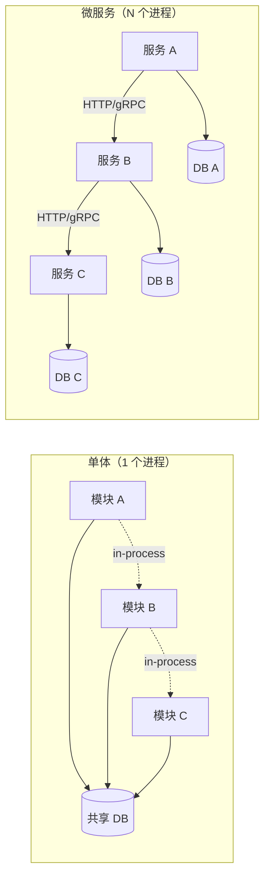
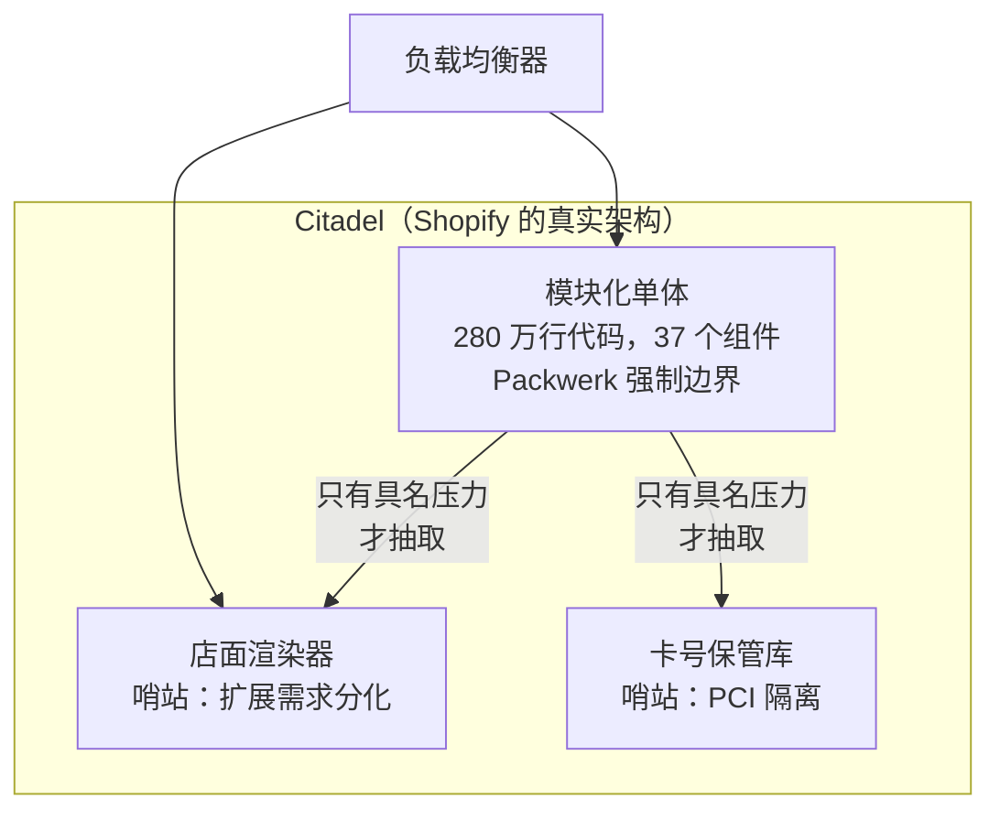
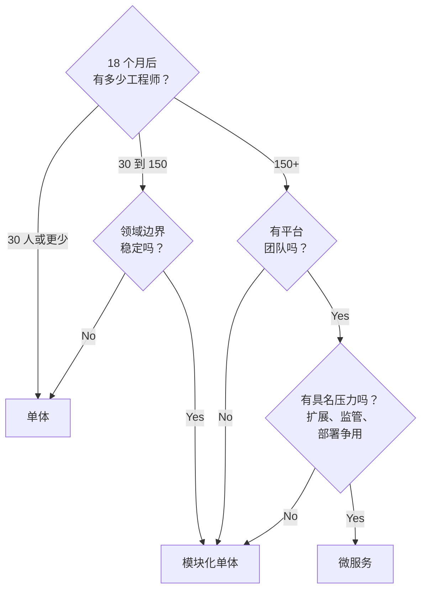

# 单体与微服务

> **TL;DR.** 这是一个伪装成技术决策的组织扩展决策。真正的驱动因素是康威定律[^1]：无论白板上画的是什么，你的架构都会镜像你的团队结构。默认选单体（或模块化单体），直到你能说清某一个具体压力——部署队列争用、扩展需求分化、监管隔离——足以证明值得支付那笔分布式税（distributed tax）。Stack Overflow 用 9 台服务器上的 .NET 单体扛住每天 6600 万页面浏览量[^2]。Shopify 在黑色星期五期间靠模块化单体处理每分钟数千万请求[^3]。微服务不会自动更好，但会自动更贵。

## 学习目标

- 从部署独立性、运维成本、团队自治三个维度比较单体、模块化单体与微服务。
- 识别把决策推向微服务的团队规模阈值与领域稳定性阈值。
- 论证模块化单体是成长型团队（30 到 150 名工程师）的默认选择。
- 以 Segment 的反向迁移和 Uber 的 DOMA 为证据，判断两种路线各自在什么情况下失效。

## 核心权衡

根本张力是**部署独立性 vs 运维开销**。单体给你进程内调用、跨所有模块的 ACID 事务、一个调试器、一条日志流，以及零网络税[^4]。微服务用团队级的部署独立性，换取对每个请求反复征收的一笔税：超时、重试、熔断器、分布式追踪、服务网格、saga 协调、契约版本管理[^5]。

这笔税不是纸上谈兵。当你有 100 个服务依赖、每个各有 1% 的概率变慢时，单个请求至少碰到一次慢响应的概率是 1 - 0.99^100 = 63%[^6]。Segment 记录过 3 名全职工程师被消耗在维持 140 个服务活着上；运维开销“随着每新增一个 destination 线性增长”[^7]。

这个决策可以压缩成三个问题：（1）18 个月后会有多少工程师碰这份代码库；（2）领域边界稳定吗；（3）有多少运维预算可用于分布式系统排障？流量规模很少成为约束条件。

*进程内调用（虚线）是免费的；网络调用（实线）背着完整的分布式税：每一跳都要付超时、重试、版本管理和可观测性。*

## 逐项对比

| 维度 | 单体 | 微服务 |
|---|---|---|
| 部署独立性 | 没有；所有团队共用一个流水线 | 完全独立；每个团队自行发布 |
| 模块间调用成本 | 进程内函数调用（纳秒级） | 网络 RPC（毫秒级 + 各种失败模式） |
| 事务模型 | 跨所有模块的 ACID | Saga、最终一致性、补偿[^8] |
| 扩展方式 | 纵向扩展，或复制同样的副本 | 按服务横向扩展 |
| 技术栈灵活性 | 单一运行时 | 多语言共存（Go、Python、JVM 并排跑）[^6] |
| 运维开销 | 一条日志流、一个调试器 | 服务网格、分布式追踪、每服务独立的 CI/CD |
| 故障爆炸半径 | 整个应用 | 单个服务（前提是边界干净） |
| 开始疼之前的团队上限 | 约 30 名工程师 | 数百人，但要投入平台团队 |

这张表在“故障爆炸半径”一栏会误导人。实践中，多数微服务架构会形成同步调用链，一个慢依赖就向上游层层级联。Uber 的“death star”依赖图证明了这一点：“Uber 最可靠的时候是周末，因为那时候工程师不在改东西”[^6]。真正的故障隔离需要异步边界，而不只是进程边界。

实践中真正占主导的维度是**团队协作成本**。如果你的团队本来就在同一步调上发布、共享同一个迭代节奏，微服务只会增加开销，不会增加独立性。

## 何时选单体

- **团队少于 30 名工程师，单一产品。** 一份代码库、一条部署流水线、一个数据库。跨模块重构严格来说比跨服务重构容易[^4]。Stack Overflow 用 9 台 Web 服务器上的单个 .NET 单体支撑每天约 6600 万页面浏览量，平均渲染时间不足 23 ms[^2]。
- **领域边界还不稳定。** 早期产品每个月都在给实体改名。微服务的边界会把今天这套（错误的）模型固化成网络契约。Fowler 的 MonolithFirst 启发式：“几乎所有我听说过的、从零就按微服务系统来建的案例，最终都陷入了严重麻烦”[^4]。
- **运维预算极少。** 没有服务网格、没有分布式追踪、没有最终一致性排障能力。一个进程、一条日志流、一个值班轮转。
- **Basecamp/HEY（37signals）：** DHH 的“Majestic Monolith”模式，一个 Rails 应用服务数百万用户，团队不到 20 名工程师[^9]。

## 何时选微服务

- **150 名以上工程师、多个自治团队，并且有平台团队。** 康威定律保证架构会镜像组织[^1]。如果 8 个团队各自拥有一个领域，不管你计划与否，他们都会产出 8 个服务。
- **独立部署节奏本身就是一个被点名的痛点。** 支付每周发布，搜索每小时发布，后台工具每月发布。共用一条流水线会把所有人绑在最慢的那个上。
- **扩展需求或运行时需求分化。** ML 推理要 GPU，数据接入要 Go，网关要 Node。单个单体无法干净地承载这三者。
- **监管隔离。** 缩小 PCI 范围、划分 HIPAA 边界，或数据驻留要求，都需要独立的进程与数据归属。
- **Netflix、Amazon、Uber：** 每天数千次部署，因为服务各自独立发布。Uber 运行 4,500 个服务，每周 100,000+ 次部署[^10]。

## 混合路线

现实中的生产终局既不是 200 个微服务，也不是一个 500 万行的单体。而是核心处一个模块化单体，加上少数在具体压力确实成立时才做的定向抽取。

**Shopify** 是参考实现。一个 280 万行的 Ruby 单体，37 个内部组件由 Packwerk 强制约束（每个 PR 都跑静态常量引用分析）[^11][^12]。店铺按 pod 分片以实现租户隔离。只有两项能力被抽成服务：店面渲染（读吞吐需求分化）和信用卡令牌化（缩小 PCI 范围）[^11]。这套架构扛住了黑色星期五每分钟数千万请求[^3]。

DHH 把这个模式命名为“Citadel”：中心是单体，外围是几个针对真正分化负载的小哨站[^9]。

*只有当你能说出具体压力（扩展需求分化、监管隔离）时才抽服务。其余一切留在单体里。*

## 真实案例

**Segment（2018）：** 140+ 个微服务（每个分析 destination 一个），3 名全职人力被运维吞掉。共享库在各仓库之间逐渐发散，因为“赶时间的时候，工程师只会在某个 destination 的代码库里更新版本”[^7]。最终合并回一个服务。共享库的改进数从微服务时期的 32 个，跃升到合并后第一年的 46 个[^7]。

**Uber（2013 到 2020）：** 从 2 个服务长到 4,000+ 个。“death star”依赖图让周末成了最可靠的时间段[^6]。解法不是减少服务，而是增加结构：DOMA 把 2,200 个关键服务归入 70 个域，横向调用经由网关中介。对早期的一个平台使用方来说，功能集成时间从约 3 天降到约 3 小时[^13]。

**Stack Overflow（2016）：** 每天 6600 万页面浏览量，9 台 Web 服务器，一个 .NET 单体，问题页平均渲染时间 22.71 ms[^2]。这证明只要团队够自律，单体也能扩展到令人意外的流量。

## 常见错误

> [!WARNING]
> **过早微服务化。** 15 个工程师的团队建了 20 个服务，40% 的产能花在平台工作上。如果你没有部署协调上的痛点，你就没有上微服务的理由。合并回去[^4]。

> [!WARNING]
> **分布式单体。** 纸面上拆开了，实际却一起部署、共享数据库，或形成 3 跳以上的同步调用链。分布式税全付了，独立性一点没拿到。试金石：升级一个库需要重新部署整个服务集群吗？[^14]

> [!WARNING]
> **照抄别人的组织架构。** 曾在 Spotify 工作的 Jeremiah Lee 写道，squad 模式“从来只是愿景，从未完整落地”。Spotify 的敏捷教练 Joakim Sunden 也确认：“即便在我们写那篇文章的时候，我们也没那么做”[^15]。要参考就用 Team Topologies[^16]，别搞形式主义照搬。

> [!WARNING]
> **先抽错了边界。** 如果单体挂掉时新服务就无法工作，那你抽走的是一个依赖，不是一项能力。要抽的是高内聚、低耦合、数据自包含的业务能力[^11]。

## 决策清单

*决策由团队规模和领域稳定性主导，而非请求量。只有当具名痛点足以证明分布式税值得付时，才跳到微服务。*

- [ ] 18 个月内会有多少工程师同时碰这份代码库？
- [ ] 你的领域边界是稳定的，还是仍在按周变动？
- [ ] 你能说出一项具体的部署协调痛点，它正在消耗可度量的交付速度吗？
- [ ] 你有运维预算来支撑分布式追踪、服务网格和 saga 排障吗？
- [ ] 今天就存在分化的运行时需求（GPU、多语言、监管）吗？
- [ ] 你的技术栈里有模块化单体工具吗（Packwerk、ArchUnit、Go internal packages）？

## 要点回顾

- 康威定律决定你的架构。先塑造团队，系统会跟着走[^1]。
- 默认选单体（或模块化单体），直到某个具名压力证明分布式税值得付。
- 模块化单体是 30 到 150 名工程师的正确中间地带：有团队归属，没有网络边界。
- 微服务是组织扩展工具，不是性能优化手段。
- 如果升级一个库就要重新部署整个服务集群，那你手里的是分布式单体——两头的好处都没拿到[^14]。

## 延伸阅读

- [MonolithFirst](https://martinfowler.com/bliki/MonolithFirst.html) by Martin Fowler, 2015：一页纸的反主流默认选项；引用“不要从微服务起步”时最权威的出处。
- [Goodbye Microservices](https://www.twilio.com/en-us/blog/developers/best-practices/goodbye-microservices) by Alexandra Noonan, Segment, 2018：最经典的反向迁移案例，带具体运维成本数字。
- [Under Deconstruction: The State of Shopify's Monolith](https://shopify.engineering/shopify-monolith) by Philip Muller, 2020：280 万行代码的模块化单体；坦白讲了哪些地方没做成。
- [Introducing Domain-Oriented Microservice Architecture](https://www.uber.com/blog/microservice-architecture/) by Adam Gluck, Uber, 2020：2,200 个微服务加上结构之后，在规模下长什么样。
- [The Majestic Monolith can become The Citadel](https://www.signalvnoise.com/svn3/the-majestic-monolith-can-become-the-citadel/) by DHH, 2020：“单体 + 哨站”这个被命名的模式。
- [Team Topologies](https://teamtopologies.com/book) by Skelton and Pais, 2019：以认知负荷为先的组织设计，用来替代盲目照搬的 squad 模型。

## 记忆卡片

<strong>Q: 单体与微服务的根本权衡是什么？</strong>

A: 部署独立性 vs 运维开销。单体没有网络税，还有 ACID 事务；微服务用每个请求反复缴纳的分布式系统税，换来团队级的部署独立性。

<strong>Q: 团队多大规模时该考虑微服务？</strong>

A: 大约 150 名以上工程师、配平台团队、并且存在具名压力（部署争用、扩展需求分化、监管隔离）时。30 人以下选单体。30 到 150 人之间选模块化单体。

<strong>Q: 什么是分布式单体，怎么发现它？</strong>

A: 必须一起部署、共享数据库，或形成深层同步调用链的服务。试金石：升级一个库版本是否需要重新部署整个服务集群？如果是，你付了全部的分布式税，却没拿到一点独立性。

<strong>Q: Shopify 如何强制模块化单体的边界？</strong>

A: 用 Packwerk，一个 Ruby 静态常量引用分析器，每个 PR 都跑，阻止新的边界违规被合入。它在 280 万行代码上守住 37 个内部组件边界，而不必拆成服务。

<strong>Q: Segment 为什么把 140 个微服务合并回一个？</strong>

A: 运维开销随每个服务线性增长。3 名全职人力被维护工作吞掉。共享库在各仓库之间发散。合并之后，共享库的改进数在头一年从 32 个升到 46 个。

<strong>Q: Uber 的 DOMA 是什么，为什么需要它？</strong>

A: 面向领域的微服务架构（Domain-Oriented Microservice Architecture）。它把 2,200 个关键服务归入 70 个域，横向调用由网关中介，分 5 个依赖层。Uber 没有减少服务数量，而是增加了结构，因为服务的半衰期只有 1.5 年。

<strong>Q: 100 个服务依赖、每个各有 1% 概率变慢，碰到慢请求的概率是多少？</strong>

A: 63%。算法是 1 - 0.99^100。这就是为什么同步微服务调用链会在单个服务都健康的情况下，仍然拖坏长尾延迟。

<strong>Q: 康威定律说了什么，为什么在这里重要？</strong>

A: 组织产出的系统设计会镜像其沟通结构。架构跟着组织架构走，而不是反过来。这意味着单体与微服务的选择本质上是组织扩展决策，不是技术决策。

## 参考文献

[^1]: Melvin E. Conway, "How Do Committees Invent?", Datamation, April 1968. http://www.melconway.com/Home/Committees_Paper.html
[^2]: Nick Craver, "Stack Overflow: The Architecture - 2016 Edition", Stack Overflow Blog, 17 Feb 2016. https://stackoverflow.blog/2016/02/17/stack-overflow-the-architecture-2016-edition/
[^3]: Faun.dev, "How Shopify Handles 30TB of Data Every Minute with a Monolithic Architecture", Oct 2025. Secondary aggregator citing Shopify BFCM scale. https://www.faun.dev/c/links/devopslinks/how-shopify-handles-30tb-of-data-every-minute-with-a-monolithic-architecture/
[^4]: Martin Fowler, "MonolithFirst", martinfowler.com, 3 June 2015. https://martinfowler.com/bliki/MonolithFirst.html
[^5]: James Lewis and Martin Fowler, "Microservices", martinfowler.com, 25 March 2014. https://martinfowler.com/articles/microservices.html
[^6]: Sujeet Jaiswal, "Uber: From Monolith to Domain-Oriented Microservices", 2026. Annotated case study citing Matt Ranney's QCon SF 2016 talk. https://sujeet.pro/articles/uber-microservices-journey
[^7]: Alexandra Noonan, "Goodbye Microservices: From 100s of problem children to 1 superstar", Twilio Segment blog, 10 July 2018. https://www.twilio.com/en-us/blog/developers/best-practices/goodbye-microservices
[^8]: Microsoft Azure, "Saga design pattern", Azure Architecture Center. https://learn.microsoft.com/en-us/azure/architecture/reference-architectures/saga/saga
[^9]: David Heinemeier Hansson, "The Majestic Monolith can become The Citadel", Signal v. Noise, 8 April 2020. https://www.signalvnoise.com/svn3/the-majestic-monolith-can-become-the-citadel/
[^10]: Mathias Schwarz and Andrew Neverov, "Up: Portable Microservices Ready for the Cloud", Uber Engineering Blog, 7 Sep 2023. https://www.uber.com/blog/up-portable-microservices-ready-for-the-cloud/
[^11]: Philip Muller, "Under Deconstruction: The State of Shopify's Monolith", Shopify Engineering, 16 Sep 2020. https://shopify.engineering/shopify-monolith
[^12]: Shopify, "Packwerk README", GitHub repository. https://github.com/Shopify/packwerk
[^13]: Adam Gluck, "Introducing Domain-Oriented Microservice Architecture", Uber Engineering Blog, July 2020. https://www.uber.com/blog/microservice-architecture/
[^14]: Hacker News discussion, "Why Twilio Segment moved from microservices back to a monolith", 2024. https://news.ycombinator.com/item?id=46257714
[^15]: Jeremiah Lee, "Spotify's Failed #SquadGoals", jeremiahlee.com, 19 April 2020. https://www.jeremiahlee.com/posts/failed-squad-goals/
[^16]: Matthew Skelton and Manuel Pais, "Team Topologies", teamtopologies.com, 2019. https://teamtopologies.com/book
