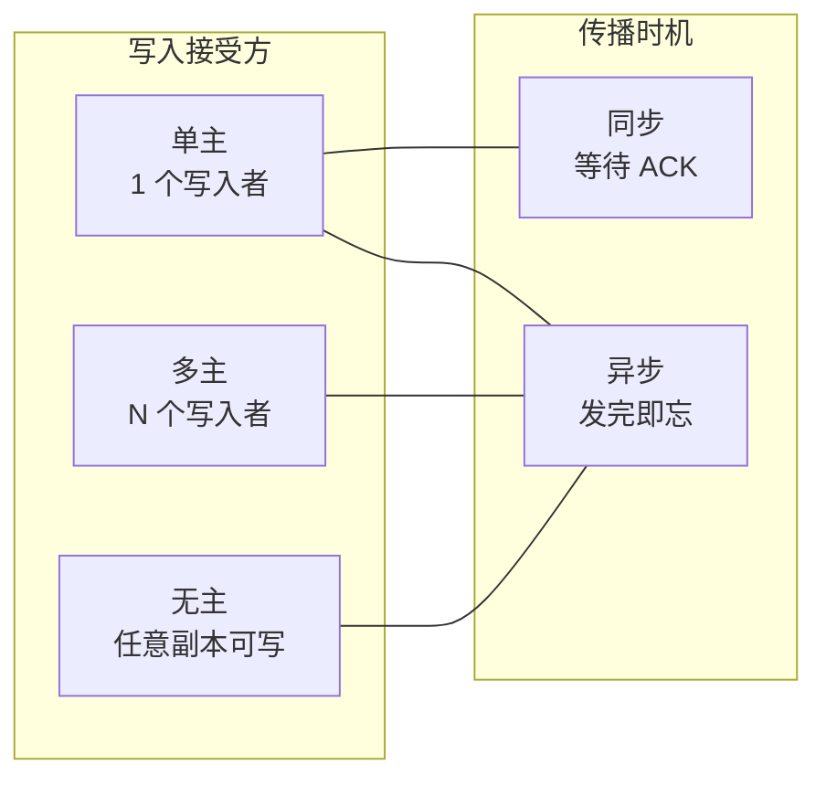
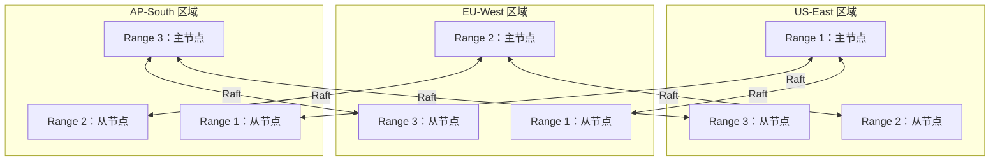
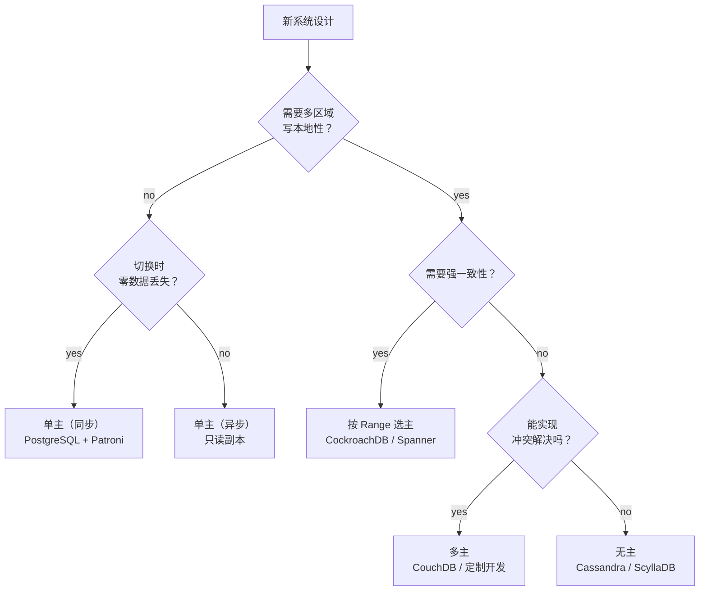

# 复制拓扑：主从、多主与无主

> **TL;DR.** 复制拓扑决定了谁能接受写入，以及这些写入怎样到达其他副本。单主把所有写操作串行经过一个节点，换来简单的一致性，但写入吞吐量有上限，还多了一份故障切换风险。多主允许多个节点并发写入，从而拿到地理分布下的低延迟，代价是冲突解决得你自己做。无主（Dynamo 风格）彻底去掉主节点，可用性拉满，但要求你算清法定人数、做好反熵。默认选单主加异步复制，除非你需要多区域写入（按 Range 选主混合方案）或以可用性优先的语义（无主）。同步/异步是另一个维度：它决定持久性保证，与拓扑无关[^1]。

## 学习目标

- 从延迟、一致性、可用性和运维复杂度四个维度比较单主、多主、无主和按 Range 选主这几种拓扑。
- 找出决定正确拓扑的负载特征（地理分布、读写比、一致性需求）。
- 论证按 Range 选主混合方案是要求强一致的全球 OLTP 的默认选择。
- 评估 DynamoDB 从无主演进到每分区单主的过程，说明亚马逊为什么做这个转变。

## 核心权衡

根本矛盾在于：允许越多节点接受写入，写延迟越低、可用性越高，但一致性越难维持。单主拓扑把所有写操作串行经过一个节点，白送你一个全序。多主和无主拓扑让多个节点同时接受写入，意味着并发的冲突写入成为可能，系统必须自己把冲突调和掉。

与拓扑正交的是同步/异步这个维度。同步复制要等从节点确认之后才向客户端确认写入。PostgreSQL 的基准测试显示，同步提交模式相比异步大约要付 50% 的写入吞吐代价[^1]。异步复制在主节点上立即确认，一旦主节点在复制完成前挂掉，就有丢数据的风险。这两个维度（拓扑与时机）组合出六种有意义的配置；生产系统里真正占主导的是三种。

*两个正交的维度：拓扑决定谁接受写入，时机决定写入者何时拿到确认。多主和无主几乎总是异步。*

## 横向对比

| 维度 | 单主 | 多主 | 无主 |
|---|---|---|---|
| 写延迟 | 同 AZ 1-5 ms（同步），亚毫秒（异步）[^1] | 本地主节点延迟，个位数毫秒 | 法定人数写入，个位数毫秒[^2] |
| 读新鲜度 | 从主节点读始终新鲜；从节点可能落后 | 各自主节点新鲜；跨主节点最终一致 | 可通过 R + W > N 调节[^3] |
| 分区期间的可用性 | 少数派一侧丢失写入[^4] | 两侧都能接受写入[^5] | 任意副本都能接受写入 |
| 冲突解决 | 不需要；存在全序 | 必需：LWW、CRDT 或应用层合并[^6] | 必需：读修复、反熵[^7] |
| 运维复杂度 | 低；故障切换成熟可控 | 高；冲突调试很痛苦[^6] | 中高；法定人数调优、修复任务 |
| 扩展天花板 | 每个分片受单写入者瓶颈限制 | 跨区域写入接近线性扩展 | 接近线性；任意节点可服务任意请求 |
| 故障切换风险 | 异步会丢数据；同步零丢失[^1] | 无单点故障 | 无单点故障 |

表格在“无主可用性”这一项上会误导人。宽松法定人数（sloppy quorum）和提示移交（hinted handoff）让写入在首选副本宕机时也能成功，但数据可能因此分叉，需要事后调和[^3]。高可用不是免费的，账单是调和的复杂度。

“冲突解决”这一行基本决定了选型。如果团队没有余力投入 CRDT 设计或应用层合并逻辑，多主和无主拓扑就会通过最后写入者胜出（LWW）造成静默的数据丢失[^6]。

## 何时选择单主

**要求强一致的 OLTP。** 银行账本、库存系统、选座系统。单个写入者天然提供全序，不需要冲突解决。PostgreSQL 流复制和 MySQL 半同步在这个场景里久经考验[^4]。

**读多写少、需要横向扩展的负载。** 异步从节点承接读流量。TimescaleDB/PostgreSQL 的基准显示，3 节点能带来 2.5 倍读吞吐，5 节点是 4.8 倍[^1]。主节点承担全部写入，从节点吸收读流量。

**单区域部署。** 所有客户端都在同一个区域时，把写入路由到单个主节点的延迟代价可以忽略（同 AZ 1-5 ms）。单写入者的简单性，胜过多主在理论上多出来的那点可用性。

**代表系统：** PostgreSQL + Patroni、MySQL Group Replication、Amazon RDS Multi-AZ、Aurora（存储层法定人数，但只有一个计算写入节点）[^8]。

## 何时选择无主

**可用性优先、能容忍最终一致性的负载。** 购物车、会话存储、时序遥测。Cassandra 用 LOCAL_QUORUM 在多区域部署下做到个位数毫秒的 p99 写入[^2]。任意副本都能服务任意请求，不需要故障切换。

**按操作调节一致性。** 同一个 Cassandra 集群，分析型查询可以用 ONE，面向用户的读可以用 QUORUM。这种按查询调节的灵活性是无主系统独有的优势[^2]。

**写入量大、键之间相互独立的负载。** 写入很少冲突（不同用户的会话、IoT 传感器数据）时，调和成本低，写入分摊的收益高。

**代表系统：** Apache Cassandra、ScyllaDB、Amazon DynamoDB（源自最初的 Dynamo 论文[^3]）、Riak。

> [!IMPORTANT]
> DynamoDB 已经从纯无主架构往外走了。2022 年的 USENIX 论文披露，现代 DynamoDB 每个分区使用 Multi-Paxos，尽管带着 Dynamo 的血统，实际上已经是“每分区单主”[^9][^10]。连亚马逊都认定，对自家旗舰数据库来说，无主的冲突解决代价太高。

## 混合方案

大多数需要全局强一致的生产系统走的是按 Range 选主这条路：把数据切成若干 Range，每个 Range 用 Raft 或 Paxos 选出共识主节点，再把主节点放在离流量近的地方。

CockroachDB 把键空间切成 Range（`range_max_bytes` 默认 512 MiB），每个 Range 复制 3 份，构成独立的 Raft 组[^11][^12]。大集群会跑几万个共识组[^13]。Spanner 每个分片用 Paxos，配合 TrueTime 做到外部一致性，通过 commit-wait 把通常 1-7 ms 的时钟不确定性吸收掉[^14]。

结果就是：全局看像多区域双活（任何区域都能服务本地 Range 的写入），按 Range 看则是经典的带共识的主从结构。强一致和区域写本地性同时拿到，还不用写应用层冲突解决。

*按 Range 选主混合方案：每个 Range 有一个 Raft 主节点，放在离它流量近的地方。全局看是双活，按 Range 看是带共识的单主。*

## 真实案例

**Amazon DynamoDB** 在 2021 年 Prime Day 峰值达到 8920 万请求/秒，延迟为个位数毫秒[^9]。2007 年最初的 Dynamo 论文描述的是用一致性哈希和向量时钟的无主系统[^3]。生产环境中只有 0.06% 的 Dynamo 读返回了分叉（多个）版本，99.94% 返回单一一致版本[^3]。到 2022 年，DynamoDB 已演进成每分区 Multi-Paxos，以提供更强的一致性保证[^10]。元数据缓存命中率 99.75%，但后备存储始终按全量流量配置，为的是消除亚稳态故障模式[^9]。

**Amazon Aurora** 在 3 个 AZ 上做 6 副本复制，写法定人数 4/6，读法定人数 3/6[^8]。存储切成 10 GB 的保护组（Protection Group），每组独立复制。在 10 Gbit 网络上，一个故障段不到一分钟就能修复完成[^8]。这个设计能扛住整个 AZ 丢失而不丢写可用性。

**CockroachDB** 在大集群里跑几万个 Raft 组[^13]。leaseholder 机制把读协调与 Raft 领导权分开：每个 Range 有一个副本处理全部读写，读不需要走完整的共识轮[^11]。跨 Range 事务在 Raft 之上跑两阶段提交，延迟会随涉及的 Range 数量增加[^11]。

## 常见错误

> [!WARNING]
> **主从架构缺少隔离（fencing）时的脑裂。** 网络分区把老主节点和故障切换编排器隔开。老主节点继续接受写入，导致数据分叉。用 STONITH 隔离、基于租约的领导权，或基于共识的选举（Patroni、Raft）[^4]。

> [!WARNING]
> **没想好冲突策略就选多主。** 最后写入者胜出会静默丢掉同一 key 上两个并发写入中的一个。如果上线前说不清自己的合并函数是什么，你必然会丢数据[^6]。CouchDB 会把所有冲突修订版本都存下来交给应用层解决[^15]；大多数团队并不会做这件事。

> [!WARNING]
> **无主系统里设成 W + R <= N。** 这破坏了法定人数重叠的保证。读可能和写不相交，返回任意陈旧的数据。默认用 W=R=多数派（N=3、W=2、R=2），只有给出明确理由才放松[^3]。

> [!WARNING]
> **以为异步复制等于零数据丢失。** PostgreSQL 异步模式和单机相比吞吐差异可以忽略[^1]，但主节点故障时，还没复制出去的写入全部丢失。如果零丢失是硬要求，那么至少同步复制到一个从节点没有商量余地，哪怕要付 50% 的吞吐代价[^1]。

## 决策清单

- [ ] 负载是否需要多区域写入且延迟低于 50 ms？如果是，单主出局；选按 Range 选主（强一致）或多主（最终一致）。
- [ ] 故障切换时零数据丢失是不是硬要求？如果是，必须同步复制到法定人数。
- [ ] 你能不能讲清冲突解决策略（LWW、CRDT、应用层合并）？如果不能，就别碰多主和无主。
- [ ] 读写比是多少？读多、且能容忍几秒延迟的负载，适合用异步主从做读扩展。
- [ ] 系统是否需要按操作调节一致性？无主（Cassandra）或按 Range 选主（CockroachDB）支持，纯主从做不到。
- [ ] 故障切换是自动的（Raft、Patroni）还是手动的？手动切换配异步复制，等于保证丢数据。

*决策流程图：多区域写本地性是第一个岔路口。需要强一致就走按 Range 选主；不需要的话，你的冲突解决能力决定了选多主还是无主。*

## 要点回顾

- 对单区域 OLTP 来说，单主是正确的默认值。它在不需要冲突解决的情况下提供全序，并通过异步从节点扩展读能力。
- 多主解决的是地理分布下的写延迟，但冲突解决必须你自己做。如果写不出合并逻辑，就不要选这个拓扑。
- 无主把可用性和写入分摊做到极致，但要求法定人数算术、反熵和调和。DynamoDB 自己都从纯无主转向了每分区 Multi-Paxos[^10]。
- 按 Range 选主混合方案（CockroachDB、Spanner）是全球 OLTP 的现代答案：强一致加区域写本地性，还不需要应用层冲突处理。
- 同步还是异步与拓扑正交。它管的是持久性，不是谁接受写入。要零丢失的故障切换就选同步；接受 50% 的吞吐代价[^1]。

## 延伸阅读

- [Amazon DynamoDB USENIX ATC 2022](https://www.usenix.org/conference/atc22/presentation/elhemali)：DynamoDB 如何从无主的 Dynamo 演进到每分区 Multi-Paxos；拓扑迁移的经典案例。
- [Amazon Aurora: Quorums and Correlated Failure](https://aws.amazon.com/blogs/database/amazon-aurora-under-the-hood-quorum-and-correlated-failure/)：Aurora 为什么选 6 副本法定人数而不是更简单的 2/3 模型；存储层复制的必读材料。
- [CockroachDB: The Resilient Geo-Distributed SQL Database, SIGMOD 2020](https://www.cockroachlabs.com/guides/cockroachdb-the-resilient-geo-distributed-sql-database-sigmod-2020/)：几万个共识组规模下的按 Range Raft。
- [High Availability and Scalable Reads in PostgreSQL, Timescale 2024](https://www.timescale.com/blog/scalable-postgresql-high-availability-read-scalability-streaming-replication-fb95023e2af)：同步、异步与单机 PostgreSQL 吞吐的实测对比。
- [Chain Replication for Supporting High Throughput and Availability, OSDI 2004](https://www.usenix.org/legacy/publications/library/proceedings/osdi04/tech/full_papers/renesse/renesse_html/index.html)：链式复制论文；理解 Azure Storage 和 HDFS 流水线的相关背景。
- [MySQL Semi-Sync: Durability, Consistency, and Split Brains](https://www.planetscale.com/blog/mysql-semi-sync-replication-durability-consistency-and-split-brains)：半同步的故障模式与脑裂场景的实践分析。

## 记忆卡片

<strong>Q: PostgreSQL 的同步复制要付多少吞吐代价？</strong>

A: 同步提交模式相比异步模式大约要付 50% 的写入吞吐代价，而异步模式与单机服务器相比差异可以忽略。

<strong>Q: DynamoDB 为什么从无主转向每分区单主？</strong>

A: 为了更强的一致性保证。2022 年的 USENIX 论文显示 DynamoDB 现在每分区使用 Multi-Paxos，消除了原版 Dynamo 设计里冲突解决的复杂度，同时在 8920 万请求/秒的峰值下仍保持个位数毫秒延迟。

<strong>Q: Aurora 用的是什么法定人数配置，为什么？</strong>

A: 跨 3 个 AZ 共 6 副本，写法定人数 4/6，读法定人数 3/6。这样可以丢掉整个 AZ 而不丢失写可用性，并且在一个 AZ 再加一处故障的情况下不丢数据。

<strong>Q: 无主系统的法定人数重叠规则是什么？</strong>

A: W + R > N 保证读集合中至少有一个副本持有最新写入。N=3、W=2、R=2 时重叠有保证。设成 W + R <= N 就破坏了一致性。

<strong>Q: 什么时候该选按 Range 选主而不是多主？</strong>

A: 当你同时需要多区域写本地性和强一致时。按 Range 选主（CockroachDB、Spanner）提供线性一致的读写，且不需要应用层冲突解决。多主是用一致性换部署上的简单。

<strong>Q: 最后写入者胜出这种冲突解决方式的主要风险是什么？</strong>

A: 静默的数据丢失。两个主节点并发修改同一条记录时，LWW 用时间戳挑一个赢家，另一个写入被悄悄丢弃。应用永远不会知道发生过冲突。

<strong>Q: CockroachDB 如何在强一致的前提下做到写操作的横向扩展？</strong>

A: 它把键空间切成 Range（默认 512 MiB），每个 Range 构成独立的 Raft 共识组。主节点放在离流量近的位置。这样写入负载分摊到几千个独立共识组上，同时每个 Range 内仍保持线性一致。

## 参考文献

[^1]: Hampton, "High Availability and Scalable Reads in PostgreSQL," Timescale Blog, March 2024. https://www.timescale.com/blog/scalable-postgresql-high-availability-read-scalability-streaming-replication-fb95023e2af
[^2]: Apache Cassandra Documentation, "Architecture Overview." https://cassandra.apache.org/doc/latest/cassandra/architecture/
[^3]: DeCandia et al., "Dynamo: Amazon's Highly Available Key-value Store," SOSP 2007. https://www.allthingsdistributed.com/files/amazon-dynamo-sosp2007.pdf
[^4]: Noach, "MySQL Semi-Sync Replication: Durability, Consistency, and Split Brains," PlanetScale, October 2020. https://www.planetscale.com/blog/mysql-semi-sync-replication-durability-consistency-and-split-brains
[^5]: Kleppmann, "Designing Data-Intensive Applications," Ch. 5: Replication. O'Reilly, 2017.
[^6]: "From Last-Writer-Wins to CRDTs," Codelit.io, 2025. https://codelit.io/blog/data-replication-conflict-resolution
[^7]: Riak Documentation, "Active Anti-Entropy." https://docs.riak.com/riak/kv/latest/learn/concepts/active-anti-entropy/
[^8]: Gupta, "Amazon Aurora Under the Hood: Quorums and Correlated Failure," AWS Database Blog, August 2017. https://aws.amazon.com/blogs/database/amazon-aurora-under-the-hood-quorum-and-correlated-failure/
[^9]: Elhemali et al., "Amazon DynamoDB: A Scalable, Predictably Performant, and Fully Managed NoSQL Database Service," USENIX ATC 2022. https://www.usenix.org/conference/atc22/presentation/elhemali
[^10]: Lu Pan, "Notes on Amazon's DynamoDB USENIX ATC'22 Paper," August 2022. https://blog.the-pans.com/dynamodb/
[^11]: Taft et al., "CockroachDB: The Resilient Geo-Distributed SQL Database," SIGMOD 2020. https://www.cockroachlabs.com/guides/cockroachdb-the-resilient-geo-distributed-sql-database-sigmod-2020/
[^12]: CockroachDB Documentation v26.2, "Replication Controls" (`range_max_bytes` default = 536870912 / 512 MiB). https://www.cockroachlabs.com/docs/stable/configure-replication-zones
[^13]: CockroachDB Blog, "Scaling Raft," June 2015. https://www.cockroachlabs.com/blog/scaling-raft/
[^14]: Corbett et al., "Spanner: Google's Globally-Distributed Database," OSDI 2012. https://research.google.com/archive/spanner.html
[^15]: Apache CouchDB Documentation, "Replication and Conflict Model." https://docs.couchdb.org/en/stable/replication/conflicts.html
