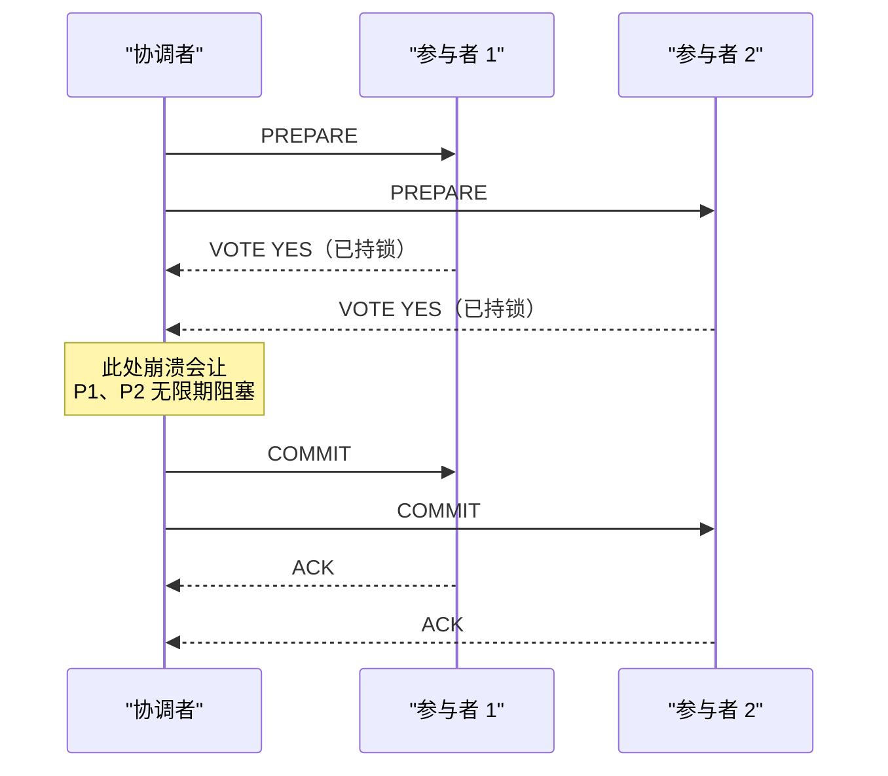
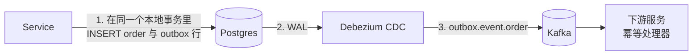
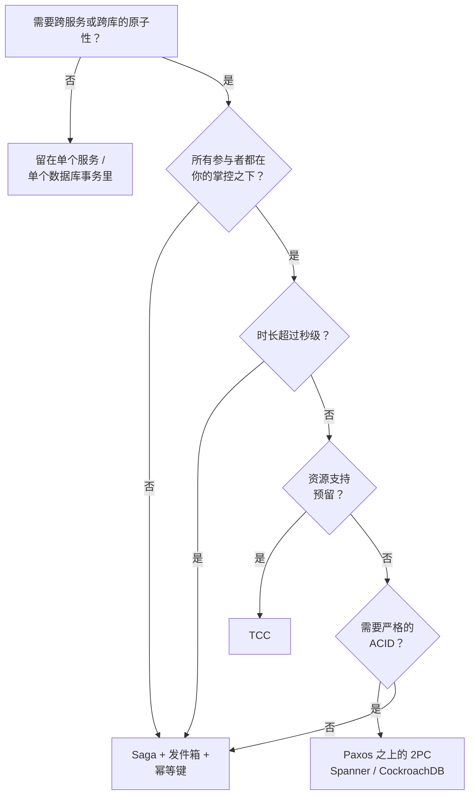

# 分布式事务：2PC vs Saga vs TCC

> **TL;DR.** 两阶段提交（2PC）能跨服务给你 ACID 原子性，但协调者一崩就阻塞，而且在两次网络往返期间一直持锁[^1]。Saga 给你可用性和长事务的持久性，代价是牺牲隔离性：观察者在步骤之间会看到中间状态[^2]。TCC 靠资源预留拿到比 Saga 更强的隔离性，但每个操作的代码面变成三倍[^3]。真正起决定作用的维度，是业务能容忍多少中间状态被人看见。2025 年大多数微服务的默认答案是 Saga + 事务性发件箱 + 幂等键[^4][^5]。

## 学习目标

- 从隔离性、可用性、延迟、实现成本四个维度对比 2PC、Saga、TCC。
- 识别哪些负载特征（时长、参与者可控性、可逆性）更适合哪种方案。
- 论证为什么 Saga + 发件箱 + 幂等这套组合是现代微服务的默认选择。
- 把 Spanner、CockroachDB、Uber Cadence 作为生产环境中的决策样本加以评估。

## 核心权衡

任何要在 N 个节点上协调提交的协议，只能在两条路里选：要么阻塞等待所有参与者回应（伤可用性），要么允许参与者各自做本地决定、事后再补补偿（伤隔离性）[^1][^4]。没有第三条路。Gray 和 Lamport 证明了，只有由共识背书的提交协议（Paxos Commit）才能绕开经典 2PC 的阻塞问题——办法是为每个参与者配 2F+1 个 acceptor 跑一轮 Paxos[^1]。Helland 走得更远，他指出只要有一个节点故障，事务提交就会卡住，而系统越大，出故障的概率越高[^4]。

这两个反向拉扯的指标就是隔离性与可用性。把隔离性调强（2PC 在所有参与者上持锁），可用性就下降，因为任何一个参与者故障都会阻塞整个事务。把隔离性放松（Saga 每步各自本地提交），可用性就上升，因为不存在跨服务的锁，但观察者会看到中间状态。

*prepare 应答到 commit 之间这段窗口，正是协调者崩溃后参与者会无限期持锁的地方——2PC 的根本阻塞问题。*

## 逐项对比

| 维度 | 2PC（XA、Spanner） | Saga（Temporal、Step Functions） | TCC（Seata） |
|---|---|---|---|
| 隔离性 | 参与者之间完整的 ACID | 步骤之间没有隔离；部分状态可见[^2] | 预留级别；资源在 Confirm 之前不可见[^3] |
| 可用性 | 协调者或参与者故障即阻塞[^1] | 不阻塞；每步本地提交 | 不阻塞；Try 本身就是本地提交 |
| 延迟 | 2 轮顺序共识（用 Parallel Commits 为 1 轮）[^6] | 各本地事务延迟之和 | Try + Confirm/Cancel 一次往返 |
| 时长上限 | 秒级（prepare 期间一直持锁） | 分钟到天 | 秒到分钟（预留 TTL） |
| 参与者可控性 | 全部要实现 prepare/commit | 任何具备补偿逻辑的服务 | 全部要暴露 Try/Confirm/Cancel[^3] |
| 故障模式 | 协调者崩溃导致无限期持锁 | 补偿可能失败；需幂等重试 | 空回滚、悬挂、幂等等病理[^7] |
| 代码复杂度 | 低（协议由数据库处理） | 中（每步一个补偿器） | 高（每个操作 3 个方法） |
| 三方 API | 需要 XA 支持（罕见） | 适用于任何可补偿的 API | 需要预留原语（外部罕见） |

这张表漏掉了一个维度：运营成熟度。2PC 在单个数据库内部是成熟工艺（Spanner、CockroachDB 都替你透明处理）。Saga 的工具链（Temporal、Cadence）已经生产可用，但要求团队守住工作流确定性的纪律[^8]。TCC 是小众路线：Seata 是唯一主流的开源实现，而它的 fence log（围栏日志）管线并不简单[^7]。

## 何时选择 2PC

**严格的 ACID 是监管要求。** 财务对账、复式记账的账目提交、任何“部分提交即违规”的合规系统。Google Spanner 用 TrueTime 在 Paxos 组之上跑 2PC，在全球规模上给出外部一致性[^9][^10]。

**事务时长很短（亚秒级）。** 2PC 从开始到做出决定，全程在所有参与者上持锁。CockroachDB 的 Parallel Commits 把延迟从 2 轮共识往返砍到 1 轮[^6]，让短的跨 range 事务变得实用。

**所有参与者都在你的运维掌控之内。** 2PC 要求每个参与者实现 prepare-commit 接口。外部 API（Stripe、Twilio、SendGrid）不暴露 XA。

**你在造数据库，而不是在用数据库。** 如果你掌控存储层，Paxos Commit 能消掉阻塞问题。Spanner、CockroachDB、TiDB 都在内部跑 2PC，应用开发者根本看不见它。

## 何时选择 Saga

**跨服务的长时间业务流程。** 订单履约、行程预订、员工入职。每一步本地提交；编排器跨分钟甚至跨天跟踪进度[^2][^11]。

**涉及三方 API。** Stripe 扣款、发邮件、发短信。这些服务没法参与 2PC，但可以补偿（退款、撤回、取消）。

**最终一致性可以接受。** 在第 N 步成功到第 N+1 步开始尝试之间，观察者会看到部分状态。如果业务能忍受“已下单但支付待定”持续几秒钟，Saga 就成立。

**团队已经在用 Temporal、Cadence 或 Step Functions。** 这些编排器把工作流状态持久化下来，带退避地重试活动，并让补偿序列可调试[^8]。Uber 披露 Cadence 在内部支撑了 1000 多个服务，每月运行超过 120 亿次工作流执行、2700 亿次 action，覆盖长流程工作流、微服务编排和分布式定时任务[^8]。

## 混合路线

2025 年的生产默认，既不是纯 Saga，也不是纯 2PC，更不是纯 TCC，而是：**Saga 编排 + 事务性发件箱（transactional outbox）+ 幂等键**。这套组合让状态变更与事件之间具备至少一次投递的原子性，却完全不需要分布式事务协议。

*发件箱记录与业务变更在同一个本地事务里原子提交；Debezium 追踪 WAL 并投递到 Kafka，从而避开任何分布式事务。*

服务把事件写进 `outbox` 表，与业务写入在同一个本地事务里。Debezium 读 WAL，把每条记录路由到正确的 Kafka topic[^12]。消费端用幂等键应对至少一次投递（Stripe 会至少保留 24 小时才清理 `Idempotency-Key` 条目[^5]）。编排器（Temporal、Cadence）负责串起 saga 序列，把每个工作流事件持久化，故障时可重放[^8][^13]。

这并不稀奇。Stripe、Uber 以及几乎所有现代支付系统都是这么跑的[^5][^14][^15]。

## 真实案例

**Google Spanner（Paxos 之上的 2PC + TrueTime）。** Spanner 把数据切成 Paxos 组，跨 3-5 个 zone 复制。读写事务在每个 Paxos leader 上加锁，用 TrueTime 的有界不确定性挑选提交时间戳，然后执行一次 2PC——而这个 2PC 的协调者本身也是 Paxos 复制的[^9][^10]。Cloud Spanner 建议为吞吐优化设置 20-100 ms 的提交延迟[^16]。这是把 2PC 做对的样子：阻塞问题被共识消掉，代价是需要 GPS + 原子钟基础设施。

**CockroachDB Parallel Commits。** CockroachDB 重做了 2PC：事务先写一条 STAGING 记录，同时并发写 intent。当它们全部达成 Raft 共识的那一刻，事务就算“隐式提交”了，延迟从 2 倍节点间 RTT 降到 1 倍 RTT[^6]。这个协议在 TLA+ 里做过形式化验证，包含一条安全性属性（`AckImpliesCommit`）和一条活性属性（`ImplicitCommitLeadsToExplicitCommit`）[^6]。

**Uber Cadence（Saga 编排）。** Cadence 把每个工作流事件持久记到分片的持久化层，在 Uber 内部支撑 1000 多个服务的长流程工作流、微服务编排和分布式定时任务，每月 120 亿次以上执行[^8]。支付工作流用编排式 saga，每一步（授权、扣款、结算、退款）都有明确的补偿动作[^14][^15]。

## 常见错误

> [!WARNING]
> **把 saga 补偿当成回滚。** 补偿是正向恢复（forward recovery），不是撤销。已提交的那一步在补偿窗口内依然可见。把记录标成 PENDING/CONFIRMED，让下游读者能过滤掉部分状态[^11]。

> [!WARNING]
> **saga 工作流里的活动不幂等。** Temporal 和 Cadence 按设计会重试失败的活动。如果幂等键不是由 workflow ID + step name 推导出来的，重试就会造成重复扣款或重复发货[^5][^8]。

> [!WARNING]
> **在不属于你的服务之间用 2PC。** 外部 API 极少实现 XA 的 prepare/commit。协调者一崩，你就再也没有办法了结这笔事务。任何涉及三方调用的流程，都用 Saga + 幂等键。

> [!WARNING]
> **忽视 TCC 的三种病理。** 空回滚（Try 之前先 Cancel）、幂等（重复 Confirm）、悬挂（Cancel 之后又来 Try）在生产里都会发生。Seata 用一张 `tcc_fence_log` 表解决，靠 (xid, branch_id) 上的主键唯一性[^7]。

## 决策清单

*决策流程：大多数微服务最终落在 Saga + 发件箱；2PC 留给数据库内部或要求严格 ACID 的短事务。*

- [ ] 业务能容忍步骤之间的中间状态被看见吗？如果不能，就把它留在单个服务里。
- [ ] 每一步都能补偿吗？补偿器幂等且可逆吗？
- [ ] 预期的时长是多少？2PC 上限是秒级；Saga 能扛到几天。
- [ ] 所有参与者都在你的运维掌控内，还是夹杂了三方 API？
- [ ] 至少一次投递 + 应用层幂等，可以接受吗？
- [ ] 资源本身支持原生的预留原语吗（座位、库存、日历占位）？
- [ ] 团队有 Temporal/Cadence 的运维经验吗？

## 要点回顾

- 2PC 给你 ACID，但一故障就阻塞，时长上限在亚秒级。把它用在数据库内部（Spanner、CockroachDB），不要跨微服务用。
- Saga 给你可用性，也能扛长流程，但牺牲隔离性。补偿是正向恢复，不是回滚。
- TCC 靠预留拿到比 Saga 更强的隔离性，代价是代码面变三倍，且要求所有参与者暴露 Try/Confirm/Cancel。
- 现代默认组合是 Saga + 事务性发件箱 + 幂等键 + 编排器（Temporal/Cadence）。这不是奇技淫巧，这就是主流。
- Helland 的定律依然成立：规模上去以后，干脆别用分布式事务。用独立实体搭系统，实体之间靠至少一次消息 + 应用层幂等相连[^4]。

## 延伸阅读

- [Consensus on Transaction Commit (Gray and Lamport, 2006)](https://www.microsoft.com/en-us/research/publication/consensus-on-transaction-commit/)：Paxos Commit，经典 2PC 的非阻塞替代方案，Spanner 与 CockroachDB 的地基。
- [Life Beyond Distributed Transactions (Helland, 2016)](https://queue.acm.org/detail.cfm?id=3025012)：主张用实体、活动、至少一次消息取代分布式事务的经典论述。
- [Parallel Commits (VanBenschoten, Cockroach Labs)](https://www.cockroachlabs.com/blog/parallel-commits/)：CockroachDB 的 1-RTT 2PC，附 TLA+ 验证；优化原子提交的当前最前沿。
- [Designing robust APIs with idempotency (Stripe)](https://stripe.com/blog/idempotency)：Stripe 那套经典的幂等键模式，让 saga 重试变得安全。
- [To choreograph or orchestrate your saga (Temporal)](https://www.temporal.io/blog/to-choreograph-or-orchestrate-your-saga-that-is-the-question)：支持编排路线的主流论证，附具体 Temporal 示例。
- [Debezium Outbox Event Router](https://debezium.io/documentation/reference/stable/transformations/outbox-event-router.html)：基于 CDC 的发件箱实现，消除双写问题。

## 记忆卡片

<strong>Q: 经典 2PC 为什么会在协调者故障时阻塞？</strong>

A: 投了 YES 的参与者没法单方面提交或中止，因为只有协调者知道是不是所有人都投了 YES。它只能一直持锁，直到协调者恢复。Paxos Commit 的解法是给每个参与者配 2F+1 个 acceptor，对“决定”本身跑共识[^1]。

<strong>Q: saga 补偿与数据库回滚的关键区别是什么？</strong>

A: 补偿是正向恢复：它执行一个新的、已提交的事务（比如“退款”），而不是中止一个未提交的事务。在原步骤与它的补偿之间，观察者会看到中间状态[^2][^11]。

<strong>Q: CockroachDB Parallel Commits 如何降低事务延迟？</strong>

A: 它把事务记录的写入（STAGING）与 intent 写入流水线化，于是只需要一轮 Raft 共识而不是两轮。延迟从 2 倍节点间 RTT 降到 1 倍 RTT[^6]。

<strong>Q: TCC 的三种病理是什么，Seata 怎么解？</strong>

A: 空回滚（Try 之前先 Cancel）、幂等（重复 Confirm/Cancel）、悬挂（Cancel 之后又来 Try）。Seata 用一张 `tcc_fence_log` 表，靠 (xid, branch_id) 上的主键唯一性识别并拒绝乱序调用[^7]。

<strong>Q: 什么是事务性发件箱模式？</strong>

A: 把事件写进 `outbox` 表，与业务写入在同一个本地数据库事务里完成。CDC 连接器（Debezium）追踪 WAL 并投递到 Kafka，于是不用分布式事务也能拿到至少一次投递[^12]。

<strong>Q: 什么时候该在微服务之间用 2PC？</strong>

A: 几乎永远不该。2PC 要求所有参与者实现 prepare/commit，跨网络持锁，一故障就阻塞。把它用在数据库内部（Spanner、CockroachDB），那里的存储层会透明地管理协议。跨服务就用 Saga + 幂等键。

<strong>Q: 为什么 Saga + 发件箱 + 幂等是 2025 年的默认？</strong>

A: 它避开了跨服务锁（可用性），能扛长流程（几天），能和三方 API 配合（不需要 XA），还保证了状态与事件之间的至少一次原子性。Stripe 和 Uber 就是这么跑的[^4][^5][^14]。

## 参考文献

[^1]: Gray, J. and Lamport, L. "Consensus on Transaction Commit." ACM TODS 2006. https://www.microsoft.com/en-us/research/publication/consensus-on-transaction-commit/
[^2]: Garcia-Molina, H. and Salem, K. "Sagas." Proc. ACM SIGMOD 1987. https://dl.acm.org/doi/10.1145/38713.38742
[^3]: Zhang Chenghui. "In-Depth Analysis of Seata TCC Mode." Apache Seata, 2022. https://seata.apache.org/blog/seata-tcc/
[^4]: Helland, P. "Life Beyond Distributed Transactions: an Apostate's Opinion." ACM Queue 2016. https://queue.acm.org/detail.cfm?id=3025012
[^5]: Leach, B. "Designing robust and predictable APIs with idempotency." Stripe Engineering, 2017. https://stripe.com/blog/idempotency
[^6]: VanBenschoten, N. "Parallel Commits: An atomic commit protocol for globally distributed transactions." Cockroach Labs, 2019. https://www.cockroachlabs.com/blog/parallel-commits/
[^7]: Zhu Jinjun. "Alibaba Seata Resolves Idempotence, Dangling, and Empty Rollback Issues in TCC Mode." Apache Seata, 2022. https://seata.apache.org/blog/seata-tcc-fence/
[^8]: Uber Engineering. "Announcing Cadence 1.0." 2023. https://www.uber.com/en-IN/blog/announcing-cadence/
[^9]: Google Cloud. "Spanner: TrueTime and external consistency." https://cloud.google.com/spanner/docs/true-time-external-consistency
[^10]: Brewer, E. "Spanner, TrueTime and the CAP Theorem." Google Research, 2017. https://research.google/pubs/spanner-truetime-and-the-cap-theorem/
[^11]: Richardson, C. "Pattern: Saga." microservices.io. https://microservices.io/patterns/data/saga.html
[^12]: Debezium Documentation. "Outbox Event Router." https://debezium.io/documentation/reference/stable/transformations/outbox-event-router.html
[^13]: temporalio/samples-go. "saga/workflow.go." https://github.com/temporalio/samples-go/blob/main/saga/workflow.go
[^14]: Uber Engineering. "Engineering Uber's Next-Gen Payments Platform." https://www.uber.com/en-LK/blog/payments-platform/
[^15]: Uber Engineering. "Building High Throughput Payment Account Processing." https://www.uber.com/ca/en/blog/high-throughput-processing/
[^16]: Google Cloud. "Throughput optimized writes (Spanner)." https://cloud.google.com/spanner/docs/throughput-optimized-writes
