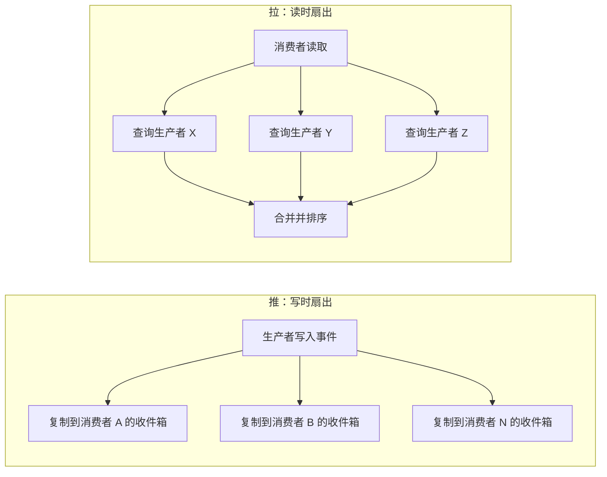
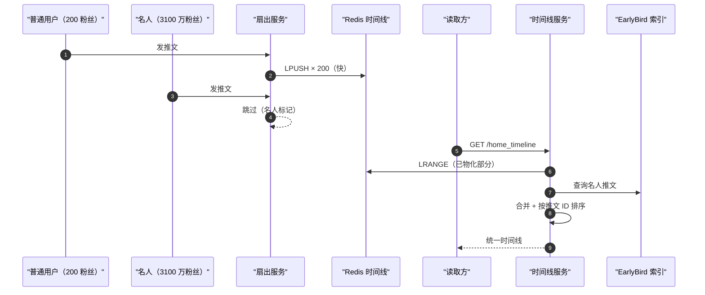
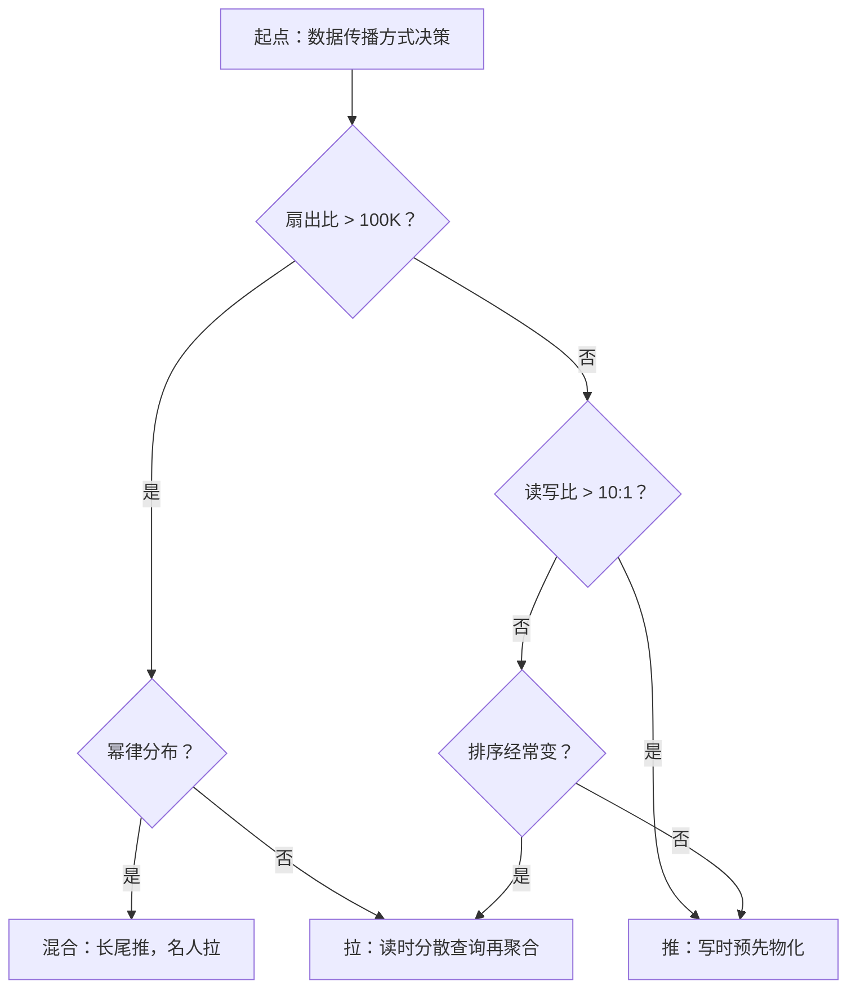

# 推 vs 拉（扇出、消息传递、信息流）

> **TL;DR.** 推模式把计算前置到写路径，于是读变成 O(1)；拉模式把计算后置到读路径，于是写变成 O(1)。决策被两个数字钉死：扇出比（每个事件对应的消费者数）和读写比。读占主导、扇出有界时，推赢（Twitter：每秒 30 万次读对每秒 6 千次写，比例 50:1）[^1]。扇出无界、或者排序模型经常变时，拉赢（LinkedIn：存储量比推少 62 倍）[^2]。真正跑在生产上的大规模系统大多走混合路线：99% 的长尾用推，头部名人用拉。

## 学习目标

- 从延迟、写放大、存储成本、运维复杂度四个维度比较推与拉。
- 找出会让选择翻转的扇出比与读写比阈值。
- 为服从幂律分布的粉丝数结构论证一种推拉混合方案。
- 评估同一种权衡如何分别在信息流、消息中间件、可观测性系统里呈现出不同形态。

## 核心权衡

推模式在写入时把 1 次写转换成 N 次消费者投递；拉模式在读取时把 1 次读转换成对多个生产者的分散查询再聚合（scatter-gather）。昂贵的操作只是在写路径和读路径之间搬家，正确的答案是「哪一侧的昂贵操作你更容易扩展」。

2013 年的 Twitter 每秒要扛 30 万次时间线读，而每秒只有 6 千次推文写。[^1] 50:1 的读写比让「预先物化时间线」（也就是推）成为显然的选择：写的时候付一次钱，之后每次读都很便宜。但一条 Lady Gaga 的推文要扇出到 3100 万粉丝，意味着 3100 万次 Redis 插入，跑完要 5 分钟以上。[^1][^3] 粉丝数一旦超过某个量级，写成本就开始主导，拉变成必须。

LinkedIn 做了相反的决定。他们带排序的信息流经常更换排序模型，而写时扇出存下的数据量是读时扇出的 62 倍。[^2] 每次换模型都要把已物化的信息流重新算一遍，IO 压力大、速度慢。改用拉之后，他们迭代排序算法完全不用碰已存数据。

*推模式在写时做 O(N) 的工作，换来 O(1) 的读；拉模式在写时只做 O(1) 的工作，代价是 O(M) 的读，M 是消费者关注的生产者数量。*

## 逐项对比

| 维度 | 推（写时扇出） | 拉（读时扇出） |
|-----------|------------------------|------------------------|
| 读延迟 | O(1)，一次查表。Twitter：p50 5 ms，p99 100 ms[^1] | O(M) 分散查询再聚合。LinkedIn：p99 140 ms[^2] |
| 写延迟 | O(N)，N 为粉丝数。扇出到 100 万粉丝要 3.5 秒[^1] | O(1)，向作者自己的时间线追加一条 |
| 存储成本 | 每个事件 N 份副本（高） | 每个事件 1 份（低）。LinkedIn：少 62 倍[^2] |
| 排序灵活性 | 模型一换，所有已物化的信息流都要重新回填[^2] | 读时才打分；模型上线即刻生效 |
| 背压 | 必须显式做（预取、429、信用流控）[^4] | 天然就有：消费者只取自己能处理的量[^5] |
| 失效模式 | 写放大层层叠加；名人推文把队列堵回去[^1] | 分散查询里最慢的那个分片决定 p99[^2] |
| 离线消费者 | 需要持久化的 broker，否则消息丢失 | 消费者重连后用游标拉取；服务端不必为它缓冲 |

这张表在读延迟上会误导人。推的 O(1) 前提是时间线还热在缓存里。一个 30 多天没登录的用户会被踢出 Redis，他第一次读会触发从磁盘完整重建，延迟飙到几百毫秒。[^1] 拉模式的分散查询延迟则与用户活跃度无关，始终稳定。

实践中起决定作用的那一维是扇出比。如果你的最大扇出有界（比如不超过 1 万），推就是直路一条。如果你面对的是重尾延伸到数百万的幂律分布，纯推会断。

## 何时选择推

- **读写比超过 10:1 且扇出有界。** Twitter 的 50:1 让推在普通用户身上是明确的赢家（多数人只有几百粉丝甚至更少）。[^1] 通知系统、企业应用里的动态流、实时看板，都落在这个画像里。
- **到消费者的延迟必须接近零。** 预先物化的收件箱能以个位数毫秒响应。交易信号、实时比分、聊天消息投递都靠这个。
- **消费者承担不起每次读都现算。** 手机 App 打开信息流，不该去几百个分片里做一次分散查询。推只在写入时付一次钱，之后每次打开都便宜。
- **生产者与消费者的关系稳定。** 关注关系很少变，物化出来的时间线就能用得更久。频繁取关又回关，等于把推做的工作白扔掉。

## 何时选择拉

- **扇出巨大或没有上限。** Lady Gaga 的 3100 万粉丝已经把 Twitter 的写时扇出顶穿了 5 分钟的 SLA；粉丝上亿的账号让纯推在物理上不可能。[^1] 只要系统里有名人级别的生产者，分布头部就必须用拉。
- **排序模型经常变。** LinkedIn 的 FollowFeed 选拉，就是因为每次模型 A/B 实验都要「把每一份已物化的信息流重新回填一遍」，IO 密集而且卡住迭代。[^2] 如果你的信息流按相关性排序、并且每周都要发模型变更，拉是唯一清醒的选择。
- **消费者是间歇性的。** 手机 App 醒来、同步、再睡下；浏览器标签页闲置；RSS 阅读器。消费者自己记住一个游标，问「T 之后有什么新的」，服务端不需要为每个消费者缓冲。
- **存储成本敏感。** 推会把数据复制 N 份。在 LinkedIn 的体量上，那个 62 倍的存储乘数就是决定性因素。[^2]

## 混合路线

纯推在名人身上会崩，纯拉在常见情形下太慢。所有大型社交平台最后都收敛到同一种混合：长尾用推，头部用拉。

Twitter 的做法（2012 到 2016 年）：Fanout Service 对普通账号把推文 ID 推进每个粉丝的 Redis 列表；对粉丝数很高的账号（阈值未公开，但与「约 1000 个账号粉丝过百万」这个量级吻合），写入时跳过扇出。读的时候，Timeline Service 把已物化的 Redis 时间线和一次对 EarlyBird（搜索索引）的实时查询合并起来，后者用来捞名人的近期推文，然后按推文 ID 重排，返回合并结果。[^1][^3]

Instagram 是同一个套路：非名人帖子在写入时扇出到每个粉丝的 Cassandra 宽行里；名人帖子只存一份，读时再拉；信息流渲染器并行发起这两路取数，按时间戳合并。[^6]

*普通推文在写入时推送，名人推文在读时拉取再合并，写成本因此有界，同时常见情形仍能保持 100 ms 以内的读延迟。*

## 真实案例

**Twitter（混合，2013 年）。** 每秒 30 万次时间线读、每秒 6 千次推文写，一个 TB 级内存的 Redis 集群每天承担 300 亿次扇出投递。个人时间线上限 800 个推文 ID，3 副本，p50 5 ms。名人推文在读时从 EarlyBird 拉。[^1][^3]

**LinkedIn FollowFeed（纯拉，2016 年）。** 服务 4 亿多会员。信息流 P99 延迟 140 ms（比之前基于推的 Sensei 系统快 5 倍），硬件成本降低 50%。720 个 RocksDB 分片，相关性打分与存储节点同机部署。Broker 会向 2 到 3 个副本重复发同一个请求，用来掩盖 P99 上的 GC 停顿。[^2] 2018 年一次压测暴露了死亡螺旋：Jetty 请求队列配成 5000（推荐值是 50 到 500），引发连锁的 GC 压力，40% 的查询拿到的是降级结果。修复办法：队列砍到 500，加上按主机限流。[^4]

**Kafka（消费者拉，消息传递）。** 明确拒绝 broker 推：“基于推的系统很难应付消费能力各异的消费者，因为速率由 broker 掌控……当消费者的消费速率低于生产速率时，它往往就被直接压垮了。”[^5] 长轮询（`fetch.min.bytes` + `fetch.max.wait.ms`）消除了空转轮询。消费者自己持有 offset，回放和回溯因此是小菜。[^5] RabbitMQ 的默认取值正好相反：`basic.consume` 注册一个推订阅，用 `prefetch_count` 当背压阀门；它自己的文档把轮询式替代方案（`basic.get`）称为 “highly discouraged”。[^7]

**Prometheus（拉/抓取，可观测性）。** 单台服务器能处理约 80 万个样本/秒（2016 年基准），监控 1 万多台机器。[^8] 服务发现会枚举出「应该存在」的目标集合；某次抓取缺失立刻就是「目标挂了」的信号，而不是靠「没有推过来」去推断——后者区分不了目标是真的死了还是在装死。[^9]

## 常见陷阱

> [!WARNING]
> **对幂律粉丝结构用纯推。** 少数粉丝上百万的账号会把写时扇出的延迟顶穿 SLA。一条 Lady Gaga 的推文扇出要 5 分钟以上，而普通推文几秒就完。[^1] 设一个混合阈值：低于 100 万粉丝走推，高于走拉。

> [!WARNING]
> **没有长轮询的密集轮询。** 天真的拉循环配上很短的 sleep，既烧 CPU，又会在空队列上把 broker 的请求处理线程占满。SQS 用 `WaitTimeSeconds=0` 时返回空响应，而且照样按请求计费。[^10] 一律用长轮询：Kafka 的 `fetch.max.wait.ms`、SQS 的 `WaitTimeSeconds=20`。

> [!WARNING]
> **无上限的推队列。** 一个「扛不住就把队列开大点」的推式服务会掉进死亡螺旋：队列变长，GC 压力上升，吞吐量下降，队列长得更快。LinkedIn 2018 年那次压测失败，根因就是 Jetty 队列配了 5000，而推荐值是 50 到 500。[^4] 队列深度的上限按（峰值 QPS × 客户端超时）来定。

> [!WARNING]
> **忽略顺序倒挂。** 在混合系统里，对某条名人推文的回复可能比原推更早出现在粉丝的时间线上，因为回复走的是快速扇出，而名人那条还没被拉过来。[^1] 读的时候按单调递增的 ID 排序，不要按写入顺序。

## 决策清单

- [ ] 最大扇出比是多少？只要有生产者的消费者超过 10 万，纯推就有风险。
- [ ] 读写比是多少？高于 10:1，推的分摊效应很好；低于 2:1，拉更便宜。
- [ ] 每次读的现算有多贵？排序复杂且频繁变动，拉赢。
- [ ] 消费者是始终在线（推可行）还是时断时续（拉 + 游标）？
- [ ] 粉丝数分布是幂律吗？是的话，提前设计好混合阈值。
- [ ] 扇出慢的时候你能容忍顺序倒挂，还是投递必须严格有序？

*先看扇出比。有界且读占主导就推；无界或排序负担重就拉；幂律分布就混合。*

## 要点回顾

- 推是 O(N) 次写换 O(1) 次读，拉是 O(1) 次写换 O(M) 次读。扇出比和读写比决定哪个更便宜。
- 名人问题让纯推在任何幂律粉丝结构的系统里都站不住。混合（99% 推、1% 拉）才是 Twitter、Instagram、Facebook 的生产答案。
- 拉自带免费背压：消费者只取自己能处理的量。推必须显式实现背压原语，否则就要面对死亡螺旋。
- 同一种权衡出现在三个领域：信息流（写时扇出 vs 读时扇出）、消息传递（broker 推 vs 消费者拉）、可观测性（指标推送 vs 抓取）。认出这个模式，三个领域都能从第一原理推出来。
- LinkedIn 改用拉之后存储降了 62 倍，这是「大规模场景下选拉」最干净的成本论据。

## 延伸阅读

- [Timelines at Scale, Raffi Krikorian, QCon 2013](https://www.infoq.com/presentations/Twitter-Timeline-Scalability/) - Twitter 写时扇出的经典演讲，讲了名人问题以及混合方案如何收场。本章所有 Twitter 数字都出自这里。
- [FollowFeed: LinkedIn's Feed Made Faster and Smarter](https://engineering.linkedin.com/blog/2016/03/followfeed--linkedin-s-feed-made-faster-and-smarter) - 关于大型社交平台为什么给排序信息流选拉而不选推，最清楚的公开论证。
- [Apache Kafka Design: Push vs Pull](https://kafka.apache.org/42/design/design/) - Kafka 为什么选消费者拉而不是 broker 推，权威一手材料。
- [Pull doesn't scale, or does it?](https://prometheus.io/blog/2016/07/23/pull-does-not-scale-or-does-it/) - 用 SoundCloud 的生产数据拆掉「拉不能扩展」这个迷思。
- [Making LinkedIn's Organic Feed Handle Peak Traffic](https://engineering.linkedin.com/blog/2018/05/making-linkedin-s-organic-feed-handle-peak-traffic) - 推式背压做错之后的定案复盘。
- [Why is Prometheus using a pull model?](https://o11y.eu/blog/prometheus-pull-model/) - 列出拉在可观测性上的六条优势，是这个论证最紧凑的版本。

## 记忆卡片

<strong>Q: 哪两个数字决定用推还是拉？</strong>

A: 扇出比（每个事件对应的消费者数）和读写比。读写比高、扇出有界，偏向推；扇出大或读写比低，偏向拉。

<strong>Q: 为什么纯写时扇出会在名人身上崩掉？</strong>

A: 一条推文扇出到 3100 万粉丝，需要 3100 万次 Redis 插入，耗时 5 分钟以上。写成本是 O(N)，N 为粉丝数，而幂律分布意味着极小比例的用户占据了总写入量的大头。

<strong>Q: Twitter 的混合模型怎么运作？</strong>

A: 普通用户的推文在写入时推进粉丝的 Redis 时间线。名人推文跳过写时扇出。读的时候，Timeline Service 把已物化的时间线和一次对 EarlyBird 的名人内容实时查询合并，按推文 ID 排序。

<strong>Q: LinkedIn 为什么给 FollowFeed 选了拉而不是推？</strong>

A: 两个原因：写时扇出的数据量大 62 倍；排序模型的 A/B 实验需要把每份已物化的信息流重新回填一遍，IO 密集且卡住迭代。拉在读时重新打分，模型上线即刻生效。

<strong>Q: Kafka 为什么用消费者拉而不是 broker 推？</strong>

A: 推式 broker 会压垮慢消费者（实质上是一次 DoS）。拉让消费者按自己的速率取数，背压自动成立。长轮询则消除了天真轮询空转这个缺点。

<strong>Q: Prometheus 为什么去抓取，而不是让目标推指标过来？</strong>

A: 监控服务器通过服务发现已经知道「应该有哪些目标」。某次抓取缺失立刻就是「目标挂了」。推则区分不了目标是真的死了还是在沉默。拉还免费带来高可用：两个 Prometheus 副本各自独立抓取。

<strong>Q: 无上限推队列的死亡螺旋是怎么形成的？</strong>

A: 推式服务收到的量超过处理能力时，队列涨到内存上限，GC 压力上升，吞吐量进一步下降，队列涨得更快，服务直接塌掉。LinkedIn 2018 年那次压测失败的根因是 Jetty 队列配了 5000，而推荐值是 50 到 500。

<strong>Q: 在 LinkedIn 的体量上，推与拉的存储成本差多少？</strong>

A: 对 LinkedIn 的信息流负载，写时扇出所需的存储是读时扇出的 62 倍，因为推会把每个事件复制进每个粉丝的物化时间线。

## 参考文献

[^1]: "The Architecture Twitter Uses to Deal with 150M Active Users, 300K QPS, a 22 MB/S Firehose, and Send Tweets in Under 5 Seconds", High Scalability, 2013. https://highscalability.com/the-architecture-twitter-uses-to-deal-with-150m-active-users/
[^2]: Ankit Gupta et al., "FollowFeed: LinkedIn's Feed Made Faster and Smarter", LinkedIn Engineering, 2016. https://engineering.linkedin.com/blog/2016/03/followfeed--linkedin-s-feed-made-faster-and-smarter
[^3]: Sujeet Jaiswal, "Twitter/X: Timeline Architecture and the Recommendation Algorithm", 2026. https://sujeet.pro/articles/twitter-timeline-architecture
[^4]: Val Markovic, "Making LinkedIn's Organic Feed Handle Peak Traffic", LinkedIn Engineering, 2018. https://engineering.linkedin.com/blog/2018/05/making-linkedin-s-organic-feed-handle-peak-traffic
[^5]: Apache Kafka documentation, Design: Push vs Pull, Kafka 4.2. https://kafka.apache.org/42/design/design/
[^6]: Sujeet Jaiswal, "Instagram: From Redis to Cassandra and the Rocksandra Storage Engine", 2026. https://sujeet.pro/articles/instagram-cassandra-migration
[^7]: Lovisa Johansson, "FAQ: RabbitMQ Basic Consumer vs RabbitMQ Basic Get", CloudAMQP, 2020. https://www.cloudamqp.com/blog/rabbitmq-basic-consume-vs-rabbitmq-basic-get.html
[^8]: Julius Volz, "Pull doesn't scale - or does it?", Prometheus blog, 2016. https://prometheus.io/blog/2016/07/23/pull-does-not-scale-or-does-it/
[^9]: Julien Pivotto, "Why is Prometheus using a pull model?", O11y blog, 2023. https://o11y.eu/blog/prometheus-pull-model/
[^10]: "Amazon SQS short and long polling", SQS Developer Guide. https://docs.aws.amazon.com/AWSSimpleQueueService/latest/SQSDeveloperGuide/sqs-short-and-long-polling.html
