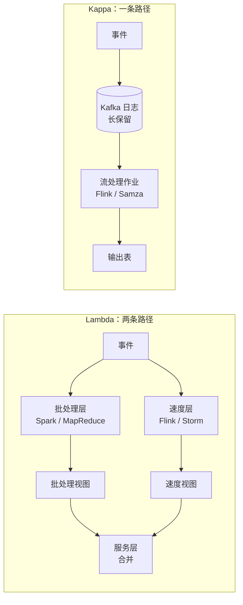
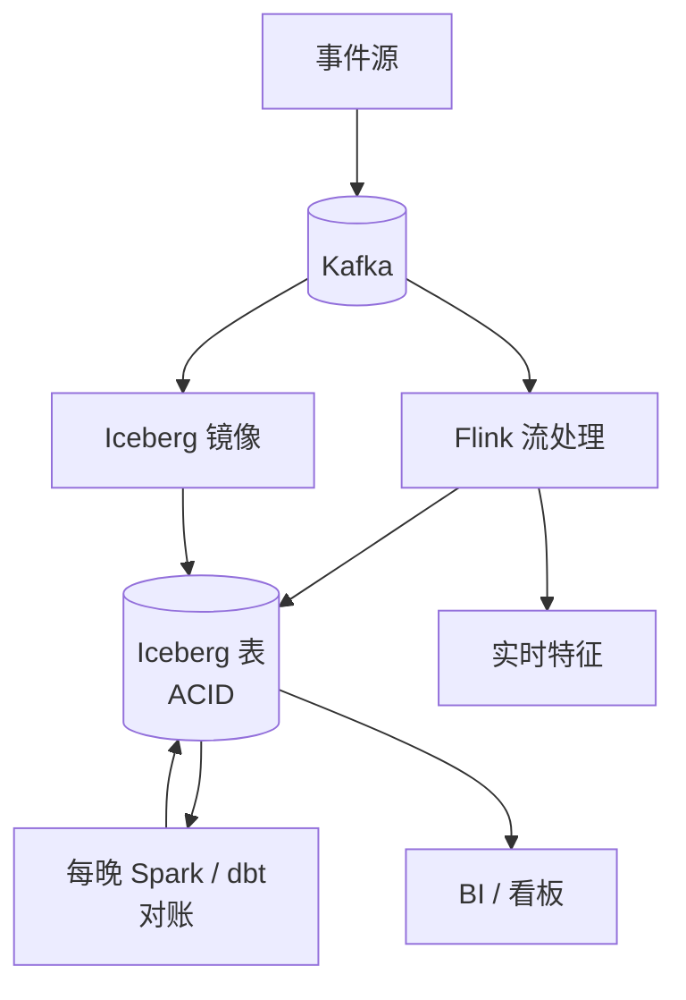
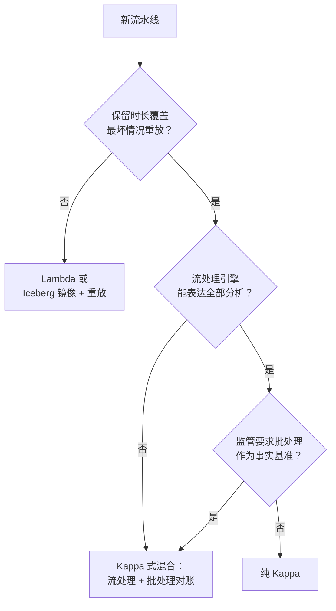

# Lambda 与 Kappa 架构

> **TL;DR.** Lambda 同时跑两条流水线（批处理负责正确性，流处理负责新鲜度），代价是两套代码库会逐渐漂移、失去同步[^1]。Kappa 把两者收拢成一个流处理作业，靠重放保留的日志来完成重算[^1]。只要你的流处理引擎能表达所需的全部分析逻辑，且日志保留时长覆盖最坏情况下的重放窗口，就默认选 Kappa。当监管要求以批处理结果作为事实基准，或者用流处理引擎重算 TB 级数据不可行时，退回 Lambda（或退到一个 Kappa 式的混合方案）[^2]。决定性的维度只有一个：批处理层是否挣得回它的运维成本。

## 学习目标

- 从运维复杂度、正确性保证、重算成本、数据新鲜度四个维度比较 Lambda 与 Kappa。
- 识别哪些负载特征（保留窗口、分析表达力、监管要求）会偏向其中一种架构。
- 论证一种混合的“Kappa 式”方案：用流处理保证新鲜度，再用周期性批处理做对账。
- 以 LinkedIn、Uber、Netflix、Spotify 的生产系统为例，评估它们当初为什么这样选。

## 核心权衡

Lambda 由 Nathan Marz 在 2011 年前后提出[^3]，并在 2015 年他的 Manning 出版图书中形成体系[^4]。它跑一个批处理层（Spark、MapReduce），从全量历史重新计算出正确的视图；跑一个速度层（Flink、Storm），算出低延迟的近似视图；再用一个服务层在查询时把两者合并。批处理这条路径是事实基准，速度层只是尽力而为的近似，直到下一次批处理结果落地。

Kappa 由 Jay Kreps 在 2014 年提出。他当时在 LinkedIn 负责数据基础设施，也是 Kafka 的联合创作者（后来成为 Confluent 的联合创始人兼 CEO）[^1]。Kappa 把两条流水线合成一条：单个流处理作业从保留的日志里读取，所谓“批处理”重算，就是拿同一个作业的第二个实例、从 offset 0 开始重放日志。等重放追平之后，读流量切到新的输出表。

根本的张力在于：Lambda 用一笔永久的运维税（两套代码库、两套值班、两套扩容配置、无休止的漂移排查）换取批处理级别的正确性。Kappa 免掉了这笔税，但要求流处理引擎能表达批处理层处理过的每一种聚合，且日志保留能覆盖你将来需要的每一次重放。Kreps 说得很直白：“维护同一份逻辑、让它在两个复杂的分布式系统里产出相同结果，痛苦程度跟你想的一模一样。”[^1]

*Lambda 把每个事件拆成两条必须产出相同结果的路径；Kappa 只留一条路径，重算时重放日志。*

## 逐项对比

| 维度 | Lambda | Kappa |
|---|---|---|
| 代码库 | 两套（批处理 + 流处理），必须保持同步[^1] | 生产与重放共用同一个流处理作业 |
| 正确性模型 | 批处理是事实基准；流处理是近似[^3] | 流处理是事实基准；靠重放修 bug |
| 重算成本 | 便宜（批处理可跑在竞价实例上、错峰跑）[^3] | 从 offset 0 重放；输出存储临时翻倍[^1] |
| 新鲜度 | 秒级（速度层） | 秒级（同一个流处理作业） |
| 运维复杂度 | 高：两套值班、两套扩容配置、还要写合并逻辑 | 较低：一个框架、一次部署、一套监控 |
| 保留要求 | 不可变的主数据集（HDFS/S3），无上限 | 日志保留必须覆盖最坏情况的重放窗口[^1] |
| 分析表达力 | 批处理能做任意 SQL、全局排序、跨天去重 | 受限于流处理引擎支持的能力[^2] |
| 迟到数据处理 | 批处理在全量历史上重算，不丢数据 | watermark 可能丢弃迟到事件，需要调参[^2] |

上表低估了一个维度：漂移。在 Lambda 里，批处理路径和流处理路径用的是不同框架，窗口语义、null 处理、类型转换都不一样。“在 Storm、Hadoop 这类分布式框架里编程很复杂，代码最终不可避免地会被专门改造成适配它所运行的那个框架。”[^1] 这种漂移不是理论风险，它就是 Lambda 在实践中主要的运维痛点。

上表同样低估了 Kappa 的保留成本。LinkedIn 为了支撑长保留重放，常年在线保留着“超过 1 PB 的 Kafka 存储”[^1]。这对 LinkedIn 划算，对你的团队就未必。

## 何时选择 Lambda

**监管要求批处理作为事实基准。** 金融风险对账、广告归因计费、月末结账。批处理路径是可审计的事实基准，流处理只是实时近似值，监管方不认[^2]。

**用流处理引擎重算 TB 级数据不可行。** Uber 的会话化流水线发现，“回填超过几天的数据，很容易变成重放好几天的客户端日志……压垮整个系统的基础设施并造成延迟。”[^2] 当 10 TB 数据在 Spark 上几小时就能重算、在 Flink 上却要几天时，批处理层就挣回了它的成本。

**流处理引擎表达不了所需的分析。** 跨天去重、全局排序、跨天会话拼接，以及 Flink 处理得很差甚至完全做不了的任意窗口 join[^2]。

**批处理和流处理本来就分属不同团队。** Lambda 往往是既有架构，而不是从零开始的选择。迁到 Kappa 是跨季度的工程；在你腾出投入之前，Lambda 就是务实的默认。

## 何时选择 Kappa

**一条流水线的运维负担已经是你真正的约束。** 两条流水线意味着两套轮值、两条代码路径，以及没完没了的“这两个数为什么对不上”排查。Kappa 把这一整类 bug 消灭掉[^1]。

**流处理引擎能表达你所有的分析逻辑。** 事件溯源应用、实时看板、CDC 驱动的数仓、在线 ML 的特征计算、欺诈检测，都很适合 Kappa[^5]。

**重算很便宜。** 保留窗口覆盖最坏情况下的重放，重放一周的数据几小时就能跑完。Kafka 便宜的消费者和长保留让这件事可行：“加第二个重算作业，无非是把你的代码再起一个实例，只是从日志里的另一个位置开始读。”[^1]

**Netflix 在 Keystone 平台上跑着超过 15,000 个 Flink 作业，每天处理 60 PB 以上的数据**[^5]。在那个规模上，为同一套逻辑再维护一条并行的批处理流水线，运维上是灾难。

## 混合路线

到了 2026 年，大多数大型流水线既不是纯 Lambda，也不是纯 Kappa，而是“Kappa 式”：Kafka 作为事件日志，Flink 算流式特征和实时看板，再由每晚跑一次的 Spark 或 dbt 作业把对账后的聚合写入 Iceberg 或 Delta 湖仓[^6][^7]。这个批处理作业并不是流处理逻辑的副本，而是对同一份事实基准做另一种查询（对账，而不是实时聚合）。

Apache Beam（基于 2015 年的 Dataflow Model 论文[^8]）提供单一 SDK，可编译到多个 runner（Dataflow、Flink、Spark）。同一份流水线既跑有界数据，也跑无界数据。Spotify 据称每天通过 38,000 多条生产流水线处理超过 1.4 万亿个事件，用的就是 Beam/Scio[^9][^10]。他们 2020 年的 Wrapped 作业，单个流水线里 join 了大约 1 PB 数据[^9]。

湖仓表格式（Iceberg、Delta Lake）给云对象存储加上了 ACID 事务和时间旅行，于是 Flink 和 Spark 能以快照隔离读写同一张表[^7][^11]。Lambda 时代批处理存储与流处理存储的分裂就此消失。

*现代混合形态：Kafka 作为唯一事实基准，Flink 负责亚秒级新鲜度，Spark/dbt 负责批处理对账，三者读写同一张 Iceberg 表。*

## 真实案例

**LinkedIn（2014 年至今）。** Kappa 的诞生地。每天超过 7 万亿条 Kafka 消息，4,000 多个 broker、100,000 个 topic[^12]。Kreps 的文章记录了他们此前 Lambda 方案痛点：“我们搭过各种 Hadoop 混合架构……没有一个让人省心或有生产力。”[^1] 2014 年之后的新流水线都走 Kappa：Kafka 作为保留日志，Samza 负责处理。

**Uber（2020 年）。** Uber 的会话化流水线（动态定价、欺诈检测）既否掉了纯 Kappa（日志重放会压垮 Kafka 基础设施），也否掉了纯批处理（会占用过多集群资源）。他们的解法：把 Hive 表当成流式数据源，回填模式下把 watermark 从 10 秒放宽到 2 小时[^2]。一套代码库，两种模式。生产作业：75 核、1.2 TB 内存。回填：9 天约 10 TB[^2]。

**Netflix Keystone（2018 年至今）。** 超过 15,000 个 Flink 作业，每天处理 60 PB 以上的数据[^5]。每个作业跑在 Titus 容器上一个隔离的集群里，以限制爆炸半径[^5]。Netflix 把 Keystone 流处理与 Iceberg 表配合使用，来处理数仓里偏批处理的部分（Iceberg 本来就是 Netflix 创造的），于是形成 Kappa 式混合架构[^11]。

## 常见错误

> [!WARNING]
> **跑着两套代码库，却管这叫“就是 Lambda”。** 运维成本不在两条流水线，而在让它们保持同步。如果你的批处理输出和流处理输出偏差超过阈值，而且好几周没人发现，那你遇到的是伪装成架构问题的正确性 bug。

> [!WARNING]
> **为 Kappa 重算设置的 Kafka 保留期太短。** 今天发现一个代码 bug、需要重放 90 天的事件，而保留期只有 30 天，那就无法挽回。把 Kafka 镜像到 S3/Iceberg 以支持长期重放[^1]。

> [!WARNING]
> **假设流处理引擎能表达批处理的一切。** 跨天去重、全局排序、复杂的窗口 join 在 Flink 里可能做不了。决定上 Kappa 之前，把每一条批处理查询都列出来核一遍[^2]。

> [!WARNING]
> **忘了 Kappa 重放会让输出存储翻倍。** Kreps 提到：“我的方案要求输出数据库里临时占用 2 倍存储空间。”[^1] 要么按峰值预留，要么按 key range 分批重放。

## 决策清单

- [ ] 你的流处理引擎能表达所需的全部分析逻辑吗（窗口、join、去重）？
- [ ] 日志保留能覆盖最坏情况下的重放窗口吗？
- [ ] 以你的数据量，用流处理引擎重算能在可接受时间内跑完吗？
- [ ] 你是否有监管或会计上的要求，必须以批处理结果作为事实基准？
- [ ] 你有一个团队还是两个团队？两条流水线需要两个负责人。
- [ ] 批处理路径多久“纠正”一次流处理路径？如果很少，这条批处理流水线就是浪费。
- [ ] Kappa 重放切换期间，输出存储能扛住 2 倍空间吗？

*决策流程图：默认走 Kappa；只有特定约束逼你时，才退到 Lambda 或混合方案。*

## 要点回顾

- 新流水线默认选 Kappa。Lambda 的双代码库成本，只有在批处理语义确实必需、或流处理重算不可行时才值得付。
- Lambda 的运维痛点不是跑两条流水线，而是让它们保持同步。批处理与流处理输出之间的漂移，是最主要的失效模式。
- 2026 年大多数生产系统都是 Kappa 式混合：Kafka 当日志，Flink 求快，Spark/dbt 做对账，Iceberg 当统一表。
- Beam 和湖仓格式（Iceberg、Delta）是“为什么要二选一”的现代答案：一套代码，批或流，同一张表。
- 认清你真正的约束：如果是正确性，就保留批处理层；如果是运维简洁，就砍掉它。

## 延伸阅读

- [Questioning the Lambda Architecture](https://www.oreilly.com/radar/questioning-the-lambda-architecture/)：Kreps 2014 年奠定 Kappa 的那篇文章，是这个决策最重要的第一手资料。
- [Designing a Production-Ready Kappa Architecture](https://www.uber.com/blog/kappa-architecture-data-stream-processing/)：Uber 坦率记录了要让 Kappa 在大规模下跑起来必须改什么。
- [The Dataflow Model (Akidau et al., VLDB 2015)](http://www.vldb.org/pvldb/vol8/p1792-Akidau.pdf)：Beam 统一批流处理的理论基础；押注统一 SDK 之前先读这篇。
- [How Spotify Optimized the Largest Dataflow Job Ever](https://engineering.atspotify.com/2021/2/how-spotify-optimized-the-largest-dataflow-job-ever-for-wrapped-2020)：1 PB 的 Beam/Scio join，公开资料里最好的 Beam 大规模实践文章。
- [Keystone Real-time Stream Processing Platform](https://netflixtechblog.com/keystone-real-time-stream-processing-platform-a3ee651812a)：Netflix 每天万亿级事件的架构，超大规模下的 Kappa 式实践。
- [Apache Iceberg documentation](https://iceberg.apache.org/)：消除 Lambda 时代批存储与流存储分裂的湖仓表格式。

## 记忆卡片

<strong>问：Lambda 架构核心的运维痛点是什么？</strong>

答：维护两套代码库（批处理 + 流处理），它们对同一份输入必须产出相同结果。不同框架的窗口语义、null 处理、类型转换都不一样，输出因此逐渐漂移、失去同步。

<strong>问：Kappa 没有批处理层，怎么做重算？</strong>

答：从保留日志的 offset 0 起再起一个流处理作业实例，写入新的输出表。等它追平后，把读流量指向新表，再拆掉旧作业和旧表。

<strong>问：纯 Kappa 能成立的三个前提是什么？</strong>

答：（1）日志保留覆盖最坏情况下的重放窗口。（2）流处理引擎能表达所需的全部分析逻辑。（3）用流处理引擎重算能在可接受时间内完成。

<strong>问：Uber 为什么在会话化流水线上否掉了纯 Kappa？</strong>

答：把好几天的数据重放进 Kafka 会压垮他们自助式的 Kafka 基础设施。于是他们把 Hive 当成流式数据源，放宽 watermark（从 10 秒到 2 小时），既保住了单一代码库，又避开了日志重放。

<strong>问：Kappa 重放的存储成本是什么？</strong>

答：切换期间输出存储临时翻倍，因为在新旧切换完成之前，旧输出表和新输出表同时存在。

<strong>问：2026 年大多数系统用的“Kappa 式混合”是什么形态？</strong>

答：Kafka 当事件日志，Flink 出亚秒级流式视图，每晚 Spark/dbt 做批处理对账，三者读写同一张 Iceberg 或 Delta 表。批处理作业是另一种查询（对账），不是流处理逻辑的副本。

<strong>问：Apache Beam 如何回应 Lambda 与 Kappa 之争？</strong>

答：Beam 提供单一 SDK（PCollection、PTransform），可编译到多个 runner。同一份流水线在有界数据上以批模式运行、在无界数据上以流模式运行，既消除了双代码库问题，又不必采用纯 Kappa 的日志重放路线。

<strong>问：LinkedIn 的 Kappa 跑在多大规模上？</strong>

答：每天超过 7 万亿条 Kafka 消息，4,000 多个 broker、100,000 个 topic、700 万个分区，常年在线保留超过 1 PB 的 Kafka 存储用于重放。

## 参考文献

[^1]: Jay Kreps, "Questioning the Lambda Architecture", O'Reilly Radar, July 2014. https://www.oreilly.com/radar/questioning-the-lambda-architecture/
[^2]: Amey Chaugule, "Designing a Production-Ready Kappa Architecture for Timely Data Stream Processing", Uber Engineering, January 2020. https://www.uber.com/blog/kappa-architecture-data-stream-processing/
[^3]: "Lambda architecture", Wikipedia. https://en.wikipedia.org/wiki/Lambda_architecture
[^4]: Nathan Marz and James Warren, "Big Data: Principles and best practices of scalable realtime data systems", Manning Publications, 2015.
[^5]: "Building a Scalable Flink Platform: A Tale of 15,000 Jobs at Netflix", Current 2024. https://current.confluent.io/2024-sessions/building-a-scalable-flink-platform-a-tale-of-15-000-jobs-at-netflix
[^6]: Kai Waehner, "Kappa Architecture is Mainstream Replacing Lambda", 2021. https://www.kai-waehner.de/blog/2021/09/23/real-time-kappa-architecture-mainstream-replacing-batch-lambda/
[^7]: Michael Armbrust et al., "Delta Lake: High-Performance ACID Table Storage over Cloud Object Stores", VLDB 2020. https://dl.acm.org/doi/10.14778/3415478.3415560
[^8]: Tyler Akidau et al., "The Dataflow Model", VLDB 2015. http://www.vldb.org/pvldb/vol8/p1792-Akidau.pdf
[^9]: Neville Li et al., "How Spotify Optimized the Largest Dataflow Job Ever for Wrapped 2020", Spotify Engineering, February 2021. https://engineering.atspotify.com/2021/2/how-spotify-optimized-the-largest-dataflow-job-ever-for-wrapped-2020
[^10]: "Spotify Data Tech Stack", Junaid Effendi, 2024. https://www.junaideffendi.com/p/spotify-data-tech-stack
[^11]: Apache Iceberg documentation. https://iceberg.apache.org/
[^12]: LinkedIn Engineering, "How LinkedIn customizes Apache Kafka for 7 trillion messages per day", 2019. https://engineering.linkedin.com/blog/2019/apache-kafka-trillion-messages
