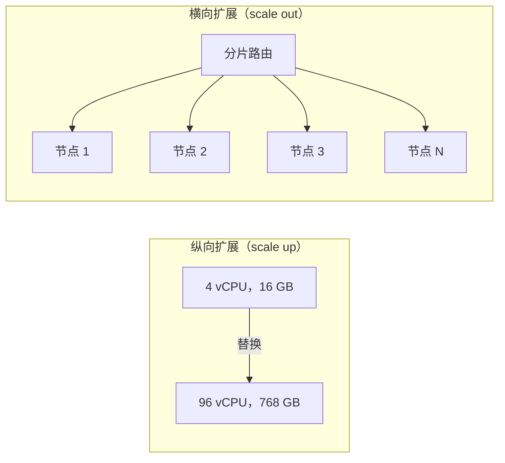
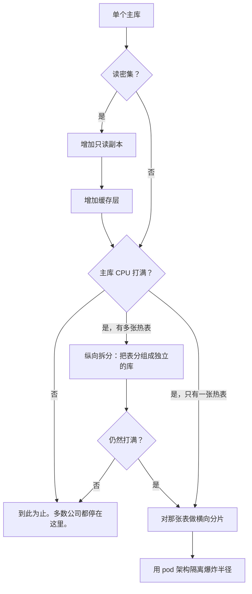
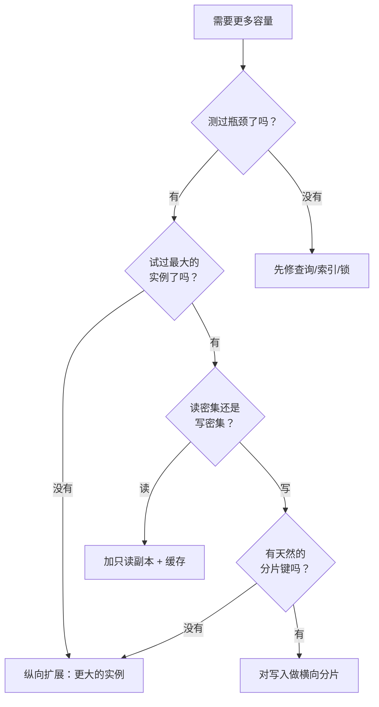

# 纵向扩展 vs 横向扩展

> **TL;DR.** 纵向扩展（把机器做大）保住了单写者的简单性、ACID 保证和运维上的清醒。横向扩展（把机器做多）拆掉了天花板，但引入了分片、复制延迟，以及数月的工程量。生产环境中被反复验证的答案是“先纵向扩展，确实需要的地方再横向扩展”。今天一台 AWS 实例最多能提供 1,920 个 vCPU 和 32 TiB 内存[^1]。绝大多数系统一辈子都用不满这个上限。真正决定选哪条路的，是每换来一单位吞吐量要付出多少运维复杂度。

## 学习目标

- 从成本、复杂度、可用性和上限这几个维度比较纵向扩展与横向扩展。
- 识别哪些负载特征支持继续留在一台机器上，哪些支持拆到多台机器上分片。
- 论证混合路径（纵向扩展做主库、加只读副本、最后才分片）为什么是默认的演进顺序。
- 评估真实系统（Stack Overflow、Figma、Shopify），并解释它们各自为何选择那样的扩展策略。

## 核心权衡

紧张关系不在于性能。两种做法都能带来吞吐量。紧张关系在于耦合。纵向扩展保住了单一故障域、一份预写日志（WAL）、一份查询计划缓存、一套运维手册。横向扩展则引入分片、复制、共识、跨分片查询、再均衡和 schema 协调。这里每一项都是要干好几个季度的工程[^2]。

面试里的标准答案是“横向扩展”，因为“无限台机器”听起来很唬人。而生产环境里的标准答案，对多数系统来说恰恰相反。Figma 的数据库团队花了九个月才把第一张 Postgres 表分片，他们形容横向分片“比我们之前所有的扩展工作复杂一个数量级”[^2]。Shopify 在 2015 年转向分片不是设计选择，而是买不到更大的数据库服务器之后的被迫之举[^3]。

*纵向扩展是用一台更大的机器替换原有机器；横向扩展是增加对等的机器，把工作分散到它们上面。*

## 逐项对比

| 维度 | 纵向扩展（scale up） | 横向扩展（scale out） |
|---|---|---|
| 上限 | 硬上限：AWS 上最多 1,920 个 vCPU、32 TiB 内存[^1] | 实际上没有边界 |
| 复杂度 | 一个主库、一份日志，没有分片逻辑 | 分片、再均衡、跨分片查询 |
| ACID | 全量支持，覆盖所有行 | 跨分片失效，只在单个分片内成立[^2] |
| 成本曲线 | 同一机型族内线性；到顶配变为超线性[^4][^5] | 每加一个节点线性增长 |
| 可用性 | 单一故障域（单点故障） | 每个分片有多个故障域 |
| 扩展操作 | 实例改规格 + 故障切换（秒级）[^6] | 加节点 + 再均衡（数小时到数天） |
| 工程前置时间 | 几分钟（一次 API 调用） | 数月（Figma 的第一批分片花了 9 个月）[^2] |
| 运维面 | 一套运维手册 | N 个分片上的 schema 迁移、分片均衡工具[^7] |

这张表在可用性那一行会误导人。“多个故障域”只有在每个分片的依赖也一并隔离时才成立。Shopify 就撞上了这个风险：当时所有数据库分片共用一个 Redis 实例，迫使他们重构为按 pod 隔离[^8]。要真正隔离爆炸半径（故障影响面），缓存、队列和配置都得按 pod 复制一份[^3]。

成本那一行藏着一个断点。在 `r5` 家族内部，价格是完全线性的：`r5.12xlarge` 的 $3.024/hr 正好是 `r5.24xlarge` 的 $6.048/hr 的一半[^9][^4]。一旦跨到内存优化机型，曲线就断了：`u7i-12tb.224xlarge`（896 vCPU、12 TiB）的价格是 $125.58/hr[^5]，相比 `r5.24xlarge`，vCPU 只多了 9.3 倍，价格却跳了 20.8 倍。

## 何时选择纵向扩展

**负载装得进一台机器。** 大多数都装得进。Stack Overflow 每天处理 2.09 亿次 HTTP 请求、每天 5.05 亿次 SQL 查询、每月 1,600 亿次 Redis 操作，而支撑这一切的只有四台 SQL Server（两个由主库加副本组成的集群）和两个 Redis 节点，这一套跑了 16 年[^10]。测试时他们甚至能用一台 Web 服务器撑起整个问答网络[^10]。

**单写者 OLTP，带跨行事务。** 如果你的查询要 join 任意行，或者需要跨表的原子提交，那么单个主库就白白送你 ACID。分片会把它拿走[^2]。

**运维简单性是第一优先级。** WhatsApp 服务了 4.65 亿月活用户，而端到端跑 Erlang 平台的工程师只有大约 10 人[^11]。他们的理念是：“用真正大的机器，在 SMP 机器上高效运行，把管理开销压下去”[^11]。

**你还没把更便宜的手段用尽。** 查询优化、索引、连接池和缓存通常能榨出 10 倍的余量。Stack Overflow 仅靠代码优化就把 ASP.Net 的处理时间从每天 757 小时降到每天 447 小时，而同期每天还多接了 6,100 万次请求[^10]。

## 何时选择横向扩展

**你确实把纵向容量用尽了。** 是实测出来的，不是假设的。在做过查询优化、索引和缓存之后，负载仍然打满了能买到的最大的实例。Shopify 在 2015 年撞上了这堵墙：“已经不可能再买一台更大的数据库服务器了”[^3]。

**可用性要求独立的故障域。** 即便一台机器扛得住负载，你也需要跨可用区或跨地域的副本来保命。Shopify 的 pod 架构就是为了让“单个 pod 的故障不会螺旋上升成平台级宕机”[^3]。

**写入吞吐超过单节点 IO。** Shopify 2024 年黑五的峰值是每秒 760 万次数据库写入，分布在 100 多个 MySQL 分片上[^8]。没有任何单节点能扛住这个量。

**数据模型有天然的分片键。** Shopify 按 `shop_id` 分片[^12]。Figma 按 `UserID`、`FileID` 或 `OrgID` 分片[^2]。Discord 按 `(channel_id, time_bucket)` 分片[^13]。如果你的数据找不到干净的分片边界，分片会非常痛苦。

## 混合路径

多数生产系统遵循一条标准演进路线：纵向扩展的主库，然后加只读副本，然后加缓存，然后做纵向分表，最后才做横向分片。每一步都比下一步便宜。大多数公司在最后一步之前就停下了。

Figma 从 2020 到 2024 年的演进堪称教科书[^14][^2]：先是单台 `r5.12xlarge` 主库，升级到 `r5.24xlarge`（当时能买到的最大 RDS Postgres 实例），加只读副本和 PgBouncer，把表纵向拆分到独立的 Postgres 集群（一次操作迁走 50 张表，30 秒内部分不可用），最后才对剩下最大的表做横向分片。四年间他们的数据库集群规模涨了 100 倍[^2]，但横向分片是最后才拉的那根杠杆，不是第一根。

*标准的扩展演进路线：每一步都比上一步更贵。多数系统走不到横向分片。*

## 真实案例

**Stack Overflow：纵向扩展用了 16 年。** Dell R720xd SQL Server（每台 24 核、384 GB 内存、4 TB PCIe SSD），双集群 AlwaysOn 部署，从 2010 年到 2025 年支撑了整个问答网络[^10][^15]。作为余量策略，数据库 CPU 利用率被刻意压得很低[^10]。2025 年迁到 GCP 是因为机房供应商关停，而不是扩展能力到顶[^15]。

**Figma：先纵向，最后横向。** 2020 年起步于一台单机 RDS Postgres，峰值流量下 CPU 占用 65%[^14]。三年里把纵向手段全部用尽。第一张横向分片的表在 2023 年 9 月上线，前后干了九个月，期间有 10 秒部分不可用[^2]。他们刻意留在 RDS Postgres 上，没有迁到 CockroachDB 或 Vitess，因为重建运维经验的风险更高[^2]。

**Shopify：被迫放弃纵向。** 2015 年撞上 MySQL 单节点上限[^3]。他们搭了 pod 架构，每个 pod 都是完全隔离的一片：一个 MySQL 分片、自己的 Redis、自己的 Memcached，pod 之间没有运行时的跨 pod 通信[^3]。到 2024 年黑五：24 小时内 1,730 亿次请求，峰值每分钟 2.84 亿次，100 多个活跃 MySQL 分片[^8]。

## 常见错误

> [!WARNING]
> **没测量就分片。** 团队为一台普通实例就能扛住的负载去设计分布式系统。一台 `r5.24xlarge`（96 vCPU、768 GB 内存、$6.048/hr）能扛的量，超过多数创业公司这辈子需要的量[^4]。先做基准测试。

> [!WARNING]
> **把横向扩展当成免费的可用性。** 横向铺开的集群如果共享依赖，会一起塌。Shopify 发现共用一个 Redis 实例给所有分片带来了关联故障风险[^8]。真正的隔离要求每一个依赖都按 pod 复制一份。

> [!WARNING]
> **无视顶配处的成本断崖。** 从普通机型（`r5`）跨到高内存机型（`u7i`）是 20 倍的价格跳升[^4][^5]。到了那个档位，三台普通机器加一层分片逻辑，每单位吞吐的成本可能比一台巨型实例还低。

> [!WARNING]
> **不预留后路。** 自增 ID、跨表外键、没有租户列，这几点会让未来的分片变成一次重写。用 UUID 或 Snowflake ID，并从第一天起就在每一行上带分片键[^2]。

## 决策清单

- [ ] 你是测出了真正的瓶颈（CPU、内存、IO、锁争用），还是只是在假设自己需要扩展？
- [ ] 在断定机器太小之前，你做过查询优化、索引和缓存了吗？
- [ ] 你的云厂商提供的最大的实例是什么规格，你在上面跑过基准测试吗？
- [ ] 你的负载有天然的分片键（tenant_id、user_id、shop_id）吗？
- [ ] 你能把读（容易横向扩）和写（难以横向扩）拆开吗？
- [ ] 分片的工程前置时间是多少，业务时间表撑得住吗？

*决策流程图：永远先测量，其次尝试纵向扩展，只有当写入超出单节点容量且存在干净的分片键时才分片。*

## 要点回顾

- 先纵向扩展。2026 年的一台机器就能提供 1,920 个 vCPU 和 32 TiB 内存[^1]。多数负载永远用不满。
- 横向扩展不是设计选择，而是纵向扩展用尽后的被迫之举。请按这个定位对待它。
- 混合路径（纵向扩展的主库、只读副本、缓存、纵向分表，最后分片）是标准演进路线。每一步都能换来数年的余地。
- 分片要花掉数月的工程量，并且永久失去跨分片的 ACID。动手之前先算账。
- 不做按分片的依赖隔离，横向扩展就不是高可用，而是多绕几步的关联故障。

## 延伸阅读

- [Stack Overflow: The Architecture 2016 Edition](https://nickcraver.com/blog/2016/02/17/stack-overflow-the-architecture-2016-edition/)：讲“纵向扩展做对了是什么样”的经典文章；在主张横向扩展之前先读它。
- [How Figma's databases team lived to tell the scale](https://www.figma.com/blog/how-figmas-databases-team-lived-to-tell-the-scale/)：长达九个月的横向分片项目；关于复杂度代价，这是最好的公开记述。
- [A Pods Architecture To Allow Shopify To Scale](https://shopify.engineering/a-pods-architecture-to-allow-shopify-to-scale)：Shopify 为何在 2015 年被迫放弃纵向扩展，以及 pod 如何带来故障域隔离。
- [How Discord Stores Trillions of Messages](https://discord.com/blog/how-discord-stores-trillions-of-messages)：聊天规模下的纯横向方案；从 Cassandra 迁到 ScyllaDB，附带节点数与延迟数据。
- [The growing pains of database architecture (Figma)](https://www.figma.com/blog/how-figma-scaled-to-multiple-databases/)：教科书级的纵向分表故事，2020 到 2023 年。
- [Amazon EC2 High Memory U7i Instances](https://aws.amazon.com/ec2/instance-types/u7i/)：当前单机上限的参考。

## 记忆卡片

<strong>Q: 2026 年 AWS 上最大的单台 EC2 实例是什么？</strong>

A: `u7inh-32tb.480xlarge`，1,920 个 vCPU、32 TiB 内存、200 Gbps 网络。多数负载根本用不到接近这个上限的水平。

<strong>Q: 为什么“横向扩展”常常是错误的第一个答案？</strong>

A: 横向扩展引入分片、复制、跨分片查询计划和 schema 协调。每一项都是要干好几个季度的工程。纵向扩展只是一次 API 调用，停机几秒。在实测到瓶颈之前，默认选纵向。

<strong>Q: 对一个由数据库支撑的系统，标准的扩展演进路线是什么？</strong>

A: 在最大的实例上放单个主库，加只读副本，加缓存，把表纵向拆分到独立的库，最后只对仍然超出单节点写容量的表做横向分片。

<strong>Q: Figma 的第一批横向分片花了多久上线？</strong>

A: 端到端九个月，而且在那之前他们已经做完了纵向分表。他们形容这“比之前所有的扩展工作复杂一个数量级”。

<strong>Q: 在 AWS 上，纵向扩展的成本曲线在哪里断裂？</strong>

A: 在同一个机型族内（比如 `r5`），定价是线性的。跨到高内存档（`x2`、`u7i`）就出现超线性跳升：`u7i-12tb.224xlarge` 的价格是 `r5.24xlarge` 的 20.8 倍，而 vCPU 只有 9.3 倍。

<strong>Q: 为什么横向扩展不等于高可用？</strong>

A: 多个节点如果共享依赖（单个 Redis、单个配置服务），会一起塌。真正的爆炸半径隔离要求每个分片的每个依赖都复制一份，Shopify 就是在共用 Redis 拖垮所有分片之后学到这一点的。

<strong>Q: 是什么迫使 Shopify 从纵向扩展转向横向扩展？</strong>

A: 2015 年，他们的 MySQL 负载已经买不到更大的数据库服务器了。分片明确是被迫之举，不是主动的设计选择。

## 参考文献

[^1]: AWS. "Amazon EC2 High Memory U7i Instances." https://aws.amazon.com/ec2/instance-types/u7i/
[^2]: Sammy Steele. "How Figma's databases team lived to tell the scale." Figma Engineering, 2024-03-14. https://www.figma.com/blog/how-figmas-databases-team-lived-to-tell-the-scale/
[^3]: Xavier Denis. "A Pods Architecture To Allow Shopify To Scale." Shopify Engineering, 2018-03-02. https://shopify.engineering/a-pods-architecture-to-allow-shopify-to-scale
[^4]: Vantage. "r5.24xlarge pricing and specs." https://instances.vantage.sh/aws/ec2/r5.24xlarge
[^5]: Vantage. "u7i-12tb.224xlarge pricing and specs." https://instances.vantage.sh/aws/ec2/u7i-12tb.224xlarge
[^6]: AWS RDS. "Scaling and high availability in Amazon RDS." https://docs.aws.amazon.com/AmazonRDS/latest/gettingstartedguide/scaling-ha.html
[^7]: Shopify Engineering. "Shard Balancing: Moving Shops Confidently with Zero-Downtime at Terabyte-scale." https://shopify.engineering/mysql-database-shard-balancing-terabyte-scale
[^8]: "Shopify Tech Stack." ByteByteGo, 2025-06-11. https://blog.bytebytego.com/p/shopify-tech-stack
[^9]: Vantage. "r5.12xlarge pricing and specs." https://instances.vantage.sh/aws/ec2/r5.12xlarge
[^10]: Nick Craver. "Stack Overflow: The Architecture - 2016 Edition." 2016-02-17. https://nickcraver.com/blog/2016/02/17/stack-overflow-the-architecture-2016-edition/
[^11]: Todd Hoff. "How WhatsApp Grew to Nearly 500 Million Users, 11,000 cores, and 70 Million Messages a Second." High Scalability, 2014-03-31. https://highscalability.com/how-whatsapp-grew-to-nearly-500-million-users-11000-cores-an/
[^12]: "How Shopify Manages its Petabyte Scale MySQL Database." ByteByteGo, 2024-09-10. https://blog.bytebytego.com/p/how-shopify-manages-its-petabyte
[^13]: Bo Ingram. "How Discord Stores Trillions of Messages." Discord Engineering, 2023-03-06. https://discord.com/blog/how-discord-stores-trillions-of-messages
[^14]: Tim Liang. "The growing pains of database architecture." Figma Engineering, 2023-04-04. https://www.figma.com/blog/how-figma-scaled-to-multiple-databases/
[^15]: Stack Overflow. "The Great Unracking: Saying goodbye to the servers at our physical datacenter." 2025-12-24. https://stackoverflow.blog/2025/12/24/the-great-unracking-saying-goodbye-to-the-servers-at-our-physical-datacenter/
