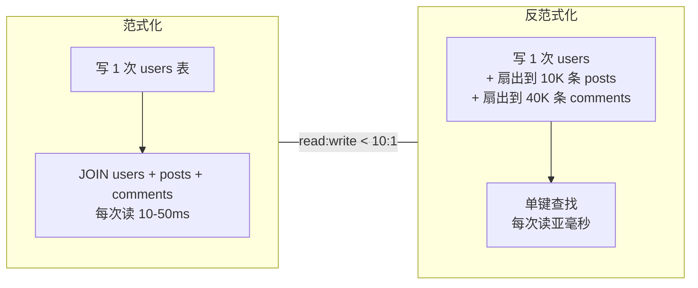
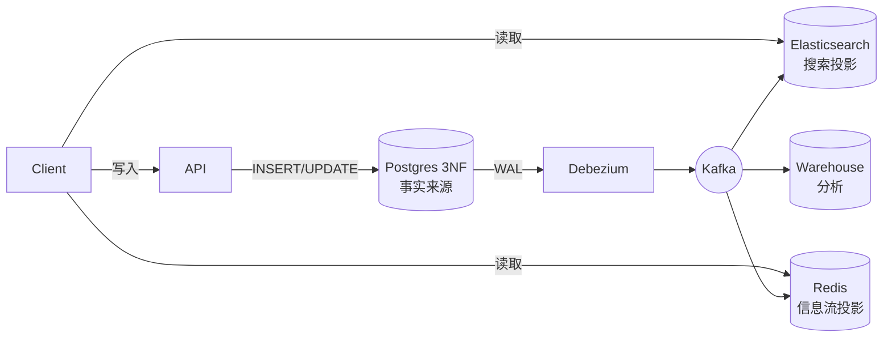
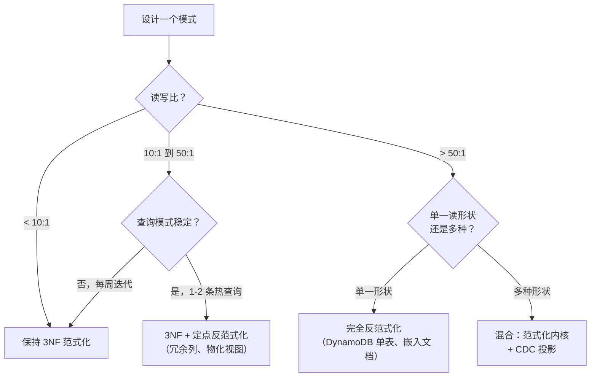

# 范式化与反范式化

> **TL;DR.** 范式化（3NF）让每个事实只存一份，消除更新异常，但读的时候要做连接。反范式化复制数据，让读避开连接，代价是写放大和一致性风险。决定性维度是读写比加上查询模式的稳定性。OLTP 默认走 3NF；只在测出来的热路径上反范式化。上规模的生产系统多数跑混合：范式化的事实来源，加热读面上由 CDC 供给的反范式化投影[^1][^2]。

## 学习目标

- 从写成本、读延迟、一致性和模式灵活性四个角度比较范式化与反范式化。
- 识别偏好某一方案的工作负载特征（读写比、查询稳定性、分片）。
- 论证混合模式（范式化内核 + 反范式化投影）是当下上规模的默认做法。
- 评析真实系统（Facebook TAO、DynamoDB 单表设计、Airbnb Riverbed）并解释它们的模式选择。

## 核心权衡

所有模式都落在同一个维度上：为了查询速度，你愿意容忍多少冗余。范式化由 Codd 在 1970-1971 年形式化提出[^3][^4]，它把关系拆开，让每个非键事实恰好只存在于一行里。回报是：在一处改掉作者姓名，所有查询立刻看到新值。代价是：读要跨多张表做连接。

反范式化往反方向推。你复制列、预计算聚合、在写入时快照关联数据，或者把连接塌缩进单个文档[^5]。读变成单键查找。但每次写现在都要碰多个位置，只要有一条写路径漏掉某个副本，数据就会悄悄分叉。

往相反方向移动的指标是单次操作成本：范式化让写便宜、读昂贵；反范式化让读便宜、写昂贵。交叉点是读写比。当读以 10:1 以上占优、且查询形状稳定时，反范式化就划算，因为你把额外的写工作摊到许多次便宜的读上[^6]。

*范式化把成本压在读侧；反范式化把成本挪到写侧。读写比决定哪一侧胜出。*

## 逐项对比

| 维度 | 范式化（3NF） | 反范式化 |
|---|---|---|
| 读延迟 | 多表连接，典型 10-50 ms | 单键取值，亚毫秒[^7] |
| 写延迟 | 单行更新，快 | 扇出到 N 个副本，较慢 |
| 写放大 | 1×（一行） | Postgres 带索引时典型 3-4×[^8]；有投影时无上界 |
| 一致性 | 即时，单一事实来源 | 同步完成前存在陈旧窗口[^9] |
| 存储占用 | 最小，没有重复 | 膨胀；把 500 字节的记录重复到数百万行，成本是真的[^5] |
| 模式灵活性 | 任何新查询只是执行计划变化，不是迁移 | 新的访问模式可能要求全量重建数据[^10] |
| 分片友好度 | 跨分片连接昂贵甚至不可能[^11] | 预连接数据留在同一个分片 |
| 失效模式 | 高负载下读变慢 | 副本分叉，静默的数据损坏 |

这张表在一个维度上会误导人：存储。2026 年存储很便宜，昂贵的是网络往返。范式化的真实成本不在磁盘，而在扇出读时的延迟。反过来，反范式化的真实成本也不在磁盘，而在让副本保持同步的运维负担。

对早期产品来说，“模式灵活性”那一行是决定性的。如果产品每周都在改查询形状，反范式化会把你锁死在昨天的访问模式里。范式化则能吸收新查询，不用迁移。

## 什么时候选范式化

**写密集、查询组合不可预测的 OLTP。** 支付账本、ERP 系统、快速迭代中的 SaaS 平台。每个事实只有一个事实来源，意味着改一处、零同步负担[^3][^5]。

**ACID 关键的操作。** 当部分更新就是正确性 bug（重复扣款、超卖库存），范式化把不变量守在一个事务里。反范式化的副本会引入一段系统自相矛盾的时间窗。

**早期产品。** 你还不知道自己的访问模式。3NF 让你用新索引或执行计划变化加上任何查询。反范式化是在赌你还没挣来的稳定性。

**单台 RDBMS 上的中小规模。** 几千行上做一次索引良好的连接只需微秒。真正的瓶颈通常是 ORM 的 N+1 查询或缺索引，不是连接本身[^12]。

## 什么时候选反范式化

**读以 50:1 以上占优、查询模式已经冻结。** 社交信息流、商品列表页、搜索结果。Facebook TAO 对着一个反范式化的图缓存，每秒扛住数十亿次读[^13]。查询形状（点查、按关联类型做范围查、计数）十年没变过。

**连接根本做不到。** DynamoDB、Cassandra 和分片的 Postgres 都没有服务端连接算子。这时的反范式化不是优化，而是唯一选项[^11][^14]。DynamoDB 的单表设计把相关实体放在同一个分区键下，一条 `Query` 就能返回物化好的连接结果，个位数毫秒[^7][^15]。

**历史准确性需要快照。** 客户当时付的价格属于订单行，不该从今天的产品目录里查。这看起来像反范式化，其实是针对时间点事实的正确范式化设计[^5]。

**Elasticsearch 与搜索索引。** Elasticsearch 里的父子（join field）查询因为全局序数（global ordinals）开销，比等价的扁平文档查询慢得多[^16]。官方建议就是：为了速度把文档反范式化。

## 混合路线

多数上规模的生产系统既不是纯 3NF，也不是完全反范式化。它们跑一个范式化的 OLTP 事实来源，在热读路径上用 CDC 供给的反范式化投影[^1][^17]。

写打到范式化存储（3NF 的 Postgres）。一条 CDC 管道（Debezium、DynamoDB Streams、Kafka Connect）把变更传播到下游投影：搜索索引、预连接的 Redis 哈希、物化的信息流、分析仓库。每个投影都为某一块屏专门打造。投影坏了，就从事件日志重建[^18]。

Airbnb 的 Riverbed 框架是一个具体实例：一个 Lambda 架构系统，从系统记录数据库维护反范式化、读优化的存储，“优化数据如何从系统记录数据存储中被消费，并更新二级读优化存储”[^2]。

*混合模式：写在范式化存储里保持正确，读在一次性的反范式化投影里保持快。每个投影都能独立重建。*

代价是：你现在要运维一套流式基础设施（Kafka、Flink 或同类），而且每个投影都引入一个产品必须写明的一致性窗口。

## 真实案例

**Facebook TAO** 用结构化的图缓存取代了随手加 memcache 的反范式化。它横跨几十万个 MySQL 分片，每秒服务数十亿次读、数千万次写[^13][^19]。底下的 MySQL 是范式化的；TAO 是两层的写穿透反范式化缓存，对外暴露带类型的对象和关联。Meta 称通过版本号和毫秒级失效做到了约 99.99999999% 的缓存一致性[^9]。RAMP-TAO 论文（2021）报告说，在旧版 TAO 里每 1,500 次批量读就有 1 次读到事务的部分更新，这促使他们引入原子可见性事务[^20]。

**DynamoDB 单表设计** 把反范式化烤进主键。一个客户档案和它所有的订单共用分区键 `CUST#123`；一条 `Query` 就能返回整个条目集合，亚毫秒级[^15][^10]。一条 `Query` 返回总计 4 KB 以内的条目花 0.5 RCU（最终一致），而两次独立的 GetItem 调用、每个条目都向上取整到 4 KB，要花 1 RCU[^21]。代价是：访问模式必须提前设计好，改模式要全表扫描重写。

**Uber Schemaless** 把数据分散存在多个 MySQL 集群上，每秒服务数百万请求[^22]。每个“cell”是不可变的追加式元组，由 (row key, column name, ref key) 定位。跨分片连接被禁止；一次读需要的所有反范式化都在写入时内联好[^22]。

## 常见错误

> [!WARNING]
> **过早反范式化。** 团队还没测量就先反范式化，然后发现连接从来不是瓶颈。几千行上索引良好的 3NF 连接跑在微秒级。先跑 `EXPLAIN ANALYZE`[^12]。

> [!WARNING]
> **反范式化却没有同步机制。** 冗余列上线了，触发器、CDC 消费者、核对器没上。副本悄悄漂移。Meta 明确说过，在 TAO 取代它之前，随手加 memcache 的反范式化带来了“bug、用户可见的不一致和站点性能问题”[^19]。

> [!WARNING]
> **无上界的嵌入数组。** 一个带嵌入 `comments` 数组的 MongoDB 文档会一直长，直到撞上 16 MB 的 BSON 上限，然后所有写都失败[^23]。超过 1-2 MB 的文档性能已经在下降[^24]。任何无上界的子集合都要改成引用。

> [!WARNING]
> **单表设计里的 GSI 写放大。** 五个全局二级索引意味着每次更新 5× 的写容量。月度账单膨胀，把读上省下的钱吃掉[^21]。只有具体访问模式确实要求时才加 GSI。

## 决策清单

- [ ] 读写比是多少？低于 10:1，保持范式化。高于 50:1，把热路径反范式化。
- [ ] 查询模式是稳定的（几个月才变一次）还是易变的（每周迭代）？
- [ ] 产品能容忍反范式化字段上的陈旧窗口吗？能忍多少秒？
- [ ] 每个反范式化字段都有同步机制（触发器、CDC、核对器）吗？
- [ ] 你的数据存储支持服务端连接吗？不支持的话，反范式化就是必须的。
- [ ] 源字段变化时，扇出更新有多贵（10 行还是 1000 万行）？

*决策流程图：读写比是第一个分支，查询模式稳定性是第二个。上规模的系统多数落在混合那一格。*

## 要点回顾

- OLTP 默认用 3NF。只有在测量证明某条查询确实热且卡在连接上时，才反范式化。
- 读写比是最好用的单一筛选工具。低于 10:1，范式化胜出。高于 50:1，把热路径反范式化。
- 没有同步机制的反范式化就是一个等着发生的数据损坏 bug。触发器、CDC 消费者、核对器要一起上线。
- 混合模式（范式化内核 + CDC 供给的投影）是上规模的现代默认。写保持正确，读保持快，投影是一次性的。
- 给时间点事实做快照（订单行上的 `unit_price_paid`）不是反范式化，那是历史数据的正确范式化设计。

## 延伸阅读

- [TAO: Facebook's Distributed Data Store for the Social Graph (Bronson et al., USENIX ATC 2013)](https://www.usenix.org/conference/atc13/technical-sessions/presentation/bronson)：十亿级读规模下反范式化图缓存的经典论文，讲清了两层写穿透架构。
- [Single-table vs multi-table design in Amazon DynamoDB (Alex DeBrie, AWS 2022)](https://aws.amazon.com/blogs/database/single-table-vs-multi-table-design-in-amazon-dynamodb/)：关于单表设计的收益与隐性成本，最平衡的一篇。
- [CQRS (Martin Fowler, 2011)](https://www.martinfowler.com/bliki/CQRS.html)：命令查询分离的权威短文，明确带着“谨慎使用”的警告。
- [When to Denormalize: Performance vs Integrity Trade-offs](https://www.kindatechnical.com/postgresql/when-to-denormalize-performance-vs-integrity-trade-offs.html)：具体的 Postgres 手法——预计算聚合、快照、物化视图、冗余列。
- [Riverbed: Optimizing Data Access at Airbnb's Scale (Airbnb Engineering, 2024)](https://medium.com/airbnb-engineering/riverbed-optimizing-data-access-at-airbnbs-scale-c37ecf6456d9)：生产级 Lambda 架构框架，从范式化源维护反范式化的读存储。
- [Further Normalization of the Data Base Relational Model (Codd, 1971)](https://thaumatorium.com/articles/the-papers-of-ef-the-coddfather-codd/1971b-further-normalization-of-the-data-base-relational-model/)：定义 2NF 与 3NF 的原始文献；读它是为了理解当年为什么非要消除冗余。

## 记忆卡片

<strong>Q：判断范式化还是反范式化，最有用的单一筛选工具是什么？</strong>

A：读写比。低于 10:1 时范式化胜出（写便宜，连接可以接受）。高于 50:1 且查询模式稳定时，把热读路径反范式化。

<strong>Q：为什么在 DynamoDB 和 Cassandra 上反范式化实际上是必须的？</strong>

A：这些存储没有服务端连接算子。关联数据必须在写入时预连接（同一分区键、嵌入文档），这样读才是单键查找。

<strong>Q：每个反范式化字段必须同时上线哪三样东西？</strong>

A：（1）更新它的写路径（触发器、应用代码）；（2）发生漂移时重建它的后台核对器；（3）验证新鲜度的监控查询。三者缺一，副本就会悄悄分叉。

<strong>Q：Facebook TAO 如何在范式化的 MySQL 后端上做到亚毫秒读？</strong>

A：TAO 是两层的写穿透反范式化缓存。读打到缓存（对象和关联）；写穿过缓存传播到分片的 MySQL。缓存是反范式化投影，MySQL 是范式化的事实来源。

<strong>Q：单表与多表读在 DynamoDB 上的 RCU 成本差多少？</strong>

A：一条 `Query` 返回总计 4 KB 以内的条目花 0.5 RCU（最终一致）。两次独立的 GetItem 调用、每个条目都向上取整到 4 KB，合计 1 RCU，差 2×。

<strong>Q：为什么把 unit_price_paid 存在 order_items 上不算反范式化？</strong>

A：所收价格是关于这张订单的事实，不是关于当前产品的事实。这是针对时间点事实的正确范式化设计。连到今天的产品表反而会返回错误的值。

<strong>Q：上规模的生产系统跑的混合模式是什么样？</strong>

A：一个范式化的 OLTP 数据库作为事实来源，CDC（Debezium、Kafka Connect）把变更流到专门打造的反范式化读存储（搜索索引、信息流缓存、分析仓库）。投影是一次性的、可重建的。

## 参考文献

[^1]: Martin Fowler, "CQRS", 14 July 2011. https://www.martinfowler.com/bliki/CQRS.html
[^2]: "Riverbed: Optimizing Data Access at Airbnb's Scale", Airbnb Engineering, 2024. https://medium.com/airbnb-engineering/riverbed-optimizing-data-access-at-airbnbs-scale-c37ecf6456d9
[^3]: E. F. Codd, "A Relational Model of Data for Large Shared Data Banks", Communications of the ACM, June 1970. https://dl.acm.org/doi/10.1145/362384.362685
[^4]: E. F. Codd, "Further Normalization of the Data Base Relational Model", 1971. https://thaumatorium.com/articles/the-papers-of-ef-the-coddfather-codd/1971b-further-normalization-of-the-data-base-relational-model/
[^5]: "When to Denormalize: Performance vs Integrity Trade-offs", kindatechnical.com. https://www.kindatechnical.com/postgresql/when-to-denormalize-performance-vs-integrity-trade-offs.html
[^6]: "Denormalization in Databases: When and How to Use It", DataCamp, 2024. https://www.datacamp.com/tutorial/denormalization
[^7]: Sandip Gangdhar, "Understanding Amazon DynamoDB latency", AWS Database Blog, April 2023. https://aws.amazon.com/blogs/database/understanding-amazon-dynamodb-latency/
[^8]: "Write Amplification in Postgres: The 3-4x Tax on Every Insert", Tigerdata. https://www.tigerdata.com/blog/write-amplification-in-postgres-the-3-4x-tax-on-every-insert
[^9]: "Cache made consistent", Meta Engineering, June 2022. https://engineering.fb.com/2022/06/08/core-infra/cache-made-consistent/
[^10]: "Amazon DynamoDB Single Table Design Complete Guide", hidekazu-konishi.com. https://hidekazu-konishi.com/entry/amazon_dynamodb_single_table_design_guide.html
[^11]: "Data Modeling for Scale: Denormalization and Materialized Views", kindatechnical.com. https://kindatechnical.com/system-design-interview/data-modeling-scale.html
[^12]: "Denormalization in Databases", GeeksforGeeks DBMS. https://www.geeksforgeeks.org/dbms/denormalization-in-databases/
[^13]: Bronson et al., "TAO: Facebook's Distributed Data Store for the Social Graph", USENIX ATC 2013. https://www.usenix.org/conference/atc13/technical-sessions/presentation/bronson
[^14]: AWS Documentation, "General design principles for Amazon DynamoDB", Amazon DynamoDB Developer Guide. https://docs.aws.amazon.com/amazondynamodb/latest/developerguide/bp-general-nosql-design.html
[^15]: Alex DeBrie, "Single-table vs. multi-table design in Amazon DynamoDB", AWS Database Blog, August 2022. https://aws.amazon.com/blogs/database/single-table-vs-multi-table-design-in-amazon-dynamodb/
[^16]: "Join field type: Parent-join and performance", Elasticsearch Reference. https://www.elastic.co/guide/en/elasticsearch/reference/current/parent-join.html
[^17]: Microsoft Azure Architecture Center, "Materialized View Pattern" (CQRS read projections). https://learn.microsoft.com/en-us/azure/architecture/patterns/materialized-view
[^18]: "Projections and Materialized Views", softwarepatternslexicon.com event-sourcing reference. https://softwarepatternslexicon.com/event-driven-architecture-patterns/event-sourcing-and-cqrs/projections-materialized-views/
[^19]: Mark Marchukov, "TAO: The power of the graph", Meta Engineering, June 2013. https://engineering.fb.com/2013/06/25/core-infra/tao-the-power-of-the-graph/
[^20]: Cheng et al., "RAMP-TAO: Layering Atomic Transactions on Facebook's Online TAO Data Store", VLDB 2021. https://engineering.fb.com/2021/08/18/core-data/ramp-tao/
[^21]: "DynamoDB Single-Table Design: Cost Saver or Overhyped Myth?", usage.ai, 2026. https://www.usage.ai/blogs/aws/reserved-instances/dynamodb/single-table-design-cost/
[^22]: "Designing Schemaless, Uber Engineering's Scalable Datastore Using MySQL". https://www.uber.com/us/en/blog/schemaless-part-one-mysql-datastore/
[^23]: "Data Modeling in MongoDB", MongoDB Manual 8.3. https://www.mongodb.com/docs/manual/data-modeling/
[^24]: "Bloated Documents", MongoDB Schema Design Anti-Patterns. https://www.mongodb.com/docs/manual/data-modeling/design-antipatterns/bloated-documents/
