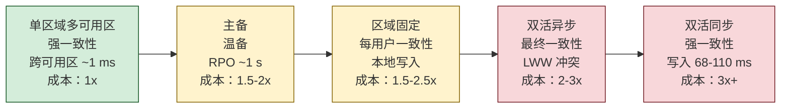
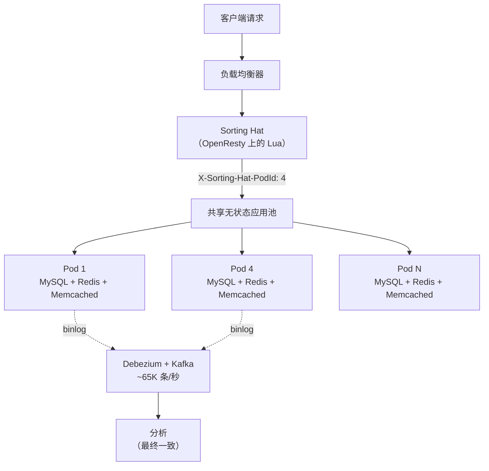
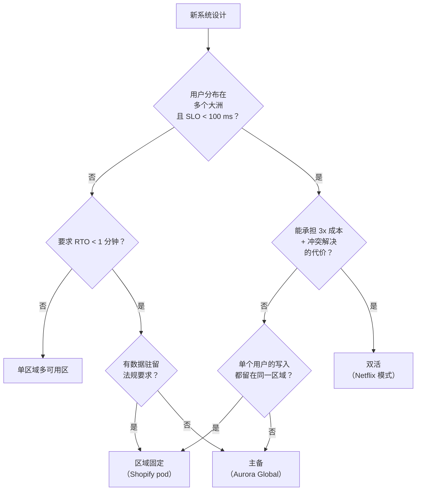

# 单区域与多区域部署

> **TL;DR.** 单区域多可用区才是正确的默认选择。它给你强一致性、亚毫秒级的跨可用区复制，以及一条部署流水线。多区域是你能选的最昂贵的架构方案：基础设施成本 2-3 倍，仅跨区域传输一项就占 AWS 账单的 10-20%[^1]，而且还必须做冲突解决，或者吞下跨区域共识延迟（每 RTT 68-110 ms[^2]）。只有当 RTO 要求、全球延迟 SLO 或数据驻留法规逼着你上时，才选多区域。真要上，优先选区域固定，而不是真正的双活。

## 学习目标

- 从 RTO、RPO、成本和一致性几个维度，对比单区域多可用区、主备、双活与区域固定。
- 识别哪些工作负载特征值得付出多区域部署的成本与复杂度。
- 论证区域固定是那条混合路径：既有多个区域带来的可用性，又不需要冲突解决。
- 用 Netflix、Shopify 和 2021 年 us-east-1 故障，说明每种方案在什么情况下成功、什么情况下失败。

## 核心权衡

根本矛盾来自物理。us-east-1 到 eu-west-1 一次往返 68 ms，到 eu-central-1 是 91 ms，到 eu-north-1 是 110 ms[^2]。任何在写路径上要求跨区域确认的协议，都要把这段延迟加到每一次提交上。你有三种应对方式：

1. **写入留在本地，接受最终一致性**（DynamoDB Global Tables MREC、Cassandra LOCAL_QUORUM）。写入很快；冲突是你自己的麻烦。
2. **为强一致性付跨区域往返的代价**（Spanner、CockroachDB REGION survival、DynamoDB MRSC）。写入变慢；正确性有保证。
3. **把每个用户固定在某个区域，让跨区域写入根本不发生**（Shopify pod、Stripe 的区域固定）。写入又快又一致；跨用户的分析是最终一致的。

有一个指标总是朝相反方向走：部署的地理范围铺得越开，写延迟就越高，或者一致性就越弱。跨区域你没法同时拿到低延迟和强一致性。[CAP 与 PACELC](../part-3-distributed-systems-theory/03-cap-and-pacelc.md) 已经把这件事形式化了；部署地理位置正是你承受其后果的地方。

*部署地理范围的光谱：每向右一步，都是用更多钱和复杂度，换更小的爆炸半径或更低的全球延迟。*

## 逐项对比

| 维度 | 单区域多可用区 | 多区域（双活） |
|---|---|---|
| 写延迟 | 1-5 ms（跨可用区同步）[^3] | 68-110 ms（同步共识）或 1-5 ms（异步、最终一致）[^2] |
| 读新鲜度 | 永远最新（单主） | 落后 0.5-2.5 s（异步），或最新（同步，但有代价）[^4] |
| RTO | 数小时到数天（在新区域重建）[^5] | 接近零（geo-DNS 改路由）[^6] |
| RPO | 数小时（上次备份）到 ~1 s（Aurora Global）[^7] | 零（同步）或数秒（异步）[^4] |
| 成本 | 1x 基准 | 2-3x 计算 + 每 GB $0.02 的跨区域传输[^1] |
| 一致性模型 | 强一致性无需额外代价 | 需要冲突解决，或承担共识延迟的惩罚[^8] |
| 故障模式 | 区域故障 = 完全停机[^9] | 区域故障 = 容量事件，而非停机[^6] |
| 运维复杂度 | 一条流水线、一套密钥、一套监控 | 每区域流水线、跨区域可观测性、故障切换演练 |

这张表在 RTO 一行上会误导人。单区域的“数小时到数天”假设你压根没有灾备。加上 Aurora Global Database（主备温备）就能把 RTO 压到几分钟[^7]，而不必背上双活的全部复杂度。大多数团队应该先评估中间几档，再考虑跳到最右列。

成本一行也低估了实际开销。按行业分析，仅跨区域数据传输一项就可能占一个复制型架构 AWS 总账单的 10-20%[^1]。一个 5 TB 的数据库，变更速率 10 MB/s，光传输费每月就约 520 美元，还没算重复的计算、存储或托管服务费用。

## 何时选择单区域

**你的用户在地理上集中。** 服务北美企业的 B2B SaaS 不需要 eu-west-1。纽约的用户访问 us-east-1 只要付 5 ms；同一个用户访问 eu-west-1 要付 68 ms[^2]。不要为了解决一个你并不存在的问题而增加延迟。

**RTO > 1 小时在合同上可以接受。** 内部工具、预发环境、分析平台和早期产品，都能容忍一次区域故障，然后从备份恢复。大多数初创公司都属于这一类。

**强一致性是硬要求，而跨区域延迟不可接受。** Spanner 的区域配置在三个可用区上给出 99.99% 可用性，提交延迟只有个位数毫秒[^3]。如果你既要线性一致性又要低延迟，那就待在一个区域里，接受区域级的爆炸半径。

**运维人力有限。** 多区域让你的部署面翻倍。如果团队没法每季度演练一次故障切换，真出事时那个灾备区域就是陈旧的[^6]。

## 何时选择多区域

**合同里的可用性要求超出了一个区域能给的上限。** Spanner 多区域公布 99.999% SLA，是区域版四个九的 10 倍[^3]。金融服务、医疗，以及把 SLA 按每年停机分钟数来衡量的全球电商，都需要多区域。

**全球用户延迟是产品需求。** 让分布在多个大洲的用户都拿到 100 ms 以下的 P99，在单区域上物理上做不到。Netflix 用三个区域（us-east-1、us-west-2、eu-west-1）服务，让每个用户都命中就近的入口[^6]。

**数据驻留法规逼你这么干。** GDPR、PDPA 和各类主权法律要求个人数据留在某个司法辖区之内。一个 EU 区域加一个 US 区域，各自只服务自己的用户，就能满足要求，而不必承担双活的复杂度[^10]。

**2021 年 12 月的 us-east-1 故障就是你的威胁模型。** 八小时的控制面故障打掉了 Netflix（靠双活撑住了[^6]）、Disney+、Venmo、Ring，以及亚马逊自家的 Connect 服务[^9]。如果你的产品承受不了这种场景，至少要有主备灾备。

## 混合路线

区域固定是大多数生产系统实际在跑的架构。每个用户（或租户）被确定性地分配到某个归属区域。该用户的所有写入都在本地完成。热路径上的跨区域流量为零。

Shopify 的 pod 架构是教科书级的例子。Sorting Hat（跑在 OpenResty 上的 Lua）通过 `X-Sorting-Hat-PodId` 把每个店铺映射到某个 pod。每个 pod 有自己的 MySQL 分片、Redis 和 Memcached。Pod Mover 能在约一分钟内把一个 pod 在数据中心之间做故障切换。2025 年 BFCM 期间，这套架构每分钟处理 4.89 亿次边缘请求，可用性 99.99%+[^11]。

*区域固定让每个用户享有单主一致性，同时把爆炸半径限制在 pod 之内；跨 pod 的读取走一条最终一致的 CDC 流水线。*

关键在于：区域固定给你多区域的可用性（一个 pod 故障只影响该 pod 的租户），却不需要冲突解决（每个用户恰好只有一个写入者）。跨用户的操作（全局搜索、分析）通过一条 CDC 流水线接受最终一致性，吞吐约 6.5 万条/秒，P99 < 10 s[^11]。

## 真实案例

**Netflix（双活，3 个区域）。** 三个 AWS 区域在 geo-DNS 后面服务在线流量。Cassandra 异步复制，读用 LOCAL_QUORUM。EVCache 通过 SQS 做跨区域失效。每个区域都按能吸收一个故障对端的全部负载来预留容量。Chaos Kong 演练定期验证这个假设。2021 年 12 月 us-east-1 故障期间，Netflix 把流量疏散到存活的区域，保持可用[^6]。

**Shopify（区域固定，100+ 个 pod）。** 2025 年 BFCM 期间每分钟 4.89 亿次边缘请求。pod 级故障切换约 1 分钟。Ghostferry 在 pod 之间迁移店铺，停机只有数秒。永远没有跨 pod 写入。这套架构源于一个教训：一个共享的 Redis 挂掉就能带走所有店铺，从而催生了彻底的按 pod 隔离[^11]。

**AWS us-east-1（2021 年 12 月 7 日）。** 一次自动扩容触发流量激增，压垮了内部到主干的网络设备。区域控制面（EC2 启动、STS、Route 53 API、监控）受损达 8 小时。正在运行的 EC2 实例和 DynamoDB 数据面仍然可用，但任何需要启动容量、轮换凭证或读取监控的团队都是瞎的[^9]。教训是：多可用区防的是可用区故障，不是区域控制面故障。

## 常见错误

> [!WARNING]
> **把多可用区和多区域混为一谈。** 多可用区能挺过一次数据中心断电，但挺不过区域控制面故障。2021 年 us-east-1 事件证明了这一点：EC2 实例跑得好好的，可团队 8 小时内既开不了新实例，也轮换不了凭证，还看不到自己的看板[^9]。

> [!WARNING]
> **故障切换依赖了正在出故障的那个区域。** 你的故障切换预案调用 Route 53 API 去切 DNS。Route 53 API 就在那个故障区域里。你卡死了。提前在灾备区域预留容量，改用数据面的故障切换原语（Route 53 ARC），并把运行手册存到区域之外[^5]。

> [!WARNING]
> **把“主备”当成配好就完事。** 如果你上个季度没做过故障切换，你的灾备区域就是陈旧的。Netflix 按计划跑 Chaos Kong 演练，因为很少走到的路径里潜藏的 bug，偏偏会在你最需要的时候咬你一口[^6]。

> [!WARNING]
> **跨区域传输费用的惊吓。** AWS 对跨区域传输收 $0.02/GB。一个 5 TB 的数据库按 10 MB/s 的变更速率复制，光传输每月就约 520 美元。在复制型架构里，给跨区域流量预留总花费的 10-20%[^1]。

## 决策清单

- [ ] 你的合同 RTO 和 RPO 是多少——不是理想值，是写在合同里的那个？
- [ ] 你的用户在地理上分布在哪里，P99 延迟 SLO 是多少？
- [ ] 数据驻留法规（GDPR、PDPA）是否逼你上多区域，还是辖区内单个区域就够？
- [ ] 你承担得起 2-3 倍基础设施成本，再加占总花费 10-20% 的跨区域传输吗？
- [ ] 区域固定能不能在不引入冲突解决复杂度的前提下，给你多区域可用性？
- [ ] 你上一次真的把流量切到灾备区域是什么时候？如果答案是“从来没有”，那你还没准备好。

*决策流程图：从单区域这个默认值起步，每往上走一步都要给出理由。大多数团队最终落在主备或区域固定，而不是完整的双活。*

## 要点回顾

- 单区域多可用区是正确的默认值。它给你强一致性、低延迟和一条部署流水线。越过它的每一步都要能说清理由。
- 多区域是最昂贵的架构选择：2-3 倍计算、每 GB $0.02 的跨区域传输，还必须做冲突解决或承担共识延迟。
- 区域固定（Shopify pod、Cloudflare Durable Objects）是现实世界里的主流中间路线：多区域的可用性，加上每用户单主的一致性。
- 2021 年 12 月的 us-east-1 故障是教科书级的威胁模型。多可用区没帮上忙；区域控制面故障让服务瘫了 8 小时。
- 如果你上个季度没往灾备区域切过流量，真需要它的时候它不会生效。要么演练，要么接受风险。

## 延伸阅读

- [AWS Disaster Recovery Whitepaper](https://docs.aws.amazon.com/whitepapers/latest/disaster-recovery-workloads-on-aws/disaster-recovery-workloads-on-aws.html)：四个灾备层级（备份/恢复、试点预热、温备、多站点双活）的权威定义，附带 RTO/RPO 区间。
- [AWS us-east-1 Post-Incident Report, December 2021](https://aws.amazon.com/message/12721/)：理解区域控制面为何重要、以及“多可用区”防不住什么的最佳单篇文档。
- [Netflix: Active-Active for Multi-Regional Resiliency](https://netflixtechblog.com/active-active-for-multi-regional-resiliency-c47719f6685b)：Netflix 怎么走向多区域，Zuul 路由、Cassandra 复制、EVCache 的 SQS 失效，以及 Chaos Kong 演练。
- [Shopify: A Pods Architecture To Allow Shopify To Scale](https://shopify.engineering/a-pods-architecture-to-allow-shopify-to-scale)：规模化的区域固定，Sorting Hat、Pod Mover、Ghostferry，以及按 pod 隔离。
- [CockroachDB Multi-Region Overview](https://www.cockroachlabs.com/docs/stable/multiregion-overview)：SURVIVE ZONE 与 SURVIVE REGION 之间的权衡，以及按行指定区域性的实用文档。
- [DynamoDB Global Tables MRSC](https://aws.amazon.com/blogs/aws/build-the-highest-resilience-apps-with-multi-region-strong-consistency-in-amazon-dynamodb-global-tables/)：带见证副本的托管零 RPO 原语，2025 年 6 月正式可用。

## 记忆卡片

<strong>Q: us-east-1 与 eu-west-1 之间的跨区域往返延迟是多少？</strong>

A: 在 AWS 骨干网上大约 68 ms。这是任何跨区域同步写入的最小额外延迟。

<strong>Q: 在复制型架构里，跨区域传输通常吃掉多少比例的 AWS 花费？</strong>

A: 按行业分析是 AWS 总花费的 10-20%。按每 GB $0.02 算，哪怕复制中等规模的数据库，光传输每月也要多出几百美元。

<strong>Q: 2021 年 12 月 us-east-1 故障期间，多可用区为什么没帮上忙？</strong>

A: 故障出在区域控制面（EC2 启动 API、STS、Route 53 API、监控），而整个区域的所有可用区共用这一层。运行中的实例还在跑，但团队无法启动新实例、无法认证、也无法观测。

<strong>Q: 什么是区域固定，为什么它是主流的生产模式？</strong>

A: 每个用户被确定性地分配给一个归属区域，其所有写入都在本地完成。它带来多区域可用性，同时保持每用户单主一致性，完全绕开冲突解决。Shopify 和 Stripe 用的是这个思路的变体。

<strong>Q: DynamoDB MREC 与 MRSC 的 RPO 差在哪里？</strong>

A: MREC（异步，默认）的 RPO 是数秒到数分钟，因为复制是异步的，冲突按最后写入者胜出（LWW）解决。MRSC（同步，2025 年 6 月正式可用）的 RPO 为零，因为它用三区域共识。

<strong>Q: Spanner 多区域与区域版公布的可用性 SLA 分别是多少？</strong>

A: 多区域：99.999%（五个九）。区域版：99.99%（四个九）。多出来这一个九，代价是 3 倍的节点价格和跨区域写延迟。

<strong>Q: Netflix 的 Chaos Kong 是什么，为什么重要？</strong>

A: Chaos Kong 是一场生产演练，把 Netflix 三个活跃区域之一的全部流量疏散出去，用来验证剩下两个区域能吸收全部负载。没有定期演练，故障切换路径上会积累潜在 bug，它们只在真实故障时才冒出来。

## 参考文献

[^1]: AWS, "Amazon EC2 On-Demand Pricing: Data Transfer" and Vantage research on AWS cross-region transfer cost. https://aws.amazon.com/ec2/pricing/on-demand/
[^2]: CloudPing, AWS inter-region latency monitoring. https://www.cloudping.co
[^3]: Google Cloud, "Instance configurations" (Spanner) and "Spanner Availability SLA". https://cloud.google.com/spanner/docs/instance-configurations
[^4]: Donnie Prakoso (AWS), "Build the highest resilience apps with multi-Region strong consistency in Amazon DynamoDB global tables", AWS News Blog, June 30 2025. https://aws.amazon.com/blogs/aws/build-the-highest-resilience-apps-with-multi-region-strong-consistency-in-amazon-dynamodb-global-tables/
[^5]: AWS, "Disaster Recovery of Workloads on AWS: Recovery in the Cloud" whitepaper. https://docs.aws.amazon.com/whitepapers/latest/disaster-recovery-workloads-on-aws/disaster-recovery-workloads-on-aws.html
[^6]: Netflix Technology Blog, "Active-Active for Multi-Regional Resiliency", November 4 2013. https://netflixtechblog.com/active-active-for-multi-regional-resiliency-c47719f6685b
[^7]: AWS, "Using Amazon Aurora global databases", Aurora User Guide. https://docs.aws.amazon.com/AmazonRDS/latest/AuroraUserGuide/aurora-global-database.html
[^8]: AWS, "Amazon DynamoDB global tables", Developer Guide. https://docs.aws.amazon.com/amazondynamodb/latest/developerguide/GlobalTables.html
[^9]: AWS, "Summary of the AWS Service Event in the Northern Virginia (US-EAST-1) Region", December 10 2021. https://aws.amazon.com/message/12721/
[^10]: Greg McKeon (Cloudflare), "Supporting jurisdictional restrictions for Durable Objects", Cloudflare Blog, December 12 2020. https://blog.cloudflare.com/supporting-jurisdictional-restrictions-for-durable-objects/
[^11]: Shopify Engineering, "A Pods Architecture To Allow Shopify To Scale" and BFCM 2025 recap. https://shopify.engineering/a-pods-architecture-to-allow-shopify-to-scale
